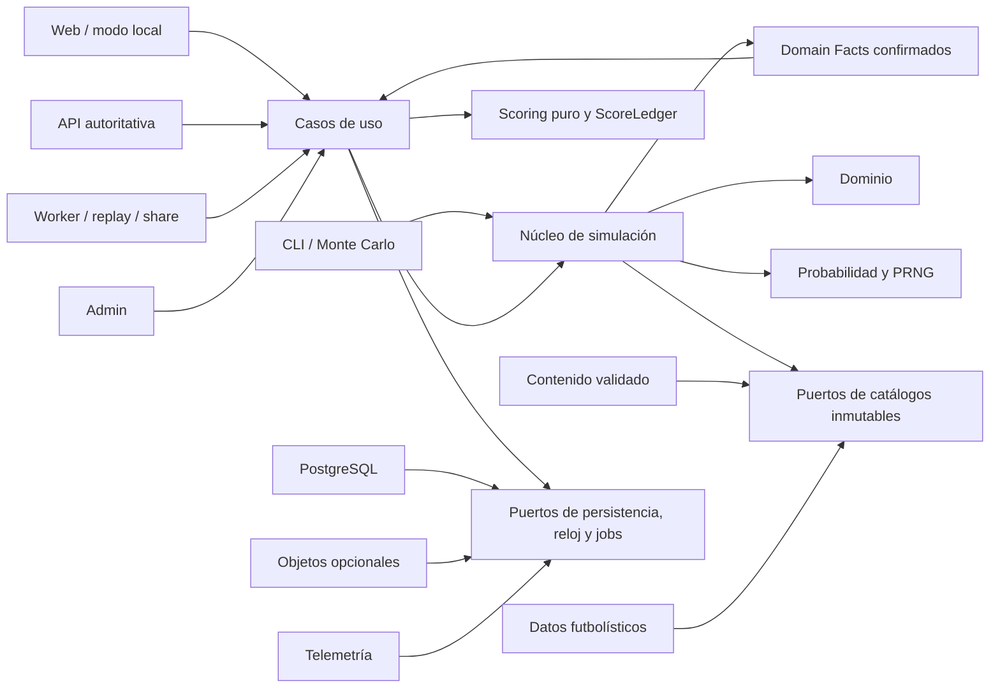

# Arquitectura técnica inicial

## 1. Estado y alcance

Este documento propone la arquitectura mínima y escalable para construir el producto definido en `MASTER_SPEC.docx`. Es una auditoría y una guía de límites; no implementa gameplay, interfaz, API ni persistencia.

La propuesta adopta como reglas de precedencia del documento maestro:

1. La sección 36 y el Anexo B prevalecen sobre cualquier regla anterior de cooldown, cupo, máximo por carrera, protección de rareza o exclusión editorial.
2. Las secciones 37 a 61 prevalecen para arquitectura, construcción, persistencia, seguridad, pruebas y despliegue.
3. Una imposibilidad lógica y una definición mecánica deshabilitada por una release/política versionada pueden tener probabilidad cero. Una preferencia narrativa sensible nunca altera la mecánica. Una situación meramente improbable debe conservar probabilidad positiva.
4. Los topes expresamente definidos para **puntuación** no son límites a la ocurrencia de eventos ni a las colas estadísticas.

Las contradicciones y decisiones no cerradas se registran en `DECISIONS_REQUIRED.md`.

## 2. Drivers arquitectónicos

La arquitectura debe preservar simultáneamente:

- determinismo por semilla, versiones, estado inicial y decisiones;
- neutralidad de la cadencia de 1, 2, 3 o 4 temporadas;
- simulación probabilística con colas abiertas;
- ausencia de cooldowns, cupos o protecciones artificiales de rareza;
- motor ejecutable sin React, Next.js, HTTP, base de datos ni servicios externos;
- contenido y datos reales versionados fuera del código del motor;
- reanudación exacta desde un checkpoint;
- causalidad temporal agregada mediante Q1–Q4, sin simular partidos;
- oportunidades evaluadas solo cuando sus hechos requeridos ya existen;
- trazabilidad de cambios de estado y de cada punto;
- servidor autoritativo para resultados competitivos;
- funcionamiento local no oficial;
- compatibilidad móvil, accesibilidad y localización;
- expansión de contenido sin reescribir el núcleo.
- equivalencia mecánica entre variantes narrativas sensibles;
- posición efectiva e historial posicional sin reescribir resultados cerrados;

## 3. Estilo de arquitectura

Se propone un **monolito modular con núcleo funcional puro y adaptadores externos**. El monorepo puede contener varias aplicaciones, pero no requiere microservicios para comenzar.

- El núcleo puro modela y ejecuta la simulación.
- La capa de aplicación coordina casos de uso y transacciones.
- Los adaptadores conectan almacenamiento, HTTP, archivos, telemetría y render.
- Web, API, CLI, worker y admin reutilizan contratos y casos de uso; no duplican fórmulas.
- API y worker pueden desplegarse inicialmente como procesos de una misma solución. Su separación física se justifica solo por carga, seguridad u operación.

### 3.1 Stack propuesto

Se adopta el stack de referencia de la sección 37.3, sujeto a fijar versiones estables durante la fundación:

| Área | Elección inicial |
|---|---|
| Workspace | pnpm workspaces; Turborepo para el grafo de tareas y cache cuando exista código |
| Lenguaje | TypeScript estricto para núcleo y aplicaciones |
| Web | Next.js con App Router |
| API | Node.js + Fastify |
| Worker y CLI | Node.js reutilizando los packages puros |
| Persistencia remota | PostgreSQL |
| Queries/migraciones | Drizzle ORM o alternativa tipada documentada por ADR |
| Contratos | JSON Schema y/o Zod con exportación versionada |
| Pruebas | Vitest, pruebas de propiedades y Playwright para E2E |
| Cache/cola | Redis solo si la carga demuestra su necesidad |
| Objetos | Provider S3-compatible solo para renders/exports cuando sea necesario |

No se instala ninguna dependencia en esta fase. Las versiones concretas y cualquier sustitución deben registrarse en P2 y no pueden introducir dependencias del framework dentro del motor.



## 4. Módulos y responsabilidades

### 4.1 Núcleo puro

| Módulo | Posee | Puede depender de | No puede poseer |
|---|---|---|---|
| `domain` | Agregados, entidades, value objects, estados, comandos, `DomainFact`, señales internas e invariantes | Biblioteca estándar | PRNG, DB, HTTP, UI, telemetría, fecha real |
| `probability` | PRNG seedable, streams derivados, probabilidades/log-probabilidades, primitivas numéricas sensibles, distribuciones y muestreo canónicos | Biblioteca estándar | Reglas de UI, datos reales, persistencia |
| `scoring` | Reglas versionadas de puntos, anti-duplicación y construcción del ScoreLedger | `domain` y contratos de scoring | Narrativa, autenticación, ranking persistido |
| `engine` | Orden de temporada, evaluación de oportunidades, transiciones y composición de resultados | `domain`, `schemas`, `probability` y puertos de catálogo de solo lectura | Scoring, IO, reloj real, variables de entorno, framework web |

El Player Model de [ADR-052](adr/052-fundamental-player-model.md) pertenece a
`domain`: `TruePlayerState` es causal, `PlayerKnowledge` es conocimiento por
observador y las proyecciones de UI son read models. `engine` podrá consumir el
estado causal y producir hechos, pero no introducir un overall, revelar latentes
ni persistir capacidades efectivas como segunda verdad.

Development & Aging sigue la frontera de
[ADR-053](adr/053-development-and-aging-model.md): `domain` posee capabilities,
traits, snapshots e invariantes; `engine` orquesta una evolución atómica por Q
contra parámetros versionados y streams deterministas. Health, Role & Minutes y
Club entregan hechos/estado confirmados; no mutan capabilities por su cuenta.

Role & Minutes sigue la frontera de
[ADR-054](adr/054-role-and-minutes-model.md) y
[ADR-072](adr/072-role-minutes-and-availability-mathematics.md): `domain` posee los contratos
separados de `SquadStatus`, `SportingRole`, `EffectiveUsage`, oportunidad y
disponibilidad; `engine` orquesta rol y minutos por Q contra parámetros
versionados. `probability` proporciona softmax, Normal y GH10 canónicos.
Performance consume exposición confirmada, Health produce disponibilidad
médica, `AvailabilityAggregator` compone por unión exacta y
Club/Competitions produce contexto, sin ciclos ni plantillas completas.

Performance sigue la frontera de
[ADR-055](adr/055-performance-and-production-model.md): `domain` posee los
contratos de `ObservedProduction`, `PerformanceSummary` e invariantes;
`engine` orquesta la proyección efímera de EffectiveCapabilities, la realización
multidimensional, los conteos correlacionados y la consolidación contra
parámetros/streams versionados. EffectiveCapabilities no se persiste como
estado; UnderlyingPerformance oculto no se filtra a consumidores
observacionales. Club/Competitions y Health producen contexto, y Performance
emite señales sin escribir sus estados.

Health sigue la frontera de
[ADR-057](adr/057-health-injury-recovery-model.md): `domain` posee
`HealthState`, `MedicalAvailabilityEnvelope`, carga, condiciones, episodios,
recuperación, secuelas e invariantes; `engine` orquesta oportunidades y
transiciones contra parámetros/streams versionados. Health no posee
suspensiones, rol, minutos ni capabilities. Una agregación autoritativa combina
el componente médico con fuentes no médicas antes de Role & Minutes; su
composición queda cerrada por ADR-072/DR-064.

Club/Competitions/World sigue la frontera de
[ADR-022](adr/022-club-competition-world-model.md): `data-football` entrega
`ClubDefinition`, `LeagueDefinition` y `CompetitionDefinition` inmutables por
`dataVersion`; `domain` posee `ClubState`, `LeagueState`, `CompetitionState`,
`WorldState`, managers/táctica, fields y outcomes; `engine` orquesta contexto Q,
resultados y updates futuros contra parámetros/streams versionados.

El núcleo no consulta datos reales durante una Career. `ClubOverall` no es
causal; `TeamSupportField` excluye la contribución del protagonista;
`leagueCompetitiveStrength` no es IJL. Ascenso/descenso no fuerza transferencia
y el scope de pools/continuidad permanece en DR-065.

Transfers/Market/Contracts sigue la frontera de
[ADR-058](adr/058-transfer-market-contract-model.md): `domain` posee
percepción/evidencia autorizada, interest, offer, negotiation, contract, loan,
Money exacto, afiliación e invariantes; `engine` orquesta el pipeline contra
`ClubNeed`, World/Calendar context, parámetros y streams versionados.

`MarketValueEstimate`, fee y salary son conceptos separados.
`ContractExpectation` no asigna rol/minutos. Los préstamos separan club
contractual/deportivo y una temporada conserva segmentos multiclub. Scoring
solo consume facts allowlisted y `engine` no importa `scoring`.

Calendar/Competitions es owner de `MarketWindowContext`; Club/World, de
`ClubNeed`, escasez, finanzas y ciclos. DR-066 conserva la frontera de
`RegistrationEligibility`; DR-067 debe cerrar cualquier operación Market entre
Qs antes de modificar el runner.

National Team sigue la frontera de
[ADR-059](adr/059-national-team-model.md): `data-football` entrega
`NationalTeamDefinition`; `domain` posee estado/contexto, eligibility, fields,
call-up, rol, historia y support field; `engine` reutiliza Role & Minutes y
Performance mediante un contexto nacional explícito. Club y selección no
comparten estado, oportunidad, minutos o facts. DR-059/021 debe cerrar el cursor
internacional y DR-068 la nacionalidad deportiva del slice.

Awards sigue la frontera de [ADR-060](adr/060-awards-model.md):
`data-football` entrega `AwardDefinition`; `domain` posee edición, fields y
outcome; `engine` resuelve eligibility, comparación y placement contra
parámetros/streams versionados. Awards no importa `scoring`, no crea
`ScoreLedger` y no aplica su anti-duplicación. Scoring consume después
`AwardWon` u otros facts allowlisted.

Reputation/Social sigue la frontera de
[ADR-061](adr/061-reputation-and-social-model.md): `data-football` entrega
`ReputationMarketDefinition`; `domain` posee Sporting/Public Reputation,
Public Attention, followers/engagement, evidence keys e invariantes; `engine`
orquesta signals, memoria, difusión y cambios exactos contra
parámetros/streams versionados.

Los productores emiten facts, no deltas. Content no escribe followers o
reputación directamente. Reputation/Social no muta capabilities ni
ScoreLedger. Market/Selection/Awards/Events consumen proyecciones autorizadas.

Retirement sigue la frontera de
[ADR-062](adr/062-playing-retirement-and-comeback.md): `domain` posee
`PlayerPlayingStatus`, motivation assessment, opportunities y episodios;
`engine` orquesta hazard, decisión, retiro y comeback. Career lifecycle
permanece separado. Un retiro deportivo no completa Career ni crea score.
DR-069 debe cerrar cursor posretiro, boundary irreversible, scoring final y
terminación antes de implementar el runner terminal.

La frontera transversal de [ADR-010](adr/010-scoring-ledger-and-domain-facts.md)
se aplica a todos los módulos: `engine` puede producir `DomainFact` tipados,
pero no `ScoreLedgerEntry`; `scoring` consume exclusivamente facts allowlisted
y configuración de su `scoringVersion`. `InternalEngineSignal`,
`NarrativeEvent`, `DomainFact` y `ScoreLedgerEntry` son conceptos distintos.
El catálogo canónico, sus aliases rechazados y la clasificación de persistencia
están en [`SCORING_FACTS_SPEC.md`](SCORING_FACTS_SPEC.md).

La frontera matemática transversal sigue
[ADR-070](adr/070-mathematical-runtime-and-parameter-sets.md) y
[`MATHEMATICAL_CALIBRATION_CONTRACT.md`](MATHEMATICAL_CALIBRATION_CONTRACT.md):
`probability` posee las primitivas probabilísticas/trascendentales y samplers
canónicos; `engine` compone fórmulas del dominio sin duplicarlas; `domain`
valida los enteros persistidos y sus invariantes. Scoring mantiene su
aritmética decimal/racional separada y no depende del ParameterSet de gameplay.

No se crea un package nuevo en G3C-1. La ubicación física final de una
primitiva no puede introducir un ciclo ni forzar que `domain` dependa de
`probability`.

### 4.2 Contratos y catálogos

| Módulo | Responsabilidad |
|---|---|
| `schemas` | Validar representaciones serializadas y contratos versionados. Los DTO validados se convierten a objetos de dominio mediante mappers; `domain` no importa librerías de validación. |
| `content` | Validar y compilar `domainEvent`, cadenas, lesiones, arquetipos, finales y `narrativePresentation` a catálogos inmutables. Separa mecánica de presentación y no ejecuta JavaScript proveniente de contenido. |
| `data-football` | Normalizar y validar clubes, países, ligas, competiciones, premios, jerarquías y snapshots de fuentes. No simula. |
| `testkit` | Builders, fixtures, golden seeds, `CalibrationSeedSet`, comparadores canónicos y herramientas de simulación/Monte Carlo. No contiene reglas que solo existan en tests. |

El acceso a archivos, repositorios o red para cargar catálogos pertenece a adaptadores. El motor recibe objetos ya cargados, validados, compilados e inmutables.

### 4.3 Aplicación y adaptadores

| Módulo | Responsabilidad |
|---|---|
| `application` | Casos de uso, autorización abstracta, coordinación de repositorios, idempotencia, revisión optimista y publicación de eventos externos. No contiene fórmulas de gameplay. |
| `db` | Esquema, migraciones, repositorios PostgreSQL, transacciones y proyecciones. |
| `api-client` | Contrato de cliente tipado; no recalcula verdad competitiva. |
| `telemetry` | Adaptadores de métricas, logs y trazas con sanitización. |
| `ui` | Tokens y componentes visuales compartidos; no depende de `engine`. |

### 4.4 Aplicaciones

| Aplicación | Responsabilidad |
|---|---|
| `simulation-cli` | Ejecutar una carrera, replay, golden seeds y Monte Carlo sin navegador ni DB. Debe existir antes de la UI completa. |
| `web` | Presentación, interacción, snapshot local y modo local. Puede ejecutar el motor para UX, pero no crea resultados oficiales por sí sola. |
| `api` | Borde HTTP, autenticación, validación de inputs y casos de uso autoritativos. |
| `worker` | Replay, simulación masiva, renders sociales, imports y jobs pesados. |
| `admin` | Edición controlada, validación, simulación, publicación y auditoría de releases. Nunca evita validadores. |

## 5. Regla de dependencias

Las dependencias apuntan hacia el núcleo:

```text
apps -> application -> engine -> domain -> schemas
                            -> probability -> schemas
                            -> schemas

                    scoring -> domain
                            -> schemas

adapters/db -> application ports
content/data adapters -> engine catalog ports
schemas -> DTO y validación de bordes
```

Reglas obligatorias:

- `domain`, `probability`, `scoring` y `engine` no importan código de `apps`, `db`, HTTP, React o Next.js.
- `engine` no importa `scoring`; ambos permanecen separados hasta una decisión normativa posterior.
- `web` no importa repositorios de DB.
- `api` no duplica reglas del motor ni de scoring.
- `content` y `data-football` no llaman mutaciones de DB desde sus validadores puros.
- `telemetry` observa resultados; nunca decide resultados.
- ningún template social recalcula estadísticas, puntos o ranking.
- ningún módulo usa `Math.random()`, tiempo real, zona horaria o orden no canónico como entropía del motor.

Un chequeo automático de límites de paquetes deberá formar parte de CI cuando exista código.

## 6. Contrato del motor

El motor se trata como una función pura:

**Entradas explícitas**

- estado de carrera válido o checkpoint;
- comando de dominio;
- `VersionSet` completo;
- semilla raíz y contrato de streams;
- snapshot de contenido compilado;
- snapshot de datos futbolísticos;
- reglas de scoring;
- decisión o política de automatización explícita, cuando corresponda.

**Salidas explícitas**

- nuevo estado o estado suspendido;
- eventos de dominio ordenados;
- ocurrencias de eventos de juego;
- decisión pendiente, si la ejecución se interrumpe;
- `SeasonResult` cuando se cierra una temporada;
- hechos autorizados que scoring podrá consumir mediante un contrato separado;
- traza explicativa interna y material canónico para hash.

**Efectos prohibidos**

- leer o escribir DB;
- acceder a red, archivos, variables de entorno o locale;
- consultar fecha/hora real;
- emitir analytics;
- depender del orden de claves de un objeto no canonicalizado;
- generar IDs aleatorios como parte de la verdad simulada.

La capa de aplicación persiste la salida y publica telemetría únicamente después de una transacción exitosa. Preferencias de dificultad y sensibilidad narrativa no son inputs mecánicos del engine.

## 7. Determinismo y aleatoriedad

### 7.1 Streams derivados

Toda tirada se deriva de una clave contextual estable, por ejemplo:

```text
rootSeed + engineVersion + seasonId + subsystem + entityId + opportunityId
```

Esto evita que agregar una tirada en redes sociales altere lesiones, rendimiento o premios históricos. ADR-006 fija xoshiro256**, root seed, streams independientes y la obligación de vectores normativos para derivación, encoding y conversión antes de implementar gameplay.

### 7.2 Orden canónico

Antes de evaluar o hashear:

- entidades, competiciones, oportunidades, efectos y entradas se ordenan por claves estables;
- no se depende del orden de inserción de mapas, de resultados SQL ni del filesystem;
- los números se serializan mediante una representación canónica;
- los snapshots incluyen versiones y hashes de catálogos;
- toda decisión tiene secuencia e idempotency key.

### 7.3 Precisión probabilística

El tipo de probabilidad permite valores positivos menores que `10^-12` sin redondearlos a cero. Se usa IEEE-754 double cuando corresponde y espacio logarítmico para cálculos/probabilidades extremas según ADR-002. Los modificadores se componen sobre log-odds según ADR-003.

### 7.4 Perfil matemático, quantization y draws

Gameplay puede calcular con IEEE-754 binary64, pero solo mediante contratos que
rechacen NaN/infinitos y usen primitivas sensibles canónicas. Estado recurrente
se cuantiza al cerrar la transición atómica con `ROUND_HALF_EVEN`; no existe un
shadow state de precisión mayor. Scoring conserva su `ROUND_HALF_UP`.

Cada draw declara `namespace`, `modelId`, contexto canónico, occurrence y
purpose. Los factores compartidos se sortean una vez y se entregan por
referencia; los shocks específicos usan keys independientes. El
`parameterSetHash` no cambia la key, permitiendo comparar candidatos con common
random numbers.

La conformidad cross-runtime se demuestra con golden vectors del perfil
matemático. Un runtime no conforme no es autoridad de replay competitivo.

## 8. Probabilidad total sin restricciones artificiales

La arquitectura separa cuatro conceptos:

1. **Posibilidad lógica:** el estado puede contener una oportunidad coherente.
2. **Disponibilidad mecánica de contenido:** una release/política versionada puede excluir una definición del catálogo activo.
3. **Probabilidad condicionada:** una posibilidad lógica recibe una probabilidad positiva, aunque sea diminuta.
4. **Explicación causal:** si ocurre un hecho con antecedentes débiles, el contenido debe poder materializar un puente causal compatible.

Consecuencias arquitectónicas:

- no existe un servicio de cooldown;
- no existe un contador de máximo de rarezas, lesiones, transferencias o catástrofes;
- no existe protección que aumente o reduzca rareza según apariciones anteriores;
- no existe selección editorial que descarte una oportunidad solo por parecer extraña;
- una repetición solo deja de ser posible cuando el estado hace el hecho materialmente irrepetible;
- una preferencia sensible selecciona `narrativePresentation` y nunca elimina el `domainEvent`;
- las estadísticas usan distribuciones con colas abiertas;
- los únicos límites duros son identidades lógicas, físicas o contables documentadas;
- los topes de ScoreLedger explícitos afectan puntos, no la posibilidad de que el hecho ocurra.

La clasificación de oportunidades se rige por [ADR-004](adr/004-opportunity-semantics.md) y su muestreo secuencial por ventanas/familias por [ADR-005](adr/005-event-opportunity-sampling.md) y ADR-043.

## 9. Ejecución, interrupción y reanudación

La temporada es la unidad mínima de avance. Q1–Q4 son ventanas causales agregadas y no partidos. La cadencia solo agrupa presentación.

El plan técnico vigente se obtiene de [ADR-013](adr/013-season-state-machine.md), [ADR-042](adr/042-season-health-performance.md) y [ADR-043](adr/043-event-opportunity-windows.md):

```text
SEASON_START
PRESEASON
PRESEASON_EVENTS
ROLE_AND_MINUTES

for Q1, Q2, Q3, Q4:
  AVAILABILITY(Qn)
  PRODUCTION(Qn)
  HEALTH(Qn)
  CONSEQUENCES(Qn)
  PERFORMANCE_EVENTS(Qn)
  HEALTH_EVENTS(Qn)

COMPETITIONS
COMPETITION_EVENTS
MARKET
MARKET_EVENTS
AWARDS
AWARD_EVENTS
WORLD_UPDATE
WORLD_EVENTS
POSTSEASON_EVENTS
SEASON_CLOSE
```

Antes de Q1 se fijan disponibilidad inicial, estado físico, suspensiones, rol
esperado y minutos potenciales. En `AVAILABILITY(Qn)`, Health produce
`MedicalAvailabilityEnvelope` y una frontera autoritativa construye el
`AvailabilityEnvelope` agregado con disciplina/otras causas mediante unión de
asignaciones sobre oportunidad. Role & Minutes consume ese resultado. Cada Q
confirma producción y exposición antes de Health;
una lesión solo afecta ventanas futuras. No existe ajuste retroactivo de
estadísticas cerradas.

Dentro de `HEALTH(Qn)` se registran carga/exposición, progresan condiciones y
recuperación, y se resuelven recaídas y nuevas oportunidades. Sus consecuencias
se aplican en `CONSEQUENCES(Qn)` para Qn+1. Esto refina suboperaciones sin
agregar fases ni cambiar las 38 operaciones canónicas.

`SimulationCursor` identifica `seasonId`, paso, Q opcional, `OpportunityWindow` opcional, suboperación y punto exacto de reanudación. `WAITING_DECISION` es un estado interruptivo de Career, no un paso.

- `advance(n)` intenta completar hasta `n` temporadas;
- puede devolver menos si aparece una decisión obligatoria;
- el checkpoint fija opciones, cursor, versiones, revisión y progreso aleatorio;
- resolver aplica efectos atómicamente y continúa después del punto confirmado;
- ninguna tirada, ventana, oportunidad o mutación confirmada se repite;
- cambiar cadencia no cambia streams, oportunidades ni resultados;
- cada evento se evalúa solo cuando existen sus facts requeridos;
- ninguna ventana impone un máximo de oportunidades.

La fase `MARKET` vigente ocurre post-competiciones. Aunque el dominio admite
afiliación efectiva entre Qs, ADR-013/043 no contienen un punto Market
mid-season. DR-067 debe elegir ventana, scheduling o restricción de scope y
versionar cualquier cambio del plan; no se inserta una fase por inferencia.

La misma restricción afecta las ventanas internacionales regulares:
ADR-013/043 no ubican call-up, role, minutes y Performance de selección entre
Qs. Resolverlas todas después de Q4 rompe causalidad de disponibilidad/carga y
mezclarlas con club rompe ownership. DR-059/021 debe fijar suboperaciones,
checkpoints y calendar contexts; no se agrega una fase por inferencia.

Awards sí conserva un boundary explícito: todos los inputs causales deben estar
confirmados antes de `AWARDS`; el outcome se cierra allí y solo después se
evalúa `AWARD_EVENTS`.

## 10. Datos, contenido y versionado

### 10.1 VersionSet

Cada carrera referencia obligatoriamente:

- `schemaVersion`;
- `engineVersion`;
- `contentVersion`;
- `dataVersion`;
- `scoringVersion`;
- `parameterSetId`;
- `parameterSetHash`;
- hash de contenido;
- hash de datos.

Las cinco versiones canónicas, sus formatos y compatibilidad se rigen por
[ADR-015](adr/015-version-taxonomy.md). `parameterSetId` y
`parameterSetHash` son referencias de artefacto, no una sexta versión. La
estructura se rige por `schemaVersion`, la semántica por `engineVersion` y los
bytes por el hash según ADR-070. `dataSnapshotVersion` y `entityVersion` no
sustituyen campos del `VersionSet` de Career.

### 10.2 Releases inmutables

- Una carrera nueva toma releases activos.
- Una carrera existente conserva exactamente sus referencias.
- Una corrección que altera replay crea una release nueva o una migración explícita.
- Los artefactos históricos necesarios para replay no se eliminan mientras exista una carrera que los referencie.
- Los textos pueden variar sin cambiar lógica solo cuando la política de versión lo permita y el hash competitivo permanezca inequívoco.
- Los catálogos completos no se duplican dentro de cada carrera; se referencian por versión/hash y se retienen como artefactos inmutables.
- Un `EngineParameterSet` se publica content-addressed, inmutable y con
  evidencia de goldens/properties/calibración.
- Una misma `engineVersion` no puede resolver a dos ParameterSets oficiales;
  cambiar parámetros que alteren resultados exige una versión nueva.
- Los ParameterSets candidatos solo existen fuera de Careers oficiales hasta
  ser aprobados.

### 10.3 Contenido declarativo seguro

El DSL se rige por [ADR-014](adr/014-event-dsl.md), admite únicamente operadores, combinadores, efectos, paths y hechos whitelisted. Su compilador debe:

- validar tipos, rutas y referencias;
- producir un orden de evaluación canónico;
- rechazar efectos desconocidos;
- detectar ciclos estructuralmente inválidos;
- diferenciar imposibilidad lógica de probabilidad residual;
- generar trazas de requisitos y modificadores;
- validar todos los efectos antes de aplicarlos atómicamente;
- impedir que contenido cree ScoreLedger entries;
- no aceptar cooldowns ni máximos por carrera como mecanismos de rareza.
- declarar `OpportunityWindow` y facts requeridos;
- rechazar lecturas anteriores al primer punto de disponibilidad del path/fact.

La release separa `domainEvent` de `narrativePresentation` según [ADR-012](adr/012-sensitive-content-equivalence.md). Variantes explícitas o reducidas conservan la misma identidad mecánica, choices y efectos; seleccionar una presentación no consume azar de gameplay.

## 11. Persistencia y autoridad

La persistencia propuesta es híbrida:

- cabeceras y campos indexables;
- snapshots versionados para lectura y reanudación;
- log ordenado de decisiones;
- `SeasonResult` inmutables;
- eventos de dominio auditables;
- ScoreLedger encadenado;
- proyecciones de perfil y ranking.

PostgreSQL es fuente de verdad del servidor, pero no forma parte del motor.

Flujo remoto:

1. API valida autenticación, contrato, revisión e idempotencia.
2. Application carga estado y catálogos por versión.
3. Engine calcula o reproduce.
4. La transacción persiste snapshot, decisiones, resultados y ledger.
5. Recién después se publican jobs, telemetría y proyecciones.

Las carreras locales usan un adaptador local y quedan fuera del ranking oficial salvo reconciliación definida.

## 12. Scoring, ranking y compartido

### 12.1 Scoring

`scoring` recibe facts ya resueltos; no decide si un evento ocurre y no usa
RNG. La función conceptual es:

```text
DomainFact[] + ScoringRuleDefinition[] + scoringVersion
  -> ScoreLedger
  -> PC
```

El `ScoreLedger`:

- es append-only;
- usa claves de idempotencia;
- registra rule, source facts, base, multiplicadores, redondeo, categoría,
  scope y versión;
- corrige mediante reversals, no edición;
- permite reconstruir el total;
- se encadena mediante hashes canónicos.

ADR-009 fija `0.00 <= CC <= 1.10` y reserva el tramo superior a `1.00` para
rendimiento extraordinario derivado. CC se aplica por defecto solo a logros
colectivos de club o selección; no a PRI, PPI, PRL o PBR. La fórmula ejecutable
y el resto del scoring siguen bloqueados por DR-008 y DR-010.

[ADR-010](adr/010-scoring-ledger-and-domain-facts.md) y
[`SCORING_FACTS_SPEC.md`](SCORING_FACTS_SPEC.md) cierran estructuralmente
DR-063: scoring puede consumir producción, exposición, summaries cerrados,
outcomes, awards, records/milestones y estados públicos únicamente mediante la
allowlist aprobada. No puede consumir EffectiveCapabilities, traits/latentes,
UnderlyingPerformance oculto, ratings de presentación, Content ni tragedias
por ocurrir. `engine` continúa sin depender de `scoring`.

ADR-059/060 añaden la misma frontera: Selection/Awards producen hechos
deportivos y outcomes; no calculan puntos. Awards permite múltiples premios y
no aplica el 100 %/60 % ni ninguna otra regla anti-duplicación de DR-010.
Scoring decide posteriormente qué facts autorizados contabilizar y con qué
clave.

Las únicas categorías de PC son
`PRI + PTC_CLUB + PPI + PSN + PRL + PBR`. `PRL` significa records y
longevidad; `PBR`, popularidad, redes y logros históricos acotados. Cada entry
termina en puntos enteros mediante `ROUND_HALF_UP`; PC suma entries enteras sin
un redondeo adicional. Los cálculos intermedios usan decimal exacto o racional
determinista.

### 12.2 Ranking

El ranking es una proyección autoritativa de carreras completadas y verificadas. Nunca acepta score, estadísticas, premios o ledger creados por el cliente.

Un `RetirementOccurred` reversible no habilita ranking. Solo `COMPLETED`, tras
el boundary terminal de ADR-016/DR-069 y scoring final confirmado, puede
proyectarse al ranking.

La proyección se materializa como `ScoreSnapshot` inmutable e identifica
`careerId`, `scoringVersion`, contexto de compatibilidad, hash del fact set,
hash y total del ledger e integridad. Igual `scoringVersion` es necesaria pero
no suficiente para mezclar leaderboards; DR-036 conserva la clave completa.

- el servidor calcula o reproduce con el mismo núcleo;
- cada entrada declara versión competitiva;
- las versiones incompatibles no se mezclan silenciosamente;
- una carrera extraordinaria no se invalida por rareza;
- anomalías disparan replay o revisión, no corrección del azar;
- invalidar ranking no borra la carrera personal.
- las cohortes posicionales se derivan del historial por `effectivePosition` y una posición dominante por scope según ADR-044; ponderación y empates siguen en DR-049;
- `ASSISTED`, `STANDARD` y `EXPERT` no separan resultados porque solo cambian información presentada;
- Carrera rápida y personalizada solo podrán compartir tabla tras validar el mismo Creation Budget con Monte Carlo;
- políticas de automatización se versionan y no son elegibles por defecto.

### 12.3 Compartido

Un `ShareCardModel` inmutable se deriva de un snapshot cerrado. Preview y renderer consumen el mismo modelo. El renderer no importa el motor ni scoring.

## 13. Seguridad y privacidad

- Validación de inputs en todos los bordes.
- Autorización server-side por recurso.
- Idempotencia y revisión optimista para mutaciones.
- Roles separados para admin.
- Publicación de contenido como release, nunca edición directa de producción.
- Public IDs no reversibles y sin IDs internos en imágenes o enlaces.
- Sanitización de nombres y textos editables.
- Logs sin secretos ni PII innecesaria.
- Rate limiting en creación, avance, ranking, compartir y admin.
- Auditoría de cambios de contenido, datos y scoring.
- Una preferencia sensible se aplica al seleccionar `narrativePresentation`, nunca a la generación mecánica de la oportunidad.

## 14. Escalabilidad

La escala se logra sin distribuir prematuramente:

- motor sin consultas durante una ejecución;
- catálogos precargados y compilados;
- índices de oportunidades por ventana y tags;
- requisitos baratos antes de modificadores costosos;
- CLI/worker para Monte Carlo y replay;
- ParameterSets y CalibrationSeedSets inmutables cargados por hash;
- ejecución de calibración por tiers `SMOKE`, `CALIBRATION` y `DEEP`;
- ranking materializado;
- jobs de imagen asíncronos;
- Redis y almacenamiento de objetos opcionales, nunca fuente de verdad.

El harness de calibración es un adaptador/herramienta, no parte del estado de
Career. Consume engine puro, ParameterSet candidato, seed set y
CalibrationTargets; produce evidencia y diagnostics. Un guard técnico devuelve
`INCONCLUSIVE_GUARD_REACHED` y nunca crea un outcome de gameplay.

## 15. Despliegue mínimo evolutivo

1. CLI y packages puros, sin infraestructura de runtime.
2. PostgreSQL local y API modular para el vertical slice oficial.
3. Web y API como despliegues separados si el entorno lo requiere.
4. Worker solo cuando replay, Monte Carlo o imágenes no deban competir con requests.
5. Admin después de que existan schemas y pipeline de releases.

El vertical slice inicial queda limitado por [ADR-018](adr/018-initial-vertical-slice.md) a Argentina, España, `GK`/`CM`/`ST`, Carrera rápida, 30 eventos, 5 cadenas y 6 lesiones. Debe completar retiro, score y ranking interno antes de ampliar contenido.

Su frontera competitiva mínima sigue
[`CLUB_COMPETITION_WORLD_SPEC.md`](CLUB_COMPETITION_WORLD_SPEC.md): dos ligas,
6–10 clubes reales detallados por liga, sus dos copas domésticas, Libertadores,
Champions y contratos para torneos de selección. IDs/fuentes pertenecen a
DR-025; participantes externos, movilidad y continuidad, a DR-065. Esta
arquitectura no autoriza fixtures, plantillas completas ni identidades
inventadas.

El slice necesita además una `NationalTeamDefinition` argentina, fields
internacionales mínimos y exactamente un premio global, uno juvenil y tres
premios posicionales o de competición. Esto no asigna automáticamente
nacionalidad deportiva al protagonista: DR-068 debe resolver eligibility.

## 16. Registro arquitectónico

ADRs aceptados:

- [ADR-001](adr/001-spec-version.md): versión normativa.
- [ADR-002](adr/002-probability-representation.md): representación de probabilidades.
- [ADR-003](adr/003-probability-composition.md): composición sobre odds/log-odds.
- [ADR-004](adr/004-opportunity-semantics.md): semántica de oportunidades.
- [ADR-005](adr/005-event-opportunity-sampling.md): muestreo por ventanas/familias.
- [ADR-006](adr/006-deterministic-prng.md): PRNG y streams.
- [ADR-007](adr/007-canonicalization-and-hashing.md): canonicalización y hashes.
- [ADR-009](adr/009-contribution-coefficient.md): rango del Coeficiente de Contribución.
- [ADR-010](adr/010-scoring-ledger-and-domain-facts.md): taxonomía de facts,
  allowlist, reglas versionadas, ledger, idempotencia y snapshots de score.
- [ADR-011](adr/011-position-taxonomy.md): taxonomía posicional.
- [ADR-012](adr/012-sensitive-content-equivalence.md): separación mecánica/narrativa sensible.
- [ADR-013](adr/013-season-state-machine.md): state machine de temporada.
- [ADR-014](adr/014-event-dsl.md): DSL de eventos.
- [ADR-015](adr/015-version-taxonomy.md): taxonomía de versiones.
- [ADR-016](adr/016-career-lifecycle.md): ciclo de vida de Career.
- [ADR-017](adr/017-discoveries.md): confirmación y procedencia de descubrimientos.
- [ADR-018](adr/018-initial-vertical-slice.md): alcance del vertical slice.
- [ADR-019](adr/019-creation-budget-equivalence.md): Creation Budget y equivalencia.
- [ADR-020](adr/020-difficulty-and-automation.md): dificultad informativa y automatización separada.
- [ADR-022](adr/022-club-competition-world-model.md): definitions inmutables,
  estados agregados, contexto competitivo, outcomes y evolución del mundo.
- [ADR-061](adr/061-reputation-and-social-model.md): reputación, mercados,
  attention, followers y engagement.
- [ADR-062](adr/062-playing-retirement-and-comeback.md): estado deportivo,
  retiro, regreso y frontera con Career lifecycle.
- [ADR-023](adr/023-dominant-foot-both.md): ambidestreza y Creation Budget.
- [ADR-042](adr/042-season-health-performance.md): causalidad de salud y rendimiento.
- [ADR-043](adr/043-event-opportunity-windows.md): ventanas causales de oportunidades.
- [ADR-044](adr/044-effective-position-and-retraining.md): posición efectiva, reconversión y cohortes.
- [ADR-050](adr/050-foundation-package-boundaries.md): límites iniciales de packages.
- [ADR-051](adr/051-deterministic-core-byte-contracts.md): contratos binarios,
  streams, canonicalización y golden vectors del núcleo determinista.
- [ADR-052](adr/052-fundamental-player-model.md): catálogo, escala, estado
  verdadero, conocimiento y generación correlacionada del jugador.
- [ADR-053](adr/053-development-and-aging-model.md): evolución por capability y
  Q, causas auditables, maduración, wear y fronteras de subsistemas.
- [ADR-054](adr/054-role-and-minutes-model.md): separación de estatus, rol y uso,
  oportunidad/disponibilidad, competencia agregada y causalidad de minutos.
- [ADR-055](adr/055-performance-and-production-model.md): pipeline de
  Performance y producción posicional.
- [ADR-057](adr/057-health-injury-recovery-model.md): estado compuesto de
  Health, disponibilidad médica, episodios, recuperación, recaída y secuelas.
- [ADR-058](adr/058-transfer-market-contract-model.md): percepción, need,
  interés, oferta, negociación, contratos, Money, loans y afiliación.
- [ADR-059](adr/059-national-team-model.md): estado, eligibility, field,
  pipeline y contexto propios de selección nacional.
- [ADR-060](adr/060-awards-model.md): definitions, fields comparativo/
  estadístico, comparación, outcome y frontera con scoring.
- [ADR-070](adr/070-mathematical-runtime-and-parameter-sets.md): perfil
  matemático, cuantización e identidad inmutable de ParameterSets.
- [ADR-071](adr/071-creation-development-mathematics.md): matemáticas de
  creación, desarrollo, reconversión y posición histórica.
- [ADR-072](adr/072-role-minutes-and-availability-mathematics.md): softmax de
  role, availability, Logit-Normal de minutos y appearances/starts.

ADRs todavía necesarios cuando se cierren sus decisiones:

- parámetros de Creation Budget y protocolo de equivalencia;
- automatización y elegibilidad competitiva;
- conteo editorial, alcance posicional del vertical slice y cálculo de posición dominante;
- scope competitivo, pools externos y continuidad tras cambios de tier;
- elegibilidad/inscripción posterior a movimientos;
- cadencia de Market y movimientos entre Qs;
- calendario/cursor internacional y nacionalidad deportiva/elegibilidad del
  vertical slice;
- snapshots, logs, replay y retención;
- servidor autoritativo, modos de confianza y reconciliación;
- fórmulas y configuración matemática todavía abiertas de ScoreLedger;
- datos reales, fuentes y assets licenciados;
- renderer de share cards;
- telemetría, privacidad y retención.
