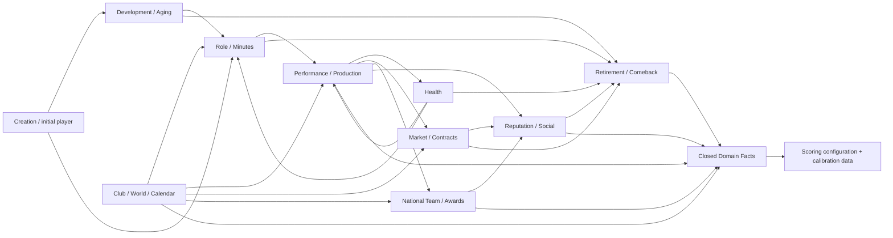

# Calibration Parameter Registry

## 1. Propósito y autoridad

Este documento es el inventario normativo de parámetros de G3D. Consolida las
ramas de `EngineParameterSet`, `ScoringConfiguration` y
`ScoringCalibrationData` definidas por G3C. No publica un ParameterSet ni una
configuración de Scoring V1, no asigna valores de balance y no autoriza
gameplay.

Las ecuaciones siguen siendo autoridad en cada `*_MATH_SPEC.md`. Este registro
es autoridad para identidad, metadata, provenance, dependencias y estado de
publicación. Ante una discrepancia:

1. la ecuación y su dominio se corrigen en la spec propietaria;
2. el `parameterPath` canónico se conserva siempre que la semántica no cambie;
3. un rename se expresa como alias/deprecation, nunca como dos parámetros.

## 2. Unidad de inventario y expansión

Una fila puede declarar un path parametrizado, por ejemplo
`health.hazard.intercept.{injuryFamily}.{origin}`. Esa fila representa todos
los paths concretos obtenidos con las claves autorizadas por el catálogo
versionado. Las llaves `{...}` no se persisten literalmente. Cada expansión:

- tiene identidad única;
- hereda toda la metadata de la fila;
- debe tener un valor explícito antes de publicación, salvo que la fila sea un
  objeto/catálogo referenciado;
- no admite un default implícito por ausencia.

El conteo de este documento se expresa en **parameter-path templates**. El
conteo escalar final solo puede calcularse cuando los catálogos de DR-025,
DR-065, DR-068 y los perfiles de posiciones/competiciones estén congelados.
Esto evita inventar cardinalidades.

## 3. Estados de publicación

| Estado | Semántica | Puede entrar en Career oficial |
|---|---|---|
| `UNASSIGNED` | Identidad y dominio existen, pero no hay valor publicable. | No |
| `PROVISIONAL_DESIGN` | Valor/ID normativo o decisión provisional documentada; aún no superó calibración completa. | No |
| `ESTIMATED_FROM_DATA` | Estimación reproducible ligada a dataset y transformación, pendiente de ajuste/aceptación. | No |
| `CALIBRATED` | Ajustado sobre CalibrationSeedSets y targets, con reporte reproducible. | No |
| `VALIDATED` | Superó gates aplicables, revisión de provenance y verificación independiente. | Solo candidato de publicación |
| `FROZEN_V1` | Incluido en artefacto V1 inmutable, hasheado, retenido y resoluble por la versión oficial. | Sí |

La progresión normal es monotónica. Una revisión puede volver un parámetro a
un estado anterior, pero debe crear un candidato nuevo; no se sobrescribe el
historial.

## 4. Origen primario del valor

| Tipo | Semántica |
|---|---|
| `NORMATIVE` | Fijado por MASTER_SPEC, ADR o identidad matemática aprobada. |
| `EXTERNAL_OBSERVATION` | Estimado principalmente desde observaciones externas versionadas. |
| `DERIVED_ESTIMATE` | Derivado reproduciblemente de otros valores/datasets publicados. |
| `SYNTHETIC_CALIBRATION` | Ajustado con simulación para cumplir targets causales o distribucionales. |
| `PRODUCT_DECISION` | Elección explícita de producto/balance, no presentada como evidencia histórica. |
| `TEMPORARY_PROVISIONAL` | Valor temporal para un candidato no oficial; debe reemplazarse o justificarse antes de V1. |

Cada valor publicado declara exactamente un origen primario y cero o más
fuentes secundarias. `TEMPORARY_PROVISIONAL` nunca alcanza `FROZEN_V1`.

## 5. Perfiles de metadata heredable

Las tablas de inventario referencian los siguientes perfiles. Junto con las
columnas específicas de cada fila satisfacen la metadata mínima por parámetro.

| Perfil | Dominio y representación | Clase / estado inicial / origen | Evidencia y provenance | Sensibilidad / invariantes | Impacto tras publicación |
|---|---|---|---|---|---|
| `SF_ALGORITHM` | ID/string/enum u orden canónico; JSON canónico. | `STRUCTURAL_FIXED` / `PROVISIONAL_DESIGN` / `NORMATIVE` | ADR/spec y goldens de conformidad. | `CRITICAL`; igualdad exacta, sin alias ambiguo. | `engineVersion`; `schemaVersion` si cambia contrato. En Scoring: `scoringVersion`. |
| `SF_NUMBER` | Entero, racional o binary64 finito en dominio indicado; persistencia exacta definida por spec. | `STRUCTURAL_FIXED` / `PROVISIONAL_DESIGN` / `NORMATIVE` | MASTER_SPEC/ADR/spec. | `HIGH` o `CRITICAL`; invariantes matemáticos del owner. | `engineVersion` o `scoringVersion`; schema si cambia representación. |
| `CAL_COEFFICIENT` | binary64 finito; signo/rango según ecuación; RFC-8785 number. | `INITIAL_CALIBRATION_REQUIRED` / `UNASSIGNED` / `SYNTHETIC_CALIBRATION` | targets, dataset cuando aplique, run report. | `HIGH`; restricciones de signo/monotonicidad de la spec. | Hash-only en candidato; `engineVersion` nuevo después de publicación. |
| `CAL_POSITIVE` | binary64 finito `> 0`. | `INITIAL_CALIBRATION_REQUIRED` / `UNASSIGNED` / `SYNTHETIC_CALIBRATION` | target/run; observación externa si es tasa/escala empírica. | `HIGH`; finitud, positividad y estabilidad. | Igual que `CAL_COEFFICIENT`. |
| `CAL_NONNEGATIVE` | binary64 finito `>= 0`. | `INITIAL_CALIBRATION_REQUIRED` / `UNASSIGNED` / `SYNTHETIC_CALIBRATION` | target/run. | `HIGH`; no varianza/hazard negativo. | Igual que `CAL_COEFFICIENT`. |
| `CAL_PERSISTENCE` | binary64 en `[0,1)` o dominio más estricto de la spec. | `INITIAL_CALIBRATION_REQUIRED` / `UNASSIGNED` / `SYNTHETIC_CALIBRATION` | series temporales + estabilidad Monte Carlo. | `CRITICAL`; estacionariedad y ordenes relativos aprobados. | Igual que `CAL_COEFFICIENT`. |
| `CAL_SIMPLEX` | vector finito, entradas `>=0`, suma exacta/normalizada a `1`. | `INITIAL_CALIBRATION_REQUIRED` / `UNASSIGNED` / `SYNTHETIC_CALIBRATION` | dataset/targets y validación. | `HIGH`; simplex, canonical key order. | Igual que `CAL_COEFFICIENT`. |
| `CAL_MATRIX` | matriz/vector binary64 finito con dimensiones catalogadas. | `INITIAL_CALIBRATION_REQUIRED` / `UNASSIGNED` / `SYNTHETIC_CALIBRATION` | dataset/targets y diagnostics de correlación. | `HIGH`; dimensiones completas, constraints de signo/PSD cuando apliquen. | Igual que `CAL_COEFFICIENT`. |
| `DATA_BINDING` | ID/hash/ref a catálogo o perfil inmutable. | `INITIAL_CALIBRATION_REQUIRED` / `UNASSIGNED` / `DERIVED_ESTIMATE` | DatasetDefinition/dataVersion y mapping validado. | `CRITICAL`; referencia resoluble y hash exacto. | `dataVersion`; además `engineVersion` si cambia semántica causal. |
| `PRODUCT_SETTING` | enum, racional o binary64 finito en dominio declarado. | `TUNABLE_LATER` o `INITIAL_CALIBRATION_REQUIRED` / `UNASSIGNED` / `PRODUCT_DECISION` | decisión registrada + acceptance report. | `MEDIUM` a `CRITICAL` según consumers. | `engineVersion`, `scoringVersion` o tooling-only según owner. |
| `TOOLING_ONLY` | config no causal de campañas/workers. | `TUNABLE_LATER` / `UNASSIGNED` / `PRODUCT_DECISION` | run manifest. | `LOW`; no cambia facts ni resultados competitivos. | Sin versión competitiva; nuevo hash de run/config. |
| `SCORE_NORMATIVE` | entero/racional/enum exacto. | `STRUCTURAL_FIXED` / `PROVISIONAL_DESIGN` / `NORMATIVE` | MASTER_SPEC/ADR-080. | `CRITICAL`; aritmética exacta y ledger reproducible. | `scoringVersion`; schema si cambia shape. |
| `SCORE_CALIBRATION` | racional exacto, knots/tablas/cohortes hash-addressed. | `INITIAL_CALIBRATION_REQUIRED` / `UNASSIGNED` / `EXTERNAL_OBSERVATION` o `DERIVED_ESTIMATE` declarado por valor. | ScoringCalibrationData + datasets/transforms. | `CRITICAL`; sin float persistido ni RNG. | `scoringVersion`; `dataVersion` solo para source snapshot separado. |

`current/provenance` de una fila vale `—` mientras esté `UNASSIGNED`. No se
interpreta como cero.

## 6. Inventario de `EngineParameterSet`

### 6.1 Player y Creation

| parameterPath | Descripción | Perfil | Referencia | Upstream → downstream | Targets | Current/provenance |
|---|---|---|---|---|---|---|
| `player.capabilityEvolution.boundaryEpsilon` | Epsilon seguro para logit en los extremos persistidos. | `CAL_POSITIVE` | Creation Math §2 | capability storage → evolución | `CT-CRE-CAP-*`, `CT-DEV-DELTA-*` | — |
| `player.capabilityEvolution.positionSuitability.{position}.{intercept|capabilityWeight.{capability}|interaction.{interaction}}` | Predictor posicional sin Overall. | `CAL_MATRIX` | Creation Math §17 | capabilities → suitability/Role/Retraining | `CT-CRE-SUIT-*` | — |
| `player.creation.position.utility.{position}.{feature}` | Utility de posición inicial. | `CAL_MATRIX` | Creation Math §12 | creation context → Position | `CT-CRE-POS-*` | — |
| `player.creation.foot.utility.{foot}.{feature}` | Utility de RIGHT/LEFT/BOTH. | `CAL_MATRIX` | Creation Math §12/§15 | creation context → DominantFoot | `CT-CRE-FOOT-*` | — |
| `player.creation.profiles.{position}.{profileId}.{weight|meanOffset.{capabilityFamily}|traitOffset.{trait}}` | Mixture de arquetipos como componentes, no clases. | `CAL_MATRIX` | Creation Math §13 | position/profile factors → creation | `CT-CRE-CAP-*`, `CT-CRE-CORR-*` | — |
| `player.creation.factors.{factorId}.{loading|sigma}` | Factores latentes compartidos de Creation. | `CAL_MATRIX` | Creation Math §12/§14 | draws → capability/trait correlation | `CT-CRE-CORR-*`, `CT-CRE-TRAIT-*` | — |
| `player.creation.capabilityGenerator.{capability}.{baseMean|ageCoefficient|generalLoading|familyLoading|profileLoading|talentLoading|residualSigma}` | Generador logit correlacionado de 20 capabilities. | `CAL_MATRIX` | Creation Math §12 | factors/age/profile/talent → capability | `CT-CRE-CAP-*`, `CT-CRE-CORR-*`, `CT-CRE-TAIL-*` | — |
| `player.creation.traitGenerator.{trait}.{baseMean|ageCoefficient|factorLoading.{factorId}|residualSigma}` | Generador correlacionado de 10 traits. | `CAL_MATRIX` | Creation Math §14 | latent factors → traits | `CT-CRE-TRAIT-*`, `CT-CRE-CORR-*` | — |
| `player.creation.powerSurrogate.{position}.{intercept|footEffect.{foot}|ageCoefficient.{term}|capabilityWeight.{capability}|traitWeight.{trait}|interaction.{pair}}` | `CreationPowerScore` surrogate versionado. | `CAL_MATRIX` | Creation Math §15 | created player → Quick/Custom equivalence | `CT-CRE-POWER-*`, `CT-CRE-EQUIV-*` | — |
| `player.creation.powerSurrogate.referenceCdf.{position}.{knot}` | CDF de poder de referencia para equivalencia. | `DATA_BINDING` | Creation Math §15 | creation cohort → percentile | `CT-CRE-POWER-*`, `CT-CRE-EQUIV-*` | — |
| `player.creation.conditionalSampler.{conditioningKey}.{weight|tolerance}` | Sampler condicional Custom sin exponer hidden variables. | `PRODUCT_SETTING` | Creation Math §16 | user-visible conditions → valid player | `CT-CRE-EQUIV-*` | — |
| `player.creation.mathProfile.{capabilityScale|stateRounding|standardNormalSampler|positionOrder|positionGroupOrder|footOrder}` | Identidades estructurales de Creation. | `SF_ALGORITHM` | ADR-052/070/071 | runtime → replay | `CT-GLOBAL-GOLDEN-*` | `capabilityScale=10000`; `stateRounding=ROUND_HALF_EVEN`; `StandardNormalInverseCdfV1`; orders según ADR/spec |

### 6.2 Development

| parameterPath | Descripción | Perfil | Referencia | Upstream → downstream | Targets | Current/provenance |
|---|---|---|---|---|---|---|
| `development.capabilityFamilyMap.{capability}` | Mapping único de cada capability a familia. | `SF_ALGORITHM` | Creation Math §3 | capability → family equations | `CT-DEV-FAMILY-*` | Mapping normativo de la spec |
| `development.mathProfile.{capabilityEvolutionSpace|developmentComposition|maturationWindowMultiplier|verticalSliceEnabledPositions}` | Contratos estructurales de evolución y scope del slice. | `SF_ALGORITHM` | Creation Math §21.2 | runtime/catalogs → Development | `CT-GLOBAL-GOLDEN-*` | `LOGIT_SAFE_V1`; composición normativa; multiplier `4`; `GK/CM/ST` |
| `development.maturationProfile.{profileMean|profileTraitLoadings|profileGlobalLoadings|profileFamilyCholesky|shiftScale}.{key}` | Shift, tempo y decline sensitivity latentes. | `CAL_MATRIX` | Creation Math §5/§21.3 | traits/draws → player maturation profile | `CT-DEV-PEAK-*`, `CT-DEV-DELTA-*` | — |
| `development.maturation.{maturationCenterAge|maturationWidthYears|maturationBaseLogRate|maturationNaturalTalentWeight}.{family}` | Curva suave de maduración por familia. | `CAL_MATRIX` | Creation Math §4/§21.3 | age/profile/talent → maturation | `CT-DEV-DELTA-*`, `CT-DEV-PEAK-*` | — |
| `development.maturation.maturationCapabilityOffset.{capability}` | Offset específico sin ceiling. | `CAL_COEFFICIENT` | Creation Math §4/§21.3 | family curve → capability term | `CT-DEV-DELTA-*` | — |
| `development.experience.{experienceMinuteUnit|experienceSaturationRate}.{family}` | Experiencia saturante desde actualMinutes. | `CAL_POSITIVE` | Creation Math §7/§21.3 | Role/Minutes → acquired development | `CT-DEV-EXPOSURE-*` | — |
| `development.environment.weights.{developmentQuality|managerInfluence|trainingContext}` | Composición del environment normalizado. | `CAL_SIMPLEX` | Creation Math §8 | Club/context → environment | `CT-DEV-ENV-*` | — |
| `development.acquired.{family}.{base|capabilityOffset.{capability}|developmentCapacityWeight|professionalismWeight|experienceWeight|environmentWeight|talentInteraction|contextWeight.{feature}}` | Predictor softplus de desarrollo adquirido. | `CAL_MATRIX` | Creation Math §6 | traits/exposure/environment → positive term | `CT-DEV-DELTA-*`, `CT-DEV-EXPOSURE-*` | — |
| `development.wear.{family}.{base|ageReference|ageScale|ageWeight|loadWeight|healthWeight|sequelaWeight|longevityWeight|inactivityWeight|contextWeight.{feature}}` | Predictor softplus de wear sin threshold de edad. | `CAL_MATRIX` | Creation Math §9 | age/load/health/longevity → wear | `CT-DEV-DELTA-*`, `CT-DEV-TAIL-*` | — |
| `development.shocks.developmentFamilySigma.{family}` | Shock compartido de familia en espacio latente. | `CAL_NONNEGATIVE` | Creation Math §10/§21.3 | RNG → correlated delta | `CT-DEV-CORR-*`, `CT-DEV-TAIL-*` | — |
| `development.shocks.developmentCapabilitySigma.{capability}` | Shock específico por capability. | `CAL_NONNEGATIVE` | Creation Math §10/§21.3 | RNG → idiosyncratic delta | `CT-DEV-DELTA-*`, `CT-DEV-TAIL-*` | — |
| `development.retraining.opportunity.{positionPair}.{intercept|currentSuitabilityWeight|candidateSuitabilityWeight|usageWeight|managerContextWeight|ageWeight|adaptabilityWeight|historyWeight}` | Logistic de oportunidad de reconversión. | `CAL_MATRIX` | Creation Math §18 | suitability/usage/context → opportunity | `CT-DEV-RETRAIN-*` | — |
| `development.retraining.completion.{positionPair}.{intercept|suitabilityWeight|usageWeight|contextWeight|adaptabilityWeight|historyWeight|decisionWeight}` | Logistic de completion/cambio efectivo. | `CAL_MATRIX` | Creation Math §18 | opportunity/evidence/decision → position history | `CT-DEV-RETRAIN-*` | — |
| `development.retraining.historyMinuteScale` | Escala suave de exposición histórica. | `CAL_POSITIVE` | Creation Math §18 | minutes by position → history signal | `CT-DEV-RETRAIN-*`, `CT-CRE-DOMPOS-*` | — |

### 6.3 Role & Minutes

| parameterPath | Descripción | Perfil | Referencia | Upstream → downstream | Targets | Current/provenance |
|---|---|---|---|---|---|---|
| `roleMinutes.quality.{center|scale}.{context}.{position}` | Normalización de RoleQualitySignal. | `CAL_MATRIX` | Role Math §3 | suitability/capabilities → role quality | `CT-ROLE-FREQ-*`, `CT-MIN-SHARE-*` | — |
| `roleMinutes.competition.weights.{strength|depth|entrenchment}` | CompetitionSignal normalizado. | `CAL_MATRIX` | Role Math §6 | PositionCompetition → utilities/share | `CT-ROLE-COMP-*`, `CT-MIN-SENS-*` | — |
| `roleMinutes.role.base.{context}.{position}.{role}` | Intercept de utility por role. | `CAL_MATRIX` | Role Math §4 | context → role softmax | `CT-ROLE-FREQ-*` | — |
| `roleMinutes.role.{betaQuality|betaFit|betaTrust|betaCompetition|betaPreviousPerformance|betaForm}.{role}` | Efectos en utilities. | `CAL_MATRIX` | Role Math §4 | signals → role softmax | `CT-ROLE-FREQ-*`, `CT-ROLE-SENS-*` | — |
| `roleMinutes.role.statusEffect.{squadStatus}.{role}` | SquadStatus como evidencia, no mapping. | `CAL_MATRIX` | Role Math §5 | squad status → utilities | `CT-ROLE-FREQ-*` | — |
| `roleMinutes.role.transitionEffect.{previousRole}.{candidateRole}` | Matriz de persistencia/transición. | `CAL_MATRIX` | Role Math §4.3 | previous role → utilities | `CT-ROLE-TRANS-*` | — |
| `roleMinutes.role.contextWeights.{role}.{feature}` | Context terms autorizados. | `CAL_MATRIX` | Role Math §4 | context → role utilities | `CT-ROLE-SENS-*` | — |
| `roleMinutes.minutes.intercept.{context}.{position}.{role}` | Intercept Logit-Normal de minuteShare. | `CAL_MATRIX` | Role Math §10 | sampled role → minuteShare | `CT-MIN-SHARE-*` | — |
| `roleMinutes.minutes.{gammaQuality|gammaFit|gammaTrust|gammaCompetition|gammaPreviousPerformance|gammaForm}` | Predictor principal de minuteShare. | `CAL_MATRIX` | Role Math §10 | inputs → logit share | `CT-MIN-SHARE-*`, `CT-MIN-SENS-*` | — |
| `roleMinutes.minutes.contextWeights.{feature}` | Context terms autorizados de minuteShare. | `CAL_MATRIX` | Role Math §10 | context → logit share | `CT-MIN-SHARE-*`, `CT-MIN-SENS-*` | — |
| `roleMinutes.minutes.sigmaTeam.{context}.{position}` | Shock compartido de uso de equipo. | `CAL_NONNEGATIVE` | Role Math §10/§11 | team-window RNG → share | `CT-MIN-CORR-*`, `CT-MIN-TAIL-*` | — |
| `roleMinutes.minutes.sigmaPlayer.{context}.{position}` | Shock específico de uso. | `CAL_NONNEGATIVE` | Role Math §10/§11 | player-window RNG → share | `CT-MIN-SHARE-*`, `CT-MIN-TAIL-*` | — |
| `roleMinutes.allocation.intercept.{context}.{competitionType}.{role}` | Intercept de asignación entre competiciones. | `CAL_MATRIX` | Role Math §13 | total minutes/opportunities → competition minutes | `CT-MIN-CONTEXT-*` | — |
| `roleMinutes.allocation.{contextWeights.{feature}|sigma}` | Contexto y dispersión de allocation sin duplicar minutos. | `CAL_MATRIX` | Role Math §13 | total minutes/opportunities → competition minutes | `CT-MIN-CONTEXT-*` | — |
| `roleMinutes.positionUsage.{mode|futureWeights.{feature}}` | Dominant effective position y extensión multiposición. | `PRODUCT_SETTING` | Role Math §14 | effective position/context → position shares | `CT-MIN-POS-*` | `mode=DOMINANT_ONLY` en el slice; weights sin valor |
| `roleMinutes.appearances.intercept.{context}.{competitionType}.{role}` | Intercept del count model jerárquico de appearances. | `CAL_MATRIX` | Role Math §15 | minutes/calendar → appearances | `CT-APP-DIST-*` | — |
| `roleMinutes.appearances.{minuteDensityWeight|contextWeights.{feature}}` | Densidad/contexto de appearances. | `CAL_MATRIX` | Role Math §15 | minutes/calendar → appearances | `CT-APP-DIST-*` | — |
| `roleMinutes.starts.intercept.{context}.{competitionType}.{role}` | Intercept de starts condicionados. | `CAL_MATRIX` | Role Math §15 | appearances/role/minutes → starts | `CT-START-DIST-*` | — |
| `roleMinutes.starts.{concentrationWeight|contextWeights.{feature}}` | Concentración/contexto de starts. | `CAL_MATRIX` | Role Math §15 | appearances/role/minutes → starts | `CT-START-DIST-*` | — |
| `roleMinutes.appearances.minimumRecordedMinutes` | Unidad lógica mínima de aparición registrada. | `SF_NUMBER` | Role Math §15 | minutes → appearance support | `CT-APP-INVARIANT-*` | `1` minute; spec/ADR-072 |
| `roleMinutes.adapters.{club|nationalTeam}.{parameter}` | Adapters que separan estados de participación. | `CAL_MATRIX` | Role Math §12 | context-specific signals → common resolver | `CT-MIN-CONTEXT-*` | — |
| `roleMinutes.contextFeatureCatalog` | Allowlist tipada de context features. | `SF_ALGORITHM` | Role Math §18 | contexts → valid predictors | `CT-ROLE-SENS-*` | Catálogo normativo de la spec |
| `roleMinutes.role.canonicalOrder` | Orden canónico de role. | `SF_ALGORITHM` | Role Math §18 | probabilities/draw → role | `CT-GLOBAL-GOLDEN-*` | Orden normativo de la spec |
| `roleMinutes.mathProfile.logitNormalMean` | Integración de expectation Logit-Normal. | `SF_ALGORITHM` | Role Math §18 | latent distribution → expectedMinutes | `CT-GLOBAL-GOLDEN-*` | `GaussHermite10V1` |
| `roleMinutes.quantization.state` | Cuantización persistida. | `SF_ALGORITHM` | Role Math §18; ADR-070 | calculations → state | `CT-GLOBAL-GOLDEN-*` | `ROUND_HALF_EVEN` |

### 6.4 Performance, Production & Form

| parameterPath | Descripción | Perfil | Referencia | Upstream → downstream | Targets | Current/provenance |
|---|---|---|---|---|---|---|
| `performance.taskAbilities.tasks.{position}.{task}` | Catálogo mínimo de task abilities por posición. | `SF_ALGORITHM` | Performance Math §3–§4/§19 | position → authorized tasks | `CT-PERF-TASK-*` | Catálogo normativo GK/CM/ST de la spec |
| `performance.taskAbilities.{capabilityCenters|capabilityScales|capabilityWeights}.{task}.{capability}` | Normalización y pesos por task, nunca EffectiveOverall. | `CAL_MATRIX` | Performance Math §3–§5/§19 | capabilities → task predictor | `CT-PERF-TASK-*`, `CT-PROD-*` | — |
| `performance.taskAbilities.intercepts.{task}` | Intercept por task. | `CAL_COEFFICIENT` | Performance Math §3–§5/§19 | task/context → task predictor | `CT-PERF-TASK-*` | — |
| `performance.taskAbilities.interactions.{task}.{pair}` | Interacciones aprobadas por task. | `CAL_MATRIX` | Performance Math §3–§5/§19 | capabilities → task predictor | `CT-PERF-TASK-*` | — |
| `performance.taskAbilities.{dynamicCoefficients|contextCoefficients}.{task}.{feature}` | Efectos DynamicState y contexto. | `CAL_MATRIX` | Performance Math §3–§5/§19 | dynamics/context → task ability | `CT-PERF-TASK-*`, `CT-PROD-*` | — |
| `performance.underlying.dimensionsByPosition.{position}` | Dimensiones causales por posición. | `SF_ALGORITHM` | Performance Math §7/§19 | position → performance dimensions | `CT-PERF-DIST-*` | Catálogo normativo de la spec |
| `performance.underlying.{intercepts|commonLoadings|domainLoadings|pressureLoadings}.{dimension}` | Expected y hierarchy realized performance. | `CAL_MATRIX` | Performance Math §7–§10/§19 | abilities/context/shocks → dimensions | `CT-PERF-DIST-*`, `CT-PERF-CORR-*` | — |
| `performance.underlying.taskLoadings.{dimension}.{task}` | Cargas de task por dimensión. | `CAL_MATRIX` | Performance Math §7/§19 | abilities → expected performance | `CT-PERF-DIST-*` | — |
| `performance.underlying.contextWeights.{dimension}.{contextKey}` | Contexto por dimensión. | `CAL_MATRIX` | Performance Math §7/§19 | context → expected performance | `CT-PERF-DIST-*` | — |
| `performance.underlying.{sigmaCommon|sigmaDomainBase.{dimension}|sigmaSpecificBase.{dimension}|sigmaPressureBase.{dimension}}` | Dispersión base de shocks. | `CAL_NONNEGATIVE` | Performance Math §8/§19 | RNG hierarchy → variance | `CT-PERF-DIST-*`, `CT-PERF-TAIL-*` | — |
| `performance.underlying.{consistencyDomainEffects|consistencySpecificEffects|consistencyPressureEffects}.{dimension}` | Reducción exponencial de dispersión por consistency. | `CAL_COEFFICIENT` | Performance Math §9/§19 | consistency → sigma effective | `CT-PERF-CONS-*` | — |
| `performance.underlying.pressureResistanceEffects.{dimension}` | Respuesta esperada/estocástica bajo pressureExposure. | `CAL_COEFFICIENT` | Performance Math §10/§19 | pressure/resistance → performance | `CT-PERF-PRESS-*` | — |
| `performance.evidence.tauByPositionAndContext.{position}.{context}` | Saturación de evidence por minutos. | `CAL_POSITIVE` | Performance Math §12/§19 | minutes → evidence | `CT-PERF-EVID-*` | — |
| `performance.evidence.seasonTauByScope.{scope}` | Agregación de evidencia estacional. | `CAL_POSITIVE` | Performance Math §17/§19 | segment evidence → season evidence | `CT-PERF-EVID-*` | — |
| `performance.evidence.{surpriseScales|pressureSurpriseScales}.{dimension}` | Escalas de surprise. | `CAL_POSITIVE` | Performance Math §13/§19 | expected/realized → normalized surprise | `CT-PERF-SURPRISE-*`, `CT-PERF-FORM-*` | — |
| `performance.evidence.{surpriseWeights|pressureSurpriseWeights}.{position}.{dimension}` | Agregación contextual/evidence-weighted de surprise. | `CAL_MATRIX` | Performance Math §13/§19 | dimensions/evidence → future signals | `CT-PERF-SURPRISE-*`, `CT-PERF-FORM-*` | — |
| `performance.stProduction.{goalOpportunity|chanceQuality|conversion|creativeOpportunity|assistRealization}.{parameter}` | Predictors ST de oportunidades, chance quality, conversión y creación. | `CAL_MATRIX` | Performance Math §14–§16/§19 | exposure/abilities/context → count means | `CT-ST-GOAL-*`, `CT-ST-CONV-*`, `CT-ST-AST-*` | — |
| `performance.stProduction.roleEffects.{branch}.{sportingRole}` | Efecto de role por branch ST. | `CAL_MATRIX` | Performance Math §14–§16/§19 | role → opportunities | `CT-ST-GOAL-*`, `CT-ST-AST-*` | — |
| `performance.stProduction.contextEffects.{branch}.{feature}` | Context effects ST. | `CAL_MATRIX` | Performance Math §14–§16/§19 | team/opponent context → production | `CT-ST-GOAL-*`, `CT-ST-AST-*` | — |
| `performance.stProduction.{sharedFactorLoadings|sharedFactorSigma}.{branch}` | Factor compartido goals/assists. | `CAL_MATRIX` | Performance Math §14–§16/§19 | RNG → correlated counts | `CT-ST-CORR-*` | — |
| `performance.stProduction.{kappaGoals|kappaAssists}.{positionContext}` | Dispersión NB2 de counts ST. | `CAL_POSITIVE` | Performance Math §15–§16/§19 | mean → count variance | `CT-ST-GOAL-*`, `CT-ST-AST-*`, `CT-PERF-TAIL-*` | — |
| `performance.cmProduction.{goalModel|assistModel}.{parameter}` | Counts secundarios CM. | `CAL_MATRIX` | Performance Math §17/§19 | exposure/context → counts | `CT-CM-COUNT-*` | — |
| `performance.cmProduction.contextEffects.{branch}.{feature}` | Contexto de producción CM. | `CAL_MATRIX` | Performance Math §17/§19 | context → CM counts/impact | `CT-CM-IMPACT-*`, `CT-CM-COUNT-*` | — |
| `performance.cmProduction.{sharedFactorLoadings|sharedFactorSigma}.{branch}` | Factor compartido de producción CM. | `CAL_MATRIX` | Performance Math §17/§19 | RNG → correlated CM outputs | `CT-CM-IMPACT-*` | — |
| `performance.cmProduction.{kappaGoals|kappaAssists}.{context}` | Dispersión NB2 CM. | `CAL_POSITIVE` | Performance Math §17/§19 | mean → count variance | `CT-CM-COUNT-*` | — |
| `performance.gkProduction.shotsFacedModel.{parameter}` | Count de shots-on-target equivalents. | `CAL_MATRIX` | Performance Math §18/§19 | defensive environment/exposure → shots | `CT-GK-SHOTS-*` | — |
| `performance.gkProduction.saveModel.{parameter}` | Probabilidad Binomial agregada de save. | `CAL_MATRIX` | Performance Math §18/§19 | task ability/shot quality → saves | `CT-GK-SAVE-*` | — |
| `performance.gkProduction.contextEffects.{branch}.{feature}` | Context effects GK. | `CAL_MATRIX` | Performance Math §18/§19 | team/opponent context → GK production | `CT-GK-SHOTS-*`, `CT-GK-SAVE-*` | — |
| `performance.gkProduction.{exposureSigma|kappaShotsFaced}` | Dispersión de exposure/shots faced. | `CAL_NONNEGATIVE` | Performance Math §18/§19 | context/RNG → shots distribution | `CT-GK-SHOTS-*` | — |
| `performance.gkProduction.cleanSheetEligibilityPolicyRef` | Policy data-driven de eligibility de clean sheet; el outcome reutiliza el proceso defensivo. | `DATA_BINDING` | Performance Math §18/§19 | goals conceded/eligible starts → clean sheets | `CT-GK-CS-*` | — |
| `performance.form.{epsilon|mean|persistence|initialSigma|transitionSigma|consistencyEffect|surpriseEffect|pressureEffect}` | AR(1) latente mean-reverting de Form. | `CAL_MATRIX` | Performance Math §20 | prior form/surprise/RNG → next form | `CT-PERF-FORM-*` | — |
| `performance.signals.{confidenceSurprise|confidencePressure|managerTrustSurprise|managerTrustPressure|moraleSurprise|moralePressure}` | Señales downstream; Performance no actualiza esos owners. | `CAL_MATRIX` | Performance Math §20/§19 | performance surprise → future resolvers | `CT-PERF-X-*` | — |
| `performance.summaries.{purposeWeights|evaluationContextWeights|epsilonEvaluation|quantizationScales}.{key}` | Agregación Q/segment/multiclub por consumer. | `CAL_MATRIX` | Performance Math §21/§19 | segment records → summaries | `CT-PERF-SUM-*`, `CT-MKT-VAL-*`, `CT-NT-CALL-*` | — |
| `performance.streamModelIds.{purpose}` | Model IDs/stream purposes exactos de Performance. | `SF_ALGORITHM` | Performance Math §18/§19; ADR-073 | PRNG keys → counts/shocks | `CT-GLOBAL-GOLDEN-*` | IDs normativos de ADR-073/spec |

### 6.5 Health

| parameterPath | Descripción | Perfil | Referencia | Upstream → downstream | Targets | Current/provenance |
|---|---|---|---|---|---|---|
| `health.math.{epsilonHealthState|recoveryBurdenUnitScale}` | Dominio/escala recurrente. | `SF_NUMBER` | Health Math §23.1 | runtime → persisted health | `CT-HLT-INVARIANT-*` | Valores estructurales aún no publicados |
| `health.load.{competitiveIntercept.{context}|betaIntensity|betaCongestion|betaScheduleDifficulty|competitiveContextWeight.{feature}}` | Transform de carga competitiva positiva. | `CAL_MATRIX` | Health Math §6/§23.1 | minutes/intensity/calendar → load | `CT-HLT-LOAD-*` | — |
| `health.load.{trainingIntercept.{context}|betaTrainingIntensity|betaTrainingCongestion|trainingContextWeight.{feature}}` | Carga de training/background. | `CAL_MATRIX` | Health Math §6/§23.1 | training exposure → load/hazard | `CT-HLT-LOAD-*`, `CT-INJ-FREQ-*` | — |
| `health.load.{rhoAcute|rhoChronic}` | Memoria EWMA con `rhoAcute < rhoChronic`. | `CAL_PERSISTENCE` | Health Math §7/§23.1 | realized load → load states | `CT-HLT-LOAD-*` | — |
| `health.load.loadDeviationEpsilon` | Estabilizador de diferencia/log-ratio aprobado. | `CAL_POSITIVE` | Health Math §8/§23.1 | acute/chronic → load deviation | `CT-INJ-LOAD-*` | — |
| `health.load.{initialAcuteMeanLatent|initialAcuteSigma|initialChronicMeanLatent|initialChronicSigma}` | Priors al crear Career. | `CAL_MATRIX` | Health Math §7/§23.1 | context/draw → initial load | `CT-HLT-LOAD-*` | — |
| `health.load.{toDevelopmentBurdenWeight|toDevelopmentLoadWeight|inactivityWeight}` | Outputs normalizados hacia Development. | `CAL_MATRIX` | Health Math §23.1/§26 | health state → wear/inactivity | `CT-DEV-DELTA-*` | — |
| `health.fatigue.{meanLatent|persistence|betaLoad|betaCongestion|betaHealth|betaRecovery|sigma|initialMeanLatent|initialSigma}.{context}` | Proceso latente de Fatigue. | `CAL_MATRIX` | Health Math §4/§23.2 | prior/load/recovery → next fatigue | `CT-HLT-FAT-*` | — |
| `health.fitness.{meanLatent|persistence|betaPreparation|betaInactivity|betaLoad|betaExcessLoad|betaInjuryBurden|betaRecovery|sigma|initialMeanLatent|initialSigma}.{context}` | Proceso propio de Fitness, no `1-fatigue`. | `CAL_MATRIX` | Health Math §5/§23.2 | prior/preparation/load/injury → next fitness | `CT-HLT-FIT-*` | — |
| `health.burden.{activeEpisodeWeight|severityWeight|remainingWeight|sequelaWeight|compositionScale}` | Composición escalar auditable de burden. | `CAL_MATRIX` | Health Math §18 | episodes/sequelae → state adapters | `CT-INJ-AVAIL-*`, `CT-RET-HEALTH-*` | — |
| `health.hazard.{intercept|betaExposure|betaLoad|betaFatigue|betaFitness|betaFragility|betaAge|betaHistory|betaMedical|contextWeight|ageCenter|ageScale|longevityAgeProtection}.{injuryFamily}.{origin}.{contextKey}` | Hazard por familia/origen. | `CAL_MATRIX` | Health Math §9–§12/§23.3 | exposure/state/history → H family | `CT-INJ-FREQ-*`, `CT-INJ-MIX-*`, `CT-INJ-LOAD-*` | — |
| `health.severity.{intercept|betaLoad|betaFragility|betaHistory|contextWeight|sigma}.{injuryFamily}.{contextKey}` | Severity logística acotada. | `CAL_MATRIX` | Health Math §13/§23.3 | occurrence/context/RNG → severity | `CT-INJ-SEV-*` | — |
| `health.recovery.{requirementIntercept|requirementSigma|betaSeverity|betaRecoveryCapacity|betaMedical|betaAge|betaHistory|contextWeight}.{injuryFamily}.{contextKey}` | Requirement LogNormal. | `CAL_MATRIX` | Health Math §14–§15/§23.4 | severity/traits/context → burden realized | `CT-REC-DUR-*` | — |
| `health.recovery.{workIntercept|workSigma|workContextWeight}.{context}.{feature}` | Recovery work positivo por Q. | `CAL_MATRIX` | Health Math §16/§23.4 | recovery opportunity/traits → progress | `CT-REC-DUR-*`, `CT-REC-SENS-*` | — |
| `health.availability.{intercept|betaRemaining|betaSeverity|betaRestriction|betaFitness|contextWeight}.{injuryFamily}.{feature}` | Curva continua de MedicalAvailability. | `CAL_MATRIX` | Health Math §17–§19/§23.4 | active episodes/progress → medical intervals | `CT-INJ-AVAIL-*` | — |
| `health.restriction.{intercept|betaRemaining|betaSeverity|betaTask}.{injuryFamily}.{task}` | Restricción médica task-specific. | `CAL_MATRIX` | Health Math §17/§23.4 | episode burden → task restriction | `CT-INJ-AVAIL-*` | — |
| `health.availability.intervalAllocation` | Asignación agregada compatible con unión exacta ADR-072. | `SF_ALGORITHM` | Health Math §17/§23.4 | episodes → intervals | `CT-HLT-INVARIANT-*` | `RECOVERY_PREFIX_V1` |
| `health.history.{relationWeight|decayRate}.{sourceFamily}.{targetFamily}` | History burden suave y auditable. | `CAL_MATRIX` | Health Math §20/§23.5 | prior episodes → hazard/recovery | `CT-INJ-HIST-*`, `CT-REL-FREQ-*` | — |
| `health.relapse.{memoryDecayRate|remainingWeight|memoryWeight|sequelaWeight|intercept|betaLoad|betaFatigue|betaFragility|betaHistory|betaMedical|contextWeight}.{injuryFamily}.{feature}` | Hazard separado de relapse/aggravation. | `CAL_MATRIX` | Health Math §21–§22/§23.5 | related episode/state → relapse | `CT-REL-FREQ-*`, `CT-REL-DECAY-*` | — |
| `health.sequela.{recoveryQualityScale|recoveryQualityWeight|occurrenceIntercept|typeIntercept|burdenIntercept|betaSeverity|betaAge|betaRecovery|betaMedical|betaHistory|burdenSigma|temporaryDecayRate}.{injuryFamily}` | Occurrence, type, burden y decay de sequela. | `CAL_MATRIX` | Health Math §23–§25/§23.5 | resolved episode → SequelaProfile | `CT-SEQ-FREQ-*`, `CT-SEQ-MIX-*`, `CT-SEQ-BURDEN-*`, `CT-SEQ-DUR-*` | — |
| `health.sequelaCapabilityAffinity.{injuryFamily}.{capabilityFamily}` | Adapter hacia Development sin cambiar capabilities. | `CAL_MATRIX` | Health Math §26/§23.5 | SequelaProfile → Development | `CT-DEV-DELTA-*`, `CT-SEQ-BURDEN-*` | — |
| `health.familyCatalogRef` | Catálogo mecánico de las familias del slice. | `DATA_BINDING` | Health Math §23.6/§24 | dataVersion → family-indexed params | `CT-INJ-MIX-*` | —; no se inventan seis nombres |
| `health.contextFeatureCatalog` | Allowlist tipada de features Health. | `SF_ALGORITHM` | Health Math §23.6 | context → valid predictors | `CT-HLT-INVARIANT-*` | Catálogo normativo de la spec |
| `health.traitTransform` | Transform común de InjuryFragility/RecoveryCapacity/Longevity. | `SF_ALGORITHM` | Health Math §23.6 | stored traits → predictors | `CT-HLT-INVARIANT-*` | `CENTER01_V1` |
| `health.nonFootball.opportunityModel.{causeProfile}.{parameter}` | Oportunidades no futbolísticas, separadas del hazard deportivo. | `CAL_MATRIX` | Health Math §23.6/§24 | external context → exogenous cause | `CT-INJ-MIX-*` | — |
| `health.externalCause.adapterCatalogRef` | Adapter de ExternalHealthCause a machinery Health. | `DATA_BINDING` | Health Math §24 | content/data fact → health consequence | `CT-INJ-MIX-*` | — |
| `health.samplerIds.{purpose}` | Samplers reutilizados, no duplicados. | `SF_ALGORITHM` | Health Math §22/§23.6; ADR-074 | PRNG → health draws | `CT-GLOBAL-GOLDEN-*` | IDs normativos de la spec |
| `health.modelIds.{purpose}` | IDs de modelos/streams Health. | `SF_ALGORITHM` | Health Math §21/§23.6 | context keys → health draws | `CT-GLOBAL-GOLDEN-*` | IDs normativos de la spec |
| `health.quantization.state` | Cuantización persistida Health. | `SF_ALGORITHM` | Health Math §23.6 | calculations → state | `CT-GLOBAL-GOLDEN-*` | `ROUND_HALF_EVEN` |
| `health.{calibrationTargetSetRef|goldenFixtureSetRef}` | Bindings de publicación/validación. | `DATA_BINDING` | Health Math §23.6 | registries → publication gates | `CT-HLT-*`, `CT-INJ-*`, `CT-REC-*` | — |
| `health.diagnosticThresholds.{diagnosticId}` | Threshold de QA, no causal. | `TOOLING_ONLY` | Health Math §23.6 | run metrics → alerts | `CT-INJ-TAIL-*` | — |

### 6.6 Club & World

| parameterPath | Descripción | Perfil | Referencia | Upstream → downstream | Targets | Current/provenance |
|---|---|---|---|---|---|---|
| `clubWorld.stateMath.{epsilonState|quantizationProfile}` | Dominio latente y cuantización de estados club/world. | `SF_ALGORITHM` | Club Math §3/§30 | runtime → state | `CT-CLUB-INVARIANT-*` | `ROUND_HALF_EVEN`; epsilon sin valor |
| `clubWorld.worldCycles.{factors|globalMeans|regionalMeans|globalPersistence|regionalPersistence|globalToRegionalCoefficients|commonLoadings|specificSigmas}.{key}` | AR(1) global/regional de ciclos con consumers reales. | `CAL_MATRIX` | Club Math §25/§30.1 | prior world/RNG → cycles | `CT-WORLD-CYCLE-*`, `CT-WORLD-TAIL-*` | — |
| `clubWorld.sportingStrength.{baseMeansByContextAndDimension|persistenceByDimension|financeCoefficients|managerCoefficients|stabilityCoefficients|recentOutcomeCoefficients|worldLeagueCoefficients|factorLoadings|specificSigmas}.{key}` | Evolución separada attack/defense/control. | `CAL_MATRIX` | Club Math §3/§30.1 | state/context/results → strengths | `CT-CLUB-STRENGTH-*` | — |
| `clubWorld.prestige.{means|persistence|outcomeMeanPersistence|outcomeVariancePersistence|sustainedSuccessCoefficients|declineCoefficients|internationalCoefficients|worldLeagueCoefficients|shockLoadings|sigmas}.{key}` | Estado de Prestige más inercial. | `CAL_MATRIX` | Club Math §4/§30.1 | history/world → prestige | `CT-CLUB-PRESTIGE-*` | — |
| `clubWorld.finance.{means|persistence|prestigeCoefficients|outcomeCoefficients|leagueWorldEconomicCoefficients|shockLoadings|sigmas}.{key}` | FinancialPower agregado, separado del éxito. | `CAL_MATRIX` | Club Math §5/§30.1 | prestige/outcomes/economy → finance | `CT-CLUB-FIN-*`, `CT-MKT-FEAS-*` | — |
| `clubWorld.stability.{means|persistence|continuityWeights|managerContinuityTau|resultVolatilityCoefficient|financeCoefficient|institutionalShockCoefficient|sigma}.{key}` | Estabilidad institucional sin inmunidad. | `CAL_MATRIX` | Club Math §6/§30.1 | continuity/results/finance → stability | `CT-CLUB-STAB-*`, `CT-MGR-TURN-*` | — |
| `clubWorld.manager.{hazardIntercepts|hazardCoefficients|evaluationExposure|expectationCompetitionWeights|tenureTransform|underperformanceTransform}.{key}` | Hazard acumulativo y transforms de turnover. | `CAL_MATRIX` | Club Math §7/§30.1 | lagged expectation/results → turnover | `CT-MGR-TURN-*` | — |
| `clubWorld.manager.{generationMeans|prestigeFinanceHireCoefficients|generationFactorLoadings|generationSigmas}.{key}` | Sampler correlacionado de ManagerContext. | `CAL_MATRIX` | Club Math §8/§30.1 | club/world/RNG → manager | `CT-MGR-QUALITY-*`, `CT-TACTIC-*` | — |
| `clubWorld.tactics.tacticalDimensions.{dimension}` | Catálogo de TacticalIdentity. | `SF_ALGORITHM` | Club Math §9/§30.1 | definitions → tactic vector | `CT-TACTIC-*` | Catálogo normativo de la spec |
| `clubWorld.tactics.{demandIntercepts|demandWeights|playerFeatureIntercepts|playerFeatureWeights|playerFeatureInteractions|mismatchWeights|fitIntercepts|fitCoefficients}.{key}` | TacticalIdentity/demand/TacticalFit parametrizados. | `CAL_MATRIX` | Club Math §9/§30.1 | manager/player/context → tactics/fit | `CT-TACTIC-*`, `CT-PCOMP-*`, `CT-MKT-FIT-*` | — |
| `clubWorld.positionCompetition.{meansByContextPositionDimension|persistence|clubStrengthCoefficients|scarcityCoefficients|financeCoefficients|tacticalDemandCoefficients|continuityCoefficients|factorLoadings|sigmas}.{key}` | Strength/depth/entrenchment agregados. | `CAL_MATRIX` | Club Math §10/§30.1 | club/world/tactics → competition | `CT-PCOMP-*`, `CT-ROLE-COMP-*` | — |
| `clubWorld.positionCompetition.{scarcityMeans|scarcityPersistence|scarcityTalentCoefficients|scarcityFactorLoadings|scarcitySigmas}.{key}` | PositionScarcity regional. | `CAL_MATRIX` | Club Math §10/§30.1 | world talent → scarcity | `CT-MKT-SCAR-*` | — |
| `clubWorld.institutionalQuality.{developmentMeans|developmentPersistence|developmentCoefficients|developmentSigma}.{key}` | DevelopmentQuality mutable. | `CAL_MATRIX` | Club Math §31/§30.1 | club state → development quality | `CT-CLUB-DEVQ-*`, `CT-DEV-ENV-*` | — |
| `clubWorld.institutionalQuality.{medicalMeans|medicalPersistence|medicalCoefficients|medicalSigma}.{key}` | MedicalQuality mutable/lenta. | `CAL_MATRIX` | Club Math §32/§30.1 | club state → medical quality | `CT-CLUB-MEDQ-*`, `CT-REC-SENS-*` | — |
| `clubWorld.leagueStrength.{sportingProjectionWeights|membershipWeights|means|persistence|clubAggregateCoefficient|internationalOutcomeCoefficient|regionalCycleCoefficient|factorLoadings|sigmas}.{key}` | LeagueCompetitiveStrength dinámica, no IJL. | `CAL_MATRIX` | Club Math §24/§30.1 | lagged clubs/results/world → league strength | `CT-WORLD-LEAGUE-*` | — |
| `clubWorld.leagueEconomy.{means|persistence|worldCoefficients|regionalCoefficients|factorLoadings|sigmas}.{key}` | Contexto económico de liga. | `CAL_MATRIX` | Club Math §25/§30.1 | world/regional cycle → economy | `CT-CLUB-FIN-*`, `CT-MKT-MONEY-*` | — |
| `clubWorld.initialState.{deterministicOffsets|factorLoadings|entitySigmas|fallbackProfileRefs}.{key}` | Transform inicial desde data snapshot. | `CAL_MATRIX` | Club Math §34/§30.1 | immutable data → initial state | `CT-CLUB-BASE-*` | — |
| `clubWorld.streams.{purpose}.modelId` | Namespaces/model IDs club/world. | `SF_ALGORITHM` | Club Math §36; ADR-075 | context keys → isolated RNG | `CT-GLOBAL-GOLDEN-*` | IDs de la spec |
| `clubWorld.calibration.{targetSetRef|diagnosticThresholds}.{key}` | Bindings/QA de calibración; thresholds no causales. | `TOOLING_ONLY` | Club Math §30.1 | registries/runs → validation | `CT-CLUB-*`, `CT-WORLD-*` | — |

### 6.7 Competitions & Calendar

| parameterPath | Descripción | Perfil | Referencia | Upstream → downstream | Targets | Current/provenance |
|---|---|---|---|---|---|---|
| `competitions.calendar.minuteUnitsPerMatchEquivalentByDefinition.{competitionDefinition}` | Minutos de equipo por match-equivalent. | `DATA_BINDING` | Club Math §11/§30.2 | CompetitionDefinition/progression → opportunity | `CT-CAL-OPP-*` | — |
| `competitions.calendar.{congestionReferenceMatches|congestionReferenceCompetitions|congestionIntercepts|congestionCoefficients}.{key}` | CongestionSignal agregado. | `CAL_MATRIX` | Club Math §13/§30.2 | exposure/density → Health | `CT-CAL-CONG-*`, `CT-HLT-FAT-*` | — |
| `competitions.calendar.{trainingExposureCoefficients|trainingIntensityCoefficients|preparationCoefficients|recoveryOpportunityCoefficients|trainingContextWeights}.{key}` | Outputs hacia Health. | `CAL_MATRIX` | Club Math §13/§30.2 | calendar/phase → health inputs | `CT-CAL-CONG-*`, `CT-HLT-LOAD-*` | — |
| `competitions.supportField.{managerCoefficients|tacticalCoefficients|difficultyCoefficients|seasonLoadings|competitionSigmas}.{key}` | Fuerza agregada del resto del equipo. | `CAL_MATRIX` | Club Math §15/§30.2 | club/manager/tactics → team support | `CT-COMP-OUTCOME-*`, `CT-PROD-CONTEXT-*` | — |
| `competitions.performanceContext.{opponentAttackIntercepts|opponentDefenseIntercepts|opponentFieldCoefficients|opponentLeagueCoefficients|opponentContextSigmas|shotQualityIntercepts|shotQualityCoefficients}.{key}` | Adapters numéricos a Performance. | `CAL_MATRIX` | Club Math §14/§18/§30.2 | field/league → difficulty/GK/ST context | `CT-PROD-CONTEXT-*`, `CT-GK-SHOTS-*` | — |
| `competitions.playerContribution.{performanceCoefficientsByPosition|productionCoefficientsByPositionStat|productionResidualScales}.{key}` | Proyección de Performance a contribution. | `CAL_MATRIX` | Club Math §16/§22/§30.2 | PerformanceSummary → team utility | `CT-COMP-CONTRIB-*` | — |
| `competitions.playerContribution.competitionAggregationRules.{competitionType}` | Reglas de exposure/context sin Score. | `DATA_BINDING` | Club Math §16/§30.2 | segments → competition contribution | `CT-COMP-CONTRIB-*` | — |
| `competitions.leagueOutcome.{intercepts|supportWeights|stabilityCoefficient|playerContributionCoefficient|contextCoefficients|clubSeasonLoading|outcomeSigma}.{key}` | Noisy utility + canonical rank. | `CAL_MATRIX` | Club Math §17/§30.2 | support/contribution/context/RNG → rank | `CT-COMP-LEAGUE-*` | — |
| `competitions.leagueOutcome.canonicalTieBreakProfile` | Desempate determinista de ranking. | `SF_ALGORITHM` | Club Math §17 | equal utility → rank | `CT-COMP-INVARIANT-*` | Perfil normativo de ADR-075 |
| `competitions.knockoutOutcome.{utilityInterceptsByCompetitionPhase|supportWeights|playerContributionCoefficient|fieldCoefficient|pressureCoefficient|clubSeasonLoading|phaseSigmas}.{key}` | Logistic advancement agregado. | `CAL_MATRIX` | Club Math §19–§20/§30.2 | team/field/context/RNG → advance | `CT-COMP-CUP-*` | — |
| `competitions.fieldWinner.{intercepts|sportingStrengthWeights|clubSeasonLoadings|specificSigmas}.{key}` | Ganador abstracto cuando protagonista no participa. | `CAL_MATRIX` | Club Math §19/§30.2 | field/RNG → winner fact | `CT-COMP-CUP-*` | — |
| `competitions.fields.{interceptsByCompetitionPhase|leagueCoefficients|worldCoefficients|factorLoadings}.{key}` | CompetitionFieldStrength por ronda/era. | `CAL_MATRIX` | Club Math §20/§30.2 | league/world → opponent field | `CT-COMP-FIELD-*` | — |
| `competitions.pressure.{interceptsByCompetitionType|featureWeights|fieldCoefficient|titleStakeScales|relegationStakeScales}.{key}` | PressureExposure gradual. | `CAL_MATRIX` | Club Math §30/§30.2 | phase/stakes/field → Performance | `CT-CAL-PRESS-*`, `CT-PERF-PRESS-*` | — |
| `competitions.recentOutcome.{definitionProjectionWeights|exposureWeights|persistence}.{key}` | Signal lagged hacia club evolution. | `CAL_MATRIX` | Club Math §23/§30.2 | closed outcomes → next club state | `CT-CLUB-STRENGTH-*` | — |
| `competitions.phaseGraphProfiles.{competitionDefinition}` | Guaranteed/conditional phases y progression. | `DATA_BINDING` | Club Math §11–§12/§30.2 | data/calendar → Q exposure | `CT-CAL-OPP-*`, `CT-COMP-INVARIANT-*` | — |
| `competitions.definitionParameterBindings.{competitionDefinition}` | Binding completo de definition a perfiles matemáticos. | `DATA_BINDING` | Club Math §33/§30.2 | dataVersion → competition resolver | `CT-COMP-*` | — |
| `competitions.streams.{purpose}.modelId` | Namespaces/model IDs por competición. | `SF_ALGORITHM` | Club Math §36 | context keys → isolated RNG | `CT-GLOBAL-GOLDEN-*` | IDs de la spec |
| `competitions.calibration.{targetSetRef|diagnosticThresholds}.{key}` | Bindings/QA de calibración; thresholds no causales. | `TOOLING_ONLY` | Club Math §30.2 | registries/runs → validation | `CT-COMP-*`, `CT-CAL-*` | — |

### 6.8 Transfers & Market

> La raíz canónica es `transfers`, no `transfersMarket`, conforme a la spec.

| parameterPath | Descripción | Perfil | Referencia | Upstream → downstream | Targets | Current/provenance |
|---|---|---|---|---|---|---|
| `transfers.perception.{sigmaPerceptionBaseByObserverClass|uncertaintyCoefficient|authorizedProjectionWeights|performanceRecencyWeights|performanceExposureWeights|healthRiskProjectionConfig}.{key}` | Percepción club-specific, sin TrueCapabilities no autorizadas. | `CAL_MATRIX` | Transfer Math §3/§32 | knowledge/performance → perceived player | `CT-MKT-VAL-*` | — |
| `transfers.ageValue.{upsideCenterByPosition|upsideScaleByPosition|horizonCenterByPosition|horizonScaleByPosition|upsideWeightByPosition}.{position}` | Curva suave de valor por edad/horizonte. | `CAL_MATRIX` | Transfer Math §7/§32 | age/position → valuation | `CT-MKT-AGE-*`, `CT-MKT-VAL-*` | — |
| `transfers.contractLeverage.{expiryRate|sellerIntercept|sellerRemainingShareCoefficient|sellerExpiryCoefficient|sellerCurrentNeedCoefficient|sellerReplacementCoefficient|sellerFinancialNeedCoefficient|playerIntercept|playerExpiryCoefficient|playerBidCompetitionCoefficient|playerReputationCoefficient|playerUnattachedCoefficient}` | Leverage separado de sporting valuation. | `CAL_MATRIX` | Transfer Math §8/§32 | contract/need/market → fee/decision | `CT-MKT-FEE-*`, `CT-CONTRACT-*` | — |
| `transfers.scarcity.{valuationCoefficientByPosition|needCoefficientByPosition|interestCoefficientByPosition|feeCoefficientByPosition|salaryCoefficientByPosition}.{position}` | Transform finita de PositionScarcity. | `CAL_MATRIX` | Transfer Math §9/§32 | World scarcity → market stages | `CT-MKT-SCAR-*` | — |
| `transfers.clubNeed.{interceptsByStrategyAndPosition|desiredQualityTargetByStrategyAndPosition|gapSlopeByPosition|qualityGapCoefficients|depthCoefficients|entrenchmentCoefficients|tacticalDemandCoefficients|strategyCoefficients|financeCoefficients|scarcityCoefficients|persistenceCoefficients|marketLoadings|regionLoadings|clubLoadings|specificSigmas}.{key}` | Need logística persistente. | `CAL_MATRIX` | Transfer Math §10/§32 | PositionCompetition/strategy/world → need | `CT-MKT-NEED-*` | — |
| `transfers.opportunityProjection.{marketPriorRoleUtilities|marketPriorStateAdapters|contextAdapterCoefficients|uncertaintyConfig}.{key}` | Forecast de oportunidad, no SportingRole asignado. | `CAL_MATRIX` | Transfer Math §11/§32 | club/player context → expected opportunity | `CT-MKT-FIT-*`, `CT-MIN-SENS-*` | — |
| `transfers.playerClubFit.{interceptsByPosition|levelMatchRate|suitabilityCoefficients|tacticalCoefficients|needCoefficients|opportunityCoefficients|levelCoefficients|adaptationCoefficients|projectCoefficients|suitabilityTacticalInteractions|needOpportunityInteractions}.{key}` | Fit contextual club-player. | `CAL_MATRIX` | Transfer Math §11/§32 | suitability/tactics/need → fit | `CT-MKT-FIT-*`, `CT-MKT-INT-*` | — |
| `transfers.candidateField.{allowedOperationPolicies|logicalEligibilityPolicies|requiredContextFields|canonicalOrderPolicy}` | Candidate enumeration/boundary. | `DATA_BINDING` | Transfer Math §12/§32 | DR-065/data/window → candidates | `CT-MKT-INT-*` | — |
| `transfers.interest.{interceptsByOperationAndPosition|fitCoefficient|needCoefficient|qualityCoefficient|potentialCoefficient|performanceCoefficient|evidenceCoefficient|reputationCoefficient|financialCoefficient|contractCoefficient|marketHeatCoefficient|healthRiskCoefficient|transitionIntercepts|marketLoading|regionLoading|clubLoading|specificSigma}.{key}` | Logistic Interest con memoria. | `CAL_MATRIX` | Transfer Math §12–§13/§32 | perceived player/club/market → Interest | `CT-MKT-INT-*` | — |
| `transfers.bidderCompetition.{intensityIntercept|intensityNeedCoefficient|intensityFitCoefficient|intensityPrestigeCoefficient|intensityFinanceCoefficient|fieldIntercept|rawIntensityCoefficient|reputationCoefficient|scarcityCoefficient|marketHeatCoefficient}` | Campo agregado de bidders. | `CAL_MATRIX` | Transfer Math §16/§32 | interests/context → leverage | `CT-MKT-BID-*`, `CT-MKT-FEE-*` | — |
| `transfers.financialFeasibility.{transferCapacityCurrencyIntercepts|salaryCapacityCurrencyIntercepts|transferFinanceCoefficient|transferMarketCoefficient|transferStrategyCoefficient|salaryFinanceCoefficient|salaryWageCoefficient|salaryStrategyCoefficient|feasibilityIntercept|feePressureCoefficient|salaryPressureCoefficient|feasibilityFinanceCoefficient|playerLeverageCoefficient}.{key}` | Feasibility sin contabilidad completa. | `CAL_MATRIX` | Transfer Math §15/§32 | finance/terms → offer/negotiation | `CT-MKT-FEAS-*` | — |
| `transfers.offer.{interceptsByOperation|needCoefficient|feasibilityCoefficient|urgencyCoefficient|bidderCompetitionCoefficient|contractOpportunityCoefficient|observableWillingnessCoefficient|fitCoefficient|marketLoading|regionLoading|clubLoading|specificSigma}.{key}` | Logistic Offer condicionado a Interest. | `CAL_MATRIX` | Transfer Math §14/§32 | interest/need/feasibility → Offer | `CT-MKT-OFFER-*` | — |
| `transfers.operation.{interceptsByOperation|ageCoefficients|opportunityCoefficients|needCoefficients|contractCoefficients|developmentCoefficients|preferenceCoefficients}.{key}` | Propensity de permanent/free/loan/renewal routes. | `CAL_MATRIX` | Transfer Math §25–§27/§32 | context → operation route | `CT-MKT-TRANS-*`, `CT-MKT-LOAN-*` | — |
| `transfers.valuation.{currencyScaleByMonetaryContext|interceptsByPositionAndContext|qualityCoefficients|potentialCoefficients|performanceCoefficients|evidenceCoefficients|ageCoefficients|scarcityCoefficients|reputationCoefficients|contractCoefficients|marketCoefficients|healthRiskCoefficients|qualityPotentialInteractions|performanceEvidenceInteractions|marketLoadings|regionLoadings|clubLoadings}.{key}` | Valuation club-specific en log-space. | `CAL_MATRIX` | Transfer Math §4–§6/§32 | perception/context/factors → reference value | `CT-MKT-VAL-*` | — |
| `transfers.valuation.referencePanelWeights.{panelMember}` | Agregación robusta visible MarketReferenceValue. | `CAL_SIMPLEX` | Transfer Math §6/§32 | club valuations → reference | `CT-MKT-VAL-*` | — |
| `transfers.fee.{anchorBuyerWeight|anchorSellerWeight|anchorMarketWeight|sellerLeverageCoefficient|buyerUrgencyCoefficient|bidderCompetitionCoefficient|marketHeatCoefficient|scarcityCoefficient|proposalAggressivenessCoefficient|marketLoading|regionLoading|sigma}` | Fee en log-space; free fee lógico cero. | `CAL_MATRIX` | Transfer Math §17–§18/§32 | anchors/leverage/RNG → Money | `CT-MKT-FEE-*`, `CT-MKT-TAIL-*` | — |
| `transfers.seller.{reservationCurrentNeedCoefficient|reservationContractCoefficient|reservationReplacementCoefficient|reservationFinancialNeedCoefficient|reservationUrgencyCoefficient|reservationSigma|responseScale|responseIntercept|relativeOfferCoefficient|financialNeedCoefficient|replacementCoefficient|playerWillingnessCoefficient|urgencyCoefficient|responseSigma}` | Reservation value y seller response separados. | `CAL_MATRIX` | Transfer Math §19–§20/§32 | offer/context → seller agreement | `CT-MKT-SELLER-*` | — |
| `transfers.contractProposal.{expectationIntercepts|expectationQualityCoefficients|expectationPotentialCoefficients|expectationAgeCoefficients|expectationNeedCoefficients|expectationCompetitionCoefficients|expectationOpportunityCoefficients|expectationSportingLevelCoefficients|expectationNegotiationCoefficients}.{key}` | Softmax ContractExpectation. | `CAL_MATRIX` | Transfer Math §23/§32 | player/club/need → expectation | `CT-CONTRACT-EXPECT-*` | — |
| `transfers.contractProposal.{durationInterceptsByTermAndOperation|durationAgeCoefficients|durationValueCoefficients|durationExpectationCoefficients|durationFinanceCoefficients|durationPlayerLeverageCoefficients|durationMarketCoefficients}.{key}` | Softmax de duración permitida por policy/data. | `CAL_MATRIX` | Transfer Math §22/§32 | proposal context → term | `CT-CONTRACT-DUR-*` | — |
| `transfers.salary.{currencyScaleByMonetaryContext|interceptsByPosition|qualityCoefficients|reputationCoefficients|expectationCoefficients|financeCoefficients|wageEnvironmentCoefficients|bidderCompetitionCoefficients|ageIntercepts|ageWeights|playerLeverageCoefficients|marketLoading|regionLoading|clubLoading|sigmasByPosition}.{key}` | Salary independiente del fee, en log-space. | `CAL_MATRIX` | Transfer Math §21/§32 | player/club/bidders/RNG → Money | `CT-MKT-SAL-*` | — |
| `transfers.playerUtility.{salaryUtilityScale|offerIntercepts|salaryCoefficient|prestigeCoefficient|sportingProjectCoefficient|opportunityCoefficient|expectationCoefficients|leagueCoefficient|moraleCoefficient|adaptationCoefficient|ambitionPrestigeInteraction|ambitionSportingInteraction|preferenceInteractions|automaticChoiceScale}.{key}` | Utility de offers solo para policy automática autorizada. | `CAL_MATRIX` | Transfer Math §28/§32 | frozen offers/preferences → automatic choice | `CT-MKT-DECISION-*` | — |
| `transfers.playerUtility.{stayIntercept|stayRoleCoefficient|stayMoraleCoefficient|stayContractCoefficient|stayAttachmentCoefficient}` | Alternativa STAY. | `CAL_MATRIX` | Transfer Math §28/§32 | current situation → utility | `CT-MKT-DECISION-*` | — |
| `transfers.renewal.{intercept|futureNeedCoefficient|performanceCoefficient|evidenceCoefficient|valueCoefficient|ageCoefficient|financeCoefficient|expectationFitCoefficient|timingCoefficient|opportunityCoefficient|clubLoading|sigma}` | Renewal propensity. | `CAL_MATRIX` | Transfer Math §25/§32 | club/player/contract → offer | `CT-MKT-RENEW-*` | — |
| `transfers.loan.{intercept|potentialCoefficient|currentOpportunityCoefficient|competitionCoefficient|developmentNeedCoefficient|contractRemainingCoefficient|clubPreferenceCoefficient|playerPreferenceCoefficient|marketAvailabilityCoefficient|sigma|durationUtilitiesByAllowedTerm|expectationUtilities}.{key}` | Loan pathway sin threshold de edad. | `CAL_MATRIX` | Transfer Math §26–§27/§32 | club/player/market → loan route | `CT-MKT-LOAN-*` | — |
| `transfers.negotiation.{sellerScale|feeCommitmentWeight|salaryCommitmentWeight|interceptsByOperation|sellerSurplusCoefficient|buyerSurplusCoefficient|playerReservationCoefficient|feasibilityCoefficient|bidderCompetitionCoefficient|frictionCoefficient|marketLoading|regionLoading|sigma}.{key}` | Negociación agregada single-stage. | `CAL_MATRIX` | Transfer Math §30–§31/§32 | frozen terms/surplus/RNG → success | `CT-MKT-NEG-*` | — |
| `transfers.monetary.{quantizerId|schemaRangePolicy|positiveDomainPolicy|conversionPolicyRefs|referenceCurrencyContextRefs|overflowValidationConfig}` | Money exacto y protección técnica, sin cap editorial. | `DATA_BINDING` | Transfer Math §37–§38/§32 | monetary context → integer minor units | `CT-MKT-MONEY-*` | `ROUND_HALF_EVEN`; otras refs pendientes DR-027 |
| `transfers.factors.{marketWindowLoadings|regionLoadings|clubStrategyLoadings|clubEvaluationLoadings|clubWageLoadings|specificSigmas}.{key}` | Correlación market/region/club sin shock universal. | `CAL_MATRIX` | Transfer Math §39/§32 | shared/specific RNG → stages | `CT-MKT-BID-*`, `CT-MKT-VAL-*` | — |
| `transfers.streams.{purpose}.modelId` | Namespaces/model IDs por stage y entidad. | `SF_ALGORITHM` | Transfer Math §31/§40 | context keys → isolated RNG | `CT-GLOBAL-GOLDEN-*` | IDs normativos de ADR-076/spec |

### 6.9 National Team

| parameterPath | Descripción | Perfil | Referencia | Upstream → downstream | Targets | Current/provenance |
|---|---|---|---|---|---|---|
| `nationalTeam.candidate.{tauSelectionUsage|ageKnots|ageScales|intercept|betaQuality|betaPerformance|betaProduction|betaUsage|betaContext|betaSportRep|betaAge|betaInteraction}.{key}` | Candidate merit observado/contextual. | `CAL_MATRIX` | National/Awards Math §3–§4/§25 | performance/evidence/history → signal | `CT-NT-CALL-*` | — |
| `nationalTeam.selectionField.{baseLocation|betaGeneration|betaWorld|betaTactical|lambdaGenerationShared|sigmaField|baseLogScale|gammaScaleGeneration|gammaScaleWorld|gammaScaleTactical|baseTailLogit|gammaTailGeneration|gammaTailWorld|baseTailUpliftRaw|gammaUpliftWorld|baseLogTailScale|gammaTailScaleWorld|epsilonField}.{key}` | Gaussian-core/elite-tail competition field. | `CAL_MATRIX` | National/Awards Math §5–§6/§25 | generation/world/tactics/RNG → field | `CT-NT-FIELD-*`, `CT-NT-CALL-*` | — |
| `nationalTeam.callUp.{alpha|betaRelative|betaNeed|betaIncumbency|betaImportance|betaHealth|betaAvailability|betaEvidence|betaCapacity|betaContext}.{key}` | Logistic call-up sin threshold. | `CAL_MATRIX` | National/Awards Math §7/§25 | eligibility/signal/field → call-up | `CT-NT-CALL-*` | — |
| `nationalTeam.squad.{alpha|gammaRelative|gammaFit|gammaNeed|gammaIncumbency|gammaAvailability|gammaImportance|gammaCapacity}.{key}` | Segundo step cuando Definition lo exige. | `CAL_MATRIX` | National/Awards Math §10/§25 | call-up/candidate context → squad | `CT-NT-SQUAD-*` | — |
| `nationalTeam.incumbency.{epsilonState|mu|phi|betaCalled|betaOmitted|betaMinutes|betaPerformance|betaContinuity|tauMinutes|sigma}.{key}` | Memoria AR(1) de selección. | `CAL_MATRIX` | National/Awards Math §8/§25 | prior facts → next incumbency | `CT-NT-INC-*` | — |
| `nationalTeam.roleMinutesProfileRef` | Adapter al resolver común ADR-072. | `DATA_BINDING` | National/Awards Math §11–§13 | national signals/calendar → role/minutes | `CT-NT-MIN-*` | — |
| `nationalTeam.generation.{epsilonState|mu|phi|betaWorldTalent|lambdaCountry|sigmaPosition}.{key}` | AR(1) generation strength. | `CAL_MATRIX` | National/Awards Math §9/§15/§25 | world talent/RNG → generation | `CT-NT-GEN-*` | — |
| `nationalTeam.teamStrength.{epsilonState|mu|phi|betaGeneration|betaRecent|lambdaWorld|lambdaSeason|sigmaDimension}.{key}` | Attack/defense/control, sin Overall. | `CAL_MATRIX` | National/Awards Math §14–§16/§25 | generation/history/world → team state | `CT-NT-STRENGTH-*`, `CT-NT-OUTCOME-*` | — |
| `nationalTeam.support.{betaSelector|betaTactical|betaGeneration|betaDifficulty|lambdaTournament|sigmaSpecific}.{key}` | Support field nacional. | `CAL_MATRIX` | National/Awards Math §16/§25 | team context → outcomes | `CT-NT-OUTCOME-*` | — |
| `nationalTeam.contributionProfileRef.{position}` | Adapter de National Performance a contribution. | `DATA_BINDING` | National/Awards Math §19 | international performance → team utility | `CT-NT-CONTRIB-*` | — |
| `nationalTeam.competition.{utilityIntercept|supportWeight|betaContribution|betaContext|lambdaTournament|sigmaTeam|knockoutContextCoefficients}.{key}` | Rank/knockout internacional reutilizado. | `CAL_MATRIX` | National/Awards Math §16–§18/§25 | team/field/contribution/RNG → outcome | `CT-NT-OUTCOME-*` | — |
| `nationalTeam.streams.{purpose}.modelId` | Streams aislados de field/callup/squad/generation/outcomes. | `SF_ALGORITHM` | National/Awards Math §24 | random keys → outputs | `CT-GLOBAL-GOLDEN-*` | IDs normativos de ADR-077 |

### 6.10 Awards

| parameterPath | Descripción | Perfil | Referencia | Upstream → downstream | Targets | Current/provenance |
|---|---|---|---|---|---|---|
| `awards.featureTransforms.{featureId}.{transformFamily|location|scale|signedDirection}` | Transform autorizado de señales. | `CAL_MATRIX` | National/Awards Math §17–§18/§25 | facts/summaries → award features | `CT-AWD-PERF-*` | — |
| `awards.candidateProfiles.{profile}.{positionScope}.{intercept|weight.{featureId}|interaction.{interaction}|allowedEvidenceKeyPolicy|sigmaPlayerJudging}` | Utility de award judged por profile/posición. | `CAL_MATRIX` | National/Awards Math §18–§20/§25 | performance/achievements/reputation lagged → utility | `CT-AWD-WIN-*`, `CT-AWD-POS-*` | — |
| `awards.positionTaskMappings.{profile}.{position}.{featureId}` | Mapeo GK/CM/ST a dimensiones propias. | `DATA_BINDING` | National/Awards Math §19 | position → eligible features | `CT-AWD-POS-*` | — |
| `awards.comparativeField.{fieldProfile}.{baseLocation|betaWorld|betaEra|betaCompetition|betaPosition|sigmaEdition|baseLogScale|gammaWorld|gammaContext|epsilonField|sigmaCompetitorJudging}` | Campo Normal abstracto judged. | `CAL_MATRIX` | National/Awards Math §20–§23/§25 | definition/world/context/RNG → competitors | `CT-AWD-FIELD-*`, `CT-AWD-WIN-*` | — |
| `awards.statisticalField.{profile}.{baseLogMean|betaCompetition|betaEra|betaFieldQuality|sigmaEdition|logKappa|epsilonDispersion|sigmaCompetitorHeterogeneity}` | Campo NB2 para statistical awards. | `CAL_MATRIX` | National/Awards Math §24/§25 | competition/era/RNG → competitor counts | `CT-AWD-STAT-*` | — |
| `awards.historyReputation.{profile}.{feature}` | Efectos solo si AwardDefinition los autoriza. | `CAL_MATRIX` | National/Awards Math §25 | prior history/reputation → judged utility | `CT-AWD-REPEAT-*` | — |
| `awards.{normalSamplerId|negativeBinomialSamplerId|tieAlgorithmVersion}` | Samplers y ordenamiento normativos. | `SF_ALGORITHM` | National/Awards Math §23–§25 | PRNG/field → placement | `CT-GLOBAL-GOLDEN-*` | IDs de ADR-077/spec |
| `awards.streamModelIds.{awardDefinition}.{purpose}` | Streams aislados por award/edition/purpose. | `SF_ALGORITHM` | National/Awards Math §24/§25 | random keys → independent outcomes | `CT-GLOBAL-GOLDEN-*` | Esquema normativo; IDs concretos al binding |

### 6.11 Reputation & Social

| parameterPath | Descripción | Perfil | Referencia | Upstream → downstream | Targets | Current/provenance |
|---|---|---|---|---|---|---|
| `reputationSocial.numerical.{stateScale|sentimentScale|followerStorage|quantization}` | Representaciones persistidas. | `SF_ALGORITHM` | Reputation Math §14.1 | runtime → state | `CT-REP-INVARIANT-*` | `10000`, signed `10000`, `uint64`, `ROUND_HALF_EVEN` |
| `reputationSocial.initialization.{statePriors|factorLoadingsAndSigmas}.{state}.{profile}.{factor}` | Priors de estados regionales/sociales. | `CAL_MATRIX` | Reputation Math §2.4/§14.2 | creation/world context → initial states | `CT-REP-SPORT-*`, `CT-SOC-FOLLOW-*` | — |
| `reputationSocial.sporting.{baseMeanByMarketProfile|persistenceByMarketProfile}.{marketProfile}` | Mean/persistencia de SportingReputation lenta. | `CAL_MATRIX` | Reputation Math §5/§14.2 | lagged sporting facts → state | `CT-REP-SPORT-*` | — |
| `reputationSocial.sporting.impulseProfiles.{profile}.{parameter}` | Impulsos deduplicados desde facts. | `CAL_MATRIX` | Reputation Math §5/§14.2 | DomainFacts → sporting impulse | `CT-REP-SPORT-*` | — |
| `reputationSocial.sporting.neighborCoefficients.{marketProfile}.{neighborProfile}` | Difusión sporting lagged. | `CAL_MATRIX` | Reputation Math §5/§14.2 | regional prior → sporting state | `CT-REP-REG-*` | — |
| `reputationSocial.evidence.{persistence|doseScales}.{sourceFamily}` | Memoria y escala de evidence por source family. | `CAL_MATRIX` | Reputation Math §4/§14.2 | deduped facts → evidence memory | `CT-REP-SPORT-*`, `CT-REP-AWARE-*` | — |
| `reputationSocial.awareness.{dynamics|impulseProfiles}.{marketProfile}.{parameter}` | Awareness separada de sentiment/followers. | `CAL_MATRIX` | Reputation Math §6/§14.2 | lagged reach/reputation/attention → awareness | `CT-REP-AWARE-*` | — |
| `reputationSocial.sentiment.{dynamics|impulseProfiles}.{marketProfile}.{parameter}` | Sentiment centrado e impulsos independientes. | `CAL_MATRIX` | Reputation Math §7/§14.2 | authorized signals/RNG → sentiment | `CT-REP-SENT-*` | — |
| `reputationSocial.attention.{decayFamilies|impulseProfiles}.{profile}.{parameter}` | Hype rápido mean-reverting por decay family. | `CAL_MATRIX` | Reputation Math §8/§14.2 | recent facts/impulses → attention | `CT-REP-ATTN-*` | — |
| `reputationSocial.regional.diffusionCoefficients.{state}.{sourceProfile}.{targetProfile}` | Difusión canónica por mercados. | `CAL_MATRIX` | Reputation Math §9/§14.2 | regional states/reach → next markets/global | `CT-REP-REG-*` | — |
| `reputationSocial.regional.diffusionPassesPerBoundary` | Número estructural de passes lagged. | `SF_NUMBER` | Reputation Math §14.1 | regional prior → next state | `CT-REP-INVARIANT-*` | `1` |
| `reputationSocial.reach.channelWeights.{channel}.{context}` | Adapters de reach data-driven. | `CAL_MATRIX` | Reputation Math §9/§14.2 | Club/World/Data → exposure | `CT-REP-AWARE-*`, `CT-SOC-FOLLOW-*` | — |
| `reputationSocial.followers.followerLogReference.{partitionProfile}` | Escala estable de log1p followers. | `CAL_POSITIVE` | Reputation Math §10/§14.2 | follower count → growth predictor | `CT-SOC-FOLLOW-*` | — |
| `reputationSocial.followers.{acquisition|churn|viral}.{profile}.{parameter}` | Acquisition, churn y tail viral en log-space. | `CAL_MATRIX` | Reputation Math §10/§14.2 | awareness/attention/sentiment/reach/RNG → follower change | `CT-SOC-FOLLOW-*`, `CT-SOC-TAIL-*` | — |
| `reputationSocial.followers.viralSampler` | Sampler viral normativo. | `SF_ALGORITHM` | Reputation Math §14.1 | RNG → viral occurrence | `CT-GLOBAL-GOLDEN-*` | `BinomialInverseCdfV1` |
| `reputationSocial.engagement.dynamics.{marketProfile}.{parameter}` | Engagement acotado, separado del audience size. | `CAL_MATRIX` | Reputation Math §11/§14.2 | prior/social context → rate | `CT-SOC-ENG-*` | — |
| `reputationSocial.publicEventProfiles.transforms.{signalProfile}.{parameter}` | Traducción declarativa; Content no escribe estados. | `DATA_BINDING` | Reputation Math §12/§14.2 | PublicEventSignal → impulses | `CT-REP-ATTN-*`, `CT-REP-SENT-*` | — |
| `reputationSocial.shocks.loadingsAndSigmas.{equation}.{factor}` | Factores global/regional/player específicos. | `CAL_MATRIX` | Reputation Math §14.2 | RNG → correlated states | `CT-REP-CORR-*`, `CT-SOC-TAIL-*` | — |
| `reputationSocial.shocks.normalSampler` | Sampler Normal normativo. | `SF_ALGORITHM` | Reputation Math §14.1 | RNG → shocks | `CT-GLOBAL-GOLDEN-*` | `StandardNormalInverseCdfV1` |
| `reputationSocial.modelIds.{canonicalPairwiseSum|followerLogAdapter|regionalDiffusion|globalProjection|followerGrowth}` | Algoritmos/ordering canónicos. | `SF_ALGORITHM` | Reputation Math §14.1; ADR-078 | runtime → deterministic updates | `CT-GLOBAL-GOLDEN-*` | IDs normativos de la spec |

### 6.12 Retirement, Comeback & Finalization

| parameterPath | Descripción | Perfil | Referencia | Upstream → downstream | Targets | Current/provenance |
|---|---|---|---|---|---|---|
| `retirementComeback.motivation.{intercept|ambitionWeight|moraleWeight|roleWeight|exposureWeight|performanceTrendWeight|playableHealthWeight|activeHealthBurdenWeight|sequelaBurdenWeight|contractContinuityWeight|marketOpportunityWeight|teamRelevanceWeight|sportingRelevanceWeight|publicAttentionWeight|unresolvedGoalsWeight|fulfillmentWeight|ambitionFulfillmentWeight|contextWeight.{feature}}` | CareerMotivation sigmoid, no reemplaza Ambition. | `CAL_MATRIX` | Retirement Math §5 | lagged career state → motivation | `CT-RET-MOT-*`, `CT-RET-AGE-*` | — |
| `retirementComeback.fulfillment.{massScale|achievementImportance.{definition}|recencyLambda.{definitionFamily}|goalWeight.{goalType}|noGoalsNeutral}` | Fulfillment desde historia/objetivos. | `CAL_MATRIX` | Retirement Math §6 | career facts/goals → fulfillment | `CT-RET-MOT-*` | — |
| `retirementComeback.age.{positionFamily}.{location|scale}` | Age susceptibility suave, sin máxima edad. | `CAL_MATRIX` | Retirement Math §7 | age/position → hazard feature | `CT-RET-AGE-*`, `CT-RET-TAIL-*` | — |
| `retirementComeback.decline.{capabilityRhoByFamily|capabilityWeightsByFamily}.{capabilityFamily}` | EWMA y pesos de decline por familia. | `CAL_MATRIX` | Retirement Math §8/§19 | development history → decline | `CT-RET-SENS-*` | — |
| `retirementComeback.decline.{performanceRho|roleRho|exposureRho|intercept|performanceWeight|roleWeight|exposureWeight}` | Decline compuesto lagged. | `CAL_MATRIX` | Retirement Math §8 | histories → decline signal | `CT-RET-SENS-*` | — |
| `retirementComeback.healthAdapter.{availabilityWeight|fitnessWeight|recoveryWeight|burdenWeight.{burdenType}}` | Inputs Health autorizados. | `CAL_MATRIX` | Retirement Math §4 | Health summary → hazard/viability | `CT-RET-HEALTH-*` | — |
| `retirementComeback.roleMinutesAdapter.roleContinuationMap.{role}` | Rol/exposure hacia motivation/hazard. | `CAL_MATRIX` | Retirement Math §4/§19 | Role/Minutes → continuation | `CT-RET-SENS-*` | — |
| `retirementComeback.roleMinutesAdapter.exposureTransform.{scale|shape}` | Transform suave de exposición. | `CAL_MATRIX` | Retirement Math §4 | minutes → exposure signal | `CT-RET-SENS-*` | — |
| `retirementComeback.marketAdapter.{routeReliabilityByType|routeViabilityTransforms}.{routeType}` | Oportunidades de Market, no no-club=retirement. | `CAL_MATRIX` | Retirement Math §4/§19 | market routes → continuation/comeback | `CT-RET-MARKET-*`, `CT-CB-ROUTE-*` | — |
| `retirementComeback.retirementHazard.{cause}.{intercept|ageWeight|declineWeight|healthWeight|roleWeight|contractWeight|marketWeight|motivationWeight|achievementWeight|contextWeight.{feature}|sharedLoading|specificSigma}` | Competing-risk hazards por causa. | `CAL_MATRIX` | Retirement Math §9 | state/exposure/RNG → retirement | `CT-RET-AGE-*`, `CT-RET-CAUSE-*` | — |
| `retirementComeback.comebackMotivation.{intercept|recentTau|elapsedTau|priorLevelWeight|sportingReputationWeight|awarenessWeight|attentionWeight|motivationWeight|healthWeight|marketWeight|ageWeight|contextWeight.{feature}}` | Motivation específica de comeback. | `CAL_MATRIX` | Retirement Math §11 | retired context → willingness | `CT-CB-FREQ-*` | — |
| `retirementComeback.comebackHazard.{route}.{intercept|willingnessWeight|viabilityWeight|marketWeight|healthWeight|reputationWeight|elapsedWeight|ageWeight|contextWeight.{feature}|sharedLoading|specificSigma}` | Hazard por ruta, sin cooldown. | `CAL_MATRIX` | Retirement Math §12 | eligibility/context/RNG → opportunity | `CT-CB-FREQ-*`, `CT-CB-ROUTE-*` | — |
| `retirementComeback.viability.{referenceYears|intercept|healthWeight|ageWeight|priorLevelWeight|marketWeight|motivationWeight|contextWeight.{feature}}` | Viabilidad determinista prospectiva. | `CAL_MATRIX` | Retirement Math §13 | retired context → potential | `CT-CB-SUCCESS-*` | — |
| `retirementComeback.finalizationOpportunity.{intercept|elapsedWeight|viabilityWeight|motivationWeight|marketWeight|healthWeight|priorCyclesWeight|contextWeight.{feature}|sharedLoading|specificSigma}` | Oportunidad probabilística de finalización; decisión explícita separada. | `CAL_MATRIX` | Retirement Math §14 | post-retirement state → finalization request | `CT-FIN-TIME-*` | — |
| `retirementComeback.history.{episodeSummaryTransform|priorLevelTransform}` | Resúmenes canónicos de episodios/ciclos. | `CAL_MATRIX` | Retirement Math §10 | lifecycle history → future hazards | `CT-CB-CYCLE-*` | — |
| `retirementComeback.postRetirement.{developmentEnvironmentAdapter|exposureAdapter}` | Zero/on-field y contexto post-retirement. | `CAL_MATRIX` | Retirement Math §15 | playing status → downstream adapters | `CT-RET-INVARIANT-*` | — |
| `retirementComeback.numericalDomains.{hazardValidationBounds|finitePredictorPolicy|stateQuantization}` | Protección matemática, no cap de gameplay. | `SF_ALGORITHM` | Retirement Math §19 | runtime → valid lifecycle | `CT-RET-INVARIANT-*` | `ROUND_HALF_EVEN`; policies de spec |

## 7. Inventario de Scoring

Scoring no carga `EngineParameterSet`, no usa RNG y no comparte parámetros de
gameplay. Todo path de esta sección está gobernado por `scoringVersion` y por
los hashes de `ScoringConfiguration`/`ScoringCalibrationData`.

### 7.1 `ScoringConfiguration`

| parameterPath | Descripción | Perfil | Referencia | Upstream → downstream | Targets | Current/provenance |
|---|---|---|---|---|---|---|
| `scoringConfiguration.identity.{configurationId|configurationHash|scoringVersion|schemaCompatibility}` | Identidad inmutable de configuración. | `SCORE_NORMATIVE` | Scoring Math §16; ADR-080 | publication → ledger/replay | `CT-SCR-REPLAY-*` | Semántica normativa; IDs/hash V1 pendientes |
| `scoringConfiguration.arithmetic.{rationalFormat|reductionOrder|roundingProfile}` | Aritmética exacta de Scoring. | `SCORE_NORMATIVE` | Scoring Math §2/§16 | facts/rules → integer entries | `CT-SCR-ARITH-*` | `ROUND_HALF_UP`; racional exacto |
| `scoringConfiguration.pri.componentMaximum.{impact|availability|positionProduction|pressure|leadershipRegularity}` | Máximos PRI aprobados. | `SCORE_NORMATIVE` | Scoring Math §5 | component amounts → PRI | `CT-SCR-PRI-*` | `450/120/230/120/80`; MASTER_SPEC |
| `scoringConfiguration.pri.segmentPolicy.{scope|aggregation|multiclub|nationalSeparation}` | Segmentación exacta. | `SCORE_NORMATIVE` | Scoring Math §5 | performance facts → segments | `CT-SCR-PRI-*` | Policy normativa de ADR-080 |
| `scoringConfiguration.pri.featureProfile.{position}.{component}.{feature}.{weight|direction|transformRef|evidenceGateRef}` | Features posicionales y transforms. | `SCORE_CALIBRATION` | Scoring Math §5 | facts/cohorts → component exact amount | `CT-SCR-PRI-*` | — |
| `scoringConfiguration.competitiveFactor.formula` | `0.25 + 0.75 × IJL/100`. | `SCORE_NORMATIVE` | Scoring Math §6 | IJL table → factor | `CT-SCR-ACH-*` | Fórmula aprobada |
| `scoringConfiguration.contributionCoefficient.{feature}.{weight|transformRef}` | CC participation/contribution exacto. | `SCORE_CALIBRATION` | Scoring Math §7 | facts/cohorts → CC | `CT-SCR-CC-*` | — |
| `scoringConfiguration.contributionCoefficient.{minimum|maximum|quantization}` | Dominio y cuantización CC. | `SCORE_NORMATIVE` | Scoring Math §7 | CC rational → eligible achievement points | `CT-SCR-CC-*` | `0..1.10`, pasos de 1/10000 según spec |
| `scoringConfiguration.clubAchievementCatalog.{competitionDefinition}.{outcome}.{baseValue|multiplier|ccUsage|stackingPolicy}` | PTC_CLUB data-driven. | `SCORE_CALIBRATION` | Scoring Math §8 | achievement facts → points | `CT-SCR-ACH-*` | Valores existentes se preservan; faltantes DATA_REQUIRED |
| `scoringConfiguration.leagueTitle.formula` | Formula exacta de título de liga. | `SCORE_NORMATIVE` | Scoring Math §8 | IJL → base points | `CT-SCR-ACH-*` | `round_half_up(650×(IJL/100)^1.35)` conforme representación exacta ADR-080 |
| `scoringConfiguration.nationalAchievementCatalog.{competitionDefinition}.{outcome}.{baseValue|multiplier|ccUsage|stackingPolicy}` | PSN versionado. | `SCORE_CALIBRATION` | Scoring Math §9 | national facts → points | `CT-SCR-NAT-*` | Valores aprobados donde existen; catálogo incompleto |
| `scoringConfiguration.awardScoringCatalog.{awardDefinition}.{baseValue|ijlPolicy|equivalenceGroup|stackingPolicy|capGroup}` | PPI por AwardDefinition. | `SCORE_CALIBRATION` | Scoring Math §10 | AwardWon → points | `CT-SCR-AWD-*` | Valores aprobados donde existen; catálogo incompleto |
| `scoringConfiguration.awardEquivalence.{group}.{rankMultiplier}` | Reducción sin borrar historial. | `SCORE_NORMATIVE` | Scoring Math §10 | equivalent AwardWon facts → points | `CT-SCR-AWD-*` | mayor `100%`, segundo `60%`, posteriores equivalentes `0%` |
| `scoringConfiguration.leagueAwardFormula.{poty|scorerAssistGk|teamOfSeason}` | Fórmulas exactas dependientes de IJL. | `SCORE_NORMATIVE` | Scoring Math §10 | award/IJL → points | `CT-SCR-AWD-*` | bases `350/220/100` × IJL/100, half-up |
| `scoringConfiguration.recordAndLongevityCatalog.{definition}.{baseValue|upgradePolicy|sharedScope|equivalenceGroup|minima}` | Records/longevity autorizados. | `SCORE_CALIBRATION` | Scoring Math §11 | record facts → PRL/PBR family | `CT-SCR-REC-*` | Longevity `300 -> +400` normativo; resto catalog/data |
| `scoringConfiguration.popularityAndHistoric.{feature}.{weight|transformRef|cohortRef}` | PRL/PBR social/historic transforms. | `SCORE_CALIBRATION` | Scoring Math §12–§13 | authorized facts/summaries → score | `CT-SCR-POP-*`, `CT-SCR-PBR-*` | — |
| `scoringConfiguration.popularityAndHistoric.prlMaximum` | Máximo competitivo de PRL. | `SCORE_NORMATIVE` | Scoring Math §12 | PRL subtotal → capped contribution | `CT-SCR-POP-*` | `1000` |
| `scoringConfiguration.competitiveCaps.{historicSubcap|rareSubcap|pbrCrossCapRate|applicationOrder}` | Caps de Scoring aprobados. | `SCORE_NORMATIVE` | Scoring Math §13 | prior sporting points/PBR → final PBR | `CT-SCR-PBR-*` | `1000`, `1000`, `5%`; orden de ADR-080 |
| `scoringConfiguration.cohortReference.{purpose}.{cohortId|fallbackHierarchy|shrinkageProfile}` | Referencias de cohortes, no datos embebidos. | `SCORE_CALIBRATION` | Scoring Math §4/§16 | ScoringCalibrationData → transforms | `CT-SCR-PRI-*`, `CT-SCR-CC-*`, `CT-SCR-POP-*` | — |
| `scoringConfiguration.narrativeTiers.{tier}.{minimumPc|label}` | Tiers de presentación derivados. | `SCORE_NORMATIVE` | Scoring Math §15 | final PC → presentation tier | `CT-SCR-TIER-*` | Límites normativos 0/5000/15000/25000/40000/55000/70000 |
| `scoringConfiguration.compatibilityPolicy.{requiredKeyFields|mismatchPolicy}` | Compatibilidad directa V1. | `SCORE_NORMATIVE` | Scoring Math §14; ADR-080 | versions/hashes → leaderboard eligibility | `CT-SCR-COMPAT-*` | Exact-match V1; DR-036 mantiene equivalencia futura abierta |

### 7.2 `ScoringCalibrationData`

| parameterPath | Descripción | Perfil | Referencia | Upstream → downstream | Targets | Current/provenance |
|---|---|---|---|---|---|---|
| `scoringCalibrationData.identity.{calibrationDataId|calibrationDataHash|scoringVersion|schemaVersion}` | Identidad inmutable del artefacto. | `SCORE_NORMATIVE` | Scoring Math §16; ADR-080 | publication → scoring runtime | `CT-SCR-REPLAY-*` | IDs/hash V1 pendientes |
| `scoringCalibrationData.provenance.{datasetId|datasetVersion|transformId|observationWindow|filterProfile}` | Cadena de provenance del recurso gobernado por scoringVersion. | `SCORE_CALIBRATION` | Scoring Math §4/§16 | source datasets → cohort data | `CT-SCR-*` | — |
| `scoringCalibrationData.cohort.{cohortId}.{key|parentCohortId|sampleCount|shrinkageWeight}` | Jerarquía y soporte de cohortes. | `SCORE_CALIBRATION` | Scoring Math §4 | segment keys → empirical transforms | `CT-SCR-PRI-*`, `CT-SCR-CC-*`, `CT-SCR-POP-*` | — |
| `scoringCalibrationData.cohort.{cohortId}.cdf.{metric}.{knot}.{value|cumulativeProbability}` | CDF racional exacta con mid-rank. | `SCORE_CALIBRATION` | Scoring Math §4 | observed metric → percentile | `CT-SCR-PRI-*` | — |
| `scoringCalibrationData.pri.{position}.{component}.{exposureBand}.{transformRef}` | Transforms PRI GK/CM/ST. | `SCORE_CALIBRATION` | Scoring Math §5 | facts → percentile/amount | `CT-SCR-PRI-*` | — |
| `scoringCalibrationData.contributionCoefficient.{competitionProfile}.{transformRef}` | Transform/cohorte de CC. | `SCORE_CALIBRATION` | Scoring Math §7 | participation/contribution → CC | `CT-SCR-CC-*` | — |
| `scoringCalibrationData.ijl.{competitionDefinition}.{edition}.{value|sourceRef}` | IJL congelado, no LeagueCompetitiveStrength. | `SCORE_CALIBRATION` | Scoring Math §6 | edition → competitive factor | `CT-SCR-ACH-*` | —; data/catalog required |
| `scoringCalibrationData.socialHistoric.{metric}.{cohortId}.{transformRef}` | Transform de popularidad/histórico. | `SCORE_CALIBRATION` | Scoring Math §12–§13 | authorized summaries → score | `CT-SCR-POP-*`, `CT-SCR-PBR-*` | — |
| `scoringCalibrationData.integrity.{payloadHash|sourceManifestHash|transformManifestHash}` | Integridad completa del recurso. | `SCORE_NORMATIVE` | ADR-080 | bytes → replay/compatibility | `CT-SCR-REPLAY-*` | Pendiente de publicación |

## 8. Aliases y deprecations

| Alias/deprecated | Canónico | Política |
|---|---|---|
| `EngineParameterSet.transfersMarket.*` | `EngineParameterSet.transfers.*` | Alias documental rechazado para payload; la spec G3C-7 conserva `transfers`. |
| `development.creation.*` | `player.creation.*` | Creation pertenece a `player`; no se duplica bajo Development. |
| `performance.st.goals.dispersion` | `performance.stProduction.dispersion.goals` | Alias de ejemplo; no se publica. |
| `health.injuryFamily.{family}.baseHazard` | `health.hazard.{family}.{origin}.intercept` | `baseHazard` era ambiguo respecto de origen/exposición. |
| `clubWorld.manager.turnover.underperformanceCoefficient` | `clubWorld.manager.turnover.{context}.underperformanceWeight` | Contexto requerido; alias no serializable. |
| `nationalTeam.selectionCompetitionField.*` | `nationalTeam.selectionField.*` | Nombre corto canónico del manifest G3C-8. |
| `awards.awardCompetitionField.*` | `awards.comparativeField.*` o `awards.statisticalField.*` | Debe elegirse según AwardDefinition; no existe field universal. |
| `reputationSocial.publicReputation.*` | `reputationSocial.awareness.*` y `reputationSocial.sentiment.*` | Split obligatorio; alias no serializable. |
| `retirement.*` | `retirementComeback.*` | La raíz refleja retiro, comeback y finalization. |
| `scoringParameters.*` | `scoringConfiguration.*` o `scoringCalibrationData.*` | Scoring nunca entra en `EngineParameterSet`. |

## 9. Grafo de dependencias de calibración



Reglas:

1. Creation precede Development; ambos preceden exposure.
2. Role/Minutes y Club/Calendar preceden rates de producción.
3. Performance y exposure preceden Health calibration; el feedback de Health
   solo opera en la ventana siguiente.
4. Market no compensa errores de Performance, ClubNeed o PositionCompetition.
5. Selection/Awards no compensan campos de Performance mal calibrados.
6. Reputation/Social consume facts lagged; no se ajusta para “arreglar” Awards.
7. Retirement se calibra después de trayectorias upstream estables.
8. Scoring se calibra último sobre facts congelados; nunca altera gameplay.

## 10. Impacto de versión

| Cambio | Durante candidato no publicado | Después de publicación oficial |
|---|---|---|
| Valor causal de `EngineParameterSet` | Nuevo `parameterSetHash`; mismo entorno experimental. | Nuevo `engineVersion` como mínimo y nuevo hash; no se edita el artefacto anterior. |
| Shape requerido de `EngineParameterSet` | Nuevo hash y schema candidato. | `schemaVersion`; `engineVersion` si cambia replay/semántica. |
| Competition/Award/Club definition o binding factual | Nuevo dataset candidate/hash. | Nuevo `dataVersion`; otras versiones si cambia semántica. |
| Event/content profile | Nuevo release candidate. | Nuevo `contentVersion`; engine si cambia operador/semántica. |
| Valor/regla de `ScoringConfiguration` | Nuevo config hash candidato. | Nuevo `scoringVersion` y hashes. |
| Cohorte/IJL/transform de `ScoringCalibrationData` | Nuevo calibration-data hash candidato. | Nuevo `scoringVersion`; no se reemplaza debajo del mismo scoringVersion. |
| Sample count, worker guard o logging de campaña | Nuevo run/config hash. | Ninguna versión competitiva, si no cambia facts/results. |

## 11. Publication bundle y gates

Un `EngineParameterSet` V1 solo puede pasar a `FROZEN_V1` si:

- todos los paths concretos están presentes, con dominios válidos y sin aliases;
- el payload RFC-8785 produce el hash publicado;
- `engineVersion` resuelve a un único hash oficial;
- provenance y source type están completos;
- targets e invariantes aplicables pasan;
- goldens críticos están verificados independientemente;
- el artefacto y sus dependencias se retienen para replay.

Un bundle de Scoring V1 exige de forma separada:

- `scoringVersion` → un único `ScoringConfiguration` hash;
- `scoringVersion` → un único `ScoringCalibrationData` hash;
- catálogos/allowlist/rounding/caps coherentes con ADR-080;
- expected goldens y ledger digests publicados;
- ningún RNG ni parámetro de gameplay dentro del bundle.

## 12. Conteo y estado G3D-1

El conteo mecánico corregido de filas arroja **268 parameter-path templates canónicos** y
cero duplicados. Todas las filas calibrables permanecen `UNASSIGNED`; las
identidades estructurales aprobadas quedan `PROVISIONAL_DESIGN`, nunca
`FROZEN_V1` en esta fase. La cardinalidad escalar expandida se publicará cuando
los catálogos que definen `{key}` estén congelados.

## 13. Referencias

- [Contrato matemático y de calibración](MATHEMATICAL_CALIBRATION_CONTRACT.md)
- [Calibration Target Registry](CALIBRATION_TARGET_REGISTRY.md)
- [Calibration Dataset Registry](CALIBRATION_DATASET_REGISTRY.md)
- [Golden Vector Registry](GOLDEN_VECTOR_REGISTRY.md)
- [Mathematical Engine](MATHEMATICAL_ENGINE_SPEC.md)
- [Scoring Math](SCORING_MATH_SPEC.md)
- [ADR-015](adr/015-version-taxonomy.md)
- [ADR-070](adr/070-mathematical-runtime-and-parameter-sets.md)
- [ADR-080](adr/080-exact-scoring-mathematics.md)

## 14. Bindings de data y producto G3D-2

Todo template hereda los blockers de su rama. Un valor no avanza de
`UNASSIGNED` si falta una dependencia P0/P1 o decisión de producto indicada.

| Rama | Dataset/catalog dependencies | Product dependencies | Publication blockers |
|---|---|---|---|
| `player.creation` | creation/trait/foot/position datasets; Position mapping | `PD-G3D-008` | baseline cohorts, Quick/Custom tolerances |
| `development` | development longitudinal, role/minutes, club qualities, injury outputs | — | censoring, environment baselines |
| `roleMinutes` | role/minutes, calendar, club competition, registration | `PD-G3D-005/006` | phase→Q, opportunity, eligibility bindings |
| `performance` | performance/exposure, club contexts, calendar/pressure | — | position coverage and context units |
| `health` | injury exposure/recovery, six InjuryDefinitions, calendar | scope freeze injury rows | taxonomy mapping and denominators |
| `clubWorld` | 16 detailed club bundle, histories, finance, manager, squad proxy | `PD-G3D-001/002/003` | club portfolio and external identity pool |
| `competitions` | competition/national/calendar catalogs and history | `PD-G3D-005/006` | editions, stages, Q mapping, registration |
| `transfers` | transfer/fee/salary/contract/money, external pool | `PD-G3D-003/004/005/006` | ARS/EUR transform, candidate identities |
| `nationalTeam` | NationalTeam/competition definitions, selection/outcome history | `PD-G3D-007` | Argentina definitions/calendar |
| `awards` | five AwardDefinitions, award/performance histories | scope freeze award slots | field size, eligibility, timing, ties |
| `reputationSocial` | club/national reach, social/reputation/attention datasets | `PD-G3D-010/013` | partitions, platform-era mappings |
| `retirementComeback` | career/retirement history, health/market/external-tier adapters | `PD-G3D-011/012/013` | activity/censoring definitions, target ranges |
| `scoringConfiguration` | scoring catalog + gameplay definition refs | `PD-G3D-009/010/015` | scoring values, compatibility/product gates |
| `scoringCalibrationData` | PRI/CC/social cohorts | `PD-G3D-009/010` | frozen cohorts and Gate 6 |

### 14.1 Dimensiones canónicas de expansión

| Placeholder | Catálogo autoritativo V1 |
|---|---|
| `{position}` | `GK|CM|ST`, salvo path architecture-only explícito |
| `{country|context}` | `ARG|ESP` y contexts nacionales/continentales declarados |
| `{club}` | 16 detailed IDs + materialized real external IDs, nunca field abstracto |
| `{competition}` | seis club slots + National definitions publicadas |
| `{injuryFamily}` | seis InjuryDefinitions aprobadas; candidates no expanden un release |
| `{award|profile}` | cinco AwardDefinitions y profiles referenciados |
| `{currency}` | ARS/EUR; otra solo por scope/dataVersion publicado |
| `{market|region}` | partitions no superpuestas de dataVersion |

La cardinalidad escalar se calcula desde hashes de esos catálogos al congelar
el candidate. Agregar una key después de publicación crea nueva versión/hash;
no activa un default. Los 268 templates canónicos no cambian en G3D-2.

## 15. Provenance y acquisition dependencies G3D-3A

No se asigna ningún `currentValue` ni se cambia publication status. Cada rama
hereda el siguiente `provenanceGate` antes de que un template calibrable pueda
avanzar de `UNASSIGNED`:

| Rama | P0 artifacts / evidence gate | Owner de valor posterior | Restricción |
|---|---|---|---|
| `player.creation` | `REFERENCE_EDITION_MANIFEST`; Position mapping; player/trait/foot source manifests | `CALIBRATION_OWNER`, con Product en equivalence | hidden proxies no se presentan como observados |
| `development` | cutoff/window policy; longitudinal source/license/privacy manifests | `CALIBRATION_OWNER` | ventana y censoring deben validarse |
| `roleMinutes` | `COMPETITION_FORMAT_EVIDENCE`, `CALENDAR_EVIDENCE`, registration bindings | `CALIBRATION_OWNER` | no opportunity inventada |
| `performance` | cutoff/context mappings y P1 performance source manifests | `CALIBRATION_OWNER` | GK/CM/ST units/exposure compatibles |
| `health` | Calendar evidence + six-definition publication route + public-sports privacy review | `CALIBRATION_OWNER` | no private medical data; denominator obligatorio |
| `clubWorld` | `DETAILED_CLUB_SELECTION_REPORT`, `EXTERNAL_CLUB_SCOPE_MANIFEST`, club source manifests | `CALIBRATION_OWNER` | identity facts y proxy estimates separados |
| `competitions` | `REFERENCE_EDITION_MANIFEST`, `COMPETITION_FORMAT_EVIDENCE`, `CALENDAR_EVIDENCE` | `CALIBRATION_OWNER` sobre data bindings frozen | Definition values pertenecen a data, no parameter defaults |
| `transfers` | external-club scope, Calendar/registration y `MONETARY_REFERENCE_EVIDENCE` | `CALIBRATION_OWNER` | Money/valuation evidence conserva date/currency/license |
| `nationalTeam` | `NATIONAL_TEAM_REFERENCE_EVIDENCE`, calendar y eligibility binding | `CALIBRATION_OWNER` | no eligibility inferida |
| `awards` | `AWARD_CATALOG_EVIDENCE` y AwardDefinitions frozen | `CALIBRATION_OWNER` | exactly five V1 slots; no scoring points |
| `reputationSocial` | reach/social source manifests, platform/date/privacy definitions | `CALIBRATION_OWNER` + Product para construct targets | follower observations no son gameplay truth universal |
| `retirementComeback` | longitudinal career source/privacy manifest + external-tier activity definition | `CALIBRATION_OWNER` + Product para comeback/finalization ranges | censoring y lower-tier continuity obligatorios |
| `scoringConfiguration` | `SCORING_CATALOG_EVIDENCE`, gameplay definition hashes | `SCORING_OWNER` | solo valores normativos; missing permanece `DATA_REQUIRED` |
| `scoringCalibrationData` | frozen PRI/CC/social cohorts + cutoff/provenance chain | `SCORING_OWNER` | separado de `EngineParameterSet` |

### 15.1 Metadata heredada por template

Todo valor futuro debe añadir:

```text
researchSnapshotId?
sourceEvidenceIds[]
datasetCandidateIds[]
transformationIds[]
productDecisionIds[]
ownerApprovalRefs[]
```

`STRUCTURAL_FIXED` puede no requerir dataset, pero conserva normative source.
`PRODUCT_DEFINED` conserva Product approval. Un valor derivado de datos no
avanza sin source→evidence→transform→estimate lineage.

No se crearon aliases ni deprecations en G3D-3A. Conteo corregido: **268 templates
canónicos**, todos con los mismos paths y valores/estados previos.

## 16. Referencias G3D-3A

- [Reference Snapshot Policy](G3D_REFERENCE_SNAPSHOT_POLICY.md)
- [G3D Data Governance](G3D_DATA_GOVERNANCE.md)
- [G3D P0 Acquisition Spec](G3D_P0_ACQUISITION_SPEC.md)

## 17. Catalog cardinality overlay G3D-3C

Los 268 templates y todos sus `currentValue`/publication statuses permanecen
sin cambios. G3D-3C solo fija cardinalidades de expansión que ya se desprenden
de catálogos candidatos; ninguna cifra siguiente es un coeficiente.

| Dimension template | Candidate cardinality / IDs | `catalogCardinalityStatus` | Effect |
|---|---|---|---|
| `{position}` | 3: `GK`,`CM`,`ST` | `CATALOG_BOUND` | expansion can be prepared |
| `{country|detailedContext}` | 2: `COUNTRY-ARG`,`COUNTRY-ESP` | `CATALOG_BOUND_CANDIDATE` | context refs stable, values unassigned |
| `{detailedClub}` | 16 | `CATALOG_BOUND_CANDIDATE` | identity expansion only; all club baseline values pending |
| `{clubCompetition}` | 6 | `CATALOG_BOUND_CANDIDATE_WITH_LIMITATIONS` | format-indexed templates can bind; two definitions partial |
| `{nationalCompetition}` | 1: World Cup 2026 context | `CATALOG_BOUND_CANDIDATE` | ordinary calendar remains pending |
| `{competitionDefinition}` | 7 total including national context | `CATALOG_BOUND_CANDIDATE_WITH_LIMITATIONS` | no scoring/gameplay value implied |
| `{competitionEdition}` | 7 | `CATALOG_BOUND_CANDIDATE` | season/edition refs stable |
| `{competitionFormat}` | 7 | `CATALOG_BOUND_CANDIDATE_WITH_LIMITATIONS` | exact partial fields remain missing |
| `{nationalTeam}` | 1: `NT-ARG-SENIOR-MEN` | `CATALOG_BOUND_CANDIDATE` | selection parameters remain unassigned |
| `{award}` | 5 | `IDENTITY_BOUND_DEFINITION_PARTIAL` | no expansion can be frozen until mechanics close |
| `{currency}` | 2: ARS/EUR | `CATALOG_BOUND_CANDIDATE` | series/value transforms remain pending |
| `{moneySourceBinding}` | 4 primary routes | `SOURCE_ROUTE_BOUND` | no observations/values acquired |
| `{scoringCompetitionDefinition}` | 7 | `IDENTITY_BOUND_CONFIGURATION_PENDING` | IJL/config values not assigned |
| `{scoringAwardDefinition}` | 5 | `IDENTITY_BOUND_CONFIGURATION_PENDING` | Award fields and config pending |
| `{materializableExternalClub}` | open, demand-driven | `CARDINALITY_PENDING_DATA` | no default/wildcard expansion |
| `{injuryFamily}` | 6 candidate slots | `UNCHANGED_PENDING_DATA` | outside G3D-3C normalization |

Canonical IDs and the exact count are in
[G3D P0 Canonical ID Registry](G3D_P0_CANONICAL_ID_REGISTRY.md). A candidate
cardinality does not advance a parameter from `UNASSIGNED`, and a later catalog
change requires a new candidate hash/data lineage.

### 17.1 Provenance bindings

Affected branches now reference `G3D3C-P0-CATALOG-CANDIDATE-C1` and the
corresponding candidate hash. `competitions`, `roleMinutes`, `clubWorld`,
`nationalTeam`, `awards`, `transfersMarket` and scoring templates inherit the
limitations recorded in the readiness report. No aliases/deprecations were
added to parameter paths.

## 18. Product-target consumer overlay G3D-3D

Los 268 templates conservan `currentValue`, publication status y classification
sin cambios. Esta sección añade únicamente metadata heredable:

```text
productTargetConsumers[]
acceptanceCritical: NONE | P1 | P0 | CROSS_SYSTEM
potentialSensitivityGroup: LOW | MEDIUM | HIGH | CRITICAL
multiOwnerTargetDependencies[]
```

| Parameter branch | Product targets consumidos | Acceptance critical | Sensitivity esperada | Multi-owner dependencies |
|---|---|---|---|---|
| `player.creation` | `PT-QC-*`, `PT-POS-FAIR-*` | P0 | HIGH | end-to-end mode/tier fairness |
| `development` | `PT-CAREER-*`, `PT-RET-*`, `PT-SCORE-007` | CROSS_SYSTEM | HIGH | Health, exposure, Market, Retirement |
| `roleMinutes` | `PT-QC-*`, `PT-CAREER-*`, `PT-NT-*` | CROSS_SYSTEM | HIGH | Performance, Health, Selection |
| `performance` | `PT-QC-*`, `PT-SCORE-*`, `PT-TROPHY-*`, `PT-AWARD-*`, `PT-NT-*` | CROSS_SYSTEM | CRITICAL | Club/competition facts y Scoring cohorts |
| `health` | `PT-CAREER-*`, `PT-RET-*`, `PT-CB-*`, `PT-HLT-*` | CROSS_SYSTEM | HIGH | Role exposure, Development, Retirement |
| `clubWorld` | `PT-TROPHY-*`, `PT-AWARD-*`, `PT-MKT-*`, `PT-NT-*` | CROSS_SYSTEM | HIGH | Competitions, Performance, Market |
| `competitions` | `PT-TROPHY-*`, `PT-AWARD-*`, `PT-NT-*`, `PT-QC-*` | CROSS_SYSTEM | CRITICAL | Calendar/exposure y scoring identities |
| `transfersMarket` | `PT-MKT-*`, `PT-CAREER-*`, `PT-CB-*`, `PT-SCORE-007` | CROSS_SYSTEM | HIGH | ClubNeed, Money, Retirement |
| `nationalTeam` | `PT-NT-*`, `PT-AWARD-*`, `PT-TIER-*` | CROSS_SYSTEM | HIGH | Performance, calendar, Scoring |
| `awards` | `PT-AWARD-*`, `PT-SCORE-009`, `PT-TIER-*` | CROSS_SYSTEM | HIGH | Performance, achievements, Scoring |
| `reputationSocial` | `PT-PBR-*`, `PT-VIRAL-*`, `PT-BESTRUN-*` | P0 | HIGH | PBR cohorts/config, no direct gameplay scoring write |
| `retirementComeback` | `PT-CAREER-*`, `PT-RET-*`, `PT-CB-*`, `PT-FIN-*`, `PT-SCORE-011` | P0 | CRITICAL | Health, Market, Development, automation policy separada |
| `scoringConfiguration` | `PT-TIER-*`, `PT-POS-FAIR-*`, `PT-SCORE-*`, `PT-AWARD-*`, `PT-TROPHY-*` | P0 | CRITICAL | todos los facts upstream; no EngineParameterSet |
| `scoringCalibrationData` | `PT-PBR-*`, `PT-TIER-*`, `PT-SCORE-*`, `PT-POS-FAIR-*` | P0 | CRITICAL | cohorts/evidence y ScoringConfiguration |

`potentialSensitivityGroup` es una expectativa de planificación, no un
resultado de sensitivity analysis. No indica qué parámetro ajustar primero.
Career length, tier rarity, Quick/Custom end-to-end y PC composition son
multi-system targets y no pertenecen exclusivamente a Retirement, Creation o
Scoring.

No se añadió ningún value, default, alias ni path. Todo template calibrable
permanece `UNASSIGNED`; G3D-3D no crea `EngineParameterSetCandidate`.

## 19. P0 dependency overlay G3D-3B2

The 268 templates remain value-free and `UNASSIGNED`. Only prior blockers are
reclassified:

| Dimension / branches | Previous dependency | G3D-3B2 state |
|---|---|---|
| `{award}` / `awards.*` | identity bound, Definition partial | five Definitions `CATALOG_BOUND_VALIDATED_CANDIDATE`; numeric field parameters still unassigned |
| `nationalTeam.*`, `roleMinutes.*`, `health.*` calendar adapters | ordinary international calendar pending | FIFA window/Q candidate bound; exposure/selection coefficients still unassigned |
| `{moneySourceBinding}` / `transfersMarket.*` monetary adapters | source route only | four sources and exact transform `SOURCE_BINDING_VALIDATED_CANDIDATE`; observed fee/salary data still pending |

No path, alias, classification, sensitivity, target consumer or value changed.
No `EngineParameterSetCandidate` was created.

## 20. P1 player-evidence and identifiability overlay G3D-4A

All 268 templates remain `UNASSIGNED` and value-free. No path, alias,
classification or sensitivity changes. The following metadata is attached to
the affected canonical branches:

| Parameter branch/family | Evidence bindings | Identifiability | Observational support | Remaining dependency |
|---|---|---|---|---|
| `player.creation.*` age/position location/scale/tails | `DS-PLAYER-CREATION-REFERENCE`; `EV-P1-CRE-*` | `INDIRECTLY_IDENTIFIABLE` | Spain/multileague emergence sensitivity; official Argentina aggregate | define likelihood jointly with exposure/selection; Argentina player panel |
| `player.creation.*` factor loadings, latent power, capabilities, traits | Creation/Development/Performance evidence | `JOINT_CALIBRATION_REQUIRED` | observable outcomes only | synthetic identification constraints and integrated calibration |
| `player.creation.*` preferred-foot transforms | none | `NO_DIRECT_EVIDENCE` | none acquired | dedicated position/foot source |
| `development.*` age-curve centers/widths/amplitudes | `DS-DEVELOPMENT-LONGITUDINAL`; `EV-P1-DEV-*` | `JOINT_CALIBRATION_REQUIRED` | longitudinal outfield findings, cross-sectional and exposure-change summaries | censoring model; GK longitudinal evidence; latent separation |
| `development.*` player offsets/noise/correlation | `DS-DEVELOPMENT-LONGITUDINAL`; `EV-P1-DEV-004,005,007` | `INDIRECTLY_IDENTIFIABLE` | broad within-player observed variability | remove opportunity/health/club effects jointly |
| `roleMinutes.*` share location/scale/zero/exposure shapes | `DS-ROLE-MINUTES-REFERENCE`; `EV-P1-ROLE-001..004` | `DIRECTLY_ESTIMABLE` | Spain/multileague position distributions | source-license acceptance; Argentina baseline |
| `roleMinutes.*` persistence/transition/club context | `EV-P1-ROLE-005..007` | `JOINT_CALIBRATION_REQUIRED` | same-club/change associations and official semantics | latent Role adapter and club/opportunity controls |
| `performance.st.*` goal/assist count location and dispersion | `DS-PERFORMANCE-REFERENCE`; `EV-P1-PERF-001,004,010` | `DIRECTLY_ESTIMABLE` | Spain count/rate shape plus event opportunity reference | evidence gating; competition/club context; source review |
| `performance.cm.*` count production | `EV-P1-PERF-002` | `DIRECTLY_ESTIMABLE` | Spain count mean/variance/zero/tails | context segmentation |
| `performance.cm.*` task factors/weights | `EV-P1-PERF-005,009` | `JOINT_CALIBRATION_REQUIRED` | small event proxy and official Argentina semantics | commercial source/permission; larger direct panels |
| `performance.gk.*` shot/save/concede/clean-sheet families | `EV-P1-PERF-006,009` | `INDIRECTLY_IDENTIFIABLE` | small event reference and official Argentina semantics | exposure/support separation and commercial source |
| `performance.form.*`, shared/correlation factors | `EV-P1-PERF-007,008` | `JOINT_CALIBRATION_REQUIRED` | observed adjacent-block associations | separate ability, exposure, opponent and count noise |

`DIRECTLY_ESTIMABLE` means a future estimator can fit an observational component;
it does not authorize a parameter value, guarantee causal identification or
advance publication status. Acceptance-critical flags and product-target
consumers from G3D-3D are unchanged.

## 21. P1 Health evidence and identifiability overlay G3D-4B

All 268 templates remain value-free and `UNASSIGNED`. No path, domain,
classification, sensitivity, monotonicity or publication status changes. This
overlay adds only evidence/dataset/identifiability metadata.

| Parameter branch/family | Evidence bindings | Identifiability | Observational support | Remaining dependency |
|---|---|---|---|---|
| `health.hazard.{intercept|betaExposure}.{injuryFamily}.{origin}.{contextKey}` | `DS-INJURY-EXPOSURE`; `EV-P1-INJ-004..025` | `DIRECTLY_ESTIMABLE` observational component | player-hour incidence by match/training and family/context | exposure/calendar transform, family mixture, era/geography and likelihood publication |
| `health.hazard.{betaLoad|betaFatigue|betaFitness|contextWeight}` | `EV-P1-LOAD-*` plus G3D-4A exposure | `JOINT_CALIBRATION_REQUIRED` | congestion/load associations, no causal universal threshold | latent Load/Fatigue/Fitness separation and controlled campaign |
| `health.hazard.{betaFragility|betaHistory}` / `health.history.*` | `EV-P1-REL-*`, `EV-P1-INJ-023` | `INDIRECTLY_IDENTIFIABLE` | prior injury and family recurrence associations | player history, site/type adapter and survivor/censoring controls |
| `health.hazard.{betaAge|ageCenter|ageScale|longevityAgeProtection}` | `EV-P1-INJ-023` | `WEAKLY_IDENTIFIED` | calf-specific age association; no common effect in other muscle groups | smooth multi-family age fit; longitudinal age×exposure evidence |
| `health.severity.*.{injuryFamily}.{contextKey}` | `EV-P1-INJ-003,005,013..021`; `DS-INJURY-RECOVERY` | `DIRECTLY_ESTIMABLE` latent-bin component | severity bins and diagnosis duration distributions | observation-bin→continuous likelihood; family/context mixture |
| `health.recovery.{requirementIntercept|requirementSigma|betaSeverity}.{injuryFamily}.{contextKey}` | `EV-P1-REC-001..006` | `DIRECTLY_ESTIMABLE` observational component | positive right-skewed family duration and long-tail evidence | duration→abstract requirement mapping and censored likelihood |
| `health.recovery.{betaRecoveryCapacity|betaMedical|betaAge|betaHistory|contextWeight}` | Recovery/relapse evidence | `JOINT_CALIBRATION_REQUIRED` | contextual associations only | latent traits, MedicalQuality and case-mix adjustment |
| `health.recovery.work*`, `health.availability.*`, `health.restriction.*` | `EV-P1-REC-007,008` | `JOINT_CALIBRATION_REQUIRED` | return-to-training/play/performance endpoint contract | quarter recovery-work adapter and exact medical interval fixtures |
| `health.relapse.*.{injuryFamily}.{feature}` | `EV-P1-REL-*` | `JOINT_CALIBRATION_REQUIRED` | family baselines and early-recurrence concentration | continuous memory fit, parent-episode relationship and origin/context |
| `health.sequela.*.{injuryFamily}` | `EV-P1-SEQ-*` | `WEAKLY_IDENTIFIED` | indirect post-return participation/performance and rare persistent effects | occurrence/type/burden/decay cannot be separated from current evidence |
| `health.sequelaCapabilityAffinity.*` | indirect sequela evidence only | `PRODUCT/SYNTHETIC` plus joint validation | no direct medical-to-capability observation | Development adapter and no-direct-capability-write invariant |
| `health.load.*`, `health.fatigue.*`, `health.fitness.*` dynamics | `EV-P1-LOAD-*`; G3D-4A Role/Minutes | `JOINT_CALIBRATION_REQUIRED` | exposure/congestion associations and methodological uncertainty | repeated load/fitness data; ACWR must not become a threshold |
| `health.burden.*` | family duration/availability evidence | `INDIRECTLY_IDENTIFIABLE` | episode duration and family tail constraints | composition weights jointly fit to downstream availability/retirement targets |
| `health.familyCatalogRef` | six V1 mappings in G3D-4B artifacts | `DEFINITION_AVAILABLE` | exact candidate family IDs and source-label mapping contract | future atomic data catalog freeze; no numeric parameter |

`DIRECTLY_ESTIMABLE` applies to a future observational likelihood component, not
to the full causal coefficient. In particular, no published incidence is copied
into a log-hazard intercept, no duration becomes a LogNormal parameter and no
recurrence proportion becomes a Bernoulli/Poisson parameter here.

## 22. P1 Club/Market evidence and identifiability overlay G3D-4C

All **268** templates remain `UNASSIGNED` and value-free. No canonical path,
alias, classification, sensitivity, domain, monotonicity or publication state
changes. Only evidence/dataset/identifiability metadata is added.

| Parameter branch/family | Evidence binding | Identifiability | Observational support | Remaining dependency |
|---|---|---|---|---|
| `clubWorld.clubState.{attack|defense|control}.*` | `DS-CLUB-HISTORICAL-STRENGTH`; `EV-P1-CLUB-002..005` | `JOINT_CALIBRATION_REQUIRED` | score environment and Spain possession/formation proxies | opponent adjustment, competition-strength and multivariate Control mapping |
| `clubWorld.clubState.{prestige|financialPower|developmentQuality|medicalQuality|stability}.*` | club/finance/training/stability evidence | `JOINT_CALIBRATION_REQUIRED`; MedicalQuality `WEAKLY_IDENTIFIED` | official histories/accounts plus academy/squad/manager proxies | latent transforms, Argentina finance/development, Health case mix and reach |
| `clubWorld.manager.turnover.*` | `DS-MANAGER-TENURE`; `EV-P1-MGR-*` | spell shape `DIRECTLY_ESTIMABLE`, hazard `JOINT_CALIBRATION_REQUIRED` | current name spells plus historical Argentina terminations | cause/at-risk spell adjudication and expectation controls |
| `clubWorld.manager.context.*`, `clubWorld.tactical.*` | formation/manager evidence | `WEAKLY_IDENTIFIED` | tactical-persistence proxies only | correlated factors/loadings and provider-noise model |
| `clubWorld.positionCompetition.*` | `DS-SQUAD-COMPETITION-PROXY`; strict Spain GK/CM/ST minutes | observation component `DIRECTLY_ESTIMABLE` Spain, joint overall | top share, HHI and depth shape | Argentina strict panel, opportunity and entrenchment joins |
| `transfersMarket.valuation.*`, `transfersMarket.age.*` | valuation/movement evidence | age `DIRECTLY_ESTIMABLE`; valuation `JOINT_CALIBRATION_REQUIRED` | dated age and external valuation proxy | no MarketValue truth/circularity; performance/club/contract joint fit |
| `transfersMarket.market.{scarcity|clubNeed|fit}.*` | position/transfer/club context | `JOINT_CALIBRATION_REQUIRED` | candidate observable proxies | candidate field and latent strategy/need decomposition |
| `transfersMarket.interest.*`, `transfersMarket.offer.*` | FIFA/provider observability assessment | `WEAKLY_IDENTIFIED` | completed selected outcomes only | full candidates, interest, offers and rejection denominator |
| `transfersMarket.fee.*` | `DS-TRANSFER-FEES`; `EV-P1-MKT-007,008` | positive-tail observation `DIRECTLY_ESTIMABLE`, causal model joint | positive EUR-proxy distribution and unresolved-zero class | native Money/date/disclosure/add-ons, selection and seller context |
| `transfersMarket.salary.*` | `DS-SALARY-REFERENCE`; official finance and FIFPRO | `JOINT_CALIBRATION_REQUIRED` | league/club cost context and broad salary tails | local verified wages; gross/net/bonus and fee separation |
| `transfersMarket.contract.duration.*` | `DS-CONTRACT-REFERENCE`; `EV-P1-CONTRACT-002,003,009` | broad shape `INDIRECTLY_IDENTIFIABLE` | global duration/entry-mode association | local longitudinal start/end/options cohort |
| `transfersMarket.renewal.*` | expiry schema and contract evidence | `WEAKLY_IDENTIFIED` | outcome announcements/snapshot only | all-at-risk expiry denominator and censoring |
| `transfersMarket.loan.*` | CIES loan evidence | broad incidence/age `INDIRECTLY_IDENTIFIABLE` | 75-league cross-section and destination relation | local duration, return and conversion panel |
| `transfersMarket.sellerResponse.*`, `transfersMarket.negotiation.*` | public outcome/source limitations | `WEAKLY_IDENTIFIED` | no reliable asking/rejected-offer panel | synthetic/product constraints plus integrated validation |
| `transfersMarket.money.*` | G3D-3B2 bindings, unchanged | `DEFINITION_AVAILABLE` | native minor-unit/date/transform contract | transaction source lineage; no transform/value change |

`DIRECTLY_ESTIMABLE` describes a future observation likelihood component, not a
causal gameplay coefficient. No score rate becomes club strength, manager
change rate becomes a hazard intercept, or fee/contract aggregate becomes a
parameter value.

## 23. P1 National Team/Awards evidence and identifiability overlay G3D-4D

All **268** templates remain value-free and `UNASSIGNED`. No canonical path,
alias, classification, sensitivity, domain, monotonicity or publication state
changes. Only evidence/dataset/identifiability metadata is attached.

| Parameter branch/family | Evidence binding | Identifiability | Observational support | Remaining dependency |
|---|---|---|---|---|
| `nationalTeam.candidate.*` | `DS-NATIONAL-SELECTION-HISTORY`; `EV-P1-NT-001..010` | `JOINT_CALIBRATION_REQUIRED` | final/preliminary/preparation stages, strict position and candidate proxy | complete plausible non-selected denominator; upstream Performance/evidence context |
| `nationalTeam.selectionField.*` | candidate proxy and selected-field evidence | `INDIRECTLY_IDENTIFIABLE` | core/tail scale and strict GK/CM/ST counts | mixture weights/location/scale must be jointly fitted; proxy coverage correction |
| `nationalTeam.callUp.*` | squad/call-up histories and calendar opportunities | `JOINT_CALIBRATION_REQUIRED` | first-call-up event and repeated selection facts | at-risk field, non-selected observations, merit/need/availability joins |
| `nationalTeam.squad.*` | 29-to-26 preparation reduction, prelist-to-26 final stage | observed stage `DIRECTLY_ESTIMABLE`, causal model joint | direct tournament-stage counts | multi-edition field and context definitions |
| `nationalTeam.incumbency.*` | `EV-P1-NT-004,011..016` | transition summaries `DIRECTLY_ESTIMABLE`, AR process joint | 17/26 cross-cycle retention and minute concentration | multi-window selected/non-selected transitions; no empirical rate becomes `phi` |
| `nationalTeam.roleMinutesProfileRef` and adapters | strict World Cup 2022 position-minute panel | observational component `DIRECTLY_ESTIMABLE` | GK/CM/ST starts, appearances and shares | ordinary-window panel, frozen opportunity fixture and common Role/Minutes parameters |
| `nationalTeam.generation.*` | squad turnover/age/depth and outcome history | `JOINT_CALIBRATION_REQUIRED` | multi-cycle continuity and major progression | separate persistent generation from team form, tactics and opponent context |
| `nationalTeam.teamStrength.*`, `nationalTeam.support.*` | `DS-NATIONAL-COMPETITION-HISTORY`; `EV-P1-NT-017..020` | outcome likelihood `DIRECTLY_ESTIMABLE`; latent axes joint | 111 context-tagged results and official endpoints | opponent-adjusted attack/defense/control proxy panel |
| `nationalTeam.contributionProfileRef.*`, `nationalTeam.competition.*` | international exposure/outcome context plus G3D-4A Performance | `JOINT_CALIBRATION_REQUIRED` | authorized contextual contribution inputs available | protagonist vs support separation and competition-field fit |
| `awards.comparativeField.*` | official 30/10/10 fields and longitudinal winner histories | `JOINT_CALIBRATION_REQUIRED` | field-size, concentration and repeat tails | official nominees are not latent field; full nominee ranks and upstream Performance |
| `awards.statisticalField.*` | two LALIGA top-scorer upper-tail editions | upper-tail component `DIRECTLY_ESTIMABLE`; NB2 joint | winner/runner-up counts and statistical semantics | multi-season full field with minutes/exposure for location/dispersion/ties |
| `awards.candidateProfiles.*`, `awards.positionTaskMappings.*` | comparative winners/positions plus G3D-4A Performance | `JOINT_CALIBRATION_REQUIRED` | GK/CM-like/forward representation and production association | strict role mapping, achievements and position fairness/product constraints |
| `awards.historyReputation.*` | repeat histories only | `WEAKLY_IDENTIFIED` | persistence/repeat tails | lagged Sporting/Public Reputation evidence in G3D-4E; no current-award feedback |
| `awards.featureTransforms.*` and judged-noise families | nominee/winner extreme-tail observations | `WEAKLY_IDENTIFIED` | ordinal outcomes and limited procedure facts | human weights private/non-public; joint/synthetic constraints and Monte Carlo |

`DIRECTLY_ESTIMABLE` applies only to a future observational likelihood or
catalog component. No roster ratio becomes a call-up intercept, transition rate
becomes incumbency persistence, result rate becomes team strength, or historical
winner share becomes an Award probability.

## 24. P1 Reputation/Social/Retirement evidence and identifiability overlay G3D-4E

All **268** templates remain value-free and `UNASSIGNED`. No canonical path,
alias, classification, sensitivity, domain, monotonicity or publication state
changes. Only evidence/dataset/identifiability metadata is attached.

| Parameter branch/family | Evidence binding | Identifiability | Observational support | Remaining dependency |
|---|---|---|---|---|
| `reputationSocial.sporting.*` | `DS-REPUTATION-REFERENCE`; `EV-P1-REP-*` | `JOINT_CALIBRATION_REQUIRED` | sport/club/public associations and typed event chronology | distinguish latent sporting persistence from attention; upstream Performance/Award/National facts |
| `reputationSocial.awareness.*` | search/follower/mention proxies | `JOINT_CALIBRATION_REQUIRED` | normalized search, public audience and reach observations | proxy measurement model, regional coverage and platform-era adapters |
| `reputationSocial.sentiment.*` | engagement definitions only | `WEAKLY_IDENTIFIED` | no comparable sentiment outcome; engagement is not sentiment | product/synthetic constraint or construct-valid longitudinal source |
| `reputationSocial.attention.*` | `DS-PUBLIC-ATTENTION-REFERENCE`; `EV-P1-REP-003..007` | observation shape `DIRECTLY_ESTIMABLE`; causal profile joint | baseline, event peak and post-event decline | repeated footballer events, query freeze and attribution |
| `reputationSocial.regionalDiffusion.*`, `reputationSocial.reach.*` | national-account outside-home shares and event context | `WEAKLY_IDENTIFIED` | aggregate regional/global reach proxy | player geography, transfers, duplicate audience and one-step transition panel |
| `reputationSocial.followers.{reference|acquisition}.*` | `DS-SOCIAL-AUDIENCE-REFERENCE`; `EV-P1-SOC-*` | cross-section `DIRECTLY_ESTIMABLE` reference; dynamics joint | heavy-tail, scale-dependent event growth and low-account mass | representative male Argentina/Spain longitudinal panel |
| `reputationSocial.followers.churn.*` | official gain/loss semantics | `JOINT_CALIBRATION_REQUIRED` | follower loss is observable and non-monotone | organic/platform-enforcement/inactivity decomposition and at-risk intervals |
| `reputationSocial.followers.viral.*` | official/published event tails | `JOINT_CALIBRATION_REQUIRED` | multiple orders-of-magnitude magnitude examples | representative episode denominator plus frozen Product Targets |
| `reputationSocial.engagement.*` | `DS-SOCIAL-ENGAGEMENT-REFERENCE` | distribution component `DIRECTLY_ESTIMABLE`; persistence joint | audience/engagement heterogeneity and exact platform numerators | comparable denominators and longitudinal AR component |
| `retirementComeback.age.*`, `retirementComeback.history.*` | `DS-CAREER-RETIREMENT-HISTORY`; `EV-P1-RET-*` | observational survival component `DIRECTLY_ESTIMABLE` | censored age/duration shapes, GK/outfield and level differences | harmonized start/end, geography and strict CM/ST adapters |
| `retirementComeback.retirementHazard.*`, health/role/market adapters | retirement context plus G3D-4A/4B/4C | `JOINT_CALIBRATION_REQUIRED` | age, health, exposure, career-level and contract context | competing-risk likelihood and causal upstream separation |
| `retirementComeback.motivation.*`, `retirementComeback.fulfillment.*` | selected surveys/public statements | `WEAKLY_IDENTIFIED` | public/multiple context labels only | private state unobserved; product/synthetic sensitivity constraints |
| `retirementComeback.comebackHazard.*` | `EV-P1-CBK-*` | `WEAKLY_IDENTIFIED` frequency; route/quality indirect | verified competitive returns, gaps, contracts and minutes | representative retired-player denominator and no-return cohort |
| `retirementComeback.viability.*`, `retirementComeback.postRetirement.*` | elapsed-time and return chronology | `JOINT_CALIBRATION_REQUIRED` | return remains possible after months/year; no hard threshold | censored comeback cohort, market route and Product Target tails |
| `retirementComeback.finalizationOpportunity.*` | lifecycle/Product contract | `PRODUCT/SYNTHETIC` | no real-world manual-finalization equivalent | frozen G3D-3D targets and Monte Carlo acceptance only |

`DIRECTLY_ESTIMABLE` describes only a future observation likelihood component.
No event growth becomes an impulse coefficient, follower summary a dynamic
parameter, retirement mean a hazard intercept, or comeback anecdote a
probability. Finalization remains Product Defined.

## 25. Integrated identifiability audit G3D-4F

The authoritative exhaustive classification is
[G3D Parameter Identifiability Matrix](G3D_PARAMETER_IDENTIFIABILITY_MATRIX.md).
Mechanical recount of sections 6–7 corrects the historical G3D-1 prose error:
there are **268**, not 275, canonical parameter-path templates. Commit `2564527`
already contained the same 268 rows while its summary reported 275. No duplicate
exists and no seven omitted normative paths were found in the G3C parameter
contracts; placeholder identities are forbidden.

| Identifiability class | Templates |
|---|---:|
| `A_DIRECT_ESTIMATION_CANDIDATE` | 20 |
| `B_DERIVED_FROM_OBSERVATIONAL_SUMMARY` | 22 |
| `C_JOINT_CALIBRATION_REQUIRED` | 146 |
| `D_PRODUCT_CONSTRAINED_CALIBRATION` | 2 |
| `E_SYNTHETIC_STRUCTURAL` | 48 |
| `F_WEAKLY_IDENTIFIED` | 17 |
| `G_UNIDENTIFIABLE_V1` | 9 |
| `H_NOT_REQUIRED_FOR_INITIAL_SLICE` | 4 |
| **Total** | **268** |

All 268 identities retain their prior value/publication state. G3D-4F assigns
no value. F/G rows require `sensitivityRequired=true`, explicit provisional
range/prior and alternative-scenario analysis before use. G rows are scoring
resources excluded from initial Engine anchor calibration and block Gate 6,
not G3D-5A.

Candidate lifecycle and artifact fields are defined in
[G3D Initial Calibration Plan](G3D_INITIAL_CALIBRATION_PLAN.md). Candidate
calibration may use immutable, hash-bound candidate data; `FROZEN_V1` still
requires published data/license/golden/acceptance gates.
