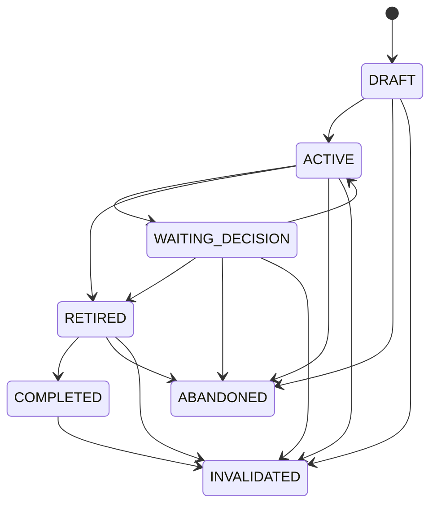
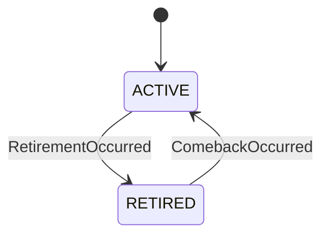

# Modelo de dominio inicial

## 1. Propósito

Este documento define lenguaje, límites de agregados, entidades, value objects, comandos, eventos e invariantes derivados de `MASTER_SPEC.docx`. No completa fórmulas ni reglas de gameplay ausentes.

## 2. Lenguaje ubicuo

| Término | Significado técnico |
|---|---|
| Carrera | Ejecución completa y versionada de un futbolista, desde borrador hasta finalización, abandono o invalidación técnica. |
| Temporada | Unidad mínima interna de simulación. |
| Ventana de temporada | Tramo agregado `Q1`–`Q4` usado para causalidad; no representa partidos. |
| Cadencia | Cantidad de temporadas agrupadas para presentación; no es una regla del motor. |
| Oportunidad | Evaluación contextual identificable en la que un resultado puede sortearse. |
| Ventana de oportunidades | Punto causal donde un conjunto de oportunidades puede evaluarse porque sus hechos requeridos ya existen. |
| Evento de juego | Definición de contenido y su ocurrencia dentro de una carrera. |
| DomainEvent | Identidad y consecuencias mecánicas de un evento, independientes de cómo se narra. |
| NarrativePresentation | Variante de texto/recursos para presentar un mismo DomainEvent sin alterar mecánica. |
| InternalEngineSignal | Valor/evaluación interna de una resolución; no prueba por sí sola una ocurrencia. |
| DomainFact | Hecho confirmado, tipado, determinista y append-only apto para replay, auditoría y consumidores. |
| NarrativeEvent | `EventInstance` y presentación data-driven; no sustituye un DomainFact deportivo. |
| Evento de dominio | Sinónimo legacy de `DomainFact` cuando cumple su contrato canónico. |
| Evento analítico | Señal de observabilidad posterior a una operación; no forma parte de la simulación. |
| Decisión | Elección ordenada que puede modificar el estado. |
| Cadena narrativa | Secuencia de oportunidades, banderas y consecuencias relacionadas. |
| Memoria narrativa | Hechos, flags y contadores persistentes que condicionan el futuro. |
| Snapshot de datos | Catálogo inmutable de entidades reales y reglas asociadas a una versión. |
| Release de contenido | Catálogo inmutable de eventos, cadenas, lesiones, finales y textos. |
| SeasonResult | Resumen inmutable de una temporada cerrada. |
| ScoreLedger | Libro mayor append-only que explica todos los puntos. |
| ScoreLedgerEntry | Movimiento contable creado exclusivamente por Scoring desde facts allowlisted y una regla versionada. |
| ScoreSnapshot | Proyección final versionada de subtotales, PC, hashes e identidad competitiva. |
| Perfil | Progreso permanente de la cuenta, separado de la simulación de una carrera. |
| Carrera oficial | Carrera verificable por servidor y elegible para una tabla competitiva. |
| Creation Budget | Presupuesto versionado común para todo poder inicial. |
| Posición efectiva | Posición realmente utilizada en una ventana con minutos. |
| Posición dominante | Posición única derivada del historial de temporadas/minutos efectivos dentro de un scope cerrado; fórmula y desempate pendientes en DR-049. |
| Squad status | Relación institucional del jugador con el plantel; no expresa minutos realizados. |
| Sporting role | Expectativa deportiva principal del jugador para un contexto y Q. |
| Effective usage | Participación efectivamente confirmada en un contexto y Q. |
| Sporting reputation | Percepción deportiva acumulada por mercado; no capability, Performance ni score. |
| Public reputation | Awareness y sentiment públicos; no equivale a mérito deportivo o followers. |
| Public attention | Exposición/hype reciente derivada de hechos autorizados; no reputación estable. |
| Audience | Followers enteros y engagement, separados de reputación. |
| Estado deportivo | `PlayerPlayingStatus` del protagonista, ortogonal a `CareerStatus` y contrato. |
| Episodio de retiro | Ocurrencia identificada de retiro deportivo; no completa Career por sí misma. |
| Comeback | Transición causal de `PlayerPlayingStatus.RETIRED` a `ACTIVE` mientras Career sigue abierta. |
| Team minutes opportunity | Tiempo físico finito que un jugador podría ocupar en un equipo/contexto/Q, derivado del calendario agregado; no suma puestos simultáneos. |
| Position competition | Field agregado de fuerza, profundidad y estabilidad de la competencia interna por posición/contexto. |
| Definition futbolística | Identidad/metadatos reales inmutables de club, liga o competición seleccionados por `dataVersion`. |
| Estado futbolístico | Evolución ficticia de esa entidad dentro de una Career; nunca modifica su Definition. |
| Fuerza competitiva de liga | Dificultad deportiva dinámica de `LeagueState`; no es IJL. |
| Team support field | Representación agregada del resto del equipo que excluye la contribución del protagonista. |
| Contribución competitiva del jugador | Proyección interna por competición desde minutos/Performance; no es CC ni score. |
| Percepción de mercado | Estimación contextual de un observador sobre calidad, potencial, riesgo y valor; no verdad del jugador. |
| Club need | Necesidad agregada de un club por posición/perfil/contexto; no vacante ni oferta garantizada. |
| Valor de mercado | Estimación monetaria simulada; no precio objetivo ni fee. |
| Transfer fee | Precio concreto acordado entre clubes para una operación. |
| Salary | Compensación contractual, separada de fee y valor. |
| Expectativa contractual | Promesa/expectativa del contrato; no SquadStatus, SportingRole o minutos. |
| Afiliación contractual/deportiva | Club que posee el contrato frente al club donde el jugador participa durante un préstamo. |
| Estado de selección nacional | Evolución ficticia propia de una selección dentro de Career; no es estado de club ni una plantilla completa. |
| Contexto de selección nacional | Scope identificado de ventana/torneo, táctica, fuerza, presión y calendario internacional. |
| Elegibilidad internacional | Restricción lógica y versionada anterior a la candidatura; no es probabilidad de convocatoria. |
| Selection competition field | Competencia generacional abstracta por selección, posición, contexto y período; no población materializada. |
| International role | Expectativa deportiva propia de selección; no se copia del SportingRole de club. |
| International minutes opportunity | Tiempo internacional físicamente ocupable, separado de oportunidad y minutos de club. |
| Award definition | Criterios estáticos/versionados de categoría, scope, cadence, eligibility, evidence, field y outcome de un premio. |
| Award competition field | Campo abstracto comparativo de una edición; no umbral ni lista de futbolistas simulados. |
| Statistical competition field | Distribución de producción rival usada para ordenar premios estadísticos por edición. |

## 3. Contextos delimitados

### 3.1 Simulation

Posee la evolución de `Career`, `Player`, `WorldState`, temporadas, mercado,
contratos, afiliación, decisiones, relaciones y memoria. Consume catálogos
inmutables.

### 3.2 Probability

Posee streams determinísticos, cálculo de probabilidades, distribuciones y muestreo. No conoce React, DB ni reglas de presentación.

### 3.3 Scoring

Transforma hechos deportivos ya resueltos en entradas auditables. No dispara eventos ni cambia estadísticas.

### 3.4 Content

Posee definiciones declarativas de `domainEvent`, cadenas, efectos y `narrativePresentation`. La preferencia sensible elige presentación y no modifica la mecánica. Content no posee estado de carrera.

### 3.5 Football Catalog

Posee identidades reales, metadatos, jerarquías, fuentes y snapshots. No decide resultados futuros.

### 3.6 Identity and Profile

Posee cuenta, preferencias, récords, colección y carrera favorita. No modifica probabilidades.

### 3.7 Competition Integrity

Posee elegibilidad, replay, checkpoints, ranking y proyecciones competitivas. Consume resultados del motor; no contiene fórmulas duplicadas.

### 3.8 Sharing

Posee modelos públicos sanitizados y renders de estados cerrados. No recalcula verdad deportiva.

### 3.9 Reputation, Social and Retirement

Reputation posee Sporting/Public Reputation y Public Attention; Social posee
Audience/Engagement; Retirement posee `PlayerPlayingStatus`, assessments,
oportunidades y episodios de retiro/regreso. Son módulos del núcleo de
simulación con estados distintos. Ninguno posee capabilities, contratos,
CareerScore, lifecycle terminal o ScoreLedger.

## 4. Agregados y propiedad

```mermaid
erDiagram
    USER_PROFILE ||--o{ CAREER_SUMMARY : registra
    USER_PROFILE ||--o{ DISCOVERY : conserva
    USER_PROFILE ||--o| CAREER_SUMMARY : mejor_carrera

    CAREER ||--|| PLAYER : contiene
    CAREER ||--|| WORLD_STATE : contiene
    CAREER ||--o{ CONTRACT : conserva
    CAREER ||--o{ TRANSFER_INTEREST : genera
    CAREER ||--o{ TRANSFER_OFFER : recibe
    CAREER ||--o{ TRANSFER_NEGOTIATION : resuelve
    CAREER ||--o{ LOAN_AGREEMENT : conserva
    CAREER ||--o{ NATIONAL_TEAM_STATE : conserva
    CAREER ||--o{ AWARD_EDITION_RESULT : conserva
    CAREER ||--o| PLAYER_CLUB_AFFILIATION : afiliacion_vigente
    CAREER ||--o{ RELATIONSHIP : contiene
    CAREER ||--|| NARRATIVE_MEMORY : contiene
    CAREER ||--o{ DECISION_RECORD : registra
    CAREER ||--o{ EVENT_INSTANCE : registra
    CAREER ||--o{ DOMAIN_FACT : confirma
    CAREER ||--o{ SEASON_RESULT : produce
    CAREER ||--|| SCORE_LEDGER : posee
    CAREER }o--|| VERSION_SET : referencia

    VERSION_SET }o--|| CONTENT_RELEASE : fija
    VERSION_SET }o--|| DATA_SNAPSHOT : fija

    DOMAIN_FACT }o--o{ SCORE_LEDGER_ENTRY : evidencia
    SCORE_LEDGER ||--o{ SCORE_LEDGER_ENTRY : contiene
    CAREER ||--o| PENDING_DECISION : suspende_en
```



### 4.1 Career

Agregado central de simulación.

**Posee**

- identidad interna y pública cuando corresponda;
- estado de ciclo de vida;
- semilla raíz;
- `VersionSet`;
- revisión y secuencia de decisiones;
- `Player`;
- `WorldState`;
- temporada actual y cursor de ejecución;
- acumuladores confirmados por Q1–Q4;
- historial contractual y contrato activo;
- afiliación contractual/deportiva;
- intereses, ofertas, negociaciones, préstamos y movimientos confirmados;
- futura elegibilidad de registro por scope;
- estados/contextos e historia de selección nacional;
- elegibilidad internacional y selection trust/incumbency cuando correspondan;
- resultados e historia de ediciones de premios;
- relaciones;
- memoria narrativa;
- consecuencias programadas;
- decisión pendiente;
- historial de ocurrencias;
- historial de uso posicional y reconversiones;
- ocurrencias de descubrimientos con procedencia;
- referencias o resultados inmutables de temporadas;
- ScoreLedger;
- estado de elegibilidad.

**No posee**

- usuario o credenciales;
- DB, repositorios o sesión HTTP;
- catálogos completos duplicados;
- ranking global;
- telemetría;
- componentes de UI.

Toda mutación ocurre mediante un comando y produce eventos de dominio. Un setter público arbitrario violaría el agregado.

### 4.2 UserProfile

Agregado separado.

**Posee**

- preferencias de cuenta;
- contadores de carreras;
- récords materializados;
- referencia a mejor carrera;
- referencia a carrera favorita;
- colección y estados de descubrimiento;
- preferencias de visibilidad.

**Invariante**

El perfil nunca modifica atributos, probabilidades, semillas, resultados o scoring de una carrera.

El documento ubica `DiscoveryState` dentro de la lista del agregado Career, pero también lo define como progreso de cuenta. La propuesta separa:

- `EventInstance` y descubrimientos ocurridos: pertenecen a Career;
- `Discovery`: pertenece a UserProfile y se actualiza a partir de hechos confirmados.

Según ADR-017:

- una ocurrencia se confirma atómicamente con `EventInstance`;
- elegibilidad no descubre;
- abandono conserva descubrimientos confirmados;
- invalidación excluye la procedencia del perfil competitivo público sin borrar auditoría.

### 4.3 ScoreLedger

Agregado transaccional separado, asociado a Career y a una `scoringVersion`.
Application coordina su cálculo después de cerrar facts; `engine` no lo muta.

- entradas inmutables y ordenadas;
- claves de idempotencia únicas por rule/category/scope/source facts;
- hashes encadenados;
- reversals explícitos;
- total derivado, no fuente primaria;
- `scoringVersion` fija.

No puede contener reglas narrativas ni aceptar entradas creadas por el cliente para ranking oficial.
Re-scoring con otra versión crea otro ledger y no modifica el histórico.

### 4.4 DataSnapshot y ContentRelease

Son agregados editoriales inmutables una vez publicados.

- tienen versión, hash, fecha, procedencia y estado de publicación;
- pueden ser reemplazados solo por una release nueva;
- se retienen para replay;
- una carrera los referencia, no los edita.

## 5. Entidades principales

| Entidad | Identidad | Responsabilidad |
|---|---|---|
| `Player` | Dentro de Career | Biografía, posición, `TruePlayerState`, salud, reputación y trayectoria; no contiene overall causal. |
| `PlayerKnowledge` | Observador + Player + contexto | Estimaciones, incertidumbre/confianza y procedencia reproducible; nunca sustituye el estado verdadero. |
| `WorldState` | Dentro de Career | Raíz del futuro ficticio: estados de clubes, ligas, competiciones, ciclos y fields; referencia una snapshot real inmutable. |
| `ClubState` | Career + `clubId` | Fuerza multidimensional, prestigio, finanzas abstractas, desarrollo, medicina, estabilidad, manager, competencia, needs y membresía simulados. |
| `LeagueState` | Career + `leagueId` + `seasonId` | Membresía, fuerza competitiva dinámica, profundidad, contexto y movilidad simulados. |
| `CompetitionState` | Career + `competitionId` + `seasonId` | Participación, contexto Q, progreso y outcome agregados de una edición. |
| `NationalTeamState` | Career + `nationalTeamId` | Fuerza/contexto agregados, manager/táctica, support field, generación, selection fields, outcomes e historia internacional. |
| `NationalTeamCallUp` | `callUpId` | Convocatoria identificada separada de squad, rol, minutos y Performance. |
| `AwardEditionResult` | `awardId` + edición/período | Outcome ordinal, winner/protagonist placement cuando aplique, field/contexto y referencias causales. |
| `ReputationState` | Player dentro de Career | Sporting/Public Reputation y Public Attention por mercado, con evidencia/memoria; no overall. |
| `AudienceState` | Player dentro de Career | Followers exactos, engagement y breakdown regional autorizado. |
| `RetirementEpisode` | `retirementEpisodeId` | Retiro deportivo identificado con causa, oportunidad, decisión y versiones; no Career completion. |
| `ComebackEpisode` | `comebackEpisodeId` | Regreso identificado y relacionado con un episodio de retiro. |
| `SeasonState` | `seasonId` | Acumuladores y fase de una temporada todavía no cerrada. |
| `SeasonWindowState` | `seasonId` + `Q1`–`Q4` | Oportunidad, disponibilidad, rol, uso efectivo, producción, salud y consecuencias confirmados del tramo agregado. |
| `MarketPerception` | Observador + Player + punto/contexto | Proyección de conocimiento, evidencia, riesgo, incertidumbre y valoración; no estado verdadero. |
| `TransferInterest` | `interestId` | Interés identificado de un club, separado de una oferta. |
| `TransferOffer` | `offerId` | Propuesta firme congelada de movimiento y contrato/préstamo. |
| `TransferNegotiation` | `negotiationId` | Proceso agregado con acuerdos de clubes/jugador separados y referencias causales. |
| `Contract` | `contractId` | Club, vigencia de dominio, salary, expectativa, cláusulas, estado y links predecesor/sucesor; no duplica role/usage. |
| `LoanAgreement` | `loanAgreementId` | Préstamo identificado que preserva contrato/club de origen y club deportivo temporal. |
| `PlayerClubAffiliation` | Dentro de Career + boundary | Estado `ATTACHED`/`UNATTACHED`, club contractual/deportivo, contrato/préstamo activos y vigencia causal; no playing status. |
| `Relationship` | Tipo + actor generado/estable | Intensidad, confianza, historia y efectos contextuales. |
| `EventInstance` | `eventInstanceId` | Definición/version, oportunidad, resultado, decisión y efectos aplicados. |
| `DiscoveryOccurrence` | Career + EventInstance + discovery ID | Confirmación idempotente y procedencia de un descubrimiento. |
| `PendingDecision` | `decisionId` | Opciones ya determinadas, secuencia, contexto y punto de reanudación. |
| `DecisionRecord` | Secuencia | Input aceptado, idempotencia y referencia al checkpoint. |
| `SeasonResult` | Career + `seasonId` | Resultado inmutable y canónico de una temporada cerrada. |
| `DomainFact` | `factId` determinista | Envelope tipado con scope, operación, semantic key, causal refs, payload hash y `VersionSet`. |
| `ScoringRuleDefinition` | `scoringVersion` + `ruleId` | Regla declarativa allowlisted; no ejecuta código de Content. |
| `ScoreLedgerEntry` | `ledgerEntryId` | Movimiento de puntos auditable. |
| `ScoreSnapshot` | Career + `scoringVersion` + ledger head | Total/subtotales, hashes, integrity y compatibility key de una proyección final. |
| `Discovery` | Perfil + discovery ID | Estado coleccionable idempotente con una o más procedencias. |
| `LeaderboardEntry` | Carrera + versión competitiva | Proyección verificable del ranking. |

## 6. Value objects necesarios

| Value object | Invariante |
|---|---|
| `VersionSet` | Contiene `schemaVersion`, `engineVersion`, `contentVersion`, `dataVersion` y `scoringVersion`; no admite referencias parciales ni aliases. |
| `RootSeed` | Representación canónica e inmutable. |
| `StreamKey` | Se deriva solo de contexto estable documentado. |
| `Probability` | Está en `[0,1]`; cero requiere motivo lógico o configuración explícita. |
| `PositiveProbability` | Está en `(0,1]` y no pierde precisión al persistir. |
| `OpportunityId` | Identifica de forma estable una oportunidad concreta y repetible. |
| `SeasonId` | Identidad estable separada de la etiqueta localizada. |
| `SimulationCursor` | Identifica temporada, paso, Q/OpportunityWindow opcionales, suboperación y punto exacto de reanudación. |
| `SeasonWindow` | `Q1`, `Q2`, `Q3` o `Q4`; no equivale a partido. |
| `OpportunityWindow` | Una de las ocho ventanas causales de ADR-043. |
| `PositionCode` | Uno de los 15 códigos canónicos definidos por ADR-011. |
| `PositionGroup` | Proyección determinística `GK`, `DEF`, `MID` o `FWD`; no es editable en Player. |
| `EffectivePosition` | `PositionCode` válido asignado antes de resolver rol/minutos; solo el uso con minutos aporta historia efectiva. |
| `DominantPosition` | Derivación única y versionada desde historial efectivo; ponderación y desempate se definen en DR-049. |
| `SquadStatus` | `OUT_OF_SQUAD`, `PROSPECT`, `SQUAD_PLAYER` o `FIRST_TEAM`; relación institucional, no rol ni uso. |
| `SportingRole` | `BENCH`, `ROTATION`, `STARTER`, `KEY_PLAYER` o `STAR`; expectativa contextual, no porcentaje fijo. |
| `EffectiveUsage` | Uso confirmado con `actualMinutes`, contexto, posición dominante y desglose conservativo opcional. |
| `PositionCompetition` | Field agregado por posición/contexto con fuerza, profundidad y estabilidad/entrenchment. |
| `TeamMinutesOpportunity` | Tiempo finito entero por competición en `SeasonId` ordinal/Q/contexto, con opportunity count y capacidades agregadas; no suma puestos ni es cap editorial por rol. |
| `ManagerContext` | Contexto versionado con calidad, táctica, influencia de desarrollo, estabilidad y vigencia causal; no requiere entidad completa de entrenador. |
| `TacticalIdentity` | Vector compacto de demandas del club/manager; no arquetipo rígido ni capability. |
| `ScheduleContext` | Oportunidad, dificultad, congestión y presión agregadas por Q; no representa fixtures. |
| `TeamSupportField` | Baseline agregado del resto del equipo por club/competición/período; excluye al protagonista. |
| `PlayerCompetitiveContribution` | Proyección interna desde uso y Performance confirmados; no `ContributionCoefficient`, score ni rating causal. |
| `LeagueCompetitiveStrength` | Estado deportivo dinámico de liga; no reescribe raw production ni IJL. |
| `WorldCycleState` | Contexto deportivo/económico/regional que modula distribuciones futuras sin guionizar resultados. |
| `ClubNeed` | Need agregado por club/ventana/posición/perfil; no garantiza interés u oferta. |
| `PositionScarcity` | Field agregado por mercado/región/posición; no población completa. |
| `PlayerClubFit` | Derivación contextual jugador-club; no capability persistente. |
| `FinancialFeasibilityAssessment` | Viabilidad de fee/salary/términos separada del interés deportivo. |
| `MarketWindowContext` | Oportunidad legal versionada producida por Calendar; no fecha diaria ni cooldown. |
| `MedicalAvailabilityEnvelope` | Componente médico por Q/contexto con share `[0,1]`, restricciones, razones, incertidumbre y asignación sobre oportunidad. |
| `AvailabilityEnvelope` | Aggregate autoritativo por unión exacta de componentes médicos, disciplinarios y otros conforme ADR-072. |
| `MinuteShare` | Proporción en `[0,1]` usada para realizar minutos; la distribución sigue en DR-054. |
| `LoadState` | Exposición/carga reciente y acumulada, tipada por fuente y referenciada a actividad realizada. |
| `InjuryFamily` | Taxonomía mecánica extensible separada de severidad, origen y narrativa. |
| `InjuryOrigin` | `MATCH`, `TRAINING`, `NON_FOOTBALL` o `EXTERNAL_EVENT`. |
| `InjuryEpisode` | Episodio persistente con identidad causal, familia, severidad, origen, recuperación y relaciones. |
| `RecoveryState` | Progreso agregado equivalente a lesión, rehabilitación, retorno limitado y disponibilidad plena. |
| `SequelaProfile` | Consecuencia `NONE`, `TEMPORARY` o `PERSISTENT`; no es un delta de capability. |
| `HealthHistorySummary` | Vista derivada por familia, severidad, recencia, relaciones y secuelas; no reemplaza evidencia de replay. |
| `TacticalFit` | Derivación contextual de capability, posición y demandas tácticas; no capability persistida. |
| `EffectiveCapabilities` | Proyección contextual y efímera del catálogo de capabilities para una Q; no muta ni duplica `TruePlayerState`. |
| `UnderlyingPerformance` | Realización multidimensional de Performance; no es overall ni producción observada. |
| `ObservedProduction` | Conteos/resultados deportivos observables atribuidos una sola vez a exposición, posición y contexto. |
| `PerformanceSummary` | Evidencia de Q con rendimiento, producción, volumen, presión, contexto e incertidumbre. |
| `SeasonPerformanceSummary` | Agregación verificable de Q1–Q4 que conserva splits; no vuelve a sortear. |
| `PerformanceContext` | Contexto agregado de club, rival, competición, táctica y presión producido fuera de Performance. |
| `DominantFoot` | `RIGHT`, `LEFT` o `BOTH`. |
| `ContributionCoefficient` | Valor derivado en el rango cerrado `[0.00, 1.10]`. |
| `CreationBudget` | Poder inicial esperado y equivalencia estadística versionada; no es una suma trivial ni puede incrementarse desde cliente/UI. |
| `DiscoveryId` | Clave estable de evento base o desenlace, independiente del texto. |
| `CareerRevision` | Entero monotónico para concurrencia optimista. |
| `DecisionSequence` | Entero monotónico sin saltos aceptados por el servidor. |
| `IdempotencyKey` | Evita aplicar dos veces una mutación o un punto. |
| `StateHash` | Hash de estado canónico, versiones y secuencia. |
| `Money` | `amountMinor` entero exacto no negativo más `currencyCode`; sin float, moneda o conversión implícita. |
| `MarketValueEstimate` | Money percibido por observador/modelo, evidencia, incertidumbre, contexto y versión; no verdad objetiva. |
| `ReputationMarketId` | Identidad data-driven de mercado/audiencia; no país hardcoded del engine. |
| `SportingReputationState` | Standing, evidence strength, memoria y vigencia por mercado; no calidad real. |
| `PublicReputationState` | Awareness y sentiment por mercado; reach es derivado. |
| `PublicAttentionState` | Exposición reciente por causa/mercado; no reputación estable. |
| `FollowerCount` | Entero exacto no negativo; no float ni Reputation. |
| `EngagementState` | Intensidad de audiencia separada del tamaño; dominio pendiente de DR-061. |
| `EvidenceKey` | Identifica una causa/evidencia aplicada una vez a un consumidor. |
| `PublicAttentionSignal` | Señal tipada con fact fuente y causal ID; no impone delta de estado. |
| `PlayerPlayingStatus` | `ACTIVE` o `RETIRED`; ortogonal a CareerStatus, contrato y retiro internacional. |
| `CareerMotivationAssessment` | Snapshot derivada de traits, estados, historia y contexto; no trait nuevo. |
| `RetirementCause` | `VOLUNTARY`, `HEALTH`, `MARKET`, `EXTERNAL` u `OTHER`, extensible/versionada. |
| `TransferFee` | Money concreto de una operación; cero es válido y no equivale a MarketValue. |
| `SalaryTerms` | Money contractual más base temporal explícita; no fee ni valor. |
| `ContractExpectation` | `DEVELOPMENT`, `SQUAD`, `IMPORTANT` o `MARQUEE`; no role/usage/minutos. |
| `ContractPeriod` | Inicio/fin en tiempo de dominio compatible con `seasonId`/cursor; schema final pendiente de DR-021/067. |
| `RegistrationEligibility` | Estado futuro por jugador/club/competición/temporada/boundary; separado de afiliación y pendiente de DR-066. |
| `NationalTeamEligibility` | Restricción lógica por jugador/selección/contexto con antecedentes y rule-set versionados; no candidate score. |
| `SelectionCompetitionField` | Distribución agregada de competencia por selección/país, posición específica, contexto y generación; no threshold ni roster. |
| `NationalTeamContext` | Contexto internacional identificado con calendario/torneo, manager/táctica, fuerza, presión y vigencia causal. |
| `InternationalRole` | `BENCH`, `ROTATION`, `STARTER` o `KEY_PLAYER`; expectativa nacional separada del rol de club. |
| `InternationalTeamMinutesOpportunity` | Tiempo físicamente ocupable en selección/contexto; nunca comparte minutos con club. |
| `NationalTeamSupportField` | Baseline agregado del resto de la selección; excluye al protagonista. |
| `AwardEligibility` | Resultado lógico de predicates declarativos de una `AwardDefinition`; no probabilidad de victoria. |
| `AwardCompetitionField` | Campo comparativo agregado por award/edición/era/contexto. |
| `StatisticalCompetitionField` | Campo de order statistics para producción observable por award/edición. |
| `AwardEvaluationFamily` | `COMPARATIVE_JUDGED` o `STATISTICAL`; eje separado de categoría. |
| `AwardCategory` | Global, league, tournament, positional, youth, team-selection o special según definición versionada. |
| `ScorePoints` | Entero no negativo derivado del ledger. |
| `CapabilityValue` | Entero canónico inclusivo `0..10000`; la proyección visible es derivada. |
| `TraitValue` | Entero canónico inclusivo `0..10000`; puede permanecer oculto. |
| `KnowledgeEstimate` | Estimación de un observador con incertidumbre/confianza, punto de simulación y contexto. |
| `RankingEligibility` | Estado explícito con causa; no se infiere en UI. |
| `ContentSensitivity` | Categoría de presentación; nunca deshabilita el DomainEvent mecánico por preferencia narrativa. |
| `PublicId` | No revela el identificador interno. |

Probabilidad, PRNG, canonicalización, posiciones, cursor, versiones, CC,
sensibilidad, Creation Budget, pie dominante, posición efectiva y modelo
fundamental del jugador se rigen por ADR-002, ADR-006, ADR-007, ADR-009,
ADR-011 a ADR-015, ADR-019, ADR-023, ADR-042 a ADR-044 y
[ADR-052](adr/052-fundamental-player-model.md),
[ADR-053](adr/053-development-and-aging-model.md) y
[ADR-054](adr/054-role-and-minutes-model.md) y
[ADR-055](adr/055-performance-and-production-model.md) y
[ADR-057](adr/057-health-injury-recovery-model.md) y
[ADR-058](adr/058-transfer-market-contract-model.md),
[ADR-059](adr/059-national-team-model.md) y
[ADR-060](adr/060-awards-model.md),
[ADR-061](adr/061-reputation-and-social-model.md) y
[ADR-062](adr/062-playing-retirement-and-comeback.md).

### 6.1 Modelo fundamental del jugador

La especificación normativa completa está en
[`PLAYER_MODEL_SPEC.md`](PLAYER_MODEL_SPEC.md).

`TruePlayerState` separa:

- `CAPABILITIES`: veinte capacidades específicas comunes a todos los jugadores
  y mutables únicamente mediante procesos de desarrollo/declive;
- `TRAITS`: diez predisposiciones persistentes o lentamente mutables;
- `DYNAMIC_STATES`: al menos `form`, `confidence`, `fitness`, `fatigue`,
  `morale` y `managerTrust`, con dominios todavía pendientes.

Las capabilities canónicas son:

- técnicas: `finishing`, `passing`, `ballControl`, `dribbling`, `defending`,
  `goalkeeping`;
- físicas: `acceleration`, `pace`, `strength`, `stamina`, `agility`;
- mentales: `composure`, `vision`, `decisionMaking`, `positioning`, `workRate`;
- tácticas: `attackingMovement`, `defensiveAwareness`, `pressing`,
  `tacticalIntelligence`.

Los traits iniciales son `naturalTalent`, `developmentCapacity`,
`professionalism`, `ambition`, `consistency`, `adaptability`,
`pressureResistance`, `injuryFragility`, `recoveryCapacity` y `longevity`.

No se persisten `overall`, `potentialOverall`, edad de pico garantizada ni
`effectiveCapability`. Ratings, potencial percibido y capacidades efectivas son
derivaciones o conocimiento de un observador.

La generación inicial usa perfiles latentes y distribuciones conjuntas
correlacionadas. Los arquetipos no son clases rígidas y todo perfil compatible
con el dominio conserva probabilidad positiva.

### 6.2 Rol y minutos

La especificación normativa completa está en
[`ROLE_MINUTES_SPEC.md`](ROLE_MINUTES_SPEC.md).

El modelo separa:

- `SquadStatus`: relación institucional;
- `SportingRole`: expectativa deportiva de la ventana;
- `EffectiveUsage`: participación confirmada.

`PROSPECT` puede coexistir con cualquier `SportingRole`. Role & Minutes consume
una `effectivePosition` válida, `managerTrust`, `tacticalFit`,
`PositionCompetition`, `TeamMinutesOpportunity`, un
`MedicalAvailabilityEnvelope` proveniente de Health y el
`AvailabilityEnvelope` ya agregado.
No decide reconversiones, no simula una plantilla/calendario y no calcula
Performance o Health.

`expectedMinutes` es una expectativa. `actualMinutes` es el hecho causal y
respeta:

```text
0 <= actualMinutes <= availableTeamMinutes <= teamMinutes
```

Apariciones/titularidades y splits por posición o competición son derivaciones
posteriores que deben conservar exposición sin duplicarla.

### 6.3 Performance y producción

La especificación normativa completa está en
[`PERFORMANCE_MODEL_SPEC.md`](PERFORMANCE_MODEL_SPEC.md).

El pipeline es:

```text
TrueCapabilities
-> EffectiveCapabilities
-> UnderlyingPerformance
-> ObservedProduction
-> PerformanceSummary
```

Performance recibe `effectivePosition`, `SportingRole`, `actualMinutes`,
Dynamic States y `PerformanceContext` ya confirmados. No decide posición,
minutos, salud, desarrollo, premios o score.

UnderlyingPerformance conserva dimensiones equivalentes a ejecución técnica,
decisión, impacto sin balón, impacto defensivo, contribución ofensiva y presión.
No existe un rating causal. `ObservedProduction` conserva outputs mínimos por
posición; `PerformanceSummary` añade exposición, contexto, fuerza de evidencia e
incertidumbre.

La temporada deriva `SeasonPerformanceSummary` de Q1–Q4 sin reescribir
contadores ni volver a sortear. Raw production permanece separada de evaluación
por competición.

### 6.4 Health, lesiones y recuperación

La especificación normativa completa está en
[`HEALTH_INJURY_SPEC.md`](HEALTH_INJURY_SPEC.md).

`HealthState` no es un único score. Separa fitness, fatigue, `LoadState`,
condiciones activas, episodios, recuperación, secuelas e historia. Los traits
`injuryFragility`, `recoveryCapacity` y `longevity` pertenecen al jugador;
`medicalQuality`, al entorno.

Health produce `MedicalAvailabilityEnvelope` parcial y no asigna minutos ni
suspensiones. Una agregación autoritativa externa combina componentes no
médicos antes de Role & Minutes.

`InjuryOccurred` registra la ocurrencia; `InjuryEpisode` preserva su estado e
identidad. Pueden coexistir varias condiciones compatibles. Recuperación
esperada y realizada se separan; recaída/agravamiento conserva relación con un
episodio previo.

Health confirma `SequelaProfile`, pero solo Development puede aplicar una
consecuencia permanente sobre capabilities. Una lesión resuelta en
`HEALTH(Qn)` afecta Qn+1, no reescribe Qn.

### 6.5 Transfers, Market y Contracts

La especificación normativa completa está en
[`TRANSFER_MARKET_CONTRACT_SPEC.md`](TRANSFER_MARKET_CONTRACT_SPEC.md).

El pipeline es:

```text
MarketPerception
-> ClubNeed
-> TransferInterest
-> TransferOffer
-> TransferNegotiation
-> PlayerDecision
-> TransferOutcome
-> Contract / PlayerClubAffiliation
```

Market consume `PlayerKnowledge` y evidencia cerrada; no lee estado verdadero.
`MarketValueEstimate`, `TransferFee` y `SalaryTerms` son magnitudes monetarias
distintas. `ContractExpectation` no asigna role/minutos.

El núcleo soporta transferencia permanente, préstamo y free transfer. Un
préstamo conserva `contractHoldingClubId` y `currentSportingClubId` por
separado. Un movimiento solo cambia boundaries futuros y la temporada conserva
splits por Q/club/competición sin duplicación.

`RegistrationEligibility` y afiliación son estados diferentes. DR-066 cierra
inscripción; DR-067 la ubicación mid-season en el cursor.

### 6.6 Reputation, Social y Retirement

La especificación normativa completa está en
[`REPUTATION_SOCIAL_RETIREMENT_SPEC.md`](REPUTATION_SOCIAL_RETIREMENT_SPEC.md).

`ReputationState` separa Sporting Reputation, Public Reputation y Public
Attention. Sporting usa standing/evidencia por mercado; Public separa awareness
y sentiment. `AudienceState` separa `FollowerCount` entero exacto de
Engagement. Un `ReputationMarketDefinition` data-driven permite origen,
contexto futbolístico y vista global sin países hardcoded.

Facts de otros módulos se convierten en signals y se aplican una vez por
`EvidenceKey`. Content no escribe deltas de followers/reputation y ningún estado
social modifica capabilities o ScoreLedger.

`PlayerPlayingStatus = ACTIVE | RETIRED` es ortogonal a `CareerStatus`. Una
Career abierta puede contener un jugador retirado y una decisión de comeback.
`RetirementEpisode`/`ComebackEpisode` preservan identidad y causa, permitiendo
retiro→regreso→retiro. El primer retiro no completa/rankea la Career.

ADR-062 aclara ADR-016 sin añadir `CareerStatus.RETIRED -> ACTIVE`. DR-069 debe
definir cursor posretiro, boundary irreversible, scoring final y terminación
práctica.

## 7. Catálogos de solo lectura

El motor recibe interfaces conceptuales inmutables:

| Catálogo | Consultas esperadas |
|---|---|
| `FootballCatalog` | `ClubDefinition`, `LeagueDefinition`, `CompetitionDefinition`, `NationalTeamDefinition`, `AwardDefinition`, `ReputationMarketDefinition`, país, jerarquía y reglas por ID, todos ligados a `dataVersion`. |
| `ContentCatalog` | Oportunidades por ventana/familia, DomainEvents, cadenas, hechos requeridos y efectos compilados. |
| `NarrativeCatalog` | Presentaciones localizadas por DomainEvent, sensibilidad y contentVersion; no contiene efectos. |
| `ScoringRules` | Valores, fórmulas, topes de puntos y política anti-duplicación por versión. |

Un catálogo:

- se identifica por versión y hash;
- devuelve resultados en orden estable;
- no consulta DB durante la simulación;
- no puede cambiar mientras se ejecuta una carrera.

## 8. Posición, uso efectivo y reconversión

`Player` mantiene:

- `primaryPosition` obligatoria;
- `secondaryPositions` compatibles y sin duplicados;
- historial de cambios;
- `effectivePosition` válida antes de Role & Minutes y uso confirmado por
  ventana cuando existen minutos.

Las estadísticas de cada Q se atribuyen principalmente a su `effectivePosition`. Cambiar luego la primaria no reetiqueta hechos anteriores.

Para un scope cerrado, `dominantPosition` usa únicamente el historial de temporadas/minutos efectivos, conserva un desglose explicable y debe producir una posición única cuando asigna cohorte. DR-049 definirá ponderación y empates; no se adopta un fallback implícito.

Sin minutos no existe cohorte posicional competitiva; la primaria solo sirve como identidad de presentación.

Rankings de posición usan la dominante del scope declarado. Premios declaran `POSITION_SPECIFIC`, `POSITION_GROUP` o `POSITION_AGNOSTIC` y calculan dominancia dentro de su período. Una secundaria sin minutos no otorga elegibilidad.

Una reconversión solo ocurre mediante transición causal confirmada, actualiza compatibilidad antes del uso y conserva posición anterior, nueva, causa, momento y versiones. Sus fórmulas siguen en DR-008.

Cada Q mantiene una posición efectiva dominante. Si existe
`usageByPosition`, la suma de sus minutos es exactamente `actualMinutes`. Club
y selección conservan exposiciones independientes.

## 9. Comandos

### 9.1 Comandos de ciclo de vida

- `CreateCareer`
- `GenerateQuickPlayer`
- `CreateCustomPlayer`
- `StartCareer`
- `AdvanceCareer`
- `ResolveDecision`
- `RetirePlayer` (retiro deportivo; produce `RetirementOccurred` conforme a
  DR-063/ADR-010)
- `RequestCareerFinalization` (candidato; precondiciones pendientes de DR-069)
- `CompleteCareer`
- `AbandonCareer`

### 9.2 Comandos de decisión especializada

Las acciones contractuales, médicas, de selección y medios deben terminar representadas como decisiones de dominio tipadas. Los nombres listados por la especificación (`AcceptTransfer`, `NegotiateContract`, `ChooseMedicalAction`, etc.) pueden ser comandos especializados o payloads de `ResolveDecision`; se debe elegir una sola convención para evitar dos rutas con reglas distintas.

### 9.3 Resultado de comando

Todo comando:

- valida estado y precondiciones;
- no hace IO;
- devuelve un nuevo estado o rechazo tipado;
- produce `DomainFact` ordenados cuando ocurre un hecho persistible;
- conserva idempotencia en la capa de aplicación;
- nunca salta silenciosamente una decisión mecánica.

## 10. Eventos

### 10.1 Eventos de dominio

El catálogo autoritativo está en
[`SCORING_FACTS_SPEC.md`, §4](SCORING_FACTS_SPEC.md#4-catálogo-único-y-clasificación).
Los `PERSISTED_DOMAIN_FACT` canónicos se agrupan así:

- **Lifecycle/decisiones:** `CareerStarted`, `SeasonStarted`,
  `SeasonWindowClosed`, `SeasonCompleted`, `DecisionRequested`,
  `DecisionResolved`, `CareerAbandoned`, `CareerInvalidated`,
  `CareerCompleted`, `DiscoveryConfirmed`, `ScoringCorrectionAuthorized`.
- **Player/Development/Role:** `PlayerCapabilitiesChanged`,
  `PlayerDynamicStateChanged`, `PrimaryPositionChanged`,
  `SquadStatusChanged`, `SportingRoleAssigned`, `MinutesRecorded`,
  `AppearanceSummaryRecorded`.
- **Performance/Health:** `ObservedProductionRecorded`,
  `PerformanceSummaryRecorded`, `SeasonPerformanceSummaryRecorded`,
  `InjuryOccurred`, `HealthConditionTransitioned`, `RelapseOccurred`,
  `SequelaRecorded`.
- **Club/World:** `CompetitionFinished`, `ClubStateUpdated`,
  `LeagueStateUpdated`, `ManagerContextChanged`, `PromotionOccurred`,
  `RelegationOccurred`, `WorldCycleUpdated`.
- **Market/Contracts:** `TransferInterestGenerated`,
  `TransferOfferCreated`, `TransferOfferWithdrawn`, `RenewalOffered`,
  `NegotiationStarted`, `NegotiationUpdated`, `NegotiationFailed`,
  `ContractAgreed`, `ContractRenewed`, `ContractExpired`,
  `ContractTerminated`, `TransferCompleted`, `LoanStarted`, `LoanEnded`.
- **National/Awards:** `NationalTeamCallUpIssued`,
  `TournamentSquadSelected`, `InternationalRoleAssigned`,
  `AwardNominated`, `AwardPlacementRecorded`, `AwardWon`. Minutos,
  Performance y competiciones internacionales reutilizan los facts genéricos
  con `contextType = NATIONAL_TEAM`.
- **Reputation/Social/Retirement:** `PublicAttentionGenerated`,
  `SportingReputationUpdated`, `PublicReputationUpdated`,
  `FollowerCountUpdated`, `EngagementUpdated`, `RetirementOccurred`,
  `ComebackOccurred`.
- **Records/Achievements:** `RecordAchieved`,
  `CareerMilestoneAchieved`, `HistoricAchievementConfirmed`.

No son facts:

- signals internos como `expectedMinutes`,
  `EffectiveCapabilitiesResolved`, `UnderlyingPerformanceRecorded`,
  `LoadRecorded`, eligibility/candidate evaluations, hazards y opportunities;
- summaries como `WindowAvailabilityAssessed`,
  `MedicalAvailabilityCalculated`, contexts preparados,
  `PlayerCompetitiveContributionRecorded`, `AwardEditionResolved` o
  `MarketValuationUpdated`;
- vistas de outcomes como `CompetitionWon`, `RoundReached`,
  `QualificationAchieved` o `NationalTeamCompetitionAchievement`;
- `NarrativeEventOccurred` y `NarrativePresentationRendered`;
- `ScoreLedgerEntry`, que pertenece exclusivamente a Scoring.

Aliases que no se emiten:

- `PlayerDeveloped`/`DevelopmentApplied` →
  `PlayerCapabilitiesChanged`;
- `StatsGenerated`/`StatisticRecorded` →
  `ObservedProductionRecorded`;
- updates específicos de Dynamic States →
  `PlayerDynamicStateChanged.stateKind`;
- progress/recovery/return/resolution →
  `HealthConditionTransitioned.transitionKind`;
- `InternationalMinutesRecorded`/`InternationalPerformanceRecorded` →
  facts genéricos con context nacional;
- `StatisticalAwardWon` → `AwardWon`;
- `FreeTransferCompleted` →
  `TransferCompleted.movementType = FREE_TRANSFER`;
- requests especializados → `DecisionRequested.decisionKind`;
- `FollowersChanged` → `FollowerCountUpdated`;
- `PlayerRetired` → `RetirementOccurred`.

`CareerFinalizationRequested` es un comando/internal signal hasta cerrar
DR-069. `CompetitionFinished` es el único outcome colectivo fact; sus vistas no
duplican la ocurrencia.

### 10.2 Eventos de juego

Se modelan con tres piezas distintas:

- `EventDefinition`: contenido versionado;
- `EventOpportunity`: evaluación contextual concreta;
- `EventInstance`: ocurrencia y consecuencias en una carrera.

Esta separación es necesaria para auditar por qué un evento tenía una probabilidad determinada y para permitir repeticiones sin cooldown artificial.

`EventDefinition` referencia un `domainEvent` mecánico y una o más `narrativePresentation`. Las variantes narrativas no alteran opportunity, choices, efectos, discoveries ni streams.

### 10.3 Eventos analíticos

`career_created`, `season_completed`, `rare_event_triggered` y similares se emiten fuera de la transacción de dominio. Su falla no cambia el estado.

## 11. Oportunidad, posibilidad y repetición

El modelo debe poder expresar:

- imposibilidad lógica actual;
- definición mecánica deshabilitada por release/política versionada;
- antecedente débil que reduce probabilidad;
- antecedente fuerte que la aumenta;
- hecho materialmente irrepetible;
- nueva oportunidad del mismo evento en otro contexto.

No se incorpora `cooldownSeasons`, `maxPerCareer` ni protección de rareza al modelo normativo. Las apariciones anteriores solo pueden influir mediante estado e historia cuando exista una relación causal, no mediante una cuota editorial.

La clasificación entre posibilidad actual, posibilidad extrema, transición causal, imposibilidad lógica y contenido deshabilitado se rige por ADR-004. Los campos antiguos `requirements`, `eligibility`, `exclusions` y `cooldown` no se interpretan como filtros duros genéricos.

Una preferencia sensible no pertenece a esta clasificación: solo selecciona presentación según ADR-012.

## 12. Estado de Career

Estados y transiciones canónicas:



Reglas:

- `DRAFT`: configuración no iniciada.
- `ACTIVE`: Career abierta y ejecutable sin decisión pendiente; el jugador
  puede estar deportivamente activo o retirado.
- `WAITING_DECISION`: interrupción mecánica; no admite otro advance.
- `RETIRED`: cierre deportivo ya irreversible para esa Career; falta
  consolidación y scoring final.
- `COMPLETED`: cierre completo; solo puede cambiar posteriormente a `INVALIDATED`.
- `ABANDONED`: terminal, no reabrible y no elegible.
- `INVALIDATED`: terminal, preservado para auditoría y no elegible.

La matriz completa de operaciones y transiciones se define en [ADR-016](adr/016-career-lifecycle.md). Descubrimientos de una Career abandonada permanecen confirmados; una Career invalidada deja de contribuir al perfil competitivo público según [ADR-017](adr/017-discoveries.md).

El estado deportivo sigue otra máquina:



Esta máquina solo opera mientras `CareerStatus` permanece `ACTIVE` o
`WAITING_DECISION`. Un comeback no reabre `CareerStatus.RETIRED`.
DR-069 define cuándo el retiro pasa a cierre irreversible.

## 13. Pipeline de temporada

El orden técnico vigente es:

```text
SEASON_START
PRESEASON
PRESEASON_EVENTS
ROLE_AND_MINUTES

for Q1, Q2, Q3, Q4:
  AVAILABILITY(Qn)
  PRODUCTION(Qn)
  HEALTH(Qn)
  CONSEQUENCES(Qn)
  PERFORMANCE_EVENTS(Qn)
  HEALTH_EVENTS(Qn)

COMPETITIONS
COMPETITION_EVENTS
MARKET
MARKET_EVENTS
AWARDS
AWARD_EVENTS
WORLD_UPDATE
WORLD_EVENTS
POSTSEASON_EVENTS
SEASON_CLOSE
```

`ROLE_AND_MINUTES` inicializa estado institucional y priors de temporada. En
cada Q, la secuencia lógica es:

```text
effectivePosition válida
-> TeamMinutesOpportunity
-> MedicalAvailabilityEnvelope
-> AvailabilityEnvelope agregado
-> SportingRole / expectedMinutes
-> minuteShare / actualMinutes
-> Performance
-> exposición/carga realizada
-> Health posterior
-> estados para Qn+1
```

No agrega fases al cursor: disponibilidad/rol/expectativa se confirman en
`AVAILABILITY(Qn)` y los minutos en la primera suboperación de
`PRODUCTION(Qn)`. Una lesión ocurrida en Qn solo modifica ventanas posteriores;
no reescribe producción cerrada.

Dentro de `HEALTH(Qn)`, Health registra exposición/carga, progresa condiciones y
recuperación, evalúa recaídas/agravamientos y nuevas oportunidades, y produce
fitness/fatigue/restricciones/secuelas para `CONSEQUENCES(Qn)`. El orden total
de oportunidades debe quedar versionado; no nace del orden incidental de una
colección.

Cada path/fact declara desde qué punto existe. Un evento no puede evaluarse antes de disponer de todos sus hechos requeridos. Cada ventana admite cero o múltiples oportunidades.

La transición usa `SimulationCursor`, Q/OpportunityWindow opcionales, checkpoints e interrupciones atómicas según ADR-013, ADR-042 y ADR-043. `advance(n)` intenta completar hasta `n` temporadas y puede detenerse antes.

El pipeline internacional debe separar eligibility, candidate evaluation,
call-up, squad, role, minutes, Performance y team outcome. Puede reutilizar
resolvers con `NationalTeamContext`, pero no mezclarlos con estado/minutos de
club. ADR-013/043 todavía no ubica ventanas internacionales regulares entre Qs:
DR-059/021 debe decidir sus suboperaciones y cursor antes de implementación.

Awards recibe únicamente evidencia y outcomes ya confirmados. Su orden es:

```text
AwardEligibility
-> CandidateSignal
-> AwardCompetitionField / StatisticalCompetitionField
-> AwardEditionResolved
-> AWARD_EVENTS
```

Un evento dependiente de premio no se evalúa antes de `AwardWon` y nunca
modifica retroactivamente la evidencia que causó la edición.

## 14. Invariantes de dominio

### 14.1 Determinismo

- Misma entrada completa produce mismo estado, eventos, ledger y hash.
- La cadencia visual no forma parte de la semántica del motor.
- Agregar UI, analytics o render no cambia streams.
- Cambiar preset de dificultad o preferencia narrativa no cambia estado ni hash mecánico.

### 14.2 Probabilidad

- Todo resultado lógicamente posible y habilitado conserva probabilidad positiva.
- No hay cooldowns, cupos, compensaciones de rareza ni máximos por carrera.
- Valores menores que `10^-12` pueden sortearse y reproducirse.
- Cero exige causa auditable: imposibilidad lógica o definición mecánica deshabilitada.
- Una preferencia narrativa no cambia probabilidad.

### 14.3 Estado y estadísticas

- Toda capability y trait inicial es un entero canónico `0..10000`.
- Valores canónicos inválidos se rechazan; no se clampan ni redondean
  implícitamente.
- Todos los jugadores poseen las veinte capabilities, sin depender de posición.
- No existe `overall` ni `potentialOverall` como fuente causal persistida.
- `CAPABILITIES`, `TRAITS` y `DYNAMIC_STATES` tienen vías de mutación separadas.
- Rendimiento, forma, confianza, fitness o fatiga no reescriben capabilities
  directamente.
- `TruePlayerState` no se sustituye ni muta desde `PlayerKnowledge`.
- Una capacidad efectiva es derivada y contextual, no estado permanente.
- No existen minutos ni contadores negativos.
- `SquadStatus`, `SportingRole` y `EffectiveUsage` no son aliases.
- `PROSPECT` puede coexistir con cualquier `SportingRole`.
- Un rol no fija porcentajes, thresholds ni garantiza minutos.
- `managerTrust`, `tacticalFit`, calidad y rendimiento son causas distintas.
- Los minutos cumplen
  `0 <= actualMinutes <= availableTeamMinutes <= teamMinutes`.
- Cero minutos implica cero producción estadística causal; la granularidad de
  appearances/starts se cierra en DR-054/DR-021.
- `expectedMinutes` no se contabiliza como participación realizada.
- `starts <= appearances`.
- Contratos simultáneos incompatibles no son válidos.
- `ContractExpectation` no es `SquadStatus`, `SportingRole` o `EffectiveUsage`
  y no asigna minutos.
- Una renovación crea contrato sucesor y no reescribe el predecesor.
- MarketValue, TransferFee y SalaryTerms no son aliases.
- Money usa unidades menores enteras exactas; no mezcla monedas sin contexto de
  conversión versionado.
- Interés no implica oferta; oferta no implica acuerdos ni movimiento.
- Acuerdo entre clubes y acuerdo del jugador son estados independientes.
- Un free transfer usa fee cero.
- Un préstamo conserva club contractual y club deportivo separados.
- Una transferencia solo cambia estado desde su boundary y no reatribuye Q
  cerradas.
- Una temporada multiclub conserva splits y no duplica producción.
- Afiliación no implica `RegistrationEligibility` universal.
- Mercado, contratos y movimientos no crean ScoreLedger.
- Un logro requiere participación en el contexto correspondiente o una cadena previa que la habilite.
- Las distribuciones mantienen colas abiertas sin violar identidades físicas o contables.
- Producción confirmada en una Q no se modifica por una lesión posterior.
- Cada ventana con minutos tiene una posición efectiva dominante compatible.
- Todo `usageByPosition` suma exactamente `actualMinutes`.
- Club y selección no comparten ni duplican oportunidad o minutos.
- `NationalTeamEligibility` es lógica y anterior a Candidate Evaluation.
- Convocatoria, squad, `InternationalRole`, minutos y Performance
  internacionales son estados/hechos diferentes.
- El rol de club no se copia a selección y selection trust no es managerTrust.
- `SelectionCompetitionField` compara por posición/contexto/generación sin
  threshold de overall ni población completa.
- Liga o club de menor fuerza no producen inelegibilidad internacional.
- `NationalTeamSupportField` excluye al protagonista; este no garantiza el
  outcome colectivo.
- `AwardDefinition` y `AwardEditionResult` son capas distintas.
- Eligibility de premio no implica nomination, placement o win.
- Awards comparativos y estadísticos usan fields distintos.
- ST, CM y GK se evalúan con evidencia posicional propia.
- Títulos pueden modificar candidatura, pero no garantizan premios salvo una
  precondición explícita de Definition.
- Pueden coexistir múltiples premios compatibles en una temporada.
- Award, Record y ScoreLedger son conceptos separados.
- Awards no aplica anti-duplicación de scoring ni crea puntos.
- `AWARD_EVENTS` ocurre después de resolver la edición.
- Performance de Qn no recalcula rol/minutos cerrados de Qn.
- Performance no muta `TrueCapabilities` ni persiste EffectiveCapabilities como
  segunda verdad.
- UnderlyingPerformance es multidimensional; un rating derivado no genera
  producción.
- Los conteos se muestrean discretamente y no redondeando una expectativa.
- Cero minutos implica cero producción participativa.
- Sparse exposure conserva la producción observada y expresa evidencia/
  incertidumbre por separado.
- Competition strength no reescribe contadores observados.
- Definitions de club/liga/competición no cambian dentro de una Career.
- `ClubState`, `LeagueState`, `CompetitionState` y `WorldState` registran futuro
  ficticio separado del catálogo real.
- Fuerza deportiva, prestigio, `financialPower` e IJL no son aliases.
- No existe `ClubOverall` causal.
- `TeamSupportField` excluye `PlayerCompetitiveContribution`.
- El protagonista no determina de forma absoluta un outcome colectivo.
- Resultados por competición comparten causas sin ser idénticos.
- Un cambio de manager/contexto afecta solo cursores posteriores.
- Ningún club tiene piso de fuerza, inmunidad al descenso o qualification
  garantizada por identidad.
- Descenso no genera transferencia automática.
- `leagueCompetitiveStrength` dinámico no modifica IJL.
- Estadísticas relacionadas comparten causas/correlaciones explícitas.
- No existen caps editoriales de goles, asistencias, atajadas, ratings o
  performance.
- Performance emite señales; no escribe form, confidence, managerTrust, morale,
  fitness o fatigue directamente.
- Health separa fitness, fatigue, carga, condiciones, recuperación e historia;
  no existe un health score causal único.
- Health produce `MedicalAvailabilityEnvelope`, no suspensiones, rol o minutos.
- `availabilityShare` permanece en `[0,1]`; el aggregate no descuenta dos veces
  una misma indisponibilidad.
- Cero minutos no implica automáticamente cero hazard total.
- `InjuryOccurred` no reemplaza el `InjuryEpisode` persistente.
- Familia, severidad y origen de lesión son dimensiones distintas.
- Pueden coexistir condiciones compatibles; no existe `currentInjury` único.
- Recuperación esperada no determina la realizada.
- Recaída/agravamiento conserva referencia al episodio causal.
- Una secuela no muta capabilities fuera de Development.
- No existen máximo de lesiones, cuota, cooldown ni inmunidad editorial.
- Una causa externa de Health no se vuelve a sortear en el hazard deportivo.
- Cambiar primaria no reetiqueta estadísticas anteriores.
- `CC` permanece en `[0.00, 1.10]` y no es editable por contenido/cliente.
- Sporting Reputation, Public Reputation, Public Attention, followers y
  engagement no son aliases.
- Followers es entero exacto no negativo y puede disminuir.
- Una misma `EvidenceKey` no actualiza dos veces la misma reputación.
- Content no escribe followers/reputation mediante deltas arbitrarios.
- Social/Reputation no modifica capabilities ni ScoreLedger.
- `PlayerPlayingStatus` no es `CareerStatus` ni ContractStatus.
- `UNATTACHED` no implica retiro.
- Edad, lesión o falta de oferta no fuerzan retiro por threshold.
- Un retiro deportivo no completa/rankea la Career.
- Comeback no reabre Q ni `CareerStatus.RETIRED`.
- No existe edad máxima, cooldown o cupo de retiro/regreso.

### 14.4 Scoring

- Un logro no se contabiliza dos veces con la misma clave.
- El total coincide con entradas posteadas y reversals.
- Accidentes y catástrofes no puntúan por ocurrir.
- Los topes de scoring no suprimen eventos.
- La UI nunca crea ni ajusta puntos.

### 14.5 Versiones y replay

- Toda carrera persiste `schemaVersion`, `engineVersion`, `contentVersion`, `dataVersion` y `scoringVersion`.
- Releases históricas requeridas por carreras existentes se conservan.
- Una migración que altera resultado es explícita y auditable.
- Un snapshot compartido declara la versión y el hash usados.
- Un runtime que no comprende un campo semántico necesario no ejecuta replay oficial.

### 14.6 Perfil e integridad

- El perfil no modifica la simulación.
- Una carrera abandonada no es mejor carrera ni entrada oficial.
- Invalidar ranking no borra el historial personal.
- Los identificadores internos no aparecen en vistas públicas.
- Elegibilidad sin ocurrencia no crea descubrimientos.
- Abandono conserva descubrimientos confirmados.
- Invalidación excluye su procedencia del perfil competitivo público.

### 14.7 Creación y dificultad

- Toda ventaja inicial participa del poder esperado representado por Creation
  Budget o tiene coste equivalente.
- Creation Budget no es una suma trivial de capabilities.
- La generación inicial es correlacionada y no usa sorteos uniformes
  independientes por variable.
- Arquetipos y perfiles latentes no bloquean combinaciones compatibles.
- Carrera rápida y personalizada no comparten leaderboard sin equivalencia
  Monte Carlo demostrada.
- `DominantFoot.BOTH` no es desbloqueable.
- `ASSISTED`, `STANDARD` y `EXPERT` solo cambian información presentada.
- Una automatización es una política versionada separada y no se presume elegible.

## 15. Read models

Las vistas se derivan del dominio y pueden optimizarse sin convertirse en fuente de verdad:

- `CareerView`;
- `CareerTimelineView`;
- `SeasonSummaryView`;
- `PlayerStatsView`;
- `PlayerKnowledgeView`;
- `ReputationView`;
- `AudienceView`;
- `RetirementHistoryView`;
- `ProfileView`;
- `DiscoveryCollectionView`;
- `LeaderboardEntryView`;
- `PublicCareerView`;
- `ShareCardModel`.

Los read models pueden materializarse en DB. No deben usarse como input autoritativo del motor salvo conversión validada a un snapshot de dominio.

## 16. Errores de dominio

Los rechazos deben ser tipados y estables, por ejemplo:

- estado de carrera incompatible;
- revisión o secuencia inválida;
- decisión no pendiente o no elegible;
- versión o catálogo ausente;
- contenido inválido;
- imposibilidad lógica;
- duplicado idempotente;
- invariante violada.

Los detalles internos, trazas probabilísticas y datos sensibles no se exponen automáticamente al usuario.

## 17. Puntos aún no modelables sin decisión

No deben completarse por inferencia:

- fórmulas de producción, desarrollo, lesiones, mercado, selección y mundo;
- valores/targets del ParameterSet de rol/minutos y producers upstream de
  TacticalFit, competencia, disponibilidad médica y oportunidad;
- hazard, severidad, recuperación, recaída, secuela, fitness/fatigue y
  parámetros de Health;
- matemática de disciplina; DR-064 ya cierra ownership/composición del
  `AvailabilityEnvelope`;
- fecha/label visible, generación de calendario, formatos y splits upstream de
  DR-021; SeasonId ordinal y unidad ya están cerrados;
- matemática, escalas, streams, parámetros y fixtures de Club/Competitions/World
  de DR-022;
- catálogo real, external pool, promotion/relegation y continuidad fuera del
  tier detallado de DR-025/065;
- valores/targets de reconversión; su fórmula ya está cerrada por ADR-071;
- fórmula exacta del Coeficiente de Contribución;
- funciones/distribuciones/streams/parámetros de Market/Transfers/Contracts de
  DR-008/058;
- fuente, moneda de referencia, conversión, calibración y presentación de
  DR-027;
- time points/ventanas de mercado y cursor mid-season de DR-021/067;
- `RegistrationEligibility` y reglas de inscripción de DR-066;
- matemática, calendario/cursor, streams y fixtures de National Team de DR-059;
- nacionalidad deportiva, antecedentes y transiciones de eligibility
  internacional de DR-068;
- matemática, catálogo, posición dominante, métricas GK, streams y fixtures de
  Awards de DR-049/055/060/063;
- parámetros/costes y evidencia Monte Carlo de Creation Budget;
- políticas automáticas y su elegibilidad;
- contrato de conteo del contenido del vertical slice;
- contenido habilitado fuera de `GK`, `CM` y `ST` en el slice;
- fórmulas y reglas de scoring todavía abiertas.

Estos puntos enlazan con `DECISIONS_REQUIRED.md`.
