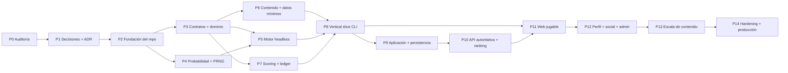

# Plan de implementación

## 1. Objetivo

Ordenar la construcción del simulador por dependencias, reducir riesgo y mantener el motor independiente de interfaz, HTTP y persistencia.

La autorización de implementación se concede por gate. G1 y G2 están
completados. G3A y los diez bloques estructurales de G3B están documentados;
esto habilita schemas estructurales conformes, pero no gameplay, scoring real
ni producto hasta el cierre matemático.

## 2. Reglas de ejecución

- `MASTER_SPEC.docx` continúa siendo la fuente principal.
- Una ambigüedad de gameplay se resuelve en `DECISIONS_REQUIRED.md`, no con código temporal.
- No se inventan reglas de gameplay para completar vacíos de la especificación.
- Primero se valida el núcleo headless; la UI consume un sistema ya reproducible.
- El motor no depende de React, Next.js, HTTP ni base de datos.
- Cada fase termina con artefactos ejecutables o verificables y checks verdes.
- No se amplía contenido antes de validar arquitectura, determinismo y distribución.
- No se implementan cooldowns, cupos, máximos de eventos, protección de rareza ni topes estadísticos editoriales.
- El motor queda sin cooldowns y sin restricciones artificiales de ocurrencia.
- Los límites físicos/lógicos y los topes de puntuación expresamente documentados se mantienen separados.
- Un cambio de fórmula, datos, contenido o scoring crea la versión correspondiente.

## 3. Camino crítico



El orden no obliga a que todo sea estrictamente secuencial. Datos, derechos, contenido y UX pueden prepararse en paralelo una vez congelados sus schemas, pero no deben bloquear ni contaminar el núcleo.

## 4. Gates previos

### Gate G0 — Auditoría completa

**Entregables**

- `ARCHITECTURE.md`;
- `DOMAIN_MODEL.md`;
- `DECISIONS_REQUIRED.md`;
- `IMPLEMENTATION_PLAN.md`.

**Criterio de salida**

- módulos, dependencias y límites identificados;
- contradicciones registradas;
- motor aislado por diseño;
- plan sin código de producto.

### Gate G1 — Definition of Ready del núcleo

Decisiones ya cerradas:

- precisión y fórmula de probabilidad;
- semántica de oportunidad válida;
- algoritmo de muestreo;
- PRNG y streams;
- canonicalización y hashes;
- cursor, interrupción y ciclo de vida de Career;
- taxonomía base de posiciones;
- posición efectiva, reconversión conceptual y cohortes;
- taxonomía de versiones;
- contrato inicial del DSL;
- causalidad Q1–Q4 y ventanas de oportunidades;
- equivalencia mecánica del contenido sensible;
- rango del Coeficiente de Contribución;
- descubrimientos, abandono e invalidación;
- alcance del vertical slice;
- principio de Creation Budget;
- dificultad informativa y separación de automatización;
- taxonomía de pie dominante.

Antes de escribir lógica de simulación todavía deben publicarse:

- valores iniciales y hashes de `EngineParameterSet` por subsistema;
- `ScoringConfiguration` y `ScoringCalibrationData` iniciales;
- Definitions/catalogs/datasets del slice con provenance;
- expected golden outputs y aceptación SMOKE/CALIBRATION/DEEP;
- schemas coherentes con las familias G3C ya cerradas.

Antes del vertical slice completo también deben cerrarse calendario/mundo
agregado, parámetros de Creation Budget, conteo editorial, alcance de
reconversiones, posición dominante, continuidad competitiva, inscripción y
cadencia mid-season (DR-021, DR-022, DR-045, DR-047 a DR-049 y DR-065 a
DR-067).

El toolchain y los contratos técnicos que no dependen de decisiones de gameplay
pueden avanzar. Pueden diseñarse los schemas estructurales enumerados en el
Closure Report; no se congelan dominios cuantitativos, fórmulas o payloads
afectados por DR pendientes.

## 5. Fases

### P0 — Auditoría de especificación

**Estado:** completada.

**Trabajo**

- leer el documento completo;
- identificar reglas normativas y precedencias;
- separar decisiones cerradas de pendientes;
- definir arquitectura y modelo de dominio;
- ordenar dependencias.

**Salida**

Los cuatro documentos técnicos iniciales.

### P1 — Decisiones y especificaciones vivas

**Dependencia:** P0.

**Estado:** en curso. G3A/G3B y G3C Mathematical Closure están completados;
parámetros iniciales, data, expected goldens y calibración integrada siguen
pendientes.

**Trabajo**

- resolver decisiones bloqueantes;
- mantener ADR de PRNG, números/hashes, eventos, versionado, lifecycle, pipeline y replay;
- redactar especificación matemática ejecutable;
- redactar contrato de scoring;
- completar especificaciones numéricas de creación, posiciones y scoring;
- elegir el contenido/data scope del vertical slice;
- iniciar política de datos, fuentes, derechos y sensibilidad.

**Checks documentales**

- cada regla tiene fuente o decisión;
- ninguna probabilidad positiva se serializa como cero;
- ningún campo de cooldown/cupo queda en el contrato normativo;
- ejemplos y fórmulas no se contradicen;
- todos los ADR enlazan decisiones.

**Criterio de salida**

DR-008/DR-010 publicadas con parámetros/data, expected fixtures, versiones y
aceptación integrada; contratos listos para gameplay.

### P2 — Fundación del repositorio

**Dependencia:** P0; puede comenzar en paralelo con el cierre final de P1 si no congela decisiones.

**Estado:** completada en G1 — Foundation Executable.

**Trabajo realizado**

- inicializar monorepo y lockfile;
- configurar TypeScript estricto;
- configurar lint, format, typecheck y test runner;
- crear packages y apps vacíos con límites de dependencias;
- configurar CI;
- documentar comandos;
- preparar entorno local reproducible.

**No incluye**

- gameplay;
- UI de producto;
- endpoints;
- tablas de negocio.

**Criterio de salida**

Repositorio vacío funcional, build y checks verdes.

### P3 — Contratos y dominio puro

**Dependencias:** P1 y P2.

**Estado:** contratos estructurales de G1/G2 implementados. Lifecycle, RootSeed y SimulationCursor están ejecutables; agregados y gameplay continúan pendientes.

**Trabajo**

- definir tipos de dominio y value objects;
- implementar `VersionSet`;
- modelar Career, Player, WorldState, SeasonState y estados;
- modelar comandos, eventos y errores tipados;
- definir DTO y schemas versionados;
- crear mappers de DTO a dominio;
- representar checkpoints, decisiones y resultados sin IO.

**Pruebas**

- constructores e invariantes;
- transiciones válidas/ inválidas;
- compatibilidad de schemas;
- fixtures aceptados y rechazados;
- ausencia de importaciones de UI/HTTP/DB.

**Criterio de salida**

Un estado de carrera puede validarse, construirse, serializarse canónicamente y restaurarse sin simular.

### P4 — Probabilidad, PRNG y determinismo

**Dependencias:** decisiones DR-002 a DR-007 y P2.

**Estado:** núcleo determinista de G2 completado. Las distribuciones específicas que requieran semántica de gameplay permanecen fuera de alcance.

**Trabajo**

- implementar PRNG elegido;
- derivar streams contextuales;
- implementar probabilidad/log-probabilidad;
- implementar distribuciones y colas abiertas;
- agregar trazas de multiplicadores;
- publicar vectores de prueba;
- implementar canonicalización y hash.

**Pruebas**

- mismos vectores en Node y navegador compatible;
- independencia entre streams;
- valores de frontera, incluido `< 10^-12`;
- ninguna salida NaN, negativa o mayor que 1;
- pruebas de propiedad y distribución;
- repetición exacta de hashes.

**Criterio de salida**

Una suite headless demuestra determinismo y muestreo extremo sin gameplay.

### P5 — Motor mínimo de temporada

**Dependencias:** P3 y P4; DR-012, DR-042 a DR-044 y DR-052 están cerradas;
falta cerrar DR-008, DR-021/022 y DR-053 a DR-069 en el alcance afectado.

**Estado:** solamente infraestructura estructural de G2 completada. El runner recorre el pipeline vacío, interrumpe, reanuda y replaya; no produce hechos ni estadísticas deportivas.

**Trabajo**

- implementar el pipeline normativo Q1–Q4 y sus ventanas causales;
- crear `SeasonContext`;
- soportar cursor y suspensión por decisión;
- generar estado nuevo y eventos de dominio;
- cerrar `SeasonResult`;
- mantener cadencia fuera de la lógica anual;
- registrar traza de replay.

**Alcance inicial**

Un jugador, un contexto de club, una temporada y estadísticas agregadas mínimas con fixtures aprobados. No UI, DB ni HTTP.

**Pruebas**

- igualdad por seed/decisiones/versiones;
- cambio de cadencia sin cambio de resultados;
- reanudación sin repetir sorteos;
- invariantes físicas;
- orden normativo;
- lesión intermedia sin reescritura retroactiva;
- facts inaccesibles antes de su ventana.

**Criterio de salida**

Una temporada completa se ejecuta desde memoria y puede reproducirse.

### P6 — Contenido y datos mínimos

**Dependencias:** P3; DR-004, DR-012, DR-014, DR-015, DR-018 y DR-043 cerradas; matemática de DR-022, DR-047, DR-065 y decisiones de datos aplicables pendientes.

**Trabajo**

- implementar DSL declarativo y compilador;
- crear loader de releases inmutables;
- validar referencias y efectos;
- implementar catálogos de datos futbolísticos;
- crear snapshot mínimo del vertical slice;
- separar textos localizados de lógica;
- separar `domainEvent` de `narrativePresentation`;
- validar `OpportunityWindow` y disponibilidad de facts;
- registrar fuentes y política de assets.

**Pruebas**

- schema y referencias;
- contenido desconocido rechazado de forma segura;
- orden de evaluación estable;
- imposibilidad lógica diferenciada de probabilidad residual;
- ausencia de cooldown, `maxPerCareer` o cuotas;
- hash estable de releases;
- equivalencia mecánica entre variantes sensibles;
- inventario conforme al contrato de conteo aprobado.

**Criterio de salida**

El motor consume catálogos en memoria sin conocer filesystem o DB.

### P7 — Scoring y ScoreLedger

**Dependencias:** P3, P5, DR-010, DR-049, DR-066/067 y DR-069 con
`scoringVersion` aprobada. DR-009 ya fija el rango de `CC`; DR-063 y
[ADR-010](adr/010-scoring-ledger-and-domain-facts.md) ya fijan estructura,
catálogo y allowlist.

**Trabajo**

- implementar cálculo puro;
- generar entradas append-only;
- aplicar anti-duplicación;
- aplicar redondeos y topes de puntos documentados;
- implementar reversals;
- encadenar hashes;
- generar desglose.

**Pruebas**

- reconstrucción exacta;
- idempotencia;
- no duplicación;
- equidad posicional;
- ejemplos normativos;
- un evento ocurre igual aunque su bonificación ya alcanzara un tope;
- accidentes/catástrofes no puntúan por ocurrir.

**Criterio de salida**

El total se deriva exclusivamente del ledger y coincide con fixtures aprobados.

### P8 — Vertical slice headless

**Dependencias:** P5, P6 y P7; DR-008, DR-010, DR-021, DR-022, DR-045,
DR-047 a DR-049, DR-053 a DR-069 y decisiones de datos aplicables cerradas.

**Alcance controlado**

- Argentina y España;
- `GK`, `CM` y `ST`;
- solo Carrera rápida;
- clubes/competiciones/pools exactos según DR-022/025/065 y el snapshot aprobado;
- 30 eventos según el contrato de conteo aprobado;
- 5 cadenas;
- 6 lesiones;
- contratos y al menos una transferencia posible;
- títulos/premios mínimos y retiro;
- carrera completa;
- CLI, replay y Monte Carlo;
- ScoreLedger y ranking interno de prueba.

**No ampliar todavía**

- 80/120/180 eventos;
- catálogo mundial;
- admin completo;
- ranking público;
- todas las plantillas sociales.

**Pruebas**

- golden seeds por posición;
- property tests;
- al menos 10.000 carreras para el informe previo a expansión;
- equivalencia de cuatro cadencias;
- eventos extremos no bloqueados;
- ausencia de estrategia dominante según criterio aprobado;
- carrera completa sin bloqueo narrativo;
- cobertura de Q1–Q4 y de las ocho ventanas de oportunidades;
- posición dominante y premios ante los cambios permitidos por el alcance aprobado.

**Criterio de salida**

El núcleo demuestra ciclo completo, determinismo, trazabilidad y distribución antes de infraestructura de producto.

### P9 — Capa de aplicación y persistencia

**Dependencias:** P8; decisiones de persistencia cerradas.

**Trabajo**

- casos de uso;
- repositorios como puertos;
- PostgreSQL y migraciones;
- snapshots, decisions, SeasonResult, domain events y ledger;
- revisión optimista;
- idempotencia;
- proyecciones de lectura;
- adaptador local separado.

**Pruebas**

- integración con DB efímera;
- transacciones y rollback;
- conflictos de revisión;
- reintentos idempotentes;
- guardado/restauración exacta;
- migraciones forward-safe;
- backup/restore de prueba.

**Criterio de salida**

Una carrera persistida puede cerrarse, restaurarse y replayarse sin corrupción.

### P10 — API autoritativa y ranking

**Dependencias:** P9; DR-030 a DR-037 cerradas.

**Trabajo**

- autenticación y autorización;
- endpoints mínimos;
- creación oficial;
- avance y decisiones;
- checkpoints;
- replay/verificación;
- finalización;
- ranking materializado;
- public views sanitizadas;
- antitrampa y auditoría.

**Pruebas**

- inputs hostiles;
- propiedad por usuario;
- secuencias fuera de orden;
- score manipulado rechazado;
- versión incompatible rechazada;
- replay de scores extremos;
- revocación de ranking sin borrar carrera;
- load tests iniciales.

**Criterio de salida**

El servidor es la única autoridad de una entrada oficial.

### P11 — Web jugable

**Dependencias:** P8 para modo local y P10 para modo oficial.

**Trabajo**

- creación rápida;
- creación personalizada solo después de cerrar DR-045 y validar equivalencia Monte Carlo;
- configuración;
- carrera y decisión;
- resumen de período;
- estadísticas, palmarés e historial;
- retiro;
- estados loading/error/offline/conflict/pending;
- accesibilidad y mobile-first;
- snapshot local.

**Pruebas**

- E2E del ciclo crítico;
- teclado y lector de pantalla;
- 320 px;
- reduced motion;
- conflicto y reconexión;
- UI no recalcula puntos ni resultados.

**Criterio de salida**

Una persona completa una carrera con los mismos resultados que CLI/API.

### P12 — Perfil, colección, compartido y admin

**Dependencias:** P10 y P11.

**Trabajo**

- perfil y descubrimientos;
- mejor carrera y favorita;
- colección;
- `ShareCardModel`;
- preview y renderer;
- ranking snapshot;
- publicación de contenido/datos desde admin;
- auditoría y rollback mediante release nueva.

**Pruebas**

- abandono no modifica récords indebidos;
- IDs privados ausentes;
- datos de share coinciden con snapshot;
- generación determinística;
- segunda lámina cuando corresponde;
- admin no evita validación.
- descubrimientos idempotentes conservados al abandonar y reproyectados al invalidar.

**Criterio de salida**

Meta, social y operación editorial funcionan sin duplicar lógica.

### P13 — Escala de contenido y datos

**Dependencias:** P8 validado y pipeline de P12.

**Trabajo**

- ampliar posiciones, ligas, clubes, premios, eventos y cadenas;
- importar snapshots;
- localizar contenido;
- ejecutar Monte Carlo por release;
- revisar fuentes, derechos y sensibilidad;
- publicar notas de versión.

**Regla**

Cada ampliación pasa schemas, referencias, golden/property tests y simulación masiva. No se corrige una cola solo por ser extrema.

### P14 — Hardening y producción

**Dependencias:** fases anteriores y decisiones de publicación.

**Trabajo**

- seguridad;
- observabilidad y alertas;
- SLO;
- rate limits;
- accesibilidad completa;
- carga;
- backups y restauración;
- runbooks;
- staging;
- despliegue y rollback.

**Criterio de salida**

Definition of Done de la sección 57 verificada con evidencia.

## 6. Dependencias por módulo

| Módulo | Requiere antes | Desbloquea |
|---|---|---|
| `domain` | Estados, posiciones, ventanas, descubrimientos y versiones decididos | Engine, scoring, application |
| `probability` | Fórmula, precisión, PRNG y canonicalización | Engine, Monte Carlo |
| `schemas` | Taxonomía de dominio/versiones | Contenido, API, DB, admin |
| `content` | DSL, ventanas causales, facts y separación mecánica/narrativa | Eventos del engine, admin |
| `data-football` | Scope, IDs, fuentes y snapshot | Clubes, competiciones, scoring |
| `engine` | Domain + probability + catálogos | CLI, API, web local |
| `scoring` | Fórmulas + domain | Ledger, ranking, share |
| `application` | Engine estable | API, worker, DB |
| `db` | Schemas + application ports | Persistencia oficial |
| `api` | Application + DB + auth | Web oficial, ranking |
| `web` | Engine local o API | Experiencia del jugador |
| `worker` | Application + jobs definidos | Replay, Monte Carlo, share |
| `admin` | Schemas + releases + auth | Escala editorial |

## 7. Estrategia de pruebas desde el inicio

| Tipo | Se introduce en | Objetivo |
|---|---|---|
| Unit | P3 | Value objects, invariantes y fórmulas |
| Property-based | P4 | Determinismo, rangos, colas y ausencia de NaN |
| Vectores de PRNG | P4 | Compatibilidad multiplataforma |
| Golden/replay | P5 | Resultado exacto por versión, Q y ventana |
| Content/data validation | P6 | Schemas y referencias |
| Monte Carlo | P8 | Distribuciones y rarezas |
| Integration | P9 | DB, transacciones e idempotencia |
| Security/contract | P10 | Inputs, auth y autoridad |
| E2E/accessibility | P11 | Flujo de usuario |
| Load/operational | P14 | SLO, ranking, replay y share |

## 8. Criterios para no avanzar

Una fase no se considera cerrada si:

- hay una regla de gameplay inventada para completar un hueco;
- una probabilidad positiva se redondea a cero;
- la misma entrada produce otro resultado;
- cambiar cadencia cambia estado o score;
- existe un cooldown, cuota o máximo de ocurrencia artificial;
- el total no se reconstruye desde ScoreLedger;
- el engine importa UI, HTTP o DB;
- un catálogo cambia sin nueva versión/hash;
- un cliente puede enviar score o stats oficiales;
- los checks de la fase no se ejecutaron o fallan.

## 9. Estado al cerrar G2

G1 completó P2. G2 completó el núcleo técnico de P4 y la porción puramente estructural de P3/P5:

1. RootSeed, PRNG, streams, probabilidad, canonicalización y hashes;
2. lifecycle, cursor, advance, interrupción y reanudación;
3. replay estructural, checkpoints, golden vectors y properties;
4. enforcement de dependencias sin acoplar engine con scoring, HTTP, DB o UI.

Antes de implementar gameplay todavía corresponde:

1. cerrar DR-008 y DR-010 con especificaciones matemática y de scoring versionadas;
2. resolver DR-053 a DR-069 y las dependencias matemáticas identificadas por
   G3A; DR-052 ya está resuelta;
3. cerrar DR-021, DR-022, DR-045, DR-047 a DR-049 y DR-065 a DR-067 para el vertical slice;
4. resolver DR-046 antes de cualquier automatización competitiva;
5. fijar catálogos, fuentes y contrato de conteo del slice;
6. recibir autorización explícita para G3B.

G2 no habilita React, endpoints de gameplay, tablas de negocio, carga de contenido ni fórmulas deportivas.

## 10. Estado al cerrar G3A

G3A produce [`MATHEMATICAL_ENGINE_SPEC.md`](MATHEMATICAL_ENGINE_SPEC.md) sin modificar código. El documento:

1. separa capacidad, calidad efectiva, rendimiento y percepción;
2. cataloga variables persistentes, dinámicas, observables y latentes;
3. define el proceso causal Q1–Q4 y el estado transferido entre ventanas;
4. delimita producción mínima para `GK`, `CM` y `ST`;
5. diseña conceptualmente desarrollo, forma, salud, mercado, selección, premios, mundo, reputación y retiro;
6. define el grafo causal para evitar sorteos independientes y feedback loops accidentales;
7. enumera hechos por Q/temporada y los contratos `SC-01` a `SC-13`;
8. registra DR-052 a DR-067 y refina DR-008, DR-010 y DR-022;
9. separa decisiones `BLOCKER_G3`, `BALANCE_LATER` y `CONTENT_LATER`.

### Gate previo a G3B

No comenzar gameplay hasta:

- aprobar la especificación conceptual;
- mantener DR-052 cerrada y resolver DR-053 a DR-069;
- integrar ecuaciones, distribuciones, correlaciones, parámetros iniciales, precisión y streams en DR-008;
- publicar fórmulas, anti-duplicación, fixtures y `scoringVersion` para DR-010;
- cerrar DR-021/022/065/066/067, DR-048/049 y la parte de DR-027 necesaria para el slice;
- aprobar targets y tolerancias Monte Carlo;
- recibir autorización explícita para G3B.

El estado de G3A es **documentación completa, decisiones matemáticas pendientes**. No se implementó gameplay y no se avanza automáticamente a G3B.

## 11. Estado de G3B — Bloque 1: Fundamental Player Model

**Estado:** especificación estructural completada el 2026-07-27; gameplay no
autorizado.

Entregables:

- [`PLAYER_MODEL_SPEC.md`](PLAYER_MODEL_SPEC.md) como especificación normativa
  compacta;
- [ADR-052](adr/052-fundamental-player-model.md);
- resolución de G3B-A01 a G3B-A05 y de las estructuras de G3B-N01/N05;
- cierres parciales explícitos de G3B-A06, B03, B04, C02, D01, E01 y
  N02–N04;
- Parameter Registry ampliado sin valores hardcoded.

Contratos cerrados:

1. veinte capabilities comunes con escala entera canónica `0..10000`;
2. diez traits iniciales con la misma escala y observabilidad independiente;
3. separación `CAPABILITIES`/`TRAITS`/`DYNAMIC_STATES`;
4. ausencia de overall y potential overall causales;
5. separación `TruePlayerState`/`PlayerKnowledge`;
6. potencial emergente y pico observado;
7. generación inicial correlacionada con arquetipos blandos;
8. Creation Budget como poder esperado, no suma nominal.

Siguen bloqueadas por sus propios bloques las fórmulas de desarrollo, capacidad
efectiva, rendimiento, dinámica temporal, salud y Creation Budget cuantitativo
(DR-045, DR-053, DR-055, DR-056 y DR-057). Sus parámetros se consumirán desde
configuración versionada y no se fijaron en esta fase.

No se modificaron packages, no se implementó gameplay y no se avanza
automáticamente al siguiente bloque.

## 12. Estado de G3B — Bloque 2: Development & Aging

**Estado:** especificación estructural completada el 2026-07-27; fórmulas,
distribuciones, calibración y gameplay no autorizados.

Entregables:

- [`DEVELOPMENT_AGING_SPEC.md`](DEVELOPMENT_AGING_SPEC.md) como especificación
  normativa compacta;
- [ADR-053](adr/053-development-and-aging-model.md), aceptado solo para la
  estructura; DR-053 continúa parcialmente abierta;
- resolución de G3B-B01;
- cierres estructurales parciales de G3B-A06, B02–B06, C05, E01, E07 y F01;
- catálogo ampliado de Parameter Registry sin valores hardcoded.

Contratos cerrados:

1. desarrollo y declive actúan sobre capabilities individuales;
2. se evalúan en Q1–Q4 y se aplican atómicamente una vez por ventana;
3. maduración, desarrollo adquirido, wear e innovación estocástica permanecen
   distinguibles;
4. cinco familias seleccionan parámetros sin convertirse en
   macrocapacidades;
5. el perfil de maduración es latente, blando y no contiene una `peakAge`
   garantizada;
6. no existen potential ceilings ni delta de overall;
7. edad y traits modifican distribuciones, no determinan signos;
8. minutos/experiencia siguen una relación no lineal externalizada;
9. lesiones solo llegan a consecuencias permanentes mediante recuperación y
   posible secuela confirmada;
10. declive no es absorbente y los picos son retrospectivos;
11. Development no ajusta capacidades para forzar reconversiones.

Siguen bloqueando la implementación de Development & Aging:

- forma funcional y combinación de componentes;
- familias de distribución y covarianza;
- precisión, acumulación y cuantización;
- contexts de streams y golden fixtures;
- parámetros iniciales y targets Monte Carlo;
- interfaces ejecutables de Role & Minutes, Health y Club;
- schemas concretos conformes al catálogo DR-063 ya aprobado.

Estas aperturas pertenecen a DR-053, DR-054, DR-057, DR-022, DR-048, DR-055 y
los schemas posteriores según su alcance; DR-063 quedó cerrada
estructuralmente en el Bloque 10. Ningún parámetro calibrable se convirtió en
una regla hardcoded. No se modificaron packages, no se implementó gameplay y no
se avanza automáticamente al siguiente bloque.

## 13. Estado de G3B — Bloque 3: Role + Minutes

**Estado:** especificación estructural completada el 2026-07-27; funciones,
distribuciones, calibración y gameplay no autorizados.

Entregables:

- [`ROLE_MINUTES_SPEC.md`](ROLE_MINUTES_SPEC.md) como especificación normativa
  compacta;
- [ADR-054](adr/054-role-and-minutes-model.md), aceptado solo para la
  estructura; DR-054 continúa parcialmente abierta;
- resolución de G3B-C01;
- cierres estructurales parciales de G3B-A06, B04, B05, C02–C06, D01, E01 y
  F01–F04;
- confirmación de G3B-C07 como Parameter Registry sin valores hardcoded.

Contratos cerrados:

1. `SquadStatus`, `SportingRole` y `EffectiveUsage` son conceptos distintos;
2. `PROSPECT` puede coexistir con cualquier rol deportivo;
3. Role & Minutes consume `effectivePosition` y no ejecuta reconversiones;
4. `managerTrust`, `tacticalFit`, calidad y rendimiento permanecen separados;
5. `PositionCompetition` representa competencia agregada por posición;
6. `TeamMinutesOpportunity` y el `AvailabilityEnvelope` agregado delimitan el
   máximo físico; Health entrega solo su componente médico;
7. la resolución causal es rol→expectativa/share→`actualMinutes`;
8. roles no crean bandas, thresholds, garantías ni cooldowns;
9. Performance de Qn consume minutos y solo afecta principalmente Qn+1;
10. minutes es la exposición causal; appearances/starts se derivan;
11. uso multiposicional conserva minutos;
12. club y selección tienen oportunidades y facts independientes;
13. outputs conceptuales quedaron reconciliados por DR-063/ADR-010.

Siguen bloqueando la implementación de Role + Minutes:

- familia y parametrización de las distribuciones de rol y share;
- escala, precisión, redondeo, correlaciones y contexts de streams;
- parámetros iniciales, golden fixtures y targets Monte Carlo;
- calendario, `SeasonId`, oportunidad y splits por competición de DR-021/022;
- calidad contextual y resumen de Performance de DR-055;
- dinámica de `managerTrust` de DR-056;
- mapping médico y Health de DR-057;
- owner de disciplina y composición de disponibilidad de DR-064;
- semántica de una eventual promesa contractual de rol/estatus de DR-058;
- schemas concretos conformes a identidad, idempotencia y allowlist ya
  aprobadas por DR-063/ADR-010;
- alcance/dominancia posicional de DR-048/049.

Ningún coeficiente calibrable se convirtió en regla normativa. No se
modificaron packages, no se implementó gameplay y no se avanza automáticamente
al siguiente bloque.

## 14. Estado de G3B — Bloque 4: Performance, Form y producción

**Estado:** especificación estructural completada el 2026-07-28; funciones,
distribuciones, calibración y gameplay no autorizados.

Entregables:

- [`PERFORMANCE_MODEL_SPEC.md`](PERFORMANCE_MODEL_SPEC.md) como especificación
  normativa compacta;
- [ADR-055](adr/055-performance-and-production-model.md), aceptado solo para la
  estructura; DR-055 continúa parcialmente abierta;
- resolución estructural de G3B-A06 y G3B-D01;
- cierres estructurales parciales de G3B-D02 a G3B-D09;
- confirmación de G3B-D10 como Parameter Registry sin valores hardcoded;
- interfaces refinadas hacia Development, Role & Minutes, Health, Club,
  Market, Selection, Awards, Reputation y Scoring.

Contratos cerrados:

1. el pipeline es `TrueCapabilities → EffectiveCapabilities →
   UnderlyingPerformance → ObservedProduction → PerformanceSummary`;
2. EffectiveCapabilities usa una proyección contextual única, efímera y pura;
3. UnderlyingPerformance es multidimensional y ningún rating es causal;
4. `actualMinutes` es exposición confirmada y Performance no la recalcula;
5. sparse exposure conserva raw production y separa evidencia/incertidumbre;
6. los conteos son discretos, correlacionados y no surgen de redondear
   expectativas;
7. `consistency` afecta principalmente dispersión/volatilidad;
8. `ST` conserva goles/asistencias y separa oportunidad, chance quality y
   conversión;
9. `CM` conserva goles/asistencias y evidencia de progresión, creación, defensa
   y control;
10. `GK` separa shot stopping/command/distribution del contexto defensivo y
    conserva atajadas, goles concedidos y vallas invictas;
11. raw production no se reescribe por competencia/contexto;
12. presión se conserva como evidencia, no como bonus editorial;
13. Dynamic States tienen ownership separado y se actualizan después de Q;
14. `SeasonPerformanceSummary` deriva de Q1–Q4 sin nuevo sorteo;
15. no existen caps editoriales ni records forzados.

Siguen bloqueando la implementación de Performance:

- forma funcional y dominio de EffectiveCapabilities;
- escalas/precisión de UnderlyingPerformance y summaries;
- familias discretas, sobredispersión, conversiones y correlaciones;
- parámetros de `GK`, `CM` y `ST`;
- dinámica ejecutable de form/confidence/managerTrust/morale en DR-056;
- fitness/fatigue, carga y Health de DR-057;
- calendario y `PerformanceContext` de DR-021/022;
- schemas concretos conformes a identidad, idempotencia, aliases y allowlist ya
  aprobadas por DR-063/ADR-010;
- parámetros iniciales, contexts de streams, golden fixtures y targets Monte
  Carlo;
- fórmulas de consumidores posteriores en DR-058 a DR-061 y DR-010.

G3B-A06 queda cerrado estructuralmente. DR-055/056 continúan parcialmente
abiertas y DR-008/010 no se cierran. No se modificaron packages, no se
implementó gameplay y no se avanza automáticamente al siguiente bloque.

## 15. Estado de G3B — Bloque 5: Health, Injuries & Recovery

**Estado:** especificación estructural completada el 2026-07-28; hazards,
distribuciones, calibración, catálogo y gameplay no autorizados.

Entregables:

- [`HEALTH_INJURY_SPEC.md`](HEALTH_INJURY_SPEC.md) como especificación normativa
  compacta;
- [ADR-057](adr/057-health-injury-recovery-model.md), aceptado solo para la
  estructura; DR-057 continúa parcialmente abierta;
- resolución estructural de G3B-E01;
- cierres estructurales parciales de G3B-E02, E03 y E05–E07;
- confirmación de G3B-E04/E08 como Parameter Registry sin valores hardcoded;
- interfaces refinadas hacia Development, Role & Minutes, Performance,
  Club/Competitions, Market/Selection, Retirement y facts;
- DR-064 registrada para disciplina y disponibilidad no médica.

Contratos cerrados:

1. Health separa fitness, fatigue, carga, condiciones, episodios, recuperación,
   secuelas e historia;
2. `injuryFragility`, `recoveryCapacity`, `longevity` y `medicalQuality` no son
   aliases;
3. Health produce `MedicalAvailabilityEnvelope` parcial y no asigna minutos;
4. disciplina/otras causas se agregan fuera de Health;
5. exposición incluye competición, training/background, non-football y eventos
   externos;
6. el hazard es contextual por oportunidad y no usa thresholds;
7. no existen caps, cuotas, cooldowns ni máximo editorial de condiciones;
8. `InjuryOccurred` se separa de `InjuryEpisode`;
9. familia, severidad y origen son dimensiones independientes;
10. se admiten condiciones concurrentes compatibles;
11. recuperación esperada y realizada son distintas y existe retorno limitado;
12. recaída/agravamiento conserva vínculo causal;
13. `SequelaProfile` puede ser `NONE`, `TEMPORARY` o `PERSISTENT`;
14. Health no muta capabilities; Development conserva ownership;
15. lesión de `HEALTH(Qn)` afecta Qn+1 y no reescribe Qn;
16. causas externas no se duplican en el hazard deportivo;
17. el pipeline de 38 operaciones no cambia.

Siguen bloqueando la implementación de Health:

- forma funcional hazard→probabilidad y proceso exacto de oportunidades;
- familias/distribuciones de severidad, duración, recuperación, recaída y
  secuela;
- dominios/transiciones, precisión y cuantización de fitness/fatigue/carga;
- orden canónico, correlaciones y contexts de streams;
- parámetros iniciales, seis lesiones del slice, golden fixtures y targets
  Monte Carlo;
- calendario, exposición y `medicalQuality` de DR-021/022;
- composición de disponibilidad y disciplina de DR-054/064;
- mapping de secuelas/desgaste de DR-053;
- schemas concretos conformes a identidad, idempotencia y clasificación ya
  aprobadas por DR-063/ADR-010;
- interfaz posterior de retiro en DR-062.

DR-042 queda confirmado, no reabierto. DR-057 sigue `BLOCKER_G3` por su
matemática ejecutable y DR-008 no se cierra. No se modificaron packages, no se
implementó gameplay y no se avanza automáticamente al siguiente bloque.

## 16. Estado de G3B — Bloque 6: Club, Competitions & World

**Estado:** especificación estructural completada el 2026-07-28; fórmulas,
distribuciones, calendarios, scope de datos, calibración y gameplay no
autorizados.

Entregables:

- [`CLUB_COMPETITION_WORLD_SPEC.md`](CLUB_COMPETITION_WORLD_SPEC.md) como
  especificación normativa compacta;
- [ADR-022](adr/022-club-competition-world-model.md), aceptado solo para la
  estructura; DR-022 continúa parcialmente abierta;
- resoluciones estructurales de G3B-F01, F02, F04 y J01;
- cierres parciales de G3B-F03, F05, F06 y J02–J04;
- confirmación de F08/J05 como configuración versionada;
- DR-065 registrada para scope competitivo, pools y continuidad tras movilidad.

Contratos cerrados:

1. Definitions reales de club/liga/competición son inmutables por
   `dataVersion`;
2. `ClubState`, `LeagueState`, `CompetitionState` y `WorldState` contienen solo
   futuro ficticio de la Career;
3. Club separa attack/defensive/control strength, prestigio, finanzas,
   desarrollo, medicina, estabilidad, manager y competencia;
4. no existe `ClubOverall` causal;
5. `ManagerContext`/`TacticalIdentity` tienen vigencia causal y TacticalFit es
   derivado;
6. Club posee `PositionCompetition`; Competitions/Calendar posee
   `TeamMinutesOpportunity`;
7. calendario/contexto es agregado por Q, sin partidos ni falsa precisión
   diaria;
8. Competition Definition/State y tipos mínimos quedan separados;
9. `TeamSupportField` excluye `PlayerCompetitiveContribution`;
10. outcomes son separados por competición y correlacionados;
11. `leagueCompetitiveStrength` dinámico no reescribe IJL;
12. world shocks siguen jerarquía global→regional→league→club→idiosincrático;
13. updates afectan solo futuro;
14. no hay protección artificial de clubes;
15. promotion/relegation es representable y no fuerza transferencia;
16. el slice requiere dos ligas, 6–10 clubes detallados por liga, dos copas,
    Libertadores, Champions y contratos de selección, sujeto a datos.

Siguen bloqueando Club/Competitions/World:

- dominios, escalas, precisión y cuantización;
- calendarios, SeasonId, formatos, fases, cupos y qualification de DR-021;
- funciones y distribuciones de fuerza, support, contribución, outcomes,
  movilidad, ciclos y world update;
- correlaciones, streams, parámetros, golden fixtures y targets Monte Carlo;
- catálogo real, fuentes, corte y licencias de DR-025;
- pool externo, participantes, promotion/relegation y continuidad de DR-065;
- schemas concretos conformes a facts e idempotencia ya aprobados por
  DR-063/ADR-010;
- interfaces matemáticas posteriores de Market, Selection, Awards y Scoring.

El siguiente paso no es implementación: diseño debe cerrar DR-008/021/022/025
y DR-065, concretar schemas conformes a DR-063 y aprobar parámetros/fixtures
del alcance aplicable. No se modificaron packages, no se implementó gameplay y
no se avanza automáticamente al siguiente bloque.

## 17. Estado de G3B — Bloque 7: Transfers, Market & Contracts

**Estado:** especificación estructural completada el 2026-07-28; fórmulas,
distribuciones, calendario de mercado, elegibilidad, calibración y gameplay no
autorizados.

Entregables:

- [`TRANSFER_MARKET_CONTRACT_SPEC.md`](TRANSFER_MARKET_CONTRACT_SPEC.md) como
  especificación normativa compacta;
- [ADR-058](adr/058-transfer-market-contract-model.md), aceptado solo para la
  estructura; DR-058 continúa parcialmente abierta;
- resoluciones estructurales de G3B-G05 y G06;
- cierres parciales de G3B-G01–G04 y G07;
- confirmación de G08 como configuración versionada;
- DR-066 registrada para `RegistrationEligibility`;
- DR-067 registrada para cadencia/cursor de movimientos entre Qs.

Contratos cerrados:

1. pipeline
   `MarketPerception → ClubNeed → TransferInterest → TransferOffer →
   SellerResponse → ContractProposal → TransferNegotiation → PlayerDecision →
   TransferOutcome → ContractState`;
2. Market usa percepción/evidencia por observador, no estado verdadero;
3. Club/World posee need, escasez, finanzas y ciclos;
4. interés deportivo y viabilidad financiera son rutas diferentes;
5. MarketValue, TransferFee y Salary son conceptos separados;
6. Money usa unidades menores enteras exactas y `currencyCode`;
7. no existe moneda/conversión global implícita;
8. `Contract` es entidad identificada con período, salary, cláusulas, status y
   links de renovación;
9. `ContractExpectation = DEVELOPMENT | SQUAD | IMPORTANT | MARQUEE` no es
   role/usage y no asigna minutos;
10. acuerdos de clubes y jugador son estados independientes;
11. ofertas/decisiones quedan congeladas y se reanudan sin resorteo;
12. se soportan permanent transfer, loan y free transfer;
13. préstamo separa club contractual/deportivo;
14. movimientos y contratos se aplican atómica/idempotentemente;
15. temporada multiclub conserva splits sin reatribución/duplicación;
16. afiliación y elegibilidad son estados distintos;
17. Transfers no crea ScoreLedger ni score financiero.

Siguen bloqueando Transfers/Market/Contracts:

- funciones/distribuciones/correlaciones de percepción, valuation, need/fit,
  interés, oferta, viabilidad, fee, salary, renewal, negociación y preferencias;
- precisión, cuantización, streams, parámetros, golden fixtures y targets Monte
  Carlo;
- calendario, `SeasonId`, time points y `MarketWindowContext` de DR-021;
- moneda de referencia, fuente, conversión, calibración y presentación de
  DR-027;
- schemas concretos conformes a facts, identidad, idempotencia y allowlist ya
  aprobados por DR-063/ADR-010;
- scope/continuidad fuera del tier de DR-065;
- `RegistrationEligibility` de DR-066;
- punto exacto del cursor mid-season de DR-067;
- alcance/dominancia posicional de DR-048/049 para consumidores posteriores.

El siguiente paso no es implementación: diseño debe cerrar DR-008/021/027/058
y DR-065/066/067, concretar schemas conformes a DR-063 y aprobar
parámetros/fixtures del alcance aplicable. No se modificaron packages, no se
implementó gameplay y no se avanza automáticamente al siguiente bloque.

## 18. Estado de G3B — Bloque 8: National Team & Awards

**Estado:** especificación estructural completada el 2026-07-28; matemática,
calendario internacional, nacionalidad deportiva, catálogo, calibración y
gameplay no autorizados.

Entregables:

- [`NATIONAL_TEAM_AWARDS_SPEC.md`](NATIONAL_TEAM_AWARDS_SPEC.md) como
  especificación normativa compacta;
- [ADR-059](adr/059-national-team-model.md), aceptado solo para la estructura;
  DR-059 continúa parcialmente abierta;
- [ADR-060](adr/060-awards-model.md), aceptado solo para la estructura; DR-060
  continúa parcialmente abierta;
- resolución estructural de G3B-I01;
- cierres parciales de G3B-H01–H04 y G3B-I02–I04;
- confirmación de G3B-H05/I05 como configuración/calibración/contenido
  versionados;
- DR-068 registrada para nacionalidad deportiva y eligibility internacional
  del vertical slice.

Contratos cerrados:

1. National Team posee Definition, State, Context, historia, fields y support
   propios; no reutiliza estado de club;
2. eligibility lógica precede Candidate Evaluation y no es probabilidad;
3. `SelectionCompetitionField` compara por selección/país, posición, contexto y
   generación sin roster mundial ni threshold;
4. convocatoria, squad, `InternationalRole`, minutos, Performance y TeamOutcome
   son etapas distintas;
5. rol/minutos/Performance reutilizan resolvers comunes bajo contexto nacional
   y facts separados de club;
6. Health conserva ownership médico y una convocatoria puede terminar sin
   minutos;
7. incumbency/selection trust no garantiza convocatorias;
8. el support field excluye al protagonista y este no garantiza títulos;
9. `AwardDefinition` se separa de edición/resultado;
10. category y evaluation family son ejes distintos;
11. premios comparativos usan `AwardCompetitionField`; estadísticos,
    `StatisticalCompetitionField`;
12. eligibility, candidate signal, field y outcome ordinal son etapas distintas;
13. ST, CM y GK requieren evidencia posicional propia;
14. títulos no garantizan premios y judging noise no simula votantes;
15. pueden coexistir múltiples premios;
16. Award, Record y ScoreLedger permanecen separados;
17. `AwardWon` es canónico también para premios estadísticos;
18. `AWARD_EVENTS` ocurre únicamente después de cerrar `AWARDS`;
19. el slice conserva exactamente un premio global, uno juvenil y tres
    posicionales o de competición, sin inventar IDs.

Siguen bloqueando National Team & Awards:

- funciones/distribuciones/correlaciones de fields, candidate signals, call-up,
  squad, role, minute share, contribution, team outcome, award comparison,
  judging, placement y empate;
- dominios, precisión, cuantización, streams, parámetros, golden fixtures y
  targets Monte Carlo;
- calendario/cursor internacional y torneos de DR-021/059;
- nacionalidad deportiva y transiciones de eligibility de DR-068;
- catálogo real y las cinco Definitions del slice de DR-025/060;
- posición histórica dominante de DR-049;
- métricas GK suficientes de DR-055;
- schemas concretos conformes a facts, identidad, idempotencia y allowlist ya
  aprobados por DR-063/ADR-010;
- Reputation/Social y Scoring todavía abiertos en DR-061/010.

El siguiente paso no es implementación: diseño debe cerrar DR-008/010/021/025,
DR-049/055/059–061/068, concretar schemas conformes a DR-063 y aprobar
parámetros/fixtures aplicables. No se
modificaron packages, no se implementó gameplay y no se avanza automáticamente
al siguiente bloque.

## 19. Estado de G3B — Bloque 9: Reputation, Social & Retirement

**Estado:** especificación estructural completada el 2026-07-28; matemática de
Reputation/Social cerrada en G3C-9 y Retirement/Finalization en G3C-10;
calibración y gameplay no autorizados.

Entregables:

- [`REPUTATION_SOCIAL_RETIREMENT_SPEC.md`](REPUTATION_SOCIAL_RETIREMENT_SPEC.md)
  como especificación normativa compacta;
- [ADR-061](adr/061-reputation-and-social-model.md), refinado por ADR-078;
  DR-061 queda `PARTIAL_CALIBRATION`;
- [ADR-062](adr/062-playing-retirement-and-comeback.md), refinado por ADR-079;
  DR-062 queda `PARTIAL_CALIBRATION`;
- [ADR-079](adr/079-retirement-comeback-finalization-mathematics.md), que
  resuelve DR-069;
- aclaración compatible de [ADR-016](adr/016-career-lifecycle.md);
- resoluciones estructurales de G3B-K03, K04 y L03;
- cierres `PARTIAL_CALIBRATION` de K01/K02/K05/L02/L04 y
  `RESOLVED_MATH` de L01;
- confirmación de K06/L05 como calibración externalizada y K07 diferida;
- DR-069 resuelta para finalización tras retiro y ventana de regreso.

Contratos cerrados:

1. Sporting Reputation, Public Reputation, Public Attention, followers y
   engagement son estados distintos;
2. Public Reputation separa awareness/sentiment; reach es derivado;
3. mercados son data-driven y global es una proyección con procedencia;
4. facts se convierten en signals y se deduplican por `EvidenceKey`;
5. shocks públicos pueden compartir causa sin convertir outputs en aliases;
6. followers es entero exacto, no negativo y no monotónico;
7. Content no escribe followers/reputation por deltas arbitrarios;
8. Social/Reputation no modifica capabilities ni ScoreLedger;
9. `PlayerPlayingStatus` es ortogonal a `CareerStatus`;
10. motivation es assessment derivada y no trait/overall nuevo;
11. retiro no usa edad máxima, threshold, cooldown o cupo;
12. no club/lesión/pocos minutos no fuerzan retiro;
13. se soporta retiro→regreso→retiro mediante episodios causales;
14. comeback no reabre Q ni restaura club/rol/salud;
15. el primer retiro deportivo no completa, congela score o rankea la Career;
16. `CareerStatus.RETIRED` conserva su etapa irreversible de cierre.

Siguen bloqueando implementación de Reputation/Social/Retirement:

- values de `EngineParameterSet.reputationSocial`, data/reach, evidence,
  goldens y targets; las ecuaciones/streams ya están cerradas por ADR-078;
- values de `EngineParameterSet.retirementComeback`, targets y goldens; las
  ecuaciones/streams/cursor ya están cerrados por ADR-079;
- mercados/IDs/fuentes del slice de DR-025/061;
- schemas concretos conformes a facts, aliases e idempotencia ya aprobados por
  DR-063/ADR-010;
- implementación del cursor/finalization boundary ya especificado por DR-069;
- PBR, records/longevity, anti-duplicación y allowlist de DR-010;
- parámetros iniciales, streams, golden fixtures y targets Monte Carlo.

El siguiente paso no es implementación: G3C-11 debe cerrar DR-010/Scoring;
después siguen ParameterSets, calibración, schemas y DR de data/policy
aplicables. No se implementa gameplay automáticamente.

## G3B Structural Closure Report

**Fecha de corte:** 2026-07-28.

**Resultado:** los diez bloques estructurales fueron auditados y tienen
contratos documentales. Esto habilita diseñar schemas estructurales, pero **no
habilita implementar el Mathematical Football Engine ni scoring real**. Quedan
63 decisiones `MUST_BEFORE_G3B` parcialmente resueltas por matemática, scope,
timing o datos.

### Estado consolidado del board

La siguiente clasificación cuenta cada ID una sola vez y reemplaza la suma
acumulativa de las tablas por bloque:

| Estado final | Cantidad | IDs |
|---|---:|---|
| `RESOLVED` | 26 | G3B-A01–A06; B01; C01; D01; E01; F01, F02, F04; G05, G06; I01; J01; K03, K04; L03; M01, M12–M14; N01, N05 |
| `PARTIAL` | 63 | G3B-B02–B06; C02–C06; D02–D09; E02, E03, E05–E07; F03, F05, F06; G01–G04, G07; H01–H04; I02–I04; J02–J04; K01, K02, K05; L01, L02, L04; M02–M11, M15, M17, M18; N02–N04 |
| `CAN_CALIBRATE`, aún abierta | 14 | G3B-B07, C07, D10, E04, E08, F08, G08, H05, I05, J05, K06, L05, M16, N06 |
| `CAN_DEFER_AFTER_VERTICAL_SLICE` | 3 | G3B-F07, K07, N07 |

G3B-M13 nació como calibrable, pero quedó `RESOLVED` porque `MASTER_SPEC`
establece `ROUND_HALF_UP`; no se cuenta entre las catorce calibraciones aún
abiertas. Total reconciliado: **106 decisiones**.

### Decisiones estructurales que ya permiten schemas

Pueden especificarse, sin implementar gameplay:

- `TruePlayerState`, capabilities, traits, dynamic states y
  `PlayerKnowledge`;
- estados y envelopes de Development, Role/Minutes, Performance y Health;
- `ClubState`, `LeagueState`, `CompetitionState`, `WorldState` y sus
  definitions inmutables;
- estados estructurales de Market/Contract, National Team, Awards,
  Reputation/Social y retiro deportivo;
- unión discriminada `DomainFact` con payload por `factType`;
- clasificación `InternalEngineSignal` / `DomainFact` / `NarrativeEvent` /
  `ScoreLedgerEntry`;
- `ScoringRuleDefinition`, `ScoreLedgerEntry`, `ScoreLedger` y
  `ScoreSnapshot`;
- referencias causales, claves idempotentes, aliases rechazados y versiones.

Estos schemas deben conservar campos cuantitativos dependientes de parámetros
como tipos/rangos estructurales, no incorporar valores provisionales.

### Matemática todavía no seleccionada

La ronda de cierre matemático debe elegir y versionar al menos:

- familias de desarrollo, maduración, wear, extremos y covarianza;
- distribuciones de rol, minute share, disponibilidad y exposición;
- transform de EffectiveCapabilities, rendimiento multidimensional,
  correlaciones y conteos posicionales;
- hazards y procesos de Health, recaída, secuela y Retirement/Comeback;
- resolución agregada de club, competición, mundo, fields y ciclos;
- interés, oferta, negociación, contratos y valor de mercado;
- fields, señales y outcomes de National Team y Awards;
- memoria, difusión, feedback y conteos de Reputation/Social;
- componentes PRI, normalización contextual/multiclub, CC, reglas PBR,
  records, equivalencias y orden de caps de Scoring.

Las escalas, precisiones, distribuciones, coeficientes, parámetros, streams,
golden fixtures y targets Monte Carlo permanecen en registros versionados; no
se hardcodean para desbloquear implementación.

### DR que siguen bloqueando implementación

- **Matemática central:** DR-008, DR-010 y DR-053–DR-062 en sus partes
  cuantitativas.
- **Calendario, contexto y mundo:** DR-021, DR-022, DR-025, DR-027, DR-048,
  DR-049 y DR-064/065.
- **Movimientos e internacional:** DR-066, DR-067 y DR-068.
- **Scoring/ranking:** DR-035, DR-036 y los componentes parciales SC-02 a
  SC-11.
- **Lifecycle/timing:** DR-069.

DR-063 **ya no es blocker estructural**: su catálogo, identidad,
clasificación y allowlist quedaron cerrados por
[ADR-010](adr/010-scoring-ledger-and-domain-facts.md) y
[`SCORING_FACTS_SPEC.md`](SCORING_FACTS_SPEC.md).

### Decisiones de content y data pendientes

Antes del vertical slice deben aprobarse mediante definitions/versiones:

- IDs, fuentes, licencias y snapshot `dataVersion` de clubes, ligas,
  competiciones, selecciones y premios;
- IJL congelado por competición/edición para scoring;
- mappings exactos de competiciones internacionales y rangos que
  `MASTER_SPEC` deja abiertos;
- `AwardScoringEquivalenceGroup`, records, milestones y logros históricos
  puntuables;
- valores juveniles dentro del rango normativo y criterios de eligibility;
- alcance de pools externos, tiers y continuidad del protagonista;
- mercado, nacionalidad deportiva y catálogo del vertical slice;
- parámetros de contenido matemático y sus versiones, separados del DSL
  narrativo.

### Lifecycle y timing — estado actualizado por G3C-10

- DR-021 debe cerrar calendario, oportunidades y cadencia internacional.
- DR-067 debe ubicar movimientos entre Qs sin reabrir ventanas cerradas.
- ADR-079/DR-069 ya define cursor posretiro, ventana de regreso,
  FinalizationOpportunity y boundary competitivo irreversible.
- El primer `RetirementOccurred` no congela PC; solo `CareerStatus.COMPLETED`
  con integridad, ledger final y contexto compatible habilita
  `ScoreSnapshot` de ranking.
- `ABANDONED`, `INVALIDATED` y retiro deportivo provisional no ingresan al
  leaderboard principal.

### Gate hacia la ronda de cierre matemático

El proyecto está listo para **la ronda de cierre matemático**, no para
implementación de gameplay. Esa ronda debe resolver los 63 `PARTIAL`, aprobar
los parámetros requeridos para el vertical slice y convertir SC-02–SC-11 en
reglas ejecutables verificables. No se avanza a código hasta satisfacer esos
gates.

## 20. G3C-1 — Numerical, Stochastic & Calibration Contract

**Fecha de cierre documental:** 2026-07-29.  
**Estado:** completado como contrato transversal; gameplay sigue bloqueado.

Entregables normativos:

- [`MATHEMATICAL_CALIBRATION_CONTRACT.md`](MATHEMATICAL_CALIBRATION_CONTRACT.md);
- [ADR-070](adr/070-mathematical-runtime-and-parameter-sets.md);
- DR-070 resuelta.

### Decisiones transversales cerradas

- capabilities/traits: storage entero `0..10000`, cálculo normalizado mediante
  `stored / 10000`, presentación separada;
- IEEE-754 binary64 permitido dentro de operaciones atómicas y perfiles
  matemáticos conformes;
- NaN/infinitos rechazados y `-0` normalizado;
- cuantización de estado mediante `ROUND_HALF_EVEN`, separada del
  `ROUND_HALF_UP` de scoring;
- toolbox canónico de transforms, softmax, proporciones, conteos, procesos
  temporales y hazards;
- factores compartidos y shocks específicos con `RandomDrawKey`;
- Scoring determinista, sin streams ni ParameterSet de gameplay;
- `EngineParameterSet` inmutable con `parameterSetId`/`parameterSetHash`,
  gobernado por `engineVersion` sin sexta versión;
- seed sets, targets, segmentación, tails y termination diagnostics;
- separación `INVARIANT` / `CALIBRATION_TARGET` / `DIAGNOSTIC`;
- guards de infraestructura sin efecto de gameplay.

### Plan de cierre de los 63 `PARTIAL`

| Fase | Scope | Cantidad |
|---|---|---:|
| G3C-2 | Player creation, Development & Aging | 8 |
| G3C-3 | Role, Minutes, Calendar & Availability | 6 |
| G3C-4 | Performance, Form & Production | 8 |
| G3C-5 | Health, Injuries & Recovery | 5 |
| G3C-6 | Club, Competitions & World | 5 |
| G3C-7 | Transfers, Market & Contracts | 5 |
| G3C-8 | National Team & Awards | 7 |
| G3C-9 | Reputation & Social | 3 |
| G3C-10 | Retirement, Comeback & Finalization | 3 |
| G3C-11 | Scoring | 13 |
| **Total** |  | **63** |

G3C-12 ejecutará calibración integrada y no será owner de decisiones
incompletas.

### Orden y dependencias

1. G3C-2 cierra distribución inicial y trayectoria causal del jugador.
2. G3C-3 cierra exposición antes de modelar producción.
3. G3C-4 cierra Performance/Production, input de casi todos los consumers.
4. G3C-5 cierra Health y feedback hacia ventanas futuras.
5. G3C-6 cierra contexto colectivo y evolución del mundo.
6. G3C-7 consume player/performance/world para Market.
7. G3C-8 consume Performance, mundo y fields.
8. G3C-9 consume hechos deportivos/públicos ya cerrados.
9. G3C-10 consume toda la trayectoria para retiro/comeback.
10. G3C-11 puntúa facts cerrados sin reejecutar gameplay.
11. G3C-12 valida la Career end-to-end.

Una fase posterior puede revelar descalibración upstream, pero no debe
compensarla con un parámetro downstream.

### Decisiones que ya permiten schemas

Además del cierre G3B, pueden especificarse:

- `EngineParameterSetManifest`, referencia/hash y compatibilidad;
- `RandomDrawKey` y contextos de factores compartidos;
- metadata de fórmula y math profile;
- `CalibrationSeedSet`;
- `CalibrationTarget` y sus clasificaciones;
- manifests de evidencia/calibración;
- resultado `INCONCLUSIVE_GUARD_REACHED` fuera del dominio de gameplay.

Esto no autoriza schemas que fijen dominios aún pendientes de DynamicStates ni
parámetros numéricos de balance.

### Matemática todavía por seleccionar

- fórmulas causales y composición de cada modelo;
- samplers exactos y parametrización de distribuciones;
- dominios/precisión de DynamicStates;
- cargas y covarianzas de factores;
- parámetros iniciales y targets del vertical slice;
- algoritmos exactos/goldens de primitivas trascendentales;
- las diez filas parciales SC-02–SC-11;
- catálogo y valores que `MASTER_SPEC` deja abiertos.

### DR y lifecycle bloqueantes al inicio de G3C

- DR-008 y DR-053–DR-062: matemática específica;
- DR-010, DR-035, DR-036 y DR-049: scoring/cohortes/compatibilidad;
- DR-021/022/027/048 y DR-064–DR-068: calendario, scope, movimiento,
  elegibilidad y datos;
- DR-069: era blocker de cursor/finalización y queda resuelta posteriormente
  por G3C-10/ADR-079.

DR-070 está resuelta. El exacto `parameterSetHash` debe formar parte de replay
y compatibilidad, pero no resuelve por sí solo qué Careers pueden compartir
leaderboard.

### Gate hacia G3C-2

El proyecto está listo para **especificar G3C-2**, no para implementar gameplay.
G3C-2 debe cerrar B02–B06 y N02–N04 con fórmulas/familias, parámetros
externalizados, streams, precision, fixtures y targets. No se avanza
automáticamente. No existe un blocker transversal para comenzarlo; su cierre
sí depende de DR-045 para Creation Budget y de DR-048/049 para
reconversión/cohortes.

## 21. G3C-2 — Creation, Development & Aging Mathematical Closure

**Estado:** especificación matemática cerrada el 2026-07-29; no implementada.

Documentos normativos:

- [`CREATION_DEVELOPMENT_MATH_SPEC.md`](CREATION_DEVELOPMENT_MATH_SPEC.md);
- [ADR-071](adr/071-creation-development-mathematics.md);
- refinamientos en
  [`MATHEMATICAL_CALIBRATION_CONTRACT.md`](MATHEMATICAL_CALIBRATION_CONTRACT.md).

### Contratos matemáticos cerrados

1. capabilities evolucionan en logit seguro y se persisten una vez mediante
   `ROUND_HALF_EVEN`;
2. cada delta conserva maturation, acquired development, wear, shock familiar
   y shock específico;
3. maduración usa un perfil jerárquico suave por familia, sin `peakAge`;
4. acquired development y wear usan predictors aditivos + `softplus`;
5. experiencia usa una curva exponencial saturante;
6. creación usa mixture categórica y factores Normal correlacionados;
7. `CreationPowerScore` mide equivalencia, sin convertirse en Overall causal;
8. Quick y Custom comparten target de poder y pasan tests distributivos;
9. `BOTH` participa en el surrogate y no penaliza capabilities de forma fija;
10. `PositionSuitability` es derivada; reconversión usa logistic/softmax;
11. el slice habilita `GK`/`CM`/`ST`, con las demás posiciones
    `CONTENT_DISABLED`;
12. posición histórica dominante usa minutos efectivos y desempate canónico.

### Estado de las ocho decisiones

| ID | Estado después de G3C-2 | Pendiente real |
|---|---|---|
| G3B-B02 | `PARTIAL_CALIBRATION` | coeficientes, sigmas, targets y goldens completos |
| G3B-B03 | `PARTIAL_CALIBRATION` | distribución/valores del perfil y evidencia de picos observados |
| G3B-B04 | `PARTIAL_CALIBRATION` | efectos de edad/load/Health/longevity y targets de declive |
| G3B-B05 | `PARTIAL_CALIBRATION` | parámetros de entorno/secuela y calibración de extremos |
| G3B-B06 | `PARTIAL_CALIBRATION` | utilities, hazards, priors y frecuencia de reconversión |
| G3B-N02 | `PARTIAL_CALIBRATION` | coeficientes CPS, CDF, banda y tolerancias |
| G3B-N03 | `PARTIAL_CALIBRATION` | catálogo/weights/loadings/dispersiones de profiles |
| G3B-N04 | `PARTIAL_CALIBRATION` | priors y efecto calibrado de pie/posición, incluido `BOTH` |

No queda una decisión G3C-2 en estado `PARTIAL` por falta de ecuación, familia
o sampler. Del total original quedan **55 `PARTIAL`** asignadas a G3C-3–G3C-11
y **8 `PARTIAL_CALIBRATION`** de esta fase.

### DR

- DR-048: `RESOLVED`; no se habilitan reconversiones fuera de `GK/CM/ST` en el
  slice y no se altera el contrato genérico para quince posiciones.
- DR-049: `RESOLVED`; cohorte por exposición real y desempate determinista.
- DR-045: `PARTIAL_CALIBRATION`; surrogate y protocolo cerrados, valores y
  evidencia pendientes.
- DR-053: `PARTIAL_CALIBRATION`; matemática cerrada, ParameterSet inicial
  pendiente.
- DR-008: continúa abierta hasta integrar G3C-3–G3C-11 y calibración.

### Validación pendiente antes de implementar

- publicar un `EngineParameterSet` inmutable con todos los valores requeridos;
- aprobar CDF, banda y tolerancias de Creation;
- incorporar evidencia de calibración externa versionada;
- completar expected outputs de golden vectors;
- ejecutar suites SMOKE/CALIBRATION/DEEP y aprobar sus targets;
- cerrar los contratos cuantitativos upstream de minutos, Health y Club que
  alimentan Development.

### Gate hacia G3C-3

El proyecto está listo para **especificar G3C-3**, no para implementar
gameplay. No queda blocker matemático de G3C-2 que impida diseñar Role,
Minutes, Calendar & Availability. Los valores de balance de G3C-2 no deben
inventarse desde G3C-3 ni compensarse con parámetros downstream.

## 22. G3C-3 — Role & Minutes Mathematical Closure

**Estado:** especificación matemática cerrada el 2026-07-29; no implementada.

Documentos normativos:

- [`ROLE_MINUTES_MATH_SPEC.md`](ROLE_MINUTES_MATH_SPEC.md);
- [ADR-072](adr/072-role-minutes-and-availability-mathematics.md);
- refinamientos en
  [`MATHEMATICAL_CALIBRATION_CONTRACT.md`](MATHEMATICAL_CALIBRATION_CONTRACT.md).

### Contratos matemáticos cerrados

1. `RoleQualitySignal` deriva de `PositionSuitability`;
2. `PositionCompetition` combina strength/depth/entrenchment de forma
   normalizada y monótona;
3. `SportingRole` usa stable softmax;
4. persistencia usa matriz role anterior→candidato sin cooldown;
5. availability usa unión de intervalos agregados y error explícito si el
   overlap no está especificado;
6. minute share usa Logit-Normal;
7. `expectedMinutes` usa GH10 y permanece signal interno;
8. minutos persistidos usan `ROUND_HALF_EVEN`;
9. splits por competición usan softmax/apportionment con suma exacta;
10. el slice usa una posición efectiva dominante por Q;
11. appearances/starts usan un modelo Bernoulli jerárquico;
12. SeasonId/Q/oportunidad usan un contrato ordinal agregado;
13. club/selección y todos los streams permanecen separados.

### Estado de las seis decisiones

| ID | Estado después de G3C-3 | Pendiente real |
|---|---|---|
| G3B-C02 | `PARTIAL_CALIBRATION` | transform/coeficientes de trust y dinámica upstream |
| G3B-C03 | `PARTIAL_CALIBRATION` | weights y field generado por G3C-6 |
| G3B-C04 | `RESOLVED_MATH` | producers upstream, no fórmula local |
| G3B-C05 | `PARTIAL_CALIBRATION` | utilities, intercepts, sigmas y targets |
| G3B-C06 | `PARTIAL_CALIBRATION` | allocation weights/targets y calendario upstream |
| G3B-F03 | `RESOLVED_MATH` | formatos/generación/integración bajo DR-021 |

Acumulado G3C: **2 `RESOLVED_MATH`**, **12
`PARTIAL_CALIBRATION`** y **49 `PARTIAL`** asignadas a G3C-4–G3C-11.

### DR

- DR-064: `RESOLVED` mediante ADR-072.
- DR-054: `PARTIAL_CALIBRATION`; ecuaciones/samplers cerrados, valores
  pendientes.
- DR-021: parcialmente resuelta; identidad ordinal y boundary cerrados,
  generación/formato/integración pendientes.
- DR-042/044/063: resoluciones preservadas y contratos confirmados.
- DR-057: en este checkpoint seguía abierta para asignación y matemática
  Health; G3C-5 la cierra después.
- DR-067: sigue abierta; G3C-3 no introduce Market entre Qs.
- DR-008: continúa abierta hasta G3C-4–G3C-11 y calibración integrada.

### Validación pendiente antes de implementar

- publicar `EngineParameterSet.roleMinutes`;
- aprobar goldens de role, availability, GH10, minute share, apportionment y
  appearances/starts;
- aprobar `RM-C01–C12` con evidencia versionada;
- recibir asignación médica de G3C-5;
- recibir TacticalFit, PositionCompetition y TeamMinutesOpportunity de G3C-6;
- completar los puntos todavía abiertos de DR-021.

### Gate hacia G3C-4

El proyecto está listo para **especificar G3C-4**, no para implementar
gameplay. Performance ya puede consumir role, actualMinutes, splits y evidence
sin inventar su exposición. No existe blocker estructural de G3C-3 para
redactar G3C-4; los parámetros sin valor no deben compensarse en Performance.

## 23. G3C-4 — Performance, Production & Form Mathematical Closure

**Estado:** especificación matemática cerrada el 2026-07-29; no implementada.

Documentos normativos:

- [`PERFORMANCE_PRODUCTION_FORM_MATH_SPEC.md`](PERFORMANCE_PRODUCTION_FORM_MATH_SPEC.md);
- [ADR-073](adr/073-performance-production-form-mathematics.md);
- refinamientos en
  [`MATHEMATICAL_CALIBRATION_CONTRACT.md`](MATHEMATICAL_CALIBRATION_CONTRACT.md).

### Contratos matemáticos cerrados

1. capabilities usan logit seguro y features acotadas por task;
2. el slice define trece task abilities para `ST`, `CM` y `GK`;
3. Underlying Performance es multidimensional, sin Overall;
4. shocks Normal common/domain/specific/pressure inducen correlación;
5. `consistency` reduce dispersión y no añade un shift directo de media;
6. pressure exposure separa ramas ordinaria/high-pressure;
7. evidence usa `-expm1(-minutes/tau)`;
8. surprise compara expectativa/realización multidimensional;
9. ST usa opportunity→chance quality/conversion y NB2 para goals/assists;
10. CM usa cuatro impactos y NB2 para goals/assists;
11. GK usa NB2 para shots, Binomial para saves, identidad de goals conceded y
    clean sheets derivadas;
12. Poisson/NB2/Binomial usan inverse-CDF log-space y las asignaciones
    categóricas usan CDF canónica, siempre desde uniformes midpoint;
13. Form usa AR(1) mean-reverting en logit;
14. summaries usan `minutes×evidence`, sums exactos y splits;
15. Performance/Form usan namespaces y context keys separados.

### Estado de las ocho decisiones

| ID | Estado después de G3C-4 | Pendiente real |
|---|---|---|
| G3B-D02 | `PARTIAL_CALIBRATION` | weights/interactions/adapters y targets |
| G3B-D03 | `PARTIAL_CALIBRATION` | loadings, sigmas, kappas y tail targets |
| G3B-D04 | `PARTIAL_CALIBRATION` | parámetros Form y dinámicas completas de otros owners |
| G3B-D05 | `PARTIAL_CALIBRATION` | rates/weights/dispersion, eligibility upstream y targets GK |
| G3B-D06 | `PARTIAL_CALIBRATION` | weights/rates/dispersion y targets CM |
| G3B-D07 | `PARTIAL_CALIBRATION` | rates/conversion/dispersion y targets ST |
| G3B-D08 | `PARTIAL_CALIBRATION` | pressure producer/weights/sigmas y targets |
| G3B-D09 | `PARTIAL_CALIBRATION` | taus/purpose weights/payload y targets |

Acumulado G3C: **2 `RESOLVED_MATH`**, **20
`PARTIAL_CALIBRATION`** y **41 `PARTIAL`** asignadas a G3C-5–G3C-11.

### DR

- DR-055: `PARTIAL_CALIBRATION`; no falta matemática ni sampler.
- DR-056: Form y señales Performance cerrados; confidence/morale/managerTrust
  conservan dinámica propia pendiente.
- DR-042/044/054/063: contratos preservados y reconciliados.
- DR-057: en este checkpoint seguía abierta para Health/adapters; G3C-5 la
  cierra después.
- DR-059/060/061: solo reciben interfaces; no se cierran.
- DR-010: no cambia; Scoring continúa determinista y sin RNG.
- DR-008: continúa abierta hasta G3C-5–G3C-11 y calibración integrada.

### Schemas habilitados conceptualmente

Sin implementar gameplay, ya pueden diseñarse:

- catálogos de task/dimension IDs;
- `PerformanceSegmentKey`;
- payloads cuantizados de summaries conformes a DR-063;
- manifests de `EngineParameterSet.performance`;
- metadata de NB2/Binomial y sampler ID;
- stream contexts de ADR-073;
- fixtures/golden manifests.

No pueden publicarse schemas que inventen valores, contexts upstream o reglas
de Awards/Scoring.

### Validación pendiente antes de implementar

- publicar valores completos de `EngineParameterSet.performance`;
- aprobar evidencia externa y CalibrationTargets de `GK/CM/ST`;
- completar expected outputs de todos los goldens;
- superar suites SMOKE/CALIBRATION/DEEP;
- recibir fitness/fatigue/restrictions de G3C-5;
- recibir attack/defense/opponents/pressure/eligibility de G3C-6;
- validar replay cross-runtime e inverse-CDF;
- congelar payload schemas compatibles con DR-063.

### Gate hacia G3C-5

El proyecto está listo para **especificar G3C-5**, no para implementar
gameplay. Health puede consumir minutos/exposición/intensidad realizados y
producir sus adapters sin reabrir Performance. Los valores pendientes de G3C-4
no deben compensarse con hazards o recuperación downstream.

## 24. G3C-5 — Health, Injury, Recovery, Fatigue & Fitness Mathematical Closure

**Estado:** especificación matemática cerrada el 2026-07-29; no implementada.

Documentos normativos:

- [`HEALTH_INJURY_RECOVERY_MATH_SPEC.md`](HEALTH_INJURY_RECOVERY_MATH_SPEC.md);
- [ADR-074](adr/074-health-injury-recovery-mathematics.md);
- refinamientos en
  [`MATHEMATICAL_CALIBRATION_CONTRACT.md`](MATHEMATICAL_CALIBRATION_CONTRACT.md).

### Contratos matemáticos cerrados

1. exposición competitiva y training generan dose rates positivas;
2. load acotada usa `-expm1(-dose)` sin perder el rate para hazard;
3. acute/chronic load usan EWMAs con memoria corta/larga;
4. load deviation usa diferencia normalizada estable;
5. fatigue y fitness usan dos AR(1) independientes en logit;
6. conditions concurrentes componen burden por complemento multiplicativo;
7. lesiones nuevas usan competing cumulative hazards por family/origin;
8. count usa Poisson inverse-CDF sin cap;
9. family/origin usan categorical canónico;
10. severity usa Normal en logit;
11. recovery requirement usa LogNormal en unidades de trabajo;
12. recovery progresa con positive softplus work;
13. medical availability usa readiness continuo, prefijos ordinales y exact
    union compatible con ADR-072;
14. relapse usa hazard Poisson separado con parent causal;
15. secuela usa logistic/Bernoulli, burden logistic-Normal y decay temporal;
16. Health emite signals hacia Development/Retirement sin editar capabilities;
17. causas externas no repiten el hazard deportivo;
18. samplers y streams están congelados por purpose.

### Estado de las cinco decisiones

| ID | Estado después de G3C-5 | Pendiente real |
|---|---|---|
| G3B-E02 | `PARTIAL_CALIBRATION` | load/exposure values, producers y targets |
| G3B-E03 | `PARTIAL_CALIBRATION` | intercepts/betas, family catalog y targets |
| G3B-E05 | `PARTIAL_CALIBRATION` | severity/recovery/work values y evidencia |
| G3B-E06 | `PARTIAL_CALIBRATION` | availability/relapse values y targets |
| G3B-E07 | `PARTIAL_CALIBRATION` | affinities/sequela values y targets |

Acumulado G3C: **2 `RESOLVED_MATH`**, **25
`PARTIAL_CALIBRATION`** y **36 `PARTIAL`** asignadas a G3C-6–G3C-11.

### DR

- DR-057: `PARTIAL_CALIBRATION`; no falta ecuación, distribución o sampler.
- DR-042: causalidad Q confirmada; Health(Qn) solo afecta Qn+1.
- DR-053: recibe load/health/sequela signals exactas; sigue calibración.
- DR-054/064: medical interval producer cerrado; aggregate ownership intacto.
- DR-055: adapters Health/Performance cerrados; valores/goldens conjuntos
  pendientes.
- DR-062: solo recibe summaries; hazard de retirement sigue abierto.
- DR-063: catálogo/facts preservados; Health no añade aliases ni scoring.
- DR-008: continúa abierta hasta G3C-6–G3C-11 y calibración integrada.

### Schemas habilitados conceptualmente

Sin implementar gameplay, ya pueden diseñarse:

- `HealthState` cuantizado;
- `InjuryEpisode` y parent relations;
- `SequelaProfile`;
- `MedicalAvailabilityEnvelope` con allocation ordinal;
- manifests de `EngineParameterSet.health`;
- metadata de samplers/model IDs;
- traces de hazard/recovery;
- payloads Health conformes a DR-063;
- golden fixture manifests.

No puede publicarse el catálogo oficial del slice sin las seis definitions
aprobadas ni valores médicos.

### Validación pendiente antes de implementar

- publicar valores completos de `EngineParameterSet.health`;
- aprobar las seis `InjuryFamilyDefinition` con provenance;
- recibir producers de medical/calendar/training desde G3C-6;
- calcular expected outputs/hashes de goldens;
- aprobar `HI-C01–HI-C26` y evidencia externa;
- superar SMOKE/CALIBRATION/DEEP;
- validar inverse-CDF, exp/log, quantization y replay cross-runtime;
- congelar schemas compatibles con DR-063.

### Gate hacia G3C-6

El proyecto está listo para **especificar G3C-6**, no para implementar
gameplay. Club/World puede producir `medicalQuality`, training exposure,
preparation, recovery opportunity, congestion y schedule difficulty contra
dominios ya cerrados. No puede reabrir las ecuaciones de Health ni compensar
valores pendientes de calibración.

## 25. G3C-6 — Club, Competitions & World Mathematical Closure

**Estado:** especificación matemática cerrada el 2026-07-29; no implementada.

Documentos normativos:

- [`CLUB_COMPETITION_WORLD_MATH_SPEC.md`](CLUB_COMPETITION_WORLD_MATH_SPEC.md);
- [ADR-075](adr/075-club-competition-world-mathematics.md);
- refinamientos en
  [`MATHEMATICAL_CALIBRATION_CONTRACT.md`](MATHEMATICAL_CALIBRATION_CONTRACT.md).

### Contratos matemáticos cerrados

1. Club/League/World states acotados usan logit seguro y half-even;
2. attack/defense/control evolucionan por AR(1) separados;
3. prestige, finance, stability y qualities poseen processes propios;
4. shocks siguen hierarchy Normal global→regional→league→club→competition;
5. world cycles continuos usan AR(1), sin eras guionadas;
6. manager turnover usa cumulative hazard sin cooldown;
7. ManagerContext/TacticalIdentity se generan con factors correlacionados;
8. TacticalFit y PositionCompetition tienen ecuaciones ejecutables;
9. phase graphs y match equivalents producen TeamMinutesOpportunity;
10. knockout progression se confirma dentro de `CONSEQUENCES(Qn)`;
11. difficulty/congestion/pressure/training/recovery producers están cerrados;
12. TeamSupportField excluye al protagonista;
13. PlayerCompetitiveContribution usa exposure/evidence/Performance;
14. league usa noisy utility y canonical rank;
15. cup/continental usan logistic advancement y Bernoulli normativo;
16. LeagueCompetitiveStrength evoluciona sin IJL;
17. world update usa snapshot previo y commit atómico;
18. mobility termina en `MobilityTransitionRequest` hasta resolver DR-065.

### Estado de las cinco decisiones

| ID | Estado después de G3C-6 | Pendiente real |
|---|---|---|
| G3B-F05 | `PARTIAL_CALIBRATION` | utility/field/contribution values, data, targets y goldens |
| G3B-F06 | `PARTIAL_CALIBRATION` | DR-065: pool, materialización y continuidad |
| G3B-J02 | `PARTIAL_CALIBRATION` | loadings, sigmas y correlation targets |
| G3B-J03 | `PARTIAL_CALIBRATION` | means, persistence, coefficients y targets |
| G3B-J04 | `PARTIAL_CALIBRATION` | cycle persistence, amplitudes y long-run targets |

Acumulado G3C: **2 `RESOLVED_MATH`**, **30
`PARTIAL_CALIBRATION`** y **31 `PARTIAL`** asignadas a G3C-7–G3C-11.

### DR

- DR-022: `PARTIAL_CALIBRATION`; no falta equation, distribution o sampler.
- DR-021: club calendar/progression cerrado; quedan fecha/label,
  extrapolación, international calendar y Market boundaries.
- DR-065: permanece `BLOCKER_G3`; no se aceptó ExternalClubPool ni continuidad.
- DR-018: scope Argentina/España, GK/CM/ST y competitions mínimas preservado.
- DR-027: financialPower sigue siendo contexto abstracto, no Money.
- DR-048/049: scope posicional y dominancia preservados.
- DR-054/055/057: upstream producers cerrados, values/goldens conjuntos
  pendientes.
- DR-058: recibe club/world context; su matemática pertenece a G3C-7.
- DR-063: catálogo/facts preservado; no se crean aliases ni scoring.
- DR-008: continúa abierta hasta G3C-7–G3C-11 y calibración integrada.

### Schemas habilitados conceptualmente

Sin implementar gameplay, ya pueden diseñarse:

- `ClubState`, `LeagueState`, `CompetitionState`, `WorldState` cuantizados;
- `ManagerContext`, `TacticalIdentity`, `PositionCompetition`;
- `CompetitionPhaseDefinition` y phase graph;
- `TeamMinutesOpportunity`;
- `CompetitionProgressionCheckpoint`;
- `TeamSupportField` y `PlayerCompetitiveContribution` derived summaries;
- `CompetitionFinished` payload conforme a DR-063;
- `MobilityTransitionRequest`;
- manifests de `EngineParameterSet.clubWorld/competitions`;
- stream contexts, trace metadata y golden manifests.

No pueden publicarse participants, promoted pools o continuity schemas con
defaults inventados.

### Validación pendiente antes de implementar

- publicar values completos de `EngineParameterSet.clubWorld/competitions`;
- aprobar CompetitionDefinitions, baselines, participants y sources;
- resolver DR-065;
- calcular expected outputs/hashes de goldens;
- aprobar CalibrationTargets y evidencia externa;
- superar SMOKE/CALIBRATION/DEEP multi-década;
- validar stream isolation, quantization y replay cross-runtime;
- congelar schemas compatibles con DR-063.

### Gate hacia G3C-7

El proyecto está listo para **especificar G3C-7**, no para implementar
gameplay. Transfers puede consumir sporting strengths, prestige,
financialPower, PositionCompetition y world/economic contexts. No puede
inventar candidates fuera del tier ni usar financialPower como Money; DR-065 y
DR-027 conservan esos boundaries.

## 26. G3C-7 — Transfers, Market & Contracts Mathematical Closure

**Estado:** especificación matemática cerrada el 2026-07-29; no implementada.

Documentos normativos:

- [`TRANSFER_MARKET_CONTRACT_MATH_SPEC.md`](TRANSFER_MARKET_CONTRACT_MATH_SPEC.md);
- [ADR-076](adr/076-transfer-market-contract-mathematics.md);
- contrato estructural refinado en
  [`TRANSFER_MARKET_CONTRACT_SPEC.md`](TRANSFER_MARKET_CONTRACT_SPEC.md).

### Contratos matemáticos cerrados

1. Market enumera canónicamente candidatos dentro del scope autorizado;
2. `ClubNeed` usa predictor logistic-Normal con memoria y shocks jerárquicos;
3. `PlayerClubFit` combina suitability, tactic, need, opportunity y project;
4. age value, contract leverage y scarcity son señales suaves sin thresholds;
5. Interest es una transición persistente logistic/Bernoulli por club;
6. Offer es otra propensión logistic/Bernoulli condicionada a Interest;
7. `BidderCompetitionField` y financial feasibility son agregados distintos;
8. operation, ContractExpectation y duration usan stable softmax;
9. valuation observer-specific, fee y salary son procesos separados en
   log-space;
10. `MarketReferenceValue` usa weighted median canónica del panel versionado;
11. Money se persiste en minor units enteras con `ROUND_HALF_EVEN`;
12. free transfer tiene fee cero y no consume draw de fee;
13. seller reservation/response precede al `ContractProposal`;
14. renovación crea contrato sucesor; loan conserva holding/sporting club;
15. V1 usa negociación agregada single-stage sin revision loop;
16. decisión del usuario no consume RNG;
17. `WAITING_DECISION` congela proposals, responses e historial de draws;
18. factors/streams market/region/club/specific son independientes del orden.

### Estado de las cinco decisiones

| ID | Estado después de G3C-7 | Pendiente real |
|---|---|---|
| G3B-G01 | `PARTIAL_CALIBRATION` | values, Definitions y scope DR-065 |
| G3B-G02 | `PARTIAL_CALIBRATION` | coefficients, sigmas, targets y goldens |
| G3B-G03 | `PARTIAL_CALIBRATION` | values, catálogo monetario/contractual y targets |
| G3B-G04 | `PARTIAL_CALIBRATION` | values y policies DR-066/067 |
| G3B-G07 | `PARTIAL_CALIBRATION` | values, moneda/conversión/rango DR-027 y evidencia |

Acumulado G3C: **2 `RESOLVED_MATH`**, **35
`PARTIAL_CALIBRATION`** y **26 `PARTIAL`** asignadas a G3C-8–G3C-11.

### DR

- DR-058: `PARTIAL_CALIBRATION`; no falta equation, distribution o sampler.
- DR-027: exact money/log-space cerrado; currency, conversion, schema range,
  sources, presentación y calibración permanecen abiertas.
- DR-065: permanece `BLOCKER_G3`; el adapter externo no aprueba pool o scope.
- DR-066: permanece `BLOCKER_G3`; affiliation no concede registration.
- DR-067: permanece `BLOCKER_G3`; no se añadió Market entre Qs.
- DR-021/022: context producers se consumen sin reabrir calendario/world.
- DR-048/049: scope y dominancia posicional preservados.
- DR-061: Market consume sporting reputation autorizada; no cierra su dinámica.
- DR-063: facts/allowlist preservados y sin aliases financieros.
- DR-008: continúa abierta por G3C-8–G3C-11 y calibración integrada.

### Schemas habilitados conceptualmente

Sin implementar gameplay, ya pueden diseñarse:

- `MarketPerception`, `ClubNeed`, `PlayerClubFit` y candidate-field snapshots;
- `TransferInterest`, `TransferOffer`, seller response y `ContractProposal`;
- `MarketReferenceValue`, `TransferFee`, `SalaryTerms` y `Money` exacto;
- `FinancialFeasibilityAssessment` y `BidderCompetitionField`;
- `Contract`, `ContractExpectation`, renewal y `LoanAgreement`;
- `TransferNegotiation` single-stage y checkpoint `WAITING_DECISION`;
- `PlayerClubAffiliation` con holding/sporting club;
- manifests de `EngineParameterSet.transfers`, stream contexts y golden traces.

No pueden congelarse defaults de moneda, conversion, external candidates,
registration o boundaries mid-season por inferencia.

### Parámetros y evidencia pendientes

- publicar todos los values de `EngineParameterSet.transfers`;
- aprobar candidate/contract/monetary Definitions y context adapters;
- calibrar valuation, interest/offer conversion, fees, salaries, renewals,
  loans, failed negotiations y tails;
- obtener evidencia externa versionada para distribuciones monetarias,
  duraciones, transfer frequency y sensitivities por edad/posición/contexto;
- fijar targets de diseño para persistence, opportunity fit, zero-interest,
  bidder competition y failure paths;
- calcular expected outputs/hashes de goldens;
- superar SMOKE/CALIBRATION/DEEP y replay/checkpoint cross-runtime.

### Gate hacia G3C-8

El proyecto está listo para **especificar G3C-8**, no para implementar
gameplay. National Team/Awards pueden consumir Performance, club/world context,
availability y sporting reputation mediante sus contratos existentes. No
pueden usar MarketValue/CareerScore como calidad ni resolver DR-065/066/067.

## 27. G3C-8 — National Team & Awards Mathematical Closure

**Estado:** especificación matemática cerrada el 2026-08-01; no implementada.

Documentos normativos:

- [`NATIONAL_TEAM_AWARDS_MATH_SPEC.md`](NATIONAL_TEAM_AWARDS_MATH_SPEC.md);
- [ADR-077](adr/077-national-team-awards-mathematics.md);
- contrato estructural refinado en
  [`NATIONAL_TEAM_AWARDS_SPEC.md`](NATIONAL_TEAM_AWARDS_SPEC.md).

### Contratos matemáticos cerrados

1. eligibility lógica precede a cualquier draw de Selection/Awards;
2. candidate merit usa evidencia deportiva purpose-scoped y conocimiento
   autorizado, nunca MarketValue/CareerScore;
3. SelectionCompetitionField usa mixture Gaussian core/elite;
4. call-up y squad opcional usan logistic/Bernoulli separados;
5. incumbency usa AR(1) logit y solo afecta contextos futuros;
6. InternationalRole/Minutes reutiliza softmax/Logit-Normal/GH10 con adapter;
7. NationalTeam strength/generation usan AR(1) y support excluye protagonista;
8. group/knockout outcome reutiliza noisy rank/logistic advancement;
9. comparative awards usan field Normal de competitors abstractos;
10. statistical count awards usan field NB2 sin resamplear player production;
11. utility juzgada es position/profile-specific;
12. nomination/shortlist/placement/winner derivan de un único rank;
13. ties usan policy canónica sin RNG;
14. multiple awards siguen permitidos y anti-duplication permanece en Scoring;
15. streams/facts nacionales, club y awards permanecen separados.

### Estado de las siete decisiones

| ID | Estado después de G3C-8 | Pendiente real |
|---|---|---|
| G3B-H01 | `PARTIAL_CALIBRATION` | field values, world/data fields, targets y goldens |
| G3B-H02 | `PARTIAL_CALIBRATION` | values, DR-068, DR-021, evidence y goldens |
| G3B-H03 | `PARTIAL_CALIBRATION` | adapter values, calendar/opportunity y targets |
| G3B-H04 | `PARTIAL_CALIBRATION` | Definitions, cursor/calendar, values y targets |
| G3B-I02 | `PARTIAL_CALIBRATION` | AwardDefinitions/field sizes, values y evidencia |
| G3B-I03 | `PARTIAL_CALIBRATION` | profile weights/sigmas, catálogo y goldens |
| G3B-I04 | `PARTIAL_CALIBRATION` | position weights, catálogo/data y métricas GK autorizadas |

Acumulado G3C: **2 `RESOLVED_MATH`**, **42
`PARTIAL_CALIBRATION`** y **19 `PARTIAL`** asignadas a G3C-9–G3C-11.

### DR

- DR-059/060: `PARTIAL_CALIBRATION`; no falta equation/distribution/sampler.
- DR-021: international calendar/cursor sigue abierto.
- DR-025: Definitions, IDs, sources y field sizes siguen abiertos.
- DR-068: nationality/sporting eligibility sigue abierta; no se infirió.
- DR-049: dominancia por exposición efectiva ya resuelta y reutilizada.
- DR-055: no se inventaron errors/penalties GK; distribution es evaluable.
- DR-056: incumbency nacional queda cerrada; otros dynamic-state owners siguen.
- DR-061: solo se consume reputation lagged/autorizada; G3C-9 la cierra.
- DR-063: catálogo/facts preservado, sin aliases.
- DR-010: Awards no puntúa ni aplica equivalence/anti-duplication.
- DR-008: continúa por G3C-9–G3C-11 y calibración integrada.

### Schemas habilitados conceptualmente

- `NationalTeamCandidateSnapshot`, `SelectionCompetitionField` y relative
  comparison trace;
- `NationalTeamIncumbency`, call-up/squad decisions y adapter de role/minutes;
- `NationalGenerationStrength`, `NationalTeamState` y support/contribution;
- comparative/statistical field manifests y indexed abstract competitors;
- `AwardCandidateSnapshot`, ordinal placement y tie result;
- manifests `EngineParameterSet.nationalTeam/awards`;
- stream contexts, golden traces y CalibrationTarget manifests.

No pueden congelarse eligibility real, calendario, AwardDefinitions, field
sizes o valores por inferencia.

### Parámetros y evidencia pendientes

- publicar todos los values de `nationalTeam` y `awards`;
- aprobar Selection/Award Definitions y feature/evidence allowlists;
- obtener evidencia externa versionada de call-ups, roles/minutos, generations,
  tournament outcomes, awards, repeat winners y statistical leaders;
- fijar design targets de elite omissions, breakouts, outsider awards, droughts
  y position representation;
- calcular expected outputs/hashes de goldens;
- superar SMOKE/CALIBRATION/DEEP y replay cross-runtime.

### Gate hacia G3C-9

El proyecto está listo para **especificar G3C-9**, no para implementar
gameplay. Reputation/Social puede consumir facts cerrados de call-up,
international achievements y Awards. Selection/Awards solo pueden consumir
reputation lagged/autorizada; G3C-9 no debe reabrir sus fields ni introducir
feedback dentro de la misma edición.

## 28. G3C-9 — Reputation, Public Attention & Social Mathematical Closure

**Estado:** especificación matemática cerrada el 2026-08-01; no implementada.

Documentos normativos:

- [`REPUTATION_SOCIAL_MATH_SPEC.md`](REPUTATION_SOCIAL_MATH_SPEC.md);
- [ADR-078](adr/078-reputation-public-attention-social-mathematics.md);
- contrato estructural refinado en
  [`REPUTATION_SOCIAL_RETIREMENT_SPEC.md`](REPUTATION_SOCIAL_RETIREMENT_SPEC.md).

### Contratos matemáticos cerrados

1. Sporting standing/evidence, awareness, sentiment, attention, followers y
   engagement son states separados; no existe `FameOverall`;
2. states unitarios usan `0..10000`, sentiment signed `-10000..10000` y
   followers `uint64` exacto;
3. Sporting Reputation usa AR(1) logit con impulses/evidence y shocks Normal;
4. `EvidenceKey`, watermark y `CanonicalPairwiseSumV1` eliminan aliases/order;
5. evidence total/por source family usa memoria exponencial;
6. awareness y sentiment usan AR(1) independientes;
7. Public Attention persiste componentes por decay family y revierte más
   rápido;
8. mercados son data-driven; difusión es lagged de un paso y global, derivado;
9. audience partitions no superpuestas producen total follower exacto;
10. followers usa acquisition/churn `softplus` en log-space;
11. viral tails usan Bernoulli canónico + magnitud Normal/softplus;
12. engagement usa otro AR(1) logit con scale effect suave;
13. Reputation candidates usan prior states; Social no realimenta el batch;
14. batches viven en `CONSEQUENCES(Qn)` y `SEASON_CLOSE`, sin nueva fase;
15. Market/Selection/Awards consumen snapshots confirmados lagged;
16. Content solo emite profiles/signals; no state/follower deltas;
17. overflow follower es error tipado, no cap;
18. no CareerScore, ScoreLedger, Sponsors, Retirement o capability writes.

### Estado de las tres decisiones

| ID | Estado después de G3C-9 | Pendiente real |
|---|---|---|
| G3B-K01 | `PARTIAL_CALIBRATION` | means/persistence, weights/loadings/sigmas, markets, evidence, targets y goldens |
| G3B-K02 | `PARTIAL_CALIBRATION` | diffusion/persistence values, source profiles, market topology y calibration evidence |
| G3B-K05 | `PARTIAL_CALIBRATION` | acquisition/churn/viral/engagement values, reach/partitions, social evidence y goldens |

Acumulado G3C: **2 `RESOLVED_MATH`**, **45
`PARTIAL_CALIBRATION`** y **16 `PARTIAL`** asignadas a G3C-10/G3C-11.

### DR

- DR-061: `PARTIAL_CALIBRATION`; no falta equation, sampler, precision,
  ordering o stream family.
- DR-008: continúa por G3C-10/G3C-11, values y calibración integrada.
- DR-010: PRL/PBR/Scoring permanece intacto para G3C-11.
- DR-016/017: lifecycle/discoveries no cambian por updates sociales.
- DR-056: G3C-9 no absorbe confidence/morale/managerTrust.
- DR-058/059/060: reciben snapshot lagged y outputs futuros sin reabrir math.
- DR-062: al cierre histórico de G3C-9 recibía summaries y seguía abierta;
  G3C-10 cierra la matemática y la deja `PARTIAL_CALIBRATION`.
- DR-063: payloads sociales refinados sin cambiar catálogo/allowlist.
- DR-069: al cierre histórico de G3C-9 seguía `BLOCKER_G3`; G3C-10 la resuelve.
- DR-025: conserva IDs/topología/reach/public profiles del slice.

### Schemas habilitados conceptualmente

- `ReputationSocialState` por market y audience partition;
- `ReputationEvidenceSignal`, `PublicEventSignal` y profile allowlist;
- `SportingReputationUpdated`, `PublicReputationUpdated`,
  `PublicAttentionGenerated`, `FollowerCountUpdated`, `EngagementUpdated`;
- lagged snapshots hacia Market/Selection/Awards/Retirement;
- manifest `EngineParameterSet.reputationSocial`;
- stream contexts, batch watermarks, golden traces y CalibrationTargets.

No pueden congelarse values, market/reach definitions, follower baselines,
public profiles o Scoring/Retirement policies por inferencia.

### Parámetros y evidencia pendientes

- publicar todos los values `INITIAL_CALIBRATION_REQUIRED`;
- aprobar markets, audience partitions, reach channels y public profiles;
- versionar evidencia histórica/de medios/social con provenance;
- calibrar persistencia, impulses, diffusion, acquisition/churn, viral tails y
  engagement;
- fijar targets de diseño para feedback stability y sensitive-event handling;
- calcular expected outputs/hashes de goldens;
- superar SMOKE/CALIBRATION/DEEP, incluido overflow/runaway diagnostics;
- congelar schemas conformes a DR-063.

### Gate hacia G3C-10

El proyecto está listo para **especificar G3C-10**, no para implementar
gameplay. Retirement puede consumir snapshots confirmados de sporting
reputation, awareness, attention e historia; no puede tratar reputación alta
como immunity ni inferir hazard, cursor posretiro o finalización. DR-062/069
siguen siendo los blockers estructurales/matemáticos propietarios.

## 29. G3C-10 — Retirement, Comeback & Career Finalization Mathematical Closure

**Estado:** especificación matemática/lifecycle cerrada el 2026-08-01; no
implementada.

Documentos normativos:

- [`RETIREMENT_COMEBACK_FINALIZATION_MATH_SPEC.md`](RETIREMENT_COMEBACK_FINALIZATION_MATH_SPEC.md);
- [ADR-079](adr/079-retirement-comeback-finalization-mathematics.md);
- [ADR-016](adr/016-career-lifecycle.md) y
  [ADR-062](adr/062-playing-retirement-and-comeback.md) reconciliados;
- adapters refinados en las specs de Development, Health, Market,
  Reputation/Social y Facts.

### Contratos cerrados

1. `PlayerPlayingStatus.RETIRED` es retiro deportivo reversible;
2. `CareerStatus.RETIRED` queda reservado a FINALIZING irreversible;
3. Q conserva las suboperaciones retirement→comeback→finalization al inicio de
   Availability, sin otra timeline;
4. quarters/seasons siguen durante retiro abierto; on-field queda en cero;
5. Motivation es sigmoid derivada; fulfillment no usa CareerScore;
6. age es señal suave sin threshold y decline usa EWMA evidence-weighted;
7. retirement usa competing risks integrados y samplers canónicos;
8. opportunities quedan frozen; user/manual decisions no usan RNG;
9. no age maximum, cooldown, forced retirement o retiro por falta de club;
10. comeback usa eligibility lógica y hazard propio;
11. rutas comeback willingness/Market Offer no inventan club/contrato;
12. affiliation/registration siguen siendo necesarias antes de minutos;
13. multiple cycles conservan episodios, counters, causas y duración;
14. continuation viability y FinalizationOpportunity no son thresholds;
15. `CareerFinalizationConfirmed` cierra el fact frontier;
16. FINALIZING proyecta score/integrity/profile de forma idempotente y luego
    `CareerCompleted`;
17. ranking solo considera `COMPLETED` íntegra/compatible;
18. calibration automation y technical guards están fuera del gameplay.

### Estado de las tres decisiones

| ID | Estado después de G3C-10 | Pendiente real |
|---|---|---|
| G3B-L01 | `RESOLVED_MATH` | implementación del cursor y golden assertions |
| G3B-L02 | `PARTIAL_CALIBRATION` | rates, coefficients, loadings/sigmas, targets y expected goldens |
| G3B-L04 | `PARTIAL_CALIBRATION` | comeback/finalization coefficients, automation fixtures y targets de producto |

Acumulado G3C: **3 `RESOLVED_MATH`**, **47 `PARTIAL_CALIBRATION`**
y **13 `PARTIAL`** asignadas exclusivamente a G3C-11.

### DR

- DR-069: **RESUELTA**; no queda policy de producto vaga.
- DR-062: `PARTIAL_CALIBRATION`; ecuaciones/samplers/transiciones cerrados.
- DR-016: `CareerStatus.RETIRED` significa FINALIZING, no playing retirement.
- DR-008: continúa por G3C-11, values y calibración integrada.
- DR-010: G3C-10 fija fact frontier/freeze, no fórmulas de Scoring.
- DR-021: quarters/interval duration se consumen; calendar label/formats siguen.
- DR-056/057/058/061: aportan summaries lagged/adapters, sin reabrir owners.
- DR-063: añade `CareerFinalizationConfirmed` al catálogo persistido.
- DR-065/066/067: external clubs, registration y mid-season timing siguen
  abiertos para una ruta real de comeback.

### Schemas habilitados conceptualmente

- `RetirementComebackState`, `RetirementEpisode`, `ComebackEpisode`;
- `CareerMotivationAssessment`, trajectory/decline summaries;
- frozen Retirement/Comeback/Finalization opportunities;
- `EngineParameterSet.retirementComeback`;
- `CareerFinalizationState` y `CareerFinalizationConfirmed`;
- post-retirement cursor/adapters y terminal fact frontier;
- calibration automation config separada y right-censor diagnostics.

### Parámetros y evidencia pendientes

- todos los coefficients/rates/loadings/sigmas/taus/rhos del registry;
- achievement importance/personal-goal profiles data-driven;
- retirement/career/comeback distributions históricas con provenance;
- targets de diseño para user finalization y automation policy;
- expected outputs/hashes de goldens;
- SMOKE/CALIBRATION/DEEP y survival/right-censor evidence;
- schemas ejecutables e integración posterior con Scoring G3C-11.

### Gate hacia G3C-11

El proyecto está listo para **especificar G3C-11**, no para implementar
gameplay. G3C-11 puede confiar en un closed fact frontier inequívoco y en que
solo `COMPLETED` produce score final/ranking. Permanecen como blockers de
implementación los values/targets/goldens, DR-065/066/067 donde aplique y toda
la matemática Scoring de DR-010/las trece decisiones M. G3C-10 no autoriza
implementation ni avanza automáticamente a G3C-11.

## 30. G3C-11 — Scoring Mathematical Closure

Especificación normativa:
[`SCORING_MATH_SPEC.md`](SCORING_MATH_SPEC.md). Decisión:
[ADR-080](adr/080-exact-scoring-mathematics.md).

G3C-11 cierra todas las familias matemáticas de Scoring:

- racionales exactos y `ROUND_HALF_UP` por cálculo lógico;
- PRI `450/120/230/120/80` por cohortes GK/CM/ST y segmentos reales;
- CC continuo por competition edition en `[0,1.10]`;
- PTC/PSN por base × outcome × CC y PPI por equivalence groups;
- PRL entitlement/delta y PBR con base deportiva/caps exactos;
- operación canónica, ledger idempotente, reversals y full recompute;
- ScoringConfiguration/CalibrationData versionadas, snapshot y compatibility;
- invariants, target registry, tail diagnostics y golden requirements.

Estado de las trece decisiones:

| Estado | IDs |
|---|---|
| `RESOLVED_MATH` | M11, M17 |
| `PARTIAL_CALIBRATION` | M02, M07, M09, M18 |
| `DATA_REQUIRED` | M03, M04, M05, M06, M08, M10, M15 |
| `PARTIAL` matemático | — |

DR-010 queda `RESOLVED_MATH`. DR-008 conserva exclusivamente publicación y
calibración integrada; DR-066/067 continúan como producers de attribution
facts. No se autoriza implementación.

## G3C Final Mathematical Closure Report

### Resultado global

Las **63 decisiones `PARTIAL` heredadas de G3B** tienen ahora una familia,
ecuación, sampler o algoritmo normativo. El resultado final es:

| Estado | Cantidad | Significado |
|---|---:|---|
| `RESOLVED_MATH` | 5 | matemática cerrada sin valor calibrable bloqueante propio |
| `PARTIAL_CALIBRATION` | 51 | matemática cerrada; faltan valores/targets/evidencia/goldens |
| `DATA_REQUIRED` | 7 | matemática cerrada; falta catálogo/dataset/fact policy concreto |
| `PARTIAL` por matemática | 0 | ninguna familia o sampler pendiente |

Los cinco `RESOLVED_MATH` son C04, F03, L01, M11 y M17. Las siete filas
`DATA_REQUIRED` son M03, M04, M05, M06, M08, M10 y M15. Todas las demás
decisiones del conjunto de 63 están `PARTIAL_CALIBRATION`.

### Decisiones transversales cerradas

- runtime/quantization/ParameterSet: ADR-070;
- Creation/Development: ADR-071;
- Role/Minutes/Availability: ADR-072;
- Performance/Production/Form: ADR-073;
- Health/Injury/Recovery: ADR-074;
- Club/Competitions/World: ADR-075;
- Transfers/Market/Contracts: ADR-076;
- National Team/Awards: ADR-077;
- Reputation/Public Attention/Social: ADR-078;
- Retirement/Comeback/Finalization: ADR-079;
- Scoring exacto/ledger/snapshot: ADR-080.

DR-010 pasa a `RESOLVED_MATH`. DR-008 pasa a
`PARTIAL_CALIBRATION`: ya no faltan familias matemáticas, pero no está cerrado
como release gate hasta publicar valores, data, goldens y evidencia integrada.

### Schemas ya habilitados conceptualmente

- `EngineParameterSet` completo por subsistema y su manifest/hash;
- estados/player/context/facts definidos por los specs G3B/G3C;
- participation, Performance, Health, World, Market, Selection/Awards,
  Reputation/Social y lifecycle records;
- `ScoringConfiguration`, `ScoringCalibrationData`, cohort registry y catalogs;
- `ScoreLedgerEntry`, `ScoreLedger`, `ScoreSnapshot` y compatibility key;
- calibration seed sets, targets, diagnostics y golden fixture manifests.

Habilitado conceptualmente no significa autorizado para implementación: los
schemas deben materializarse juntos y pasar revisión de dependencias/versiones.

### Valores y evidencia todavía requeridos

1. valores iniciales de todas las secciones de `EngineParameterSet`;
2. `ScoringConfiguration` y `ScoringCalibrationData` iniciales;
3. datasets externos versionados con provenance y licencias;
4. target intervals por segmento y tolerancias de aceptación;
5. Definitions/catalogs concretos del vertical slice;
6. expected outputs y hashes de todos los golden vectors;
7. resultados SMOKE/CALIBRATION/DEEP y aceptación de colas/correlaciones;
8. calibración end-to-end de duración, terminación, PC y narrative tiers.

### Decisiones data/content/policy que siguen abiertas

- DR-021: calendar/cursor/format details no cerrados por inferencia;
- DR-022/025/047/065: catálogos, alcance y external club/mobility policy;
- DR-027: fuente/conversión monetaria de publicación;
- DR-035/036: presentación de percentiles y compatibilidad más amplia que la
  exact-key conservadora;
- DR-066/067: registration/eligibility y timing tras movimientos;
- DR-068: sporting-nationality eligibility;
- criterios exactos dentro de rangos de competitions, youth, records y
  milestones;
- políticas operativas/producto/telemetría fuera del cierre matemático.

### Golden y Monte Carlo readiness

Cada spec G3C define fixtures inequívocos. La arquitectura está lista para
construir el harness y calcular expected outputs una vez publicados los valores.
Los tres tiers de `CalibrationSeedSet` y el orden causal de calibración se
mantienen:

1. Creation/initial player;
2. Development/Aging;
3. Role/Minutes;
4. Performance/Production/Form;
5. Health;
6. Club/World/Competitions;
7. Transfers/Market;
8. National Team/Awards;
9. Reputation/Social;
10. Retirement/Finalization;
11. Scoring;
12. end-to-end career, termination, compatibility and PC diagnostics.

Scoring no agrega seeds ni RNG: proyecta exactamente los facts producidos por
las suites.

### Readiness decision

El proyecto está listo para la **ronda de calibración/publicación de valores y
goldens**, no para implementación de gameplay. No quedan blockers por ausencia
de fórmula, distribución o sampler; sí quedan blockers reales de data,
calibración, Definitions, lifecycle/calendar policy aplicable, schemas y
aceptación end-to-end. Ningún package debe modificarse hasta superar esos gates
y recibir autorización explícita.

## 31. G3D — Calibration Data, Parameter Publication & Golden Outputs

### G3D-1 — Registry/contracts

**Estado:** documentación completada; publicación no iniciada.

Artefactos:

- [Calibration Parameter Registry](CALIBRATION_PARAMETER_REGISTRY.md): 275
  parameter-path templates sin duplicados;
- [Calibration Target Registry](CALIBRATION_TARGET_REGISTRY.md): 186 targets
  canónicos sin duplicados;
- [Calibration Dataset Registry](CALIBRATION_DATASET_REGISTRY.md): 40 datasets
  o catálogos planificados;
- [Golden Vector Registry](GOLDEN_VECTOR_REGISTRY.md): 139 golden requirements.

No se asignaron valores de balance, rangos observacionales, datasets reales ni
expected outputs. No se investigaron fuentes externas y no se modificó código.

### Plan de fases G3D

| Fase | Inputs | Outputs | Gates | Blockers principales | Permitido |
|---|---|---|---|---|---|
| **G3D-1 Registry/contracts** | specs/ADR G3C, 63 closure rows | cuatro registries, dependency graph, manifests, publication/acceptance policy | consistencia documental, IDs únicos, cobertura completa | ninguno matemático; datos/policies se preservan | documentación únicamente |
| **G3D-2 Data catalog** | Dataset Registry, DR-021/025/027/065/066/067/068 | scope, schema contracts, mappings, product policies y research backlog; sin adquisición | consistencia de catálogo, policy y readiness | acceso/licencias/identidades/valores | documentación contractual únicamente en esta tarea |
| **G3D-3 Creation/development calibration** | player/development datasets, initial catalogs, seed sets | values candidatos player/creation/development, target ranges, reports | Gate 1 y Gate 2 del bloque; Creation equivalence | evidence de hidden proxies; Quick/Custom/BOTH product tolerances | docs/data/calibration tooling autorizado por tarea futura; no gameplay oficial |
| **G3D-4 Role/performance/health calibration** | G3D-3 candidate, calendar exposure, performance/injury datasets | roleMinutes/performance/health candidates y joint reports | Gate 1–4 para exposure/production/health | coverage GK/CM/ST; injury exposure/recovery definitions | docs/data/harness; modelos solo como reference/calibration implementation si se autoriza explícitamente |
| **G3D-5 Club/world/market calibration** | accepted upstream candidate, club/calendar/competition/money/transfer data | clubWorld/competitions/transfers candidates | Gate 2–4 y cross-system Gate 3 | DR-021/027/065/066/067; club proxies/currency | docs/data/harness; no official outcomes/transfers |
| **G3D-6 National/awards/reputation calibration** | accepted Performance/World/Market, national/award/social data | nationalTeam/awards/reputationSocial candidates | Gate 2–4, lag/feedback checks | DR-025/068, social evidence/platform bias | docs/data/harness; no production selection/awards/social |
| **G3D-7 Retirement/scoring calibration** | stable career trajectories, retirement data, complete scoring catalogs/cohorts | retirementComeback candidate, ScoringConfiguration/Data candidates, PC/tier reports | Gate 2–6 | comeback/finalization product targets; scoring catalogs/DR-066/067 facts | docs/data/scoring reference tooling; no competitive ledger |
| **G3D-8 Golden outputs** | frozen candidate inputs/config/data and specified vectors | exact expected artifacts, independent reviews, hashes | Gate 7 fixture-level | independent reference path, all inputs frozen | golden/reference tooling and reviewed worksheets; no gameplay publication yet |
| **G3D-9 Integrated Monte Carlo** | validated candidates, frozen datasets/goldens, seed sets | SMOKE/CALIBRATION/DEEP reports, tails, regression matrix | Gates 1–7 end-to-end | runtime/harness availability; unresolved product acceptance | simulation tooling; no official Careers/ranking |
| **G3D-10 V1 publication** | all accepted reports and immutable artifacts | EngineParameterSet V1, Scoring bundle V1, dataset/catalog releases, golden bundle, compatibility entries | all critical gates pass; hash/retention/replay audit | any failed gate or unresolved critical DR | publication metadata/artifacts; gameplay implementation only by later explicit authorization |

### Dependencia causal de calibración

```text
G3D-2 data/catalogs
  -> G3D-3 Creation/Development
  -> G3D-4 Role/Performance/Health
  -> G3D-5 Club/World/Market
  -> G3D-6 National/Awards/Reputation
  -> G3D-7 Retirement/Scoring
  -> G3D-8 Goldens
  -> G3D-9 Integrated Monte Carlo
  -> G3D-10 Publication
```

Una fase puede preparar contratos downstream en paralelo, pero no aceptar sus
targets antes de estabilizar los upstream listados.

### Acceptance gates

1. mathematical validity/invariants;
2. subsystem target acceptance;
3. cross-system acceptance;
4. tail acceptance;
5. end-to-end career distribution;
6. scoring/tier acceptance;
7. replay/golden stability.

Un gate crítico fallido bloquea V1. Los diagnostics no se convierten en caps;
abren análisis o revisión cuando revelan patología.

### Implementación mínima antes de cerrar calibración

**Safe to implement later, con autorización explícita:**

- numerical primitives and normative samplers;
- schemas de artefactos/registries;
- canonicalization/hash extensions;
- loaders/validators;
- golden harness;
- Monte Carlo harness skeleton and non-causal worker guards.

**Bloqueado hasta publicación/aceptación:**

- gameplay models que carguen valores no publicados;
- competitive Scoring y ScoreLedger oficial;
- vertical-slice sporting/market/selection/award outcomes;
- Career final competitiva y leaderboard.

### Cierre G3D-2 — Vertical Slice Data Catalog & Product Policy

**Estado:** contratos y policies completados; adquisición/publicación no
iniciadas.

Artefactos:

- [Vertical Slice Data Catalog Spec](VERTICAL_SLICE_DATA_CATALOG_SPEC.md);
- [G3D Product Decisions](G3D_PRODUCT_DECISIONS.md);
- [G3D External Research Plan](G3D_EXTERNAL_RESEARCH_PLAN.md);
- [ADR-081](adr/081-hybrid-external-club-pool.md);
- [ADR-082](adr/082-vertical-slice-sporting-nationality.md).
- [ADR-083](adr/083-native-money-and-calibration-normalization.md).

Scope congelado para adquisición:

- `GK`, `CM`, `ST`; Argentina y España;
- ocho clubes reales detallados por liga, seleccionados luego por cobertura y
  no por inferencia de identidad;
- liga y copa doméstica por contexto, Libertadores y Champions;
- una `NationalTeamDefinition` argentina y tournaments/fields estrictamente
  necesarios;
- seis InjuryFamily candidates mecánicas;
- exactamente cinco slots de `AwardDefinition`: global, juvenil y tres
  posicionales/de competición;
- una única ventana `MARKET` post-season V1;
- pool externo híbrido y Argentina-only sporting nationality.

Los 275 parameter templates, 186 targets, 40 DatasetDefinitions y 139 goldens
mantienen identidad/cantidad. G3D-2 añade bindings, perfiles de adquisición y
blockers, no entradas duplicadas ni valores ficticios.

### Secuencia recomendada después de G3D-2

La próxima ejecución debe abrir dos tracks controlados, sin avanzar todavía a
calibración causal:

1. **Data catalog publication track:** resolver primero P0 del
   `G3D_EXTERNAL_RESEARCH_PLAN`, con licencias/provenance, baseline cutoff,
   Competition/Calendar/Club/National/Award catalogs, money y registration.
2. **Product acceptance track:** aprobar tolerancias Quick/Custom, frecuencias
   de tiers/comeback, balance Social, tail policy pública y PD-G3D-015.

G3D-3 solo puede comenzar con los datasets upstream mínimos en `NORMALIZED` o
mejor, schemas/mappings validados y las product tolerances que afecten sus
acceptance rules. G3D-4–7 permanecen bloqueadas por sus dependencias causales.

### Blockers posteriores a G3D-2

- fuentes/licencias y fecha de corte todavía no investigadas;
- IDs y valores reales no adquiridos ni normalizados;
- Calendar/Competition/National/Award manifests no congelados;
- catálogo/fields del pool híbrido y mobility rules sin contenido;
- native money/inflation/exchange artifacts y representation range pendientes;
- `RegistrationEligibility` y market-window data sin publicar;
- tolerancias/frecuencias de producto sin valores y best-run sin aprobación;
- ningún ParameterSet/Scoring bundle/expected golden ha superado acceptance.

No se requiere una ADR para los contratos de catálogo: identidad/versioning ya
están cubiertos por ADR-015/070/080. ADR-081/082/083 sí son necesarias porque
cierran decisiones normativas de arquitectura, eligibility y normalización
monetaria que antes estaban abiertas. Gameplay continúa expresamente bloqueado.

### Cierre G3D-3A — Research Governance, Reference Cutoff & P0 Readiness

**Estado:** governance/policy completadas; investigación P0 no iniciada.

Artefactos:

- [G3D Reference Snapshot Policy](G3D_REFERENCE_SNAPSHOT_POLICY.md);
- [G3D Data Governance](G3D_DATA_GOVERNANCE.md);
- [G3D P0 Acquisition Spec](G3D_P0_ACQUISITION_SPEC.md).

Decisiones cerradas:

- un `referenceCutoffDate` común precede cualquier extracción; su valor se
  congela al abrir el snapshot G3D-3B y cada slot usa la última edición
  completamente cerrada compatible;
- season labels cross-year son canónicos por contexto, no se fuerzan a un año;
- todas las sources pasan por usage/license, source metadata, EvidenceRecord y
  conflict policy;
- raw external data no entra al repo por defecto;
- observation privacy favorece IDs anónimos y aggregates; health se limita a
  información deportiva pública necesaria;
- `DATA_OWNER`, `PRODUCT_OWNER`, `CALIBRATION_OWNER`, `SCORING_OWNER`,
  `TECHNICAL_VALIDATOR` y `PROVENANCE_REVIEWER` tienen approvals separados;
  solo-project mode permite que una persona ocupe varios roles;
- las nueve P0 tienen exact question, fields, hierarchy, artifact, validation y
  stopping condition;
- best-run V1 adopta mejor Career elegible por user y exact compatibility key;
  queda registrado en ADR-084; tier rarity recomienda `BALANCED`, sin
  porcentajes.

Los registries mantienen **275 parameters, 186 targets, 40 datasets y 139
goldens**. No se agregaron values/tolerances/expected outputs.

### Readiness track antes de calibración causal

| Task | Inputs | Outputs | Gate | Permitido / prohibido |
|---|---|---|---|---|
| **G3D-3A** | G3D-1/2 registries y product scope | cutoff/governance/P0 contracts + registry bindings | policy, privacy, license y ownership aprobados | docs únicamente; completada |
| **G3D-3B** | snapshot header, approvers, nueve P0 | EvidenceRecords y diez acquisition manifests | P0 acceptance + viable license route; no material conflicts | web/source research y acquisition permitida por licencia; no calibration/gameplay/publication |
| **G3D-3D product numeric freeze** | evidence diagnostics + sensitivity proposals | Quick/Custom, tiers, social, comeback/finalization tolerances | `PRODUCT_OWNER`/`SCORING_OWNER` approvals | product/config docs; no gameplay; no número antes de evidence/sensitivity |
| **G3D-3 causal calibration** | P0/P1 artifacts normalizados y product gates aplicables | Creation/Development candidates y reports según el roadmap | Gates 1–2 | calibration artifacts/harness solo con autorización futura |

No se asigna aquí alcance a una eventual G3D-3C. Los labels de task readiness no
renumeran las fases causales G3D-3–G3D-10 ya publicadas.

### Go/No-Go hacia G3D-3B

Estado: **`GO`** para abrir la campaña P0.

Completado:

- cutoff/edition selection policy;
- ownership y solo-project mode;
- licensing/redistribution/derived-data policy;
- privacy/anonymization;
- EvidenceRecord/conflict/stopping contracts;
- P0 questions y artifact acceptance.

Controles obligatorios al abrir G3D-3B:

1. registrar `approverRef` por rol bajo el solo-project mode aceptado;
2. congelar el valor concreto de `referenceCutoffDate` antes de capturar facts;
3. crear `researchSnapshotId` y manifests vacíos hasheados;
4. revisar usage/license/privacy de cada source antes de descarga/extracción.

Estos controles son pasos obligatorios de ejecución; no reabren el GO. Si no se
cumplen, no se captura la evidencia afectada. G3D-3B sigue expresamente impedida de calibrar, publicar
Data V1 o modificar gameplay.

### Blockers después de G3D-3A

- valor del cutoff y ediciones reales todavía no investigados;
- ninguna source/license route evaluada;
- diez artifacts P0 aún inexistentes;
- identities de 16 detailed clubs y cinco awards no elegidas;
- Calendar/Competition/National/ExternalPool/Money manifests no adquiridos;
- tier rarity sigue `PROPOSED`; Quick/Custom y otros product ranges sin números;
- DR-021/025/027/035 y data gates de DR-065–068 continúan según
  `DECISIONS_REQUIRED.md`;
- ningún ParameterSet, Scoring bundle o golden esperado está publicado.

### Cierre G3D-3B — P0 External Evidence Acquisition & Reference Freeze

**Snapshot:** `RSNAP-G3D3B-2026-08-07-C1`; cutoff inmutable
`2026-08-07` (inclusive, UTC). La campaña produjo los diez artifacts
contractuales más el [índice de 81 EvidenceRecords](P0_EVIDENCE_INDEX.md), sin
raw externo, normalización, calibración ni cambio de código.

| Track P0 | Resultado | Próximo gate |
|---|---|---|
| baseline/formats/calendar | evidence complete con límites explícitos | canonical IDs, phase→Q transform y annual/international boundary validation |
| detailed/external clubs | 16 identities + hybrid scope definidos | P1 baseline evidence y materialization schemas |
| national team | closed World Cup context + eligibility reference | ordinary windows/reach solo si se publican en V1 |
| awards | cinco candidates; dos LaLiga definitions y 2025 rule continuity incompletas | primary rule source o approved definition policy; no freeze parcial oculto |
| money | official ARS/EUR units and CPI/HICP/FX source routes | versioned observations, base dates, terms review and transforms |
| scoring | normative values extracted; exact gaps enumerated | data/product catalogs, IJL and cohorts; no external point invention |

**Readiness:** `CONDITIONAL_GO_FOR_G3D_3C`.

G3D-3C queda autorizable únicamente para Evidence→Normalized candidate work de
los scopes con coverage suficiente. Debe excluir del freeze las
AwardDefinitions incompletas, cualquier ordinary national calendar no adquirido
y los monetary series aún no capturados. Un Data V1 bundle completo sigue
bloqueado; si la publicación es atómica, el estado se degrada a `NO_GO` hasta
cerrar esos P0.

**G3D-3C podrá, con autorización explícita futura:**

- canonicalizar EvidenceRecords y hashes;
- crear transforms reproducibles y normalized candidates;
- validar IDs, units, dates, mappings y referential integrity;
- publicar solo candidate artifacts que cumplan el gate específico.

**Sigue prohibido:** calibrar coeficientes, fijar tolerancias de producto,
publicar EngineParameterSet/ScoringConfiguration/Data V1 incompleto, implementar
gameplay o modificar packages/apps/tooling.

Blockers concretos:

1. reglas field/ballot/tie de `LALIGA_POTY-2025-26`;
2. tie policy y binding oficial del scorer `LALIGA_TOP_SCORER-2025-26`;
3. continuidad de las reglas comparativas UEFA adquiridas hacia las ediciones
   Ballon/Kopa/Yashin 2025;
4. ordinary Argentina senior calendar si forma parte del catalog V1;
5. acquisition/normalization de CPI/HICP/FX, base dates y license/terms review;
6. todos los P1 causales y los gaps de scoring descritos en sus artifacts.

### Cierre G3D-3C — P0 Normalization & Candidate Catalog Publication

**Resultado:** `GO_FOR_G3D_3D_WITH_PARALLEL_P0_GAP_CLOSURE`.

G3D-3C transforma los 81 EvidenceRecords inmutables en el candidate documental
`G3D3C-P0-CATALOG-CANDIDATE-C1`, con cutoff
`2026-08-07T23:59:59.999Z`, 114 canonical IDs y hashes SHA-256. Se crean:

- normalization/status/lineage contract;
- reference editions y six club CompetitionDefinitions;
- stage-aligned Calendar/Q candidate y post-season windows;
- 16 Club identity candidates y external-club classification;
- Argentina senior/World Cup context;
- five partial Award candidates;
- ARS/EUR/source bindings;
- 12 scoring/gameplay identity bindings y normative scoring subset.

Estado de datasets: Competition, National, Calendar, Awards y Scoring avanzan a
`NORMALIZED_WITH_LIMITATIONS`; Club y Currency permanecen `SOURCE_IDENTIFIED`
con subartifacts `VALIDATED_CANDIDATE`. Ninguno queda `FROZEN`. Los 275
parameter templates, 186 targets y 139 goldens conservan valores/tolerancias/
expected outputs sin publicar.

#### Próxima secuencia autorizable

| Track | Input | Output futuro | Gate | Boundary |
|---|---|---|---|---|
| `G3D-3D` | Product decisions + target metrics | numeric product targets/tolerances | Product/Scoring approvals | puede avanzar; no calibration/gameplay |
| `G3D-3B2` paralelo | focused Award/Calendar/Money gaps | superseding evidence + revised candidates | P0 fields and license/transform review | no P0 general ni ParameterSet |
| P1 scoped planning | stable candidate IDs | acquisition manifests | technical candidate review + independent joins | no acquisition iniciada por G3D-3C |
| Data V1 publication | all candidates, gaps and validation | atomic `dataVersion` | complete data/license/replay gate | bloqueada |

Focused blockers:

1. 2025 Ballon/Kopa/Yashin rule continuity;
2. LaLiga POTY field/ballot/tie;
3. scorer/Pichichi official alias and tie;
4. ordinary Argentina senior windows;
5. monetary series/vintages/terms and deterministic transform;
6. scoring IJL, equivalence, record/milestone/historic catalogs and cohorts.

No se creó ADR: normalization aplica versioning/provenance/pool/money policies
ya cubiertas por ADR-015/070/080–084. `Data V1`, EngineParameterSet,
ScoringConfiguration y gameplay siguen bloqueados.

### Cierre G3D-3D — Product Numeric Targets & Acceptance Tolerances

**Resultado:** `GO_FOR_P1_AND_INITIAL_CALIBRATION_PREPARATION`.

Fuente normativa:
[G3D Product Calibration Targets](G3D_PRODUCT_CALIBRATION_TARGETS.md).

Queda cerrado:

- perfil de rareza `BALANCED` con bandas para los siete tiers y fairness
  GK/CM/ST;
- equivalencia Quick/Custom por SMD, mediana, P05/P25/P50/P75/P95/P99, W1,
  KS y probability gaps, con `PASS|PASS_WITH_WARNING|FAIL`;
- targets de career duration, retirement tails, comeback raro visible,
  FinalizationOpportunity y non-termination;
- balance PBR/PC, composición de categorías, farming diagnostics y viral tails;
- guardrails de trophy/Award/National Team, Health y Market sin presentarlos
  como observaciones;
- `EXPECTED_RARE|REVIEW_REQUIRED|INVALID` y precision policy por suite;
- clasificación exhaustiva de 186 targets, consumer overlay para 275 parameter
  templates y acceptance-use de 139 goldens.

No se asignan parameters, scoring values ni expected outputs. Data V1 sigue
`DATA_V1_NOT_PUBLISHED`.

#### Secuencia posterior reconciliada

El roadmap ya usa `G3D-3..G3D-10` para calibración causal; no se renombran esas
fases ni se introduce un alias `G3D-4/5` incompatible.

| Track | Input | Output autorizado futuro | Gate | Boundary |
|---|---|---|---|---|
| `G3D-3B2` paralelo | gaps focused P0 | evidence/candidates superseding de Award, ordinary international calendar y Money | fields/licensing/transforms validados | no ParameterSet ni Data V1 parcial |
| `G3D-P1` observational acquisition | 40 DatasetDefinitions + IDs candidate + target registry | datasets P1 acquired/normalized con provenance | coverage, units, censoring, privacy, license | no tuning de coefficients durante acquisition |
| initial calibration preparation | product target set + registries | candidate manifests, sensitivity plan, harness/config skeleton permitidos por boundary vigente | upstream dataset readiness | sin publicar valores competitivos |
| `G3D-3` causal roadmap existente | Creation/Development P1 ready | primer `EngineParameterSetCandidate` parcial y reports | Gates 1–2, autorización futura expresa | no gameplay implementation |
| `G3D-4..G3D-10` existentes | upstream candidates aceptados | calibración causal, goldens, integrated MC y V1 publication | orden causal del plan | no saltar upstream gates |

`G3D-P1` es un label de track de adquisición, no una sexta versión ni una
renumeración competitiva. G3D-3D no inicia automáticamente ninguno de estos
tracks.

#### Blockers después de G3D-3D

1. P1 observational evidence para Development, usage, Performance, Health,
   Club, Market, National Team, Social y Retirement;
2. focused G3D-3B2 Award/Calendar/Money gaps;
3. scoring IJL/catalog/cohort resources;
4. todos los candidate parameter values y sensitivity runs;
5. 139 expected goldens, independent verification y acceptance reports;
6. atomic Data V1 y Scoring bundle publication.

### Cierre G3D-3B2 — Focused P0 Gap Closure

**Resultado:** `P0_DATA_READY_WITH_NONBLOCKING_LIMITATIONS`.

Queda cerrado en candidate state:

- cinco AwardDefinitions consumer-complete, con reglas 2025 verificadas o
  `VERIFIED_BY_CONTINUITY`, POTY ballot no público clasificado y Pichichi como
  alias externo/presentation del top-scorer estadístico;
- ordinary Argentina senior calendar mediante ventanas FIFA 2026, selección/Q,
  máximos de oportunidad y separación de World Cup progression;
- cuatro bindings monetarios oficiales adquiridos/fingerprinted, reuse review y
  `TR-MONEY-NORMALIZE-V1` racional exacto con `ROUND_HALF_EVEN` final;
- DR-021/025/027 en `RESOLVED_DATA_V1_CANDIDATE` para su scope V1.

No se publica Data V1, no se normaliza un mirror monetario, no se inicia P1 y no
se asigna ningún valor de los 275 templates. Los 186 targets y 77 product targets
no cambian; los 139 goldens siguen sin expected outputs.

#### Secuencia autorizable después de G3D-3B2

1. revisión futura de freeze/publicación atómica del bundle P0;
2. `G3D-P1` observational evidence acquisition según los manifests existentes;
3. preparación de calibración inicial solo bajo autorización separada;
4. scoring IJL/catalog/cohorts permanece en su track, sin ampliarlo aquí.

Esta fase no inicia automáticamente ninguno de esos pasos.

### Cierre G3D-4A — P1 Player, Development, Role & Performance evidence

**Resultado:** `GO_FOR_G3D_4B_WITH_PLAYER_EVIDENCE_LIMITATIONS`.

G3D-4A creates a separate `EV-P1-*` namespace, acquires aggregate Spain and
multileague evidence, records limited official Argentina coverage, and maps
observational support/identifiability into Dataset, Target, Parameter and Golden
registries. Raw data, player identity and parameter values stay outside the
repository. Data V1 remains unpublished.

#### Reconciled P1 sequence

| Phase | Inputs | Authorized output | Gate | Explicit boundary |
|---|---|---|---|---|
| `G3D-4B` — Health/Injury evidence | Health math/spec and injury dataset contracts | exposure-compatible incidence/severity/recovery evidence | definition, censoring, privacy and license review | no parameter calibration; not started here |
| `G3D-4C` — Clubs/Market evidence | club identities, money candidate, market contracts | club baseline and transfer/contract observational evidence | context/money mappings and source legality | no gameplay or coefficients |
| `G3D-4D` — National Team/Awards evidence | validated candidate definitions | histories/selection/award distributions | eligibility/timing/field mappings | no scoring values |
| `G3D-4E` — Reputation/Social/Retirement evidence | public/reputation/lifecycle contracts | permitted aggregates and longitudinal histories | platform era, privacy, career-state definitions | no sponsor/scoring/retirement hazard calibration |
| Initial ParameterSet Calibration | completed P1 evidence, 77 product targets, P0 candidates | explicit partial/full parameter candidates and reports | upstream coverage, license, identifiability and authorization | occurs only in a later explicit phase |

Player-side blockers carried forward: no Argentina player-season panel, direct
GK aging evidence, freeze-quality event-task licensing, preferred-foot evidence,
and joint identification of latent Creation/Development/Role/Form variables.
No later phase starts automatically.

### Cierre G3D-4B — P1 Health, Injury & Recovery evidence

**Resultado:** `GO_FOR_G3D_4C_WITH_HEALTH_EVIDENCE_LIMITATIONS`.

G3D-4B acquires aggregate professional-football incidence, family, severity,
recovery, recurrence, post-return and workload evidence. The six V1 injury
families and all G3C-5 mathematics remain unchanged. Two Health datasets advance
to `NORMALIZED_WITH_LIMITATIONS`; no parameter, Product Target, Data V1 or
golden output is published.

#### Reconciled sequence after G3D-4B

| Phase | Inputs | Authorized output | Gate | Explicit boundary |
|---|---|---|---|---|
| `G3D-4C` — Clubs, Managers, Market & Transfers | P0 club/money candidates and market contracts | contextual club/manager/transfer evidence | identity, monetary/date and license mappings | no coefficients or gameplay; not started here |
| `G3D-4D` — National Team & Awards | national/award candidates and math | selection, international exposure and award-history evidence | eligibility, field, timing and catalog mapping | no scoring values |
| `G3D-4E` — Reputation, Social & Retirement | public/lifecycle contracts | permitted platform and longitudinal aggregates | privacy, platform era and career-state definitions | no sponsor, score or hazard calibration |
| Initial ParameterSet Calibration | completed P1 evidence and product targets | explicit parameter candidates and acceptance reports | all upstream readiness, identifiability, license and separate authorization | no automatic start from evidence acquisition |

Health blockers carried forward are freeze-quality licensing, modern local
panels, exact CM/ST family mapping, standardized training/load histories,
censored episode-level recovery/recurrence data and sequela/MedicalQuality
identification. No subsequent phase starts automatically.

### Cierre G3D-4C — P1 Clubs, Managers, Market & Transfers evidence

**Resultado:** `GO_FOR_G3D_4D_WITH_CLUB_MARKET_LIMITATIONS`.

G3D-4C acquires aggregate evidence for the frozen 16 clubs, manager spells,
tactical/position proxies, movement/fee tails, club financial environments,
contracts, salaries and loans. Ten existing DatasetDefinitions advance at most
to `NORMALIZED_WITH_LIMITATIONS`; all 275 parameter templates remain
`UNASSIGNED`, all 77 Product Targets remain unchanged, all 139 goldens remain
without expected outputs and Data V1 is not published.

#### Reconciled sequence after G3D-4C

| Phase | Inputs | Authorized output | Gate | Explicit boundary |
|---|---|---|---|---|
| `G3D-4D` — National Team & Awards | validated national/award candidates plus G3C math | selection, international exposure, outcome and award-history evidence | eligibility, field, timing, position and catalog mapping | no scoring values, coefficients or gameplay; not started here |
| `G3D-4E` — Reputation, Social & Retirement | public/lifecycle contracts | permitted platform and longitudinal aggregates | privacy, platform era and career-state definitions | no sponsor, score or retirement-hazard calibration |
| consolidated observational readiness | completed G3D-4A..4E artifacts | cross-domain identifiability/dependency report | coverage, license, mapping and target readiness | no parameter values unless separately authorized |
| Initial ParameterSet Calibration | complete P1 evidence + product targets + P0 candidates | explicit parameter candidates, sensitivity and acceptance reports | upstream readiness and separate authorization | no automatic start from evidence acquisition |

Carried blockers are Argentina strict position minutes, comparable 16-club
finance/control/development panels, manager event causes, official/licensed
player-at-risk transfer data, native disclosed fee semantics, local salary/
contract/renewal cohorts and private Interest/Offer/negotiation identification.
No later phase starts automatically.
