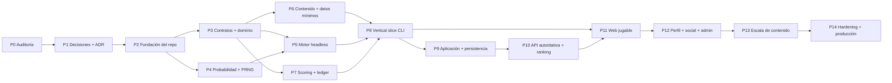

# Plan de implementación

## 1. Objetivo

Ordenar la construcción del simulador por dependencias, reducir riesgo y mantener el motor independiente de interfaz, HTTP y persistencia.

La autorización de implementación se concede por gate. G1 y G2 están
completados. G3A y los diez bloques estructurales de G3B están documentados;
esto habilita schemas estructurales conformes, pero no gameplay, scoring real
ni producto hasta el cierre matemático.

## 2. Reglas de ejecución

- `MASTER_SPEC.docx` continúa siendo la fuente principal.
- Una ambigüedad de gameplay se resuelve en `DECISIONS_REQUIRED.md`, no con código temporal.
- No se inventan reglas de gameplay para completar vacíos de la especificación.
- Primero se valida el núcleo headless; la UI consume un sistema ya reproducible.
- El motor no depende de React, Next.js, HTTP ni base de datos.
- Cada fase termina con artefactos ejecutables o verificables y checks verdes.
- No se amplía contenido antes de validar arquitectura, determinismo y distribución.
- No se implementan cooldowns, cupos, máximos de eventos, protección de rareza ni topes estadísticos editoriales.
- El motor queda sin cooldowns y sin restricciones artificiales de ocurrencia.
- Los límites físicos/lógicos y los topes de puntuación expresamente documentados se mantienen separados.
- Un cambio de fórmula, datos, contenido o scoring crea la versión correspondiente.

## 3. Camino crítico

El orden no obliga a que todo sea estrictamente secuencial. Datos, derechos, contenido y UX pueden prepararse en paralelo una vez congelados sus schemas, pero no deben bloquear ni contaminar el núcleo.

## 4. Gates previos

### Gate G0 — Auditoría completa

**Entregables**

- `ARCHITECTURE.md`;
- `DOMAIN_MODEL.md`;
- `DECISIONS_REQUIRED.md`;
- `IMPLEMENTATION_PLAN.md`.

**Criterio de salida**

- módulos, dependencias y límites identificados;
- contradicciones registradas;
- motor aislado por diseño;
- plan sin código de producto.

### Gate G1 — Definition of Ready del núcleo

Decisiones ya cerradas:

- precisión y fórmula de probabilidad;
- semántica de oportunidad válida;
- algoritmo de muestreo;
- PRNG y streams;
- canonicalización y hashes;
- cursor, interrupción y ciclo de vida de Career;
- taxonomía base de posiciones;
- posición efectiva, reconversión conceptual y cohortes;
- taxonomía de versiones;
- contrato inicial del DSL;
- causalidad Q1–Q4 y ventanas de oportunidades;
- equivalencia mecánica del contenido sensible;
- rango del Coeficiente de Contribución;
- descubrimientos, abandono e invalidación;
- alcance del vertical slice;
- principio de Creation Budget;
- dificultad informativa y separación de automatización;
- taxonomía de pie dominante.

Antes de escribir lógica de simulación todavía deben cerrarse:

- fórmulas de producción, salud, desarrollo, reconversión, mercado, premios y mundo (DR-008);
- fórmula completa de scoring y Coeficiente de Contribución (DR-010);
- decisiones matemáticas derivadas de G3A/G3B (partes abiertas de DR-053 a
  DR-062 y DR-064 a DR-069; DR-052/063 resueltas estructuralmente);
- primera versión ejecutable de las especificaciones matemática y de scoring.

Antes del vertical slice completo también deben cerrarse calendario/mundo
agregado, parámetros de Creation Budget, conteo editorial, alcance de
reconversiones, posición dominante, continuidad competitiva, inscripción y
cadencia mid-season (DR-021, DR-022, DR-045, DR-047 a DR-049 y DR-065 a
DR-067).

El toolchain y los contratos técnicos que no dependen de decisiones de gameplay
pueden avanzar. Pueden diseñarse los schemas estructurales enumerados en el
Closure Report; no se congelan dominios cuantitativos, fórmulas o payloads
afectados por DR pendientes.

## 5. Fases

### P0 — Auditoría de especificación

**Estado:** completada.

**Trabajo**

- leer el documento completo;
- identificar reglas normativas y precedencias;
- separar decisiones cerradas de pendientes;
- definir arquitectura y modelo de dominio;
- ordenar dependencias.

**Salida**

Los cuatro documentos técnicos iniciales.

### P1 — Decisiones y especificaciones vivas

**Dependencia:** P0.

**Estado:** en curso. G3A y G3B Structural Design están completados; la ronda de
cierre matemático, los parámetros iniciales y SC-02 a SC-11 siguen pendientes.

**Trabajo**

- resolver decisiones bloqueantes;
- mantener ADR de PRNG, números/hashes, eventos, versionado, lifecycle, pipeline y replay;
- redactar especificación matemática ejecutable;
- redactar contrato de scoring;
- completar especificaciones numéricas de creación, posiciones y scoring;
- elegir el contenido/data scope del vertical slice;
- iniciar política de datos, fuentes, derechos y sensibilidad.

**Checks documentales**

- cada regla tiene fuente o decisión;
- ninguna probabilidad positiva se serializa como cero;
- ningún campo de cooldown/cupo queda en el contrato normativo;
- ejemplos y fórmulas no se contradicen;
- todos los ADR enlazan decisiones.

**Criterio de salida**

DR-008 y DR-010 cerradas con parámetros iniciales, fixtures y versiones; contratos listos para gameplay.

### P2 — Fundación del repositorio

**Dependencia:** P0; puede comenzar en paralelo con el cierre final de P1 si no congela decisiones.

**Estado:** completada en G1 — Foundation Executable.

**Trabajo realizado**

- inicializar monorepo y lockfile;
- configurar TypeScript estricto;
- configurar lint, format, typecheck y test runner;
- crear packages y apps vacíos con límites de dependencias;
- configurar CI;
- documentar comandos;
- preparar entorno local reproducible.

**No incluye**

- gameplay;
- UI de producto;
- endpoints;
- tablas de negocio.

**Criterio de salida**

Repositorio vacío funcional, build y checks verdes.

### P3 — Contratos y dominio puro

**Dependencias:** P1 y P2.

**Estado:** contratos estructurales de G1/G2 implementados. Lifecycle, RootSeed y SimulationCursor están ejecutables; agregados y gameplay continúan pendientes.

**Trabajo**

- definir tipos de dominio y value objects;
- implementar `VersionSet`;
- modelar Career, Player, WorldState, SeasonState y estados;
- modelar comandos, eventos y errores tipados;
- definir DTO y schemas versionados;
- crear mappers de DTO a dominio;
- representar checkpoints, decisiones y resultados sin IO.

**Pruebas**

- constructores e invariantes;
- transiciones válidas/ inválidas;
- compatibilidad de schemas;
- fixtures aceptados y rechazados;
- ausencia de importaciones de UI/HTTP/DB.

**Criterio de salida**

Un estado de carrera puede validarse, construirse, serializarse canónicamente y restaurarse sin simular.

### P4 — Probabilidad, PRNG y determinismo

**Dependencias:** decisiones DR-002 a DR-007 y P2.

**Estado:** núcleo determinista de G2 completado. Las distribuciones específicas que requieran semántica de gameplay permanecen fuera de alcance.

**Trabajo**

- implementar PRNG elegido;
- derivar streams contextuales;
- implementar probabilidad/log-probabilidad;
- implementar distribuciones y colas abiertas;
- agregar trazas de multiplicadores;
- publicar vectores de prueba;
- implementar canonicalización y hash.

**Pruebas**

- mismos vectores en Node y navegador compatible;
- independencia entre streams;
- valores de frontera, incluido `< 10^-12`;
- ninguna salida NaN, negativa o mayor que 1;
- pruebas de propiedad y distribución;
- repetición exacta de hashes.

**Criterio de salida**

Una suite headless demuestra determinismo y muestreo extremo sin gameplay.

### P5 — Motor mínimo de temporada

**Dependencias:** P3 y P4; DR-012, DR-042 a DR-044 y DR-052 están cerradas;
falta cerrar DR-008, DR-021/022 y DR-053 a DR-069 en el alcance afectado.

**Estado:** solamente infraestructura estructural de G2 completada. El runner recorre el pipeline vacío, interrumpe, reanuda y replaya; no produce hechos ni estadísticas deportivas.

**Trabajo**

- implementar el pipeline normativo Q1–Q4 y sus ventanas causales;
- crear `SeasonContext`;
- soportar cursor y suspensión por decisión;
- generar estado nuevo y eventos de dominio;
- cerrar `SeasonResult`;
- mantener cadencia fuera de la lógica anual;
- registrar traza de replay.

**Alcance inicial**

Un jugador, un contexto de club, una temporada y estadísticas agregadas mínimas con fixtures aprobados. No UI, DB ni HTTP.

**Pruebas**

- igualdad por seed/decisiones/versiones;
- cambio de cadencia sin cambio de resultados;
- reanudación sin repetir sorteos;
- invariantes físicas;
- orden normativo;
- lesión intermedia sin reescritura retroactiva;
- facts inaccesibles antes de su ventana.

**Criterio de salida**

Una temporada completa se ejecuta desde memoria y puede reproducirse.

### P6 — Contenido y datos mínimos

**Dependencias:** P3; DR-004, DR-012, DR-014, DR-015, DR-018 y DR-043 cerradas; matemática de DR-022, DR-047, DR-065 y decisiones de datos aplicables pendientes.

**Trabajo**

- implementar DSL declarativo y compilador;
- crear loader de releases inmutables;
- validar referencias y efectos;
- implementar catálogos de datos futbolísticos;
- crear snapshot mínimo del vertical slice;
- separar textos localizados de lógica;
- separar `domainEvent` de `narrativePresentation`;
- validar `OpportunityWindow` y disponibilidad de facts;
- registrar fuentes y política de assets.

**Pruebas**

- schema y referencias;
- contenido desconocido rechazado de forma segura;
- orden de evaluación estable;
- imposibilidad lógica diferenciada de probabilidad residual;
- ausencia de cooldown, `maxPerCareer` o cuotas;
- hash estable de releases;
- equivalencia mecánica entre variantes sensibles;
- inventario conforme al contrato de conteo aprobado.

**Criterio de salida**

El motor consume catálogos en memoria sin conocer filesystem o DB.

### P7 — Scoring y ScoreLedger

**Dependencias:** P3, P5, DR-010, DR-049, DR-066/067 y DR-069 con
`scoringVersion` aprobada. DR-009 ya fija el rango de `CC`; DR-063 y
[ADR-010](adr/010-scoring-ledger-and-domain-facts.md) ya fijan estructura,
catálogo y allowlist.

**Trabajo**

- implementar cálculo puro;
- generar entradas append-only;
- aplicar anti-duplicación;
- aplicar redondeos y topes de puntos documentados;
- implementar reversals;
- encadenar hashes;
- generar desglose.

**Pruebas**

- reconstrucción exacta;
- idempotencia;
- no duplicación;
- equidad posicional;
- ejemplos normativos;
- un evento ocurre igual aunque su bonificación ya alcanzara un tope;
- accidentes/catástrofes no puntúan por ocurrir.

**Criterio de salida**

El total se deriva exclusivamente del ledger y coincide con fixtures aprobados.

### P8 — Vertical slice headless

**Dependencias:** P5, P6 y P7; DR-008, DR-010, DR-021, DR-022, DR-045,
DR-047 a DR-049, DR-053 a DR-069 y decisiones de datos aplicables cerradas.

**Alcance controlado**

- Argentina y España;
- `GK`, `CM` y `ST`;
- solo Carrera rápida;
- clubes/competiciones/pools exactos según DR-022/025/065 y el snapshot aprobado;
- 30 eventos según el contrato de conteo aprobado;
- 5 cadenas;
- 6 lesiones;
- contratos y al menos una transferencia posible;
- títulos/premios mínimos y retiro;
- carrera completa;
- CLI, replay y Monte Carlo;
- ScoreLedger y ranking interno de prueba.

**No ampliar todavía**

- 80/120/180 eventos;
- catálogo mundial;
- admin completo;
- ranking público;
- todas las plantillas sociales.

**Pruebas**

- golden seeds por posición;
- property tests;
- al menos 10.000 carreras para el informe previo a expansión;
- equivalencia de cuatro cadencias;
- eventos extremos no bloqueados;
- ausencia de estrategia dominante según criterio aprobado;
- carrera completa sin bloqueo narrativo;
- cobertura de Q1–Q4 y de las ocho ventanas de oportunidades;
- posición dominante y premios ante los cambios permitidos por el alcance aprobado.

**Criterio de salida**

El núcleo demuestra ciclo completo, determinismo, trazabilidad y distribución antes de infraestructura de producto.

### P9 — Capa de aplicación y persistencia

**Dependencias:** P8; decisiones de persistencia cerradas.

**Trabajo**

- casos de uso;
- repositorios como puertos;
- PostgreSQL y migraciones;
- snapshots, decisions, SeasonResult, domain events y ledger;
- revisión optimista;
- idempotencia;
- proyecciones de lectura;
- adaptador local separado.

**Pruebas**

- integración con DB efímera;
- transacciones y rollback;
- conflictos de revisión;
- reintentos idempotentes;
- guardado/restauración exacta;
- migraciones forward-safe;
- backup/restore de prueba.

**Criterio de salida**

Una carrera persistida puede cerrarse, restaurarse y replayarse sin corrupción.

### P10 — API autoritativa y ranking

**Dependencias:** P9; DR-030 a DR-037 cerradas.

**Trabajo**

- autenticación y autorización;
- endpoints mínimos;
- creación oficial;
- avance y decisiones;
- checkpoints;
- replay/verificación;
- finalización;
- ranking materializado;
- public views sanitizadas;
- antitrampa y auditoría.

**Pruebas**

- inputs hostiles;
- propiedad por usuario;
- secuencias fuera de orden;
- score manipulado rechazado;
- versión incompatible rechazada;
- replay de scores extremos;
- revocación de ranking sin borrar carrera;
- load tests iniciales.

**Criterio de salida**

El servidor es la única autoridad de una entrada oficial.

### P11 — Web jugable

**Dependencias:** P8 para modo local y P10 para modo oficial.

**Trabajo**

- creación rápida;
- creación personalizada solo después de cerrar DR-045 y validar equivalencia Monte Carlo;
- configuración;
- carrera y decisión;
- resumen de período;
- estadísticas, palmarés e historial;
- retiro;
- estados loading/error/offline/conflict/pending;
- accesibilidad y mobile-first;
- snapshot local.

**Pruebas**

- E2E del ciclo crítico;
- teclado y lector de pantalla;
- 320 px;
- reduced motion;
- conflicto y reconexión;
- UI no recalcula puntos ni resultados.

**Criterio de salida**

Una persona completa una carrera con los mismos resultados que CLI/API.

### P12 — Perfil, colección, compartido y admin

**Dependencias:** P10 y P11.

**Trabajo**

- perfil y descubrimientos;
- mejor carrera y favorita;
- colección;
- `ShareCardModel`;
- preview y renderer;
- ranking snapshot;
- publicación de contenido/datos desde admin;
- auditoría y rollback mediante release nueva.

**Pruebas**

- abandono no modifica récords indebidos;
- IDs privados ausentes;
- datos de share coinciden con snapshot;
- generación determinística;
- segunda lámina cuando corresponde;
- admin no evita validación.
- descubrimientos idempotentes conservados al abandonar y reproyectados al invalidar.

**Criterio de salida**

Meta, social y operación editorial funcionan sin duplicar lógica.

### P13 — Escala de contenido y datos

**Dependencias:** P8 validado y pipeline de P12.

**Trabajo**

- ampliar posiciones, ligas, clubes, premios, eventos y cadenas;
- importar snapshots;
- localizar contenido;
- ejecutar Monte Carlo por release;
- revisar fuentes, derechos y sensibilidad;
- publicar notas de versión.

**Regla**

Cada ampliación pasa schemas, referencias, golden/property tests y simulación masiva. No se corrige una cola solo por ser extrema.

### P14 — Hardening y producción

**Dependencias:** fases anteriores y decisiones de publicación.

**Trabajo**

- seguridad;
- observabilidad y alertas;
- SLO;
- rate limits;
- accesibilidad completa;
- carga;
- backups y restauración;
- runbooks;
- staging;
- despliegue y rollback.

**Criterio de salida**

Definition of Done de la sección 57 verificada con evidencia.

## 6. Dependencias por módulo

| Módulo | Requiere antes | Desbloquea |
|---|---|---|
| `domain` | Estados, posiciones, ventanas, descubrimientos y versiones decididos | Engine, scoring, application |
| `probability` | Fórmula, precisión, PRNG y canonicalización | Engine, Monte Carlo |
| `schemas` | Taxonomía de dominio/versiones | Contenido, API, DB, admin |
| `content` | DSL, ventanas causales, facts y separación mecánica/narrativa | Eventos del engine, admin |
| `data-football` | Scope, IDs, fuentes y snapshot | Clubes, competiciones, scoring |
| `engine` | Domain + probability + catálogos | CLI, API, web local |
| `scoring` | Fórmulas + domain | Ledger, ranking, share |
| `application` | Engine estable | API, worker, DB |
| `db` | Schemas + application ports | Persistencia oficial |
| `api` | Application + DB + auth | Web oficial, ranking |
| `web` | Engine local o API | Experiencia del jugador |
| `worker` | Application + jobs definidos | Replay, Monte Carlo, share |
| `admin` | Schemas + releases + auth | Escala editorial |

## 7. Estrategia de pruebas desde el inicio

| Tipo | Se introduce en | Objetivo |
|---|---|---|
| Unit | P3 | Value objects, invariantes y fórmulas |
| Property-based | P4 | Determinismo, rangos, colas y ausencia de NaN |
| Vectores de PRNG | P4 | Compatibilidad multiplataforma |
| Golden/replay | P5 | Resultado exacto por versión, Q y ventana |
| Content/data validation | P6 | Schemas y referencias |
| Monte Carlo | P8 | Distribuciones y rarezas |
| Integration | P9 | DB, transacciones e idempotencia |
| Security/contract | P10 | Inputs, auth y autoridad |
| E2E/accessibility | P11 | Flujo de usuario |
| Load/operational | P14 | SLO, ranking, replay y share |

## 8. Criterios para no avanzar

Una fase no se considera cerrada si:

- hay una regla de gameplay inventada para completar un hueco;
- una probabilidad positiva se redondea a cero;
- la misma entrada produce otro resultado;
- cambiar cadencia cambia estado o score;
- existe un cooldown, cuota o máximo de ocurrencia artificial;
- el total no se reconstruye desde ScoreLedger;
- el engine importa UI, HTTP o DB;
- un catálogo cambia sin nueva versión/hash;
- un cliente puede enviar score o stats oficiales;
- los checks de la fase no se ejecutaron o fallan.

## 9. Estado al cerrar G2

G1 completó P2. G2 completó el núcleo técnico de P4 y la porción puramente estructural de P3/P5:

1. RootSeed, PRNG, streams, probabilidad, canonicalización y hashes;
2. lifecycle, cursor, advance, interrupción y reanudación;
3. replay estructural, checkpoints, golden vectors y properties;
4. enforcement de dependencias sin acoplar engine con scoring, HTTP, DB o UI.

Antes de implementar gameplay todavía corresponde:

1. cerrar DR-008 y DR-010 con especificaciones matemática y de scoring versionadas;
2. resolver DR-053 a DR-069 y las dependencias matemáticas identificadas por
   G3A; DR-052 ya está resuelta;
3. cerrar DR-021, DR-022, DR-045, DR-047 a DR-049 y DR-065 a DR-067 para el vertical slice;
4. resolver DR-046 antes de cualquier automatización competitiva;
5. fijar catálogos, fuentes y contrato de conteo del slice;
6. recibir autorización explícita para G3B.

G2 no habilita React, endpoints de gameplay, tablas de negocio, carga de contenido ni fórmulas deportivas.

## 10. Estado al cerrar G3A

G3A produce [`MATHEMATICAL_ENGINE_SPEC.md`](MATHEMATICAL_ENGINE_SPEC.md) sin modificar código. El documento:

1. separa capacidad, calidad efectiva, rendimiento y percepción;
2. cataloga variables persistentes, dinámicas, observables y latentes;
3. define el proceso causal Q1–Q4 y el estado transferido entre ventanas;
4. delimita producción mínima para `GK`, `CM` y `ST`;
5. diseña conceptualmente desarrollo, forma, salud, mercado, selección, premios, mundo, reputación y retiro;
6. define el grafo causal para evitar sorteos independientes y feedback loops accidentales;
7. enumera hechos por Q/temporada y los contratos `SC-01` a `SC-13`;
8. registra DR-052 a DR-067 y refina DR-008, DR-010 y DR-022;
9. separa decisiones `BLOCKER_G3`, `BALANCE_LATER` y `CONTENT_LATER`.

### Gate previo a G3B

No comenzar gameplay hasta:

- aprobar la especificación conceptual;
- mantener DR-052 cerrada y resolver DR-053 a DR-069;
- integrar ecuaciones, distribuciones, correlaciones, parámetros iniciales, precisión y streams en DR-008;
- publicar fórmulas, anti-duplicación, fixtures y `scoringVersion` para DR-010;
- cerrar DR-021/022/065/066/067, DR-048/049 y la parte de DR-027 necesaria para el slice;
- aprobar targets y tolerancias Monte Carlo;
- recibir autorización explícita para G3B.

El estado de G3A es **documentación completa, decisiones matemáticas pendientes**. No se implementó gameplay y no se avanza automáticamente a G3B.

## 11. Estado de G3B — Bloque 1: Fundamental Player Model

**Estado:** especificación estructural completada el 2026-07-27; gameplay no
autorizado.

Entregables:

- [`PLAYER_MODEL_SPEC.md`](PLAYER_MODEL_SPEC.md) como especificación normativa
  compacta;
- [ADR-052](adr/052-fundamental-player-model.md);
- resolución de G3B-A01 a G3B-A05 y de las estructuras de G3B-N01/N05;
- cierres parciales explícitos de G3B-A06, B03, B04, C02, D01, E01 y
  N02–N04;
- Parameter Registry ampliado sin valores hardcoded.

Contratos cerrados:

1. veinte capabilities comunes con escala entera canónica `0..10000`;
2. diez traits iniciales con la misma escala y observabilidad independiente;
3. separación `CAPABILITIES`/`TRAITS`/`DYNAMIC_STATES`;
4. ausencia de overall y potential overall causales;
5. separación `TruePlayerState`/`PlayerKnowledge`;
6. potencial emergente y pico observado;
7. generación inicial correlacionada con arquetipos blandos;
8. Creation Budget como poder esperado, no suma nominal.

Siguen bloqueadas por sus propios bloques las fórmulas de desarrollo, capacidad
efectiva, rendimiento, dinámica temporal, salud y Creation Budget cuantitativo
(DR-045, DR-053, DR-055, DR-056 y DR-057). Sus parámetros se consumirán desde
configuración versionada y no se fijaron en esta fase.

No se modificaron packages, no se implementó gameplay y no se avanza
automáticamente al siguiente bloque.

## 12. Estado de G3B — Bloque 2: Development & Aging

**Estado:** especificación estructural completada el 2026-07-27; fórmulas,
distribuciones, calibración y gameplay no autorizados.

Entregables:

- [`DEVELOPMENT_AGING_SPEC.md`](DEVELOPMENT_AGING_SPEC.md) como especificación
  normativa compacta;
- [ADR-053](adr/053-development-and-aging-model.md), aceptado solo para la
  estructura; DR-053 continúa parcialmente abierta;
- resolución de G3B-B01;
- cierres estructurales parciales de G3B-A06, B02–B06, C05, E01, E07 y F01;
- catálogo ampliado de Parameter Registry sin valores hardcoded.

Contratos cerrados:

1. desarrollo y declive actúan sobre capabilities individuales;
2. se evalúan en Q1–Q4 y se aplican atómicamente una vez por ventana;
3. maduración, desarrollo adquirido, wear e innovación estocástica permanecen
   distinguibles;
4. cinco familias seleccionan parámetros sin convertirse en
   macrocapacidades;
5. el perfil de maduración es latente, blando y no contiene una `peakAge`
   garantizada;
6. no existen potential ceilings ni delta de overall;
7. edad y traits modifican distribuciones, no determinan signos;
8. minutos/experiencia siguen una relación no lineal externalizada;
9. lesiones solo llegan a consecuencias permanentes mediante recuperación y
   posible secuela confirmada;
10. declive no es absorbente y los picos son retrospectivos;
11. Development no ajusta capacidades para forzar reconversiones.

Siguen bloqueando la implementación de Development & Aging:

- forma funcional y combinación de componentes;
- familias de distribución y covarianza;
- precisión, acumulación y cuantización;
- contexts de streams y golden fixtures;
- parámetros iniciales y targets Monte Carlo;
- interfaces ejecutables de Role & Minutes, Health y Club;
- schemas concretos conformes al catálogo DR-063 ya aprobado.

Estas aperturas pertenecen a DR-053, DR-054, DR-057, DR-022, DR-048, DR-055 y
los schemas posteriores según su alcance; DR-063 quedó cerrada
estructuralmente en el Bloque 10. Ningún parámetro calibrable se convirtió en
una regla hardcoded. No se modificaron packages, no se implementó gameplay y no
se avanza automáticamente al siguiente bloque.

## 13. Estado de G3B — Bloque 3: Role + Minutes

**Estado:** especificación estructural completada el 2026-07-27; funciones,
distribuciones, calibración y gameplay no autorizados.

Entregables:

- [`ROLE_MINUTES_SPEC.md`](ROLE_MINUTES_SPEC.md) como especificación normativa
  compacta;
- [ADR-054](adr/054-role-and-minutes-model.md), aceptado solo para la
  estructura; DR-054 continúa parcialmente abierta;
- resolución de G3B-C01;
- cierres estructurales parciales de G3B-A06, B04, B05, C02–C06, D01, E01 y
  F01–F04;
- confirmación de G3B-C07 como Parameter Registry sin valores hardcoded.

Contratos cerrados:

1. `SquadStatus`, `SportingRole` y `EffectiveUsage` son conceptos distintos;
2. `PROSPECT` puede coexistir con cualquier rol deportivo;
3. Role & Minutes consume `effectivePosition` y no ejecuta reconversiones;
4. `managerTrust`, `tacticalFit`, calidad y rendimiento permanecen separados;
5. `PositionCompetition` representa competencia agregada por posición;
6. `TeamMinutesOpportunity` y el `AvailabilityEnvelope` agregado delimitan el
   máximo físico; Health entrega solo su componente médico;
7. la resolución causal es rol→expectativa/share→`actualMinutes`;
8. roles no crean bandas, thresholds, garantías ni cooldowns;
9. Performance de Qn consume minutos y solo afecta principalmente Qn+1;
10. minutes es la exposición causal; appearances/starts se derivan;
11. uso multiposicional conserva minutos;
12. club y selección tienen oportunidades y facts independientes;
13. outputs conceptuales quedaron reconciliados por DR-063/ADR-010.

Siguen bloqueando la implementación de Role + Minutes:

- familia y parametrización de las distribuciones de rol y share;
- escala, precisión, redondeo, correlaciones y contexts de streams;
- parámetros iniciales, golden fixtures y targets Monte Carlo;
- calendario, `SeasonId`, oportunidad y splits por competición de DR-021/022;
- calidad contextual y resumen de Performance de DR-055;
- dinámica de `managerTrust` de DR-056;
- mapping médico y Health de DR-057;
- owner de disciplina y composición de disponibilidad de DR-064;
- semántica de una eventual promesa contractual de rol/estatus de DR-058;
- schemas concretos conformes a identidad, idempotencia y allowlist ya
  aprobadas por DR-063/ADR-010;
- alcance/dominancia posicional de DR-048/049.

Ningún coeficiente calibrable se convirtió en regla normativa. No se
modificaron packages, no se implementó gameplay y no se avanza automáticamente
al siguiente bloque.

## 14. Estado de G3B — Bloque 4: Performance, Form y producción

**Estado:** especificación estructural completada el 2026-07-28; funciones,
distribuciones, calibración y gameplay no autorizados.

Entregables:

- [`PERFORMANCE_MODEL_SPEC.md`](PERFORMANCE_MODEL_SPEC.md) como especificación
  normativa compacta;
- [ADR-055](adr/055-performance-and-production-model.md), aceptado solo para la
  estructura; DR-055 continúa parcialmente abierta;
- resolución estructural de G3B-A06 y G3B-D01;
- cierres estructurales parciales de G3B-D02 a G3B-D09;
- confirmación de G3B-D10 como Parameter Registry sin valores hardcoded;
- interfaces refinadas hacia Development, Role & Minutes, Health, Club,
  Market, Selection, Awards, Reputation y Scoring.

Contratos cerrados:

1. el pipeline es `TrueCapabilities → EffectiveCapabilities →
   UnderlyingPerformance → ObservedProduction → PerformanceSummary`;
2. EffectiveCapabilities usa una proyección contextual única, efímera y pura;
3. UnderlyingPerformance es multidimensional y ningún rating es causal;
4. `actualMinutes` es exposición confirmada y Performance no la recalcula;
5. sparse exposure conserva raw production y separa evidencia/incertidumbre;
6. los conteos son discretos, correlacionados y no surgen de redondear
   expectativas;
7. `consistency` afecta principalmente dispersión/volatilidad;
8. `ST` conserva goles/asistencias y separa oportunidad, chance quality y
   conversión;
9. `CM` conserva goles/asistencias y evidencia de progresión, creación, defensa
   y control;
10. `GK` separa shot stopping/command/distribution del contexto defensivo y
    conserva atajadas, goles concedidos y vallas invictas;
11. raw production no se reescribe por competencia/contexto;
12. presión se conserva como evidencia, no como bonus editorial;
13. Dynamic States tienen ownership separado y se actualizan después de Q;
14. `SeasonPerformanceSummary` deriva de Q1–Q4 sin nuevo sorteo;
15. no existen caps editoriales ni records forzados.

Siguen bloqueando la implementación de Performance:

- forma funcional y dominio de EffectiveCapabilities;
- escalas/precisión de UnderlyingPerformance y summaries;
- familias discretas, sobredispersión, conversiones y correlaciones;
- parámetros de `GK`, `CM` y `ST`;
- dinámica ejecutable de form/confidence/managerTrust/morale en DR-056;
- fitness/fatigue, carga y Health de DR-057;
- calendario y `PerformanceContext` de DR-021/022;
- schemas concretos conformes a identidad, idempotencia, aliases y allowlist ya
  aprobadas por DR-063/ADR-010;
- parámetros iniciales, contexts de streams, golden fixtures y targets Monte
  Carlo;
- fórmulas de consumidores posteriores en DR-058 a DR-061 y DR-010.

G3B-A06 queda cerrado estructuralmente. DR-055/056 continúan parcialmente
abiertas y DR-008/010 no se cierran. No se modificaron packages, no se
implementó gameplay y no se avanza automáticamente al siguiente bloque.

## 15. Estado de G3B — Bloque 5: Health, Injuries & Recovery

**Estado:** especificación estructural completada el 2026-07-28; hazards,
distribuciones, calibración, catálogo y gameplay no autorizados.

Entregables:

- [`HEALTH_INJURY_SPEC.md`](HEALTH_INJURY_SPEC.md) como especificación normativa
  compacta;
- [ADR-057](adr/057-health-injury-recovery-model.md), aceptado solo para la
  estructura; DR-057 continúa parcialmente abierta;
- resolución estructural de G3B-E01;
- cierres estructurales parciales de G3B-E02, E03 y E05–E07;
- confirmación de G3B-E04/E08 como Parameter Registry sin valores hardcoded;
- interfaces refinadas hacia Development, Role & Minutes, Performance,
  Club/Competitions, Market/Selection, Retirement y facts;
- DR-064 registrada para disciplina y disponibilidad no médica.

Contratos cerrados:

1. Health separa fitness, fatigue, carga, condiciones, episodios, recuperación,
   secuelas e historia;
2. `injuryFragility`, `recoveryCapacity`, `longevity` y `medicalQuality` no son
   aliases;
3. Health produce `MedicalAvailabilityEnvelope` parcial y no asigna minutos;
4. disciplina/otras causas se agregan fuera de Health;
5. exposición incluye competición, training/background, non-football y eventos
   externos;
6. el hazard es contextual por oportunidad y no usa thresholds;
7. no existen caps, cuotas, cooldowns ni máximo editorial de condiciones;
8. `InjuryOccurred` se separa de `InjuryEpisode`;
9. familia, severidad y origen son dimensiones independientes;
10. se admiten condiciones concurrentes compatibles;
11. recuperación esperada y realizada son distintas y existe retorno limitado;
12. recaída/agravamiento conserva vínculo causal;
13. `SequelaProfile` puede ser `NONE`, `TEMPORARY` o `PERSISTENT`;
14. Health no muta capabilities; Development conserva ownership;
15. lesión de `HEALTH(Qn)` afecta Qn+1 y no reescribe Qn;
16. causas externas no se duplican en el hazard deportivo;
17. el pipeline de 38 operaciones no cambia.

Siguen bloqueando la implementación de Health:

- forma funcional hazard→probabilidad y proceso exacto de oportunidades;
- familias/distribuciones de severidad, duración, recuperación, recaída y
  secuela;
- dominios/transiciones, precisión y cuantización de fitness/fatigue/carga;
- orden canónico, correlaciones y contexts de streams;
- parámetros iniciales, seis lesiones del slice, golden fixtures y targets
  Monte Carlo;
- calendario, exposición y `medicalQuality` de DR-021/022;
- composición de disponibilidad y disciplina de DR-054/064;
- mapping de secuelas/desgaste de DR-053;
- schemas concretos conformes a identidad, idempotencia y clasificación ya
  aprobadas por DR-063/ADR-010;
- interfaz posterior de retiro en DR-062.

DR-042 queda confirmado, no reabierto. DR-057 sigue `BLOCKER_G3` por su
matemática ejecutable y DR-008 no se cierra. No se modificaron packages, no se
implementó gameplay y no se avanza automáticamente al siguiente bloque.

## 16. Estado de G3B — Bloque 6: Club, Competitions & World

**Estado:** especificación estructural completada el 2026-07-28; fórmulas,
distribuciones, calendarios, scope de datos, calibración y gameplay no
autorizados.

Entregables:

- [`CLUB_COMPETITION_WORLD_SPEC.md`](CLUB_COMPETITION_WORLD_SPEC.md) como
  especificación normativa compacta;
- [ADR-022](adr/022-club-competition-world-model.md), aceptado solo para la
  estructura; DR-022 continúa parcialmente abierta;
- resoluciones estructurales de G3B-F01, F02, F04 y J01;
- cierres parciales de G3B-F03, F05, F06 y J02–J04;
- confirmación de F08/J05 como configuración versionada;
- DR-065 registrada para scope competitivo, pools y continuidad tras movilidad.

Contratos cerrados:

1. Definitions reales de club/liga/competición son inmutables por
   `dataVersion`;
2. `ClubState`, `LeagueState`, `CompetitionState` y `WorldState` contienen solo
   futuro ficticio de la Career;
3. Club separa attack/defensive/control strength, prestigio, finanzas,
   desarrollo, medicina, estabilidad, manager y competencia;
4. no existe `ClubOverall` causal;
5. `ManagerContext`/`TacticalIdentity` tienen vigencia causal y TacticalFit es
   derivado;
6. Club posee `PositionCompetition`; Competitions/Calendar posee
   `TeamMinutesOpportunity`;
7. calendario/contexto es agregado por Q, sin partidos ni falsa precisión
   diaria;
8. Competition Definition/State y tipos mínimos quedan separados;
9. `TeamSupportField` excluye `PlayerCompetitiveContribution`;
10. outcomes son separados por competición y correlacionados;
11. `leagueCompetitiveStrength` dinámico no reescribe IJL;
12. world shocks siguen jerarquía global→regional→league→club→idiosincrático;
13. updates afectan solo futuro;
14. no hay protección artificial de clubes;
15. promotion/relegation es representable y no fuerza transferencia;
16. el slice requiere dos ligas, 6–10 clubes detallados por liga, dos copas,
    Libertadores, Champions y contratos de selección, sujeto a datos.

Siguen bloqueando Club/Competitions/World:

- dominios, escalas, precisión y cuantización;
- calendarios, SeasonId, formatos, fases, cupos y qualification de DR-021;
- funciones y distribuciones de fuerza, support, contribución, outcomes,
  movilidad, ciclos y world update;
- correlaciones, streams, parámetros, golden fixtures y targets Monte Carlo;
- catálogo real, fuentes, corte y licencias de DR-025;
- pool externo, participantes, promotion/relegation y continuidad de DR-065;
- schemas concretos conformes a facts e idempotencia ya aprobados por
  DR-063/ADR-010;
- interfaces matemáticas posteriores de Market, Selection, Awards y Scoring.

El siguiente paso no es implementación: diseño debe cerrar DR-008/021/022/025
y DR-065, concretar schemas conformes a DR-063 y aprobar parámetros/fixtures
del alcance aplicable. No se modificaron packages, no se implementó gameplay y
no se avanza automáticamente al siguiente bloque.

## 17. Estado de G3B — Bloque 7: Transfers, Market & Contracts

**Estado:** especificación estructural completada el 2026-07-28; fórmulas,
distribuciones, calendario de mercado, elegibilidad, calibración y gameplay no
autorizados.

Entregables:

- [`TRANSFER_MARKET_CONTRACT_SPEC.md`](TRANSFER_MARKET_CONTRACT_SPEC.md) como
  especificación normativa compacta;
- [ADR-058](adr/058-transfer-market-contract-model.md), aceptado solo para la
  estructura; DR-058 continúa parcialmente abierta;
- resoluciones estructurales de G3B-G05 y G06;
- cierres parciales de G3B-G01–G04 y G07;
- confirmación de G08 como configuración versionada;
- DR-066 registrada para `RegistrationEligibility`;
- DR-067 registrada para cadencia/cursor de movimientos entre Qs.

Contratos cerrados:

1. pipeline
   `MarketPerception → ClubNeed → TransferInterest → TransferOffer →
   TransferNegotiation → PlayerDecision → TransferOutcome → ContractState`;
2. Market usa percepción/evidencia por observador, no estado verdadero;
3. Club/World posee need, escasez, finanzas y ciclos;
4. interés deportivo y viabilidad financiera son rutas diferentes;
5. MarketValue, TransferFee y Salary son conceptos separados;
6. Money usa unidades menores enteras exactas y `currencyCode`;
7. no existe moneda/conversión global implícita;
8. `Contract` es entidad identificada con período, salary, cláusulas, status y
   links de renovación;
9. `ContractExpectation = DEVELOPMENT | SQUAD | IMPORTANT | MARQUEE` no es
   role/usage y no asigna minutos;
10. acuerdos de clubes y jugador son estados independientes;
11. ofertas/decisiones quedan congeladas y se reanudan sin resorteo;
12. se soportan permanent transfer, loan y free transfer;
13. préstamo separa club contractual/deportivo;
14. movimientos y contratos se aplican atómica/idempotentemente;
15. temporada multiclub conserva splits sin reatribución/duplicación;
16. afiliación y elegibilidad son estados distintos;
17. Transfers no crea ScoreLedger ni score financiero.

Siguen bloqueando Transfers/Market/Contracts:

- funciones/distribuciones/correlaciones de percepción, valuation, need/fit,
  interés, oferta, viabilidad, fee, salary, renewal, negociación y preferencias;
- precisión, cuantización, streams, parámetros, golden fixtures y targets Monte
  Carlo;
- calendario, `SeasonId`, time points y `MarketWindowContext` de DR-021;
- moneda de referencia, fuente, conversión, calibración y presentación de
  DR-027;
- schemas concretos conformes a facts, identidad, idempotencia y allowlist ya
  aprobados por DR-063/ADR-010;
- scope/continuidad fuera del tier de DR-065;
- `RegistrationEligibility` de DR-066;
- punto exacto del cursor mid-season de DR-067;
- alcance/dominancia posicional de DR-048/049 para consumidores posteriores.

El siguiente paso no es implementación: diseño debe cerrar DR-008/021/027/058
y DR-065/066/067, concretar schemas conformes a DR-063 y aprobar
parámetros/fixtures del alcance aplicable. No se modificaron packages, no se
implementó gameplay y no se avanza automáticamente al siguiente bloque.

## 18. Estado de G3B — Bloque 8: National Team & Awards

**Estado:** especificación estructural completada el 2026-07-28; matemática,
calendario internacional, nacionalidad deportiva, catálogo, calibración y
gameplay no autorizados.

Entregables:

- [`NATIONAL_TEAM_AWARDS_SPEC.md`](NATIONAL_TEAM_AWARDS_SPEC.md) como
  especificación normativa compacta;
- [ADR-059](adr/059-national-team-model.md), aceptado solo para la estructura;
  DR-059 continúa parcialmente abierta;
- [ADR-060](adr/060-awards-model.md), aceptado solo para la estructura; DR-060
  continúa parcialmente abierta;
- resolución estructural de G3B-I01;
- cierres parciales de G3B-H01–H04 y G3B-I02–I04;
- confirmación de G3B-H05/I05 como configuración/calibración/contenido
  versionados;
- DR-068 registrada para nacionalidad deportiva y eligibility internacional
  del vertical slice.

Contratos cerrados:

1. National Team posee Definition, State, Context, historia, fields y support
   propios; no reutiliza estado de club;
2. eligibility lógica precede Candidate Evaluation y no es probabilidad;
3. `SelectionCompetitionField` compara por selección/país, posición, contexto y
   generación sin roster mundial ni threshold;
4. convocatoria, squad, `InternationalRole`, minutos, Performance y TeamOutcome
   son etapas distintas;
5. rol/minutos/Performance reutilizan resolvers comunes bajo contexto nacional
   y facts separados de club;
6. Health conserva ownership médico y una convocatoria puede terminar sin
   minutos;
7. incumbency/selection trust no garantiza convocatorias;
8. el support field excluye al protagonista y este no garantiza títulos;
9. `AwardDefinition` se separa de edición/resultado;
10. category y evaluation family son ejes distintos;
11. premios comparativos usan `AwardCompetitionField`; estadísticos,
    `StatisticalCompetitionField`;
12. eligibility, candidate signal, field y outcome ordinal son etapas distintas;
13. ST, CM y GK requieren evidencia posicional propia;
14. títulos no garantizan premios y judging noise no simula votantes;
15. pueden coexistir múltiples premios;
16. Award, Record y ScoreLedger permanecen separados;
17. `AwardWon` es canónico también para premios estadísticos;
18. `AWARD_EVENTS` ocurre únicamente después de cerrar `AWARDS`;
19. el slice conserva exactamente un premio global, uno juvenil y tres
    posicionales o de competición, sin inventar IDs.

Siguen bloqueando National Team & Awards:

- funciones/distribuciones/correlaciones de fields, candidate signals, call-up,
  squad, role, minute share, contribution, team outcome, award comparison,
  judging, placement y empate;
- dominios, precisión, cuantización, streams, parámetros, golden fixtures y
  targets Monte Carlo;
- calendario/cursor internacional y torneos de DR-021/059;
- nacionalidad deportiva y transiciones de eligibility de DR-068;
- catálogo real y las cinco Definitions del slice de DR-025/060;
- posición histórica dominante de DR-049;
- métricas GK suficientes de DR-055;
- schemas concretos conformes a facts, identidad, idempotencia y allowlist ya
  aprobados por DR-063/ADR-010;
- Reputation/Social y Scoring todavía abiertos en DR-061/010.

El siguiente paso no es implementación: diseño debe cerrar DR-008/010/021/025,
DR-049/055/059–061/068, concretar schemas conformes a DR-063 y aprobar
parámetros/fixtures aplicables. No se
modificaron packages, no se implementó gameplay y no se avanza automáticamente
al siguiente bloque.

## 19. Estado de G3B — Bloque 9: Reputation, Social & Retirement

**Estado:** especificación estructural completada el 2026-07-28; matemática,
cursor posretiro, finalización, calibración y gameplay no autorizados.

Entregables:

- [`REPUTATION_SOCIAL_RETIREMENT_SPEC.md`](REPUTATION_SOCIAL_RETIREMENT_SPEC.md)
  como especificación normativa compacta;
- [ADR-061](adr/061-reputation-and-social-model.md), aceptado solo para
  estructura; DR-061 continúa parcialmente abierta;
- [ADR-062](adr/062-playing-retirement-and-comeback.md), aceptado solo para
  estructura; DR-062 continúa parcialmente abierta;
- aclaración compatible de [ADR-016](adr/016-career-lifecycle.md);
- resoluciones estructurales de G3B-K03, K04 y L03;
- cierres parciales de G3B-K01, K02, K05 y L01, L02, L04;
- confirmación de K06/L05 como calibración externalizada y K07 diferida;
- DR-069 registrada para finalización tras retiro y ventana de regreso.

Contratos cerrados:

1. Sporting Reputation, Public Reputation, Public Attention, followers y
   engagement son estados distintos;
2. Public Reputation separa awareness/sentiment; reach es derivado;
3. mercados son data-driven y global es una proyección con procedencia;
4. facts se convierten en signals y se deduplican por `EvidenceKey`;
5. shocks públicos pueden compartir causa sin convertir outputs en aliases;
6. followers es entero exacto, no negativo y no monotónico;
7. Content no escribe followers/reputation por deltas arbitrarios;
8. Social/Reputation no modifica capabilities ni ScoreLedger;
9. `PlayerPlayingStatus` es ortogonal a `CareerStatus`;
10. motivation es assessment derivada y no trait/overall nuevo;
11. retiro no usa edad máxima, threshold, cooldown o cupo;
12. no club/lesión/pocos minutos no fuerzan retiro;
13. se soporta retiro→regreso→retiro mediante episodios causales;
14. comeback no reabre Q ni restaura club/rol/salud;
15. el primer retiro deportivo no completa, congela score o rankea la Career;
16. `CareerStatus.RETIRED` conserva su etapa irreversible de cierre.

Siguen bloqueando Reputation/Social/Retirement:

- dominios, escalas, precisión y serialización;
- ecuaciones de memoria/decay, difusión y shared-shock correlations;
- distribución de cambios enteros de followers y dinámica de engagement;
- hazard/competing risks, outcomes, motivation y comeback;
- mercados/IDs/fuentes del slice de DR-025/061;
- schemas concretos conformes a facts, aliases e idempotencia ya aprobados por
  DR-063/ADR-010;
- cursor posretiro, boundary irreversible, scoring final, perfil/ranking y
  terminación práctica de DR-069;
- PBR, records/longevity, anti-duplicación y allowlist de DR-010;
- parámetros iniciales, streams, golden fixtures y targets Monte Carlo.

El siguiente paso no es implementación: diseño debe cerrar DR-008/010/025,
DR-061/062/069, concretar schemas conformes a DR-063 y aprobar
parámetros/fixtures aplicables. No se modificaron packages, no se implementó
gameplay y no se avanza automáticamente al siguiente bloque.

## G3B Structural Closure Report

**Fecha de corte:** 2026-07-28.

**Resultado:** los diez bloques estructurales fueron auditados y tienen
contratos documentales. Esto habilita diseñar schemas estructurales, pero **no
habilita implementar el Mathematical Football Engine ni scoring real**. Quedan
63 decisiones `MUST_BEFORE_G3B` parcialmente resueltas por matemática, scope,
timing o datos.

### Estado consolidado del board

La siguiente clasificación cuenta cada ID una sola vez y reemplaza la suma
acumulativa de las tablas por bloque:

| Estado final | Cantidad | IDs |
|---|---:|---|
| `RESOLVED` | 26 | G3B-A01–A06; B01; C01; D01; E01; F01, F02, F04; G05, G06; I01; J01; K03, K04; L03; M01, M12–M14; N01, N05 |
| `PARTIAL` | 63 | G3B-B02–B06; C02–C06; D02–D09; E02, E03, E05–E07; F03, F05, F06; G01–G04, G07; H01–H04; I02–I04; J02–J04; K01, K02, K05; L01, L02, L04; M02–M11, M15, M17, M18; N02–N04 |
| `CAN_CALIBRATE`, aún abierta | 14 | G3B-B07, C07, D10, E04, E08, F08, G08, H05, I05, J05, K06, L05, M16, N06 |
| `CAN_DEFER_AFTER_VERTICAL_SLICE` | 3 | G3B-F07, K07, N07 |

G3B-M13 nació como calibrable, pero quedó `RESOLVED` porque `MASTER_SPEC`
establece `ROUND_HALF_UP`; no se cuenta entre las catorce calibraciones aún
abiertas. Total reconciliado: **106 decisiones**.

### Decisiones estructurales que ya permiten schemas

Pueden especificarse, sin implementar gameplay:

- `TruePlayerState`, capabilities, traits, dynamic states y
  `PlayerKnowledge`;
- estados y envelopes de Development, Role/Minutes, Performance y Health;
- `ClubState`, `LeagueState`, `CompetitionState`, `WorldState` y sus
  definitions inmutables;
- estados estructurales de Market/Contract, National Team, Awards,
  Reputation/Social y retiro deportivo;
- unión discriminada `DomainFact` con payload por `factType`;
- clasificación `InternalEngineSignal` / `DomainFact` / `NarrativeEvent` /
  `ScoreLedgerEntry`;
- `ScoringRuleDefinition`, `ScoreLedgerEntry`, `ScoreLedger` y
  `ScoreSnapshot`;
- referencias causales, claves idempotentes, aliases rechazados y versiones.

Estos schemas deben conservar campos cuantitativos dependientes de parámetros
como tipos/rangos estructurales, no incorporar valores provisionales.

### Matemática todavía no seleccionada

La ronda de cierre matemático debe elegir y versionar al menos:

- familias de desarrollo, maduración, wear, extremos y covarianza;
- distribuciones de rol, minute share, disponibilidad y exposición;
- transform de EffectiveCapabilities, rendimiento multidimensional,
  correlaciones y conteos posicionales;
- hazards y procesos de Health, recaída, secuela y Retirement/Comeback;
- resolución agregada de club, competición, mundo, fields y ciclos;
- interés, oferta, negociación, contratos y valor de mercado;
- fields, señales y outcomes de National Team y Awards;
- memoria, difusión, feedback y conteos de Reputation/Social;
- componentes PRI, normalización contextual/multiclub, CC, reglas PBR,
  records, equivalencias y orden de caps de Scoring.

Las escalas, precisiones, distribuciones, coeficientes, parámetros, streams,
golden fixtures y targets Monte Carlo permanecen en registros versionados; no
se hardcodean para desbloquear implementación.

### DR que siguen bloqueando implementación

- **Matemática central:** DR-008, DR-010 y DR-053–DR-062 en sus partes
  cuantitativas.
- **Calendario, contexto y mundo:** DR-021, DR-022, DR-025, DR-027, DR-048,
  DR-049 y DR-064/065.
- **Movimientos e internacional:** DR-066, DR-067 y DR-068.
- **Scoring/ranking:** DR-035, DR-036 y los componentes parciales SC-02 a
  SC-11.
- **Lifecycle/timing:** DR-069.

DR-063 **ya no es blocker estructural**: su catálogo, identidad,
clasificación y allowlist quedaron cerrados por
[ADR-010](adr/010-scoring-ledger-and-domain-facts.md) y
[`SCORING_FACTS_SPEC.md`](SCORING_FACTS_SPEC.md).

### Decisiones de content y data pendientes

Antes del vertical slice deben aprobarse mediante definitions/versiones:

- IDs, fuentes, licencias y snapshot `dataVersion` de clubes, ligas,
  competiciones, selecciones y premios;
- IJL congelado por competición/edición para scoring;
- mappings exactos de competiciones internacionales y rangos que
  `MASTER_SPEC` deja abiertos;
- `AwardScoringEquivalenceGroup`, records, milestones y logros históricos
  puntuables;
- valores juveniles dentro del rango normativo y criterios de eligibility;
- alcance de pools externos, tiers y continuidad del protagonista;
- mercado, nacionalidad deportiva y catálogo del vertical slice;
- parámetros de contenido matemático y sus versiones, separados del DSL
  narrativo.

### Lifecycle y timing sin resolver

- DR-021 debe cerrar calendario, oportunidades y cadencia internacional.
- DR-067 debe ubicar movimientos entre Qs sin reabrir ventanas cerradas.
- DR-069 debe definir cursor posretiro, ventana de regreso, condición de
  finalización práctica y boundary competitivo irreversible.
- El primer `RetirementOccurred` no congela PC; solo `CareerStatus.COMPLETED`
  con integridad, ledger final y contexto compatible habilita
  `ScoreSnapshot` de ranking.
- `ABANDONED`, `INVALIDATED` y retiro deportivo provisional no ingresan al
  leaderboard principal.

### Gate hacia la ronda de cierre matemático

El proyecto está listo para **la ronda de cierre matemático**, no para
implementación de gameplay. Esa ronda debe resolver los 63 `PARTIAL`, aprobar
los parámetros requeridos para el vertical slice y convertir SC-02–SC-11 en
reglas ejecutables verificables. No se avanza a código hasta satisfacer esos
gates.

## 20. G3C-1 — Numerical, Stochastic & Calibration Contract

**Fecha de cierre documental:** 2026-07-29.  
**Estado:** completado como contrato transversal; gameplay sigue bloqueado.

Entregables normativos:

- [`MATHEMATICAL_CALIBRATION_CONTRACT.md`](MATHEMATICAL_CALIBRATION_CONTRACT.md);
- [ADR-070](adr/070-mathematical-runtime-and-parameter-sets.md);
- DR-070 resuelta.

### Decisiones transversales cerradas

- capabilities/traits: storage entero `0..10000`, cálculo normalizado mediante
  `stored / 10000`, presentación separada;
- IEEE-754 binary64 permitido dentro de operaciones atómicas y perfiles
  matemáticos conformes;
- NaN/infinitos rechazados y `-0` normalizado;
- cuantización de estado mediante `ROUND_HALF_EVEN`, separada del
  `ROUND_HALF_UP` de scoring;
- toolbox canónico de transforms, softmax, proporciones, conteos, procesos
  temporales y hazards;
- factores compartidos y shocks específicos con `RandomDrawKey`;
- Scoring determinista, sin streams ni ParameterSet de gameplay;
- `EngineParameterSet` inmutable con `parameterSetId`/`parameterSetHash`,
  gobernado por `engineVersion` sin sexta versión;
- seed sets, targets, segmentación, tails y termination diagnostics;
- separación `INVARIANT` / `CALIBRATION_TARGET` / `DIAGNOSTIC`;
- guards de infraestructura sin efecto de gameplay.

### Plan de cierre de los 63 `PARTIAL`

| Fase | Scope | Cantidad |
|---|---|---:|
| G3C-2 | Player creation, Development & Aging | 8 |
| G3C-3 | Role, Minutes, Calendar & Availability | 6 |
| G3C-4 | Performance, Form & Production | 8 |
| G3C-5 | Health, Injuries & Recovery | 5 |
| G3C-6 | Club, Competitions & World | 5 |
| G3C-7 | Transfers, Market & Contracts | 5 |
| G3C-8 | National Team & Awards | 7 |
| G3C-9 | Reputation & Social | 3 |
| G3C-10 | Retirement, Comeback & Finalization | 3 |
| G3C-11 | Scoring | 13 |
| **Total** |  | **63** |

G3C-12 ejecutará calibración integrada y no será owner de decisiones
incompletas.

### Orden y dependencias

1. G3C-2 cierra distribución inicial y trayectoria causal del jugador.
2. G3C-3 cierra exposición antes de modelar producción.
3. G3C-4 cierra Performance/Production, input de casi todos los consumers.
4. G3C-5 cierra Health y feedback hacia ventanas futuras.
5. G3C-6 cierra contexto colectivo y evolución del mundo.
6. G3C-7 consume player/performance/world para Market.
7. G3C-8 consume Performance, mundo y fields.
8. G3C-9 consume hechos deportivos/públicos ya cerrados.
9. G3C-10 consume toda la trayectoria para retiro/comeback.
10. G3C-11 puntúa facts cerrados sin reejecutar gameplay.
11. G3C-12 valida la Career end-to-end.

Una fase posterior puede revelar descalibración upstream, pero no debe
compensarla con un parámetro downstream.

### Decisiones que ya permiten schemas

Además del cierre G3B, pueden especificarse:

- `EngineParameterSetManifest`, referencia/hash y compatibilidad;
- `RandomDrawKey` y contextos de factores compartidos;
- metadata de fórmula y math profile;
- `CalibrationSeedSet`;
- `CalibrationTarget` y sus clasificaciones;
- manifests de evidencia/calibración;
- resultado `INCONCLUSIVE_GUARD_REACHED` fuera del dominio de gameplay.

Esto no autoriza schemas que fijen dominios aún pendientes de DynamicStates ni
parámetros numéricos de balance.

### Matemática todavía por seleccionar

- fórmulas causales y composición de cada modelo;
- samplers exactos y parametrización de distribuciones;
- dominios/precisión de DynamicStates;
- cargas y covarianzas de factores;
- parámetros iniciales y targets del vertical slice;
- algoritmos exactos/goldens de primitivas trascendentales;
- las diez filas parciales SC-02–SC-11;
- catálogo y valores que `MASTER_SPEC` deja abiertos.

### DR y lifecycle todavía bloqueantes

- DR-008 y DR-053–DR-062: matemática específica;
- DR-010, DR-035, DR-036 y DR-049: scoring/cohortes/compatibilidad;
- DR-021/022/027/048 y DR-064–DR-068: calendario, scope, movimiento,
  elegibilidad y datos;
- DR-069: cursor posretiro, comeback, finalización irreversible y freeze.

DR-070 está resuelta. El exacto `parameterSetHash` debe formar parte de replay
y compatibilidad, pero no resuelve por sí solo qué Careers pueden compartir
leaderboard.

### Gate hacia G3C-2

El proyecto está listo para **especificar G3C-2**, no para implementar gameplay.
G3C-2 debe cerrar B02–B06 y N02–N04 con fórmulas/familias, parámetros
externalizados, streams, precision, fixtures y targets. No se avanza
automáticamente. No existe un blocker transversal para comenzarlo; su cierre
sí depende de DR-045 para Creation Budget y de DR-048/049 para
reconversión/cohortes.

## 21. G3C-2 — Creation, Development & Aging Mathematical Closure

**Estado:** especificación matemática cerrada el 2026-07-29; no implementada.

Documentos normativos:

- [`CREATION_DEVELOPMENT_MATH_SPEC.md`](CREATION_DEVELOPMENT_MATH_SPEC.md);
- [ADR-071](adr/071-creation-development-mathematics.md);
- refinamientos en
  [`MATHEMATICAL_CALIBRATION_CONTRACT.md`](MATHEMATICAL_CALIBRATION_CONTRACT.md).

### Contratos matemáticos cerrados

1. capabilities evolucionan en logit seguro y se persisten una vez mediante
   `ROUND_HALF_EVEN`;
2. cada delta conserva maturation, acquired development, wear, shock familiar
   y shock específico;
3. maduración usa un perfil jerárquico suave por familia, sin `peakAge`;
4. acquired development y wear usan predictors aditivos + `softplus`;
5. experiencia usa una curva exponencial saturante;
6. creación usa mixture categórica y factores Normal correlacionados;
7. `CreationPowerScore` mide equivalencia, sin convertirse en Overall causal;
8. Quick y Custom comparten target de poder y pasan tests distributivos;
9. `BOTH` participa en el surrogate y no penaliza capabilities de forma fija;
10. `PositionSuitability` es derivada; reconversión usa logistic/softmax;
11. el slice habilita `GK`/`CM`/`ST`, con las demás posiciones
    `CONTENT_DISABLED`;
12. posición histórica dominante usa minutos efectivos y desempate canónico.

### Estado de las ocho decisiones

| ID | Estado después de G3C-2 | Pendiente real |
|---|---|---|
| G3B-B02 | `PARTIAL_CALIBRATION` | coeficientes, sigmas, targets y goldens completos |
| G3B-B03 | `PARTIAL_CALIBRATION` | distribución/valores del perfil y evidencia de picos observados |
| G3B-B04 | `PARTIAL_CALIBRATION` | efectos de edad/load/Health/longevity y targets de declive |
| G3B-B05 | `PARTIAL_CALIBRATION` | parámetros de entorno/secuela y calibración de extremos |
| G3B-B06 | `PARTIAL_CALIBRATION` | utilities, hazards, priors y frecuencia de reconversión |
| G3B-N02 | `PARTIAL_CALIBRATION` | coeficientes CPS, CDF, banda y tolerancias |
| G3B-N03 | `PARTIAL_CALIBRATION` | catálogo/weights/loadings/dispersiones de profiles |
| G3B-N04 | `PARTIAL_CALIBRATION` | priors y efecto calibrado de pie/posición, incluido `BOTH` |

No queda una decisión G3C-2 en estado `PARTIAL` por falta de ecuación, familia
o sampler. Del total original quedan **55 `PARTIAL`** asignadas a G3C-3–G3C-11
y **8 `PARTIAL_CALIBRATION`** de esta fase.

### DR

- DR-048: `RESOLVED`; no se habilitan reconversiones fuera de `GK/CM/ST` en el
  slice y no se altera el contrato genérico para quince posiciones.
- DR-049: `RESOLVED`; cohorte por exposición real y desempate determinista.
- DR-045: `PARTIAL_CALIBRATION`; surrogate y protocolo cerrados, valores y
  evidencia pendientes.
- DR-053: `PARTIAL_CALIBRATION`; matemática cerrada, ParameterSet inicial
  pendiente.
- DR-008: continúa abierta hasta integrar G3C-3–G3C-11 y calibración.

### Validación pendiente antes de implementar

- publicar un `EngineParameterSet` inmutable con todos los valores requeridos;
- aprobar CDF, banda y tolerancias de Creation;
- incorporar evidencia de calibración externa versionada;
- completar expected outputs de golden vectors;
- ejecutar suites SMOKE/CALIBRATION/DEEP y aprobar sus targets;
- cerrar los contratos cuantitativos upstream de minutos, Health y Club que
  alimentan Development.

### Gate hacia G3C-3

El proyecto está listo para **especificar G3C-3**, no para implementar
gameplay. No queda blocker matemático de G3C-2 que impida diseñar Role,
Minutes, Calendar & Availability. Los valores de balance de G3C-2 no deben
inventarse desde G3C-3 ni compensarse con parámetros downstream.

## 22. G3C-3 — Role & Minutes Mathematical Closure

**Estado:** especificación matemática cerrada el 2026-07-29; no implementada.

Documentos normativos:

- [`ROLE_MINUTES_MATH_SPEC.md`](ROLE_MINUTES_MATH_SPEC.md);
- [ADR-072](adr/072-role-minutes-and-availability-mathematics.md);
- refinamientos en
  [`MATHEMATICAL_CALIBRATION_CONTRACT.md`](MATHEMATICAL_CALIBRATION_CONTRACT.md).

### Contratos matemáticos cerrados

1. `RoleQualitySignal` deriva de `PositionSuitability`;
2. `PositionCompetition` combina strength/depth/entrenchment de forma
   normalizada y monótona;
3. `SportingRole` usa stable softmax;
4. persistencia usa matriz role anterior→candidato sin cooldown;
5. availability usa unión de intervalos agregados y error explícito si el
   overlap no está especificado;
6. minute share usa Logit-Normal;
7. `expectedMinutes` usa GH10 y permanece signal interno;
8. minutos persistidos usan `ROUND_HALF_EVEN`;
9. splits por competición usan softmax/apportionment con suma exacta;
10. el slice usa una posición efectiva dominante por Q;
11. appearances/starts usan un modelo Bernoulli jerárquico;
12. SeasonId/Q/oportunidad usan un contrato ordinal agregado;
13. club/selección y todos los streams permanecen separados.

### Estado de las seis decisiones

| ID | Estado después de G3C-3 | Pendiente real |
|---|---|---|
| G3B-C02 | `PARTIAL_CALIBRATION` | transform/coeficientes de trust y dinámica upstream |
| G3B-C03 | `PARTIAL_CALIBRATION` | weights y field generado por G3C-6 |
| G3B-C04 | `RESOLVED_MATH` | producers upstream, no fórmula local |
| G3B-C05 | `PARTIAL_CALIBRATION` | utilities, intercepts, sigmas y targets |
| G3B-C06 | `PARTIAL_CALIBRATION` | allocation weights/targets y calendario upstream |
| G3B-F03 | `RESOLVED_MATH` | formatos/generación/integración bajo DR-021 |

Acumulado G3C: **2 `RESOLVED_MATH`**, **12
`PARTIAL_CALIBRATION`** y **49 `PARTIAL`** asignadas a G3C-4–G3C-11.

### DR

- DR-064: `RESOLVED` mediante ADR-072.
- DR-054: `PARTIAL_CALIBRATION`; ecuaciones/samplers cerrados, valores
  pendientes.
- DR-021: parcialmente resuelta; identidad ordinal y boundary cerrados,
  generación/formato/integración pendientes.
- DR-042/044/063: resoluciones preservadas y contratos confirmados.
- DR-057: sigue abierta para la asignación médica y matemática Health.
- DR-067: sigue abierta; G3C-3 no introduce Market entre Qs.
- DR-008: continúa abierta hasta G3C-4–G3C-11 y calibración integrada.

### Validación pendiente antes de implementar

- publicar `EngineParameterSet.roleMinutes`;
- aprobar goldens de role, availability, GH10, minute share, apportionment y
  appearances/starts;
- aprobar `RM-C01–C12` con evidencia versionada;
- recibir asignación médica de G3C-5;
- recibir TacticalFit, PositionCompetition y TeamMinutesOpportunity de G3C-6;
- completar los puntos todavía abiertos de DR-021.

### Gate hacia G3C-4

El proyecto está listo para **especificar G3C-4**, no para implementar
gameplay. Performance ya puede consumir role, actualMinutes, splits y evidence
sin inventar su exposición. No existe blocker estructural de G3C-3 para
redactar G3C-4; los parámetros sin valor no deben compensarse en Performance.
