# Especificación del modelo matemático del motor

## 1. Estado, alcance y autoridad

- Estado: **base conceptual G3A, refinada estructuralmente por G3B, por el
  contrato transversal G3C-1 y por los cierres matemáticos G3C-2/G3C-3; no
  ejecutable**.
- Fecha: 2026-07-29.
- Objetivo: definir las variables, relaciones causales, familias de modelos y hechos que deben cerrarse para resolver DR-008 y DR-010.
- Fuera de alcance: elegir coeficientes, calibrar distribuciones, implementar gameplay o modificar `packages/engine`, `packages/domain`, `packages/probability` o `packages/scoring`.

**Refinamiento G3B — Bloque 1:** el modelo fundamental del jugador fue cerrado
en ADR-052 y `PLAYER_MODEL_SPEC.md`. Cuando un ejemplo exploratorio de G3A
diverge de ese catálogo o escala, prevalece la resolución posterior.

**Refinamiento G3B — Bloque 2:** ADR-053 y
[`DEVELOPMENT_AGING_SPEC.md`](DEVELOPMENT_AGING_SPEC.md) cierran la estructura
por capability y Q, las causas auditables, las familias de maduración y las
fronteras con Health, Club, Role & Minutes y Reconversión. Las funciones,
distribuciones, precisión y parámetros continúan pendientes.

**Refinamiento G3B — Bloque 3:** ADR-054 y
[`ROLE_MINUTES_SPEC.md`](ROLE_MINUTES_SPEC.md) separan estado institucional,
expectativa y uso efectivo, y fijan las fronteras de posición, confianza,
competencia, disponibilidad, oportunidad y exposición. Las funciones,
distribuciones, calendarios, precisión y parámetros continúan pendientes.

**Refinamiento G3B — Bloque 4:** ADR-055 y
[`PERFORMANCE_MODEL_SPEC.md`](PERFORMANCE_MODEL_SPEC.md) fijan el pipeline de
Performance, EffectiveCapabilities derivadas, rendimiento multidimensional,
producción mínima `GK`/`CM`/`ST`, evidencia, presión, ownership y agregación.
Funciones, distribuciones, escalas, precisión, correlaciones y parámetros siguen
pendientes.

**Refinamiento G3B — Bloque 5:** ADR-057 y
[`HEALTH_INJURY_SPEC.md`](HEALTH_INJURY_SPEC.md) fijan estado compuesto,
disponibilidad médica, exposición/carga, episodios, recuperación, recaída,
secuelas y ownership entre Health, Role & Minutes, Performance y Development.
Las funciones, distribuciones, precisión, orden de oportunidades, streams,
parámetros y catálogo concreto continúan pendientes.

**Refinamiento G3B — Bloque 6:** ADR-022 y
[`CLUB_COMPETITION_WORLD_SPEC.md`](CLUB_COMPETITION_WORLD_SPEC.md) separan
definitions reales de states ficticios y fijan `ClubState`, `LeagueState`,
`CompetitionState`, `WorldState`, táctica/manager, calendario agregado,
contribución/soporte colectivo, outcomes correlacionados, shocks jerárquicos,
movilidad e IJL separado de fuerza dinámica. Las fórmulas, distribuciones,
escalas, precisión, streams, parámetros, catálogo y fixtures siguen pendientes.

**Refinamiento G3B — Bloque 7:** ADR-058 y
[`TRANSFER_MARKET_CONTRACT_SPEC.md`](TRANSFER_MARKET_CONTRACT_SPEC.md) separan
percepción, necesidad, interés, oferta, negociación, decisión, outcome y
contrato; fijan Money exacto, expectativa contractual, acuerdos separados,
afiliación dual, loans, free transfers e historia multiclub. Fórmulas,
distribuciones, tiempo, elegibilidad, moneda/calibración, streams, parámetros y
fixtures siguen pendientes.

**Refinamiento G3B — Bloque 8:** ADR-059, ADR-060 y
[`NATIONAL_TEAM_AWARDS_SPEC.md`](NATIONAL_TEAM_AWARDS_SPEC.md) separan estado,
eligibility, field, convocatoria, rol, minutos, Performance y outcome de
National Team; y Definition, eligibility, field comparativo/estadístico,
candidate signal, outcome ordinal y facts de Awards. Matemática, calendario
internacional, nacionalidad deportiva, posición dominante, métricas GK,
streams, parámetros, catálogo y fixtures continúan pendientes.

**Refinamientos G3B — Bloques 9 y 10:** ADR-061/062 y
[`REPUTATION_SOCIAL_RETIREMENT_SPEC.md`](REPUTATION_SOCIAL_RETIREMENT_SPEC.md)
cierran fronteras de Reputation/Social/Retirement; ADR-010 y
[`SCORING_FACTS_SPEC.md`](SCORING_FACTS_SPEC.md) cierran facts, allowlist,
ledger y redondeo de scoring. Las matemáticas específicas y DR-069 permanecen
pendientes.

**Refinamiento G3C-1:**
[`MATHEMATICAL_CALIBRATION_CONTRACT.md`](MATHEMATICAL_CALIBRATION_CONTRACT.md)
y ADR-070 fijan representación numérica, toolbox, quantization, randomness,
ParameterSets y calibración. Todas las 63 decisiones G3B `PARTIAL` tienen una
fase G3C owner, pero conservan ese estado hasta que su fórmula sea cerrada.

**Refinamiento G3C-2:**
[`CREATION_DEVELOPMENT_MATH_SPEC.md`](CREATION_DEVELOPMENT_MATH_SPEC.md) y
ADR-071 fijan las ecuaciones y samplers de creación, evolución por capability,
maduración, desarrollo adquirido, wear, shocks, Creation Budget,
`PositionSuitability`, reconversión y posición histórica dominante. B02–B06 y
N02–N04 pasan a `PARTIAL_CALIBRATION`: ya no falta familia matemática, pero sí
un ParameterSet inicial aprobado, targets cuantitativos, evidencia y golden
vectors completos.

**Refinamiento G3C-3:**
[`ROLE_MINUTES_MATH_SPEC.md`](ROLE_MINUTES_MATH_SPEC.md) y ADR-072 fijan
softmax de role, matriz de persistencia, señal de competencia, composición de
availability, Logit-Normal de minutos, expectativa GH10, apportionment,
appearances/starts y streams. C04/F03 quedan `RESOLVED_MATH`; C02/C03/C05/C06,
`PARTIAL_CALIBRATION`.

La autoridad normativa se aplica en este orden:

1. `MASTER_SPEC v0.8 — 27/07/2026`;
2. ADR aceptados, que refinan o reemplazan contradicciones de la fuente;
3. decisiones resueltas de `DECISIONS_REQUIRED.md`;
4. esta especificación, una vez aprobada y convertida en decisiones/ADR ejecutables.

Este documento no cierra DR-008 ni DR-010. Define su superficie completa y separa las decisiones estructurales de las decisiones de balance. Ninguna fórmula descrita como esqueleto, propiedad requerida o alternativa candidata constituye por sí sola un coeficiente aprobado.

Referencias normativas principales:

- [ADR-002: representación de probabilidades](adr/002-probability-representation.md);
- [ADR-003: composición mediante log-odds](adr/003-probability-composition.md);
- [ADR-004: semántica de oportunidades](adr/004-opportunity-semantics.md);
- [ADR-005: muestreo de oportunidades](adr/005-event-opportunity-sampling.md);
- [ADR-006: PRNG determinista](adr/006-deterministic-prng.md);
- [ADR-009: Coeficiente de Contribución](adr/009-contribution-coefficient.md);
- [ADR-011: taxonomía de posiciones](adr/011-position-taxonomy.md);
- [ADR-013: state machine de temporada](adr/013-season-state-machine.md);
- [ADR-015: taxonomía de versiones](adr/015-version-taxonomy.md);
- [ADR-042: causalidad PERFORMANCE/HEALTH](adr/042-season-health-performance.md);
- [ADR-043: ventanas de eventos](adr/043-event-opportunity-windows.md);
- [ADR-044: posición efectiva y reconversión](adr/044-effective-position-and-retraining.md);
- [ADR-052: modelo fundamental del jugador](adr/052-fundamental-player-model.md);
- [ADR-053: estructura de desarrollo y envejecimiento](adr/053-development-and-aging-model.md);
- [ADR-054: estructura de rol y minutos](adr/054-role-and-minutes-model.md);
- [ADR-055: estructura de Performance y producción](adr/055-performance-and-production-model.md);
- [ADR-057: estructura de salud, lesiones y recuperación](adr/057-health-injury-recovery-model.md);
- [ADR-058: estructura de transferencias, mercado y contratos](adr/058-transfer-market-contract-model.md);
- [ADR-059: estructura de selección nacional](adr/059-national-team-model.md);
- [ADR-060: estructura de premios](adr/060-awards-model.md);
- [ADR-061: reputación y social](adr/061-reputation-and-social-model.md);
- [ADR-062: estado deportivo, retiro y regreso](adr/062-playing-retirement-and-comeback.md);
- [ADR-070: runtime matemático y ParameterSets](adr/070-mathematical-runtime-and-parameter-sets.md);
- [ADR-071: matemáticas de creación, desarrollo y envejecimiento](adr/071-creation-development-mathematics.md);
- [ADR-072: matemáticas de rol, minutos y availability](adr/072-role-minutes-and-availability-mathematics.md);
- [PLAYER_MODEL_SPEC.md](PLAYER_MODEL_SPEC.md);
- [DEVELOPMENT_AGING_SPEC.md](DEVELOPMENT_AGING_SPEC.md);
- [ROLE_MINUTES_SPEC.md](ROLE_MINUTES_SPEC.md);
- [PERFORMANCE_MODEL_SPEC.md](PERFORMANCE_MODEL_SPEC.md);
- [HEALTH_INJURY_SPEC.md](HEALTH_INJURY_SPEC.md);
- [CLUB_COMPETITION_WORLD_SPEC.md](CLUB_COMPETITION_WORLD_SPEC.md);
- [TRANSFER_MARKET_CONTRACT_SPEC.md](TRANSFER_MARKET_CONTRACT_SPEC.md);
- [NATIONAL_TEAM_AWARDS_SPEC.md](NATIONAL_TEAM_AWARDS_SPEC.md);
- [REPUTATION_SOCIAL_RETIREMENT_SPEC.md](REPUTATION_SOCIAL_RETIREMENT_SPEC.md);
- [SCORING_FACTS_SPEC.md](SCORING_FACTS_SPEC.md);
- [MATHEMATICAL_CALIBRATION_CONTRACT.md](MATHEMATICAL_CALIBRATION_CONTRACT.md);
- [CREATION_DEVELOPMENT_MATH_SPEC.md](CREATION_DEVELOPMENT_MATH_SPEC.md).
- [ROLE_MINUTES_MATH_SPEC.md](ROLE_MINUTES_MATH_SPEC.md).

## 2. Principios matemáticos no negociables

1. El modelo representa una trayectoria multivariable; nunca reduce al jugador a un único `overall`.
2. Capacidad, calidad efectiva, rendimiento realizado y percepción son conceptos distintos.
3. Toda variable aleatoria recibe un `RandomStream` determinista y contextual. No existe azar implícito.
4. Las oportunidades usan probabilidad/log-probabilidad y composición por log-odds conforme a ADR-002/003.
5. Un resultado concebible y habilitado conserva probabilidad positiva. Cero solo expresa imposibilidad lógica o contenido mecánicamente deshabilitado.
6. No existen caps estadísticos editoriales, cooldowns, cupos, correcciones de rareza ni máximos artificiales de eventos.
7. Sí se respetan identidades físicas y contables: no hay minutos negativos, los minutos no superan el tiempo realmente disponible y un conteo condicionado no supera el número de oportunidades que lo originó.
8. Las distribuciones deben permitir colas suficientemente abiertas para temporadas extraordinarias, sin convertir una anomalía válida en un error.
9. Los hechos ya cerrados no se reescriben. Una lesión resuelta después de la producción de Q2 no cambia estadísticas de Q2.
10. Las correlaciones se expresan mediante causas compartidas y dependencias temporales, no mediante sorteos independientes duplicados.
11. Los estados ocultos no se filtran a subsistemas que solo pueden usar percepción o información pública.
12. `scoring` consume hechos deportivos autorizados; no controla el motor ni crea resultados deportivos.

## 3. Capas temporales, visibilidad y unidades

### 3.1 Cadencias conceptuales

| Cadencia | Semántica | Ejemplos |
|---|---|---|
| Inmutable | No cambia dentro de una Career. | Identidad, nacionalidad inicial, root seed, versiones. |
| Persistente lenta | Puede cambiar, pero conserva continuidad entre temporadas. | Capacidades, personality, fragilidad, reputación deportiva. |
| Por temporada | Se abre y se cierra una vez por temporada. | Contrato, contexto de club, objetivos, competencia agregada. |
| Por Q | Puede cambiar entre Q1, Q2, Q3 y Q4. | Disponibilidad, forma, confianza, rol esperado, minutos, condición. |
| Por oportunidad | Existe durante una evaluación causal concreta. | Interés de transferencia, lesión, candidatura a premio. |
| Derivada | Se calcula desde hechos; no se edita como segunda verdad. | Grupo posicional, calidad efectiva, percentil, CC, valor estimado. |

Una variable que cambia lentamente puede recibir un delta en cada Q sin dejar de ser persistente. “Lenta” describe su dinámica, no impone un máximo de cambio.

### 3.2 Clases de observabilidad

| Clase conceptual | Uso |
|---|---|
| Hecho público | El usuario puede observar el valor exacto ya ocurrido: minutos, goles, club, lesión comunicada. |
| Estimación visible | La UI muestra una banda, categoría o estimación ruidosa: forma percibida, valor de mercado, potencial percibido. |
| Estado mecánico oculto | El motor lo conoce, pero el usuario no: talento natural, fragilidad exacta, volatilidad. |
| Latente derivado | Se calcula para una operación y no necesita persistirse como verdad: calidad efectiva contextual, intensidad de hazard. |
| Evidencia auditable interna | Explica un resultado o replay sin convertirse en información de usuario. |

La política exacta de revelación depende también de `ASSISTED`, `STANDARD` y `EXPERT`, pero esos presets solo cambian presentación conforme a ADR-020.

### 3.3 Dominios numéricos

- Dinero, seguidores, score y conteos confirmados se persisten como enteros.
- Probabilidades y estadística interna pueden usar `double` y log-space conforme a ADR-002.
- Las tasas, índices y estados continuos necesitan unidad, dominio, precisión, redondeo y semántica de frontera explícitos antes de ser implementados.
- ADR-052 fija `CapabilityValue` y `TraitValue` como enteros canónicos
  `0..10000`, inclusive. Una escala 0–100 solo puede ser una proyección de
  presentación o conocimiento.
- Los dominios de `form`, `confidence`, `fitness`, `fatigue`, `morale` y
  `managerTrust` siguen pendientes en sus bloques matemáticos.
- Toda conversión de capabilities/traits usa `normalized = stored / 10000`.
  Estado recurrente se cuantiza una vez por transición atómica mediante
  `ROUND_HALF_EVEN`; scoring conserva `ROUND_HALF_UP`.
- NaN, infinitos y `-0` están prohibidos en estado canónico. Las primitivas
  trascendentales atraviesan el perfil matemático conforme a ADR-070.

## 4. Contrato requerido para toda fórmula futura

Cada fórmula o distribución aprobada para G3B debe documentar:

| Campo | Contenido obligatorio |
|---|---|
| `formulaId` | Identificador estable y versionado. |
| `parameterSetRef` | `parameterSetId` y hash canónico del artefacto que aporta parámetros. |
| `mathProfile` | Primitivas y algoritmo/sampler canónicos requeridos. |
| Output | Nombre semántico, unidad, soporte y granularidad. |
| Inputs | Variables permitidas, visibilidad y momento causal en que existen. |
| Ecuación | Transformación completa, orden de operaciones y constantes. |
| Distribución | Familia, parametrización y procedimiento de muestreo exacto. |
| Dependencias | Variables compartidas, covarianzas o shocks jerárquicos. |
| Random context | Namespace y contexto canónico del stream. |
| Fronteras | Cuándo son válidos cero, uno, mínimos físicos o identidades contables. |
| Precisión | Representación, redondeo y momento de cuantización. |
| Estado | Qué se persiste, qué se deriva y qué se emite como hecho. |
| Invariantes | Propiedades que jamás deben violarse. |
| Calibración | Datos/objetivos, población, tolerancia y tamaño de muestra. |
| Pruebas | Unitarias, property-based, golden y Monte Carlo. |
| Versionado | Versión que cambia si se modifica la semántica o el resultado. |

No se admite una constante “temporal” en código si falta cualquiera de estos campos.

## 5. Modelo conceptual del jugador

Esta sección queda refinada por
[`PLAYER_MODEL_SPEC.md`](PLAYER_MODEL_SPEC.md). Su catálogo es normativo y
reemplaza listas candidatas anteriores de G3A.

### 5.1 Identidad y contexto biográfico

Son datos persistentes, mayormente observables y no forman un `overall`: identidad, edad/fecha conceptual, nacionalidad, altura o morfología si el modelo la necesita, `DominantFoot`, `primaryPosition`, `secondaryPositions` e historial posicional.

La inclusión de una variable biográfica solo se justifica si condiciona una mecánica aprobada o una presentación. No se agregan atributos decorativos al estado autoritativo.

### 5.2 Capacidades técnicas

`finishing`, `passing`, `ballControl`, `dribbling`, `defending` y
`goalkeeping`.

Todos los jugadores poseen las seis. Los modelos posicionales posteriores
derivan tareas o producción sin crear un catálogo causal diferente por posición.

### 5.3 Capacidades físicas

`acceleration`, `pace`, `strength`, `stamina` y `agility`.

`fitness` y `fatigue` son estados dinámicos. `injuryFragility` y
`recoveryCapacity` son traits. Ninguno se confunde con una capability física.

### 5.4 Capacidades mentales

`composure`, `vision`, `decisionMaking`, `positioning` y `workRate`.

No sustituyen traits como `ambition`, `consistency` o `pressureResistance`.

### 5.5 Capacidades tácticas

`attackingMovement`, `defensiveAwareness`, `pressing` y
`tacticalIntelligence`.

La compatibilidad contextual y la posición efectiva participan en funciones
derivadas posteriores. No se persiste un `tacticalOverall`.

### 5.6 Rasgos y personality

Los traits iniciales son `naturalTalent`, `developmentCapacity`,
`professionalism`, `ambition`, `consistency`, `adaptability`,
`pressureResistance`, `injuryFragility`, `recoveryCapacity` y `longevity`.

Son persistentes o lentamente mutables, usan `TraitValue 0..10000` y pueden
permanecer ocultos. Otros conceptos narrativos no se convierten en traits
causales sin una decisión posterior.

### 5.7 Estados dinámicos

El modelo fundamental admite `form`, `confidence`, `fitness`, `fatigue`,
`morale` y `managerTrust`. Sus dominios y dinámicas no se fijan en DR-052.

Rol, disponibilidad, recuperación, reputaciones y seguidores pertenecen a
estados o agregados de sus subsistemas; no amplían por sí solos el catálogo
fundamental de `DYNAMIC_STATES`.

### 5.8 Variables latentes

Los traits anteriores constituyen las predisposiciones latentes iniciales. El
jugador puede contener además parámetros latentes de timing de maduración cuya
forma exacta resolverá DR-053.

La generación usa un perfil latente y una distribución conjunta correlacionada.
Los arquetipos son componentes blandos de mezcla, no clases. `PlayerKnowledge`
mantiene la incertidumbre propia de cada observador fuera de
`TruePlayerState`.

## 6. Potencial como distribución de trayectorias

El potencial no es un `overall` futuro, un ceiling por capability ni un máximo
garantizado. Es una distribución condicional sobre trayectorias posibles por
capability:

```text
P(trayectoria de capacidades |
  talento,
  capacidad de desarrollo,
  perfil latente de maduración,
  longevidad,
  historial,
  entorno,
  decisiones)
```

Conceptos separados:

- **Talento natural:** predisposición innata a poseer o desarrollar capacidades extraordinarias.
- **Development capacity:** capacidad de convertir exposición, entrenamiento, entorno y aprendizaje en mejora posterior; no es un techo duro.
- **Perfil de maduración:** parámetros latentes blandos de inicio, velocidad, estabilización y sensibilidad al declive.
- **Longevity:** persistencia de capacidades y recuperación frente a envejecimiento, carga y lesiones.
- **Curva de desarrollo:** trayectoria emergente; puede ser temprana, tardía, gradual, irregular o con más de un máximo local.
- **Incertidumbre:** dos jugadores con información visible equivalente pueden tener futuros diferentes.
- **Entorno:** minutos adecuados, club, entrenador, desarrollo, salud, decisiones y contexto modifican la distribución realizada.

No existe una edad universal de pico. Las capabilities y familias pueden tener
timings distintos, un declive no impide un resurgimiento posterior y todo valor
menor que `10000` carece de un hard cap individual. Los picos son
retrospectivos y pueden ser de capability, físicos, de performance o de carrera.
La estimación visible de potencial es una creencia ruidosa y actualizable;
mercado, clubes y selección no acceden al potencial verdadero.

## 7. Club agregado mínimo

El club no requiere una plantilla completa. Necesita un estado agregado versionado y suficiente para las fórmulas:

| Variable | Función |
|---|---|
| Fortaleza ofensiva | Generación de oportunidades y contexto para producción ofensiva. |
| Fortaleza defensiva | Supresión de oportunidades rivales y contexto GK/defensivo. |
| Control/creación | Reparto de posesión y oportunidades para mediocampo/ataque. |
| Fortaleza global derivada | Resumen para comparación; no reemplaza los componentes. |
| Prestigio | Atracción, presión, reputación y contexto de premios/mercado. |
| Poder financiero | Capacidad de contratos y ofertas, no garantía de éxito. |
| Calidad del entrenador | Decisiones de rol, táctica y desarrollo. |
| Calidad de desarrollo | Entorno de aprendizaje. |
| Calidad médica | Prevención, diagnóstico, recuperación y recaída. |
| Competencia de plantel por posición | Campo abstracto contra el que se disputa rol/minutos. |
| Estabilidad | Persistencia del proyecto, entrenador y confianza. |
| Contexto táctico | Demanda por posiciones, roles y compatibilidades. |
| Presión institucional/mediática | Modula rendimiento, percepción y decisiones. |

`overallStrength` debe ser una proyección derivada y explicable; ninguna fórmula debe usar simultáneamente el global y todos sus componentes sin declarar cómo evita doble conteo.

La competencia de plantel se expresa mediante `PositionCompetition`, un field
agregado por posición/contexto con fuerza, profundidad y estabilidad, no una
lista ficticia exhaustiva. DR-022 debe fijar escalas, distribución, relación con
calendarios/competiciones y evolución.

ADR-022 y
[`CLUB_COMPETITION_WORLD_SPEC.md`](CLUB_COMPETITION_WORLD_SPEC.md) cierran la
estructura posterior de este modelo:

- Definitions de club/liga/competición pertenecen a `dataVersion`;
- States simulados pertenecen a `WorldState`;
- `ManagerContext` y `TacticalIdentity` tienen vigencia causal;
- Club es owner de `PositionCompetition`;
- Competitions/Calendar es owner de `TeamMinutesOpportunity`;
- fuerza deportiva, prestigio y finanzas no son aliases;
- `TeamSupportField` excluye `PlayerCompetitiveContribution`;
- ningún club recibe protección por identidad.

Escalas, dinámica, calendario y matemática de outcomes continúan en
DR-008/021/022.

## 8. Rol y minutos

ADR-054 y [`ROLE_MINUTES_SPEC.md`](ROLE_MINUTES_SPEC.md) reemplazan el
vocabulario plano exploratorio de G3A.

### 8.1 Estado institucional, expectativa y resultado

`SquadStatus` expresa la relación institucional:

```text
OUT_OF_SQUAD
PROSPECT
SQUAD_PLAYER
FIRST_TEAM
```

`SportingRole` expresa la expectativa deportiva principal de Q:

```text
BENCH
ROTATION
STARTER
KEY_PLAYER
STAR
```

`EffectiveUsage` expresa la participación confirmada y no es un enum. Los tres
conceptos son independientes: `PROSPECT` puede coexistir con `STAR`, y un rol no
garantiza ni fija una banda de minutos.

### 8.2 Proceso causal requerido

1. `ROLE_AND_MINUTES` abre la temporada con priors institucionales y
   deportivos, sin cerrar los cuatro Q.
2. Una `effectivePosition` válida existe antes de resolver la ventana; el módulo
   no reconvierte.
3. Club/Competitions entrega `PositionCompetition`, contexto táctico y una
   `TeamMinutesOpportunity` finita.
4. Health entrega `MedicalAvailabilityEnvelope`; disciplina y otras fuentes
   entregan componentes separados.
5. Una agregación autoritativa produce `AvailabilityEnvelope` y
   `availableTeamMinutes`.
6. Se obtiene `SportingRole` desde una distribución contextual y se calcula
   `expectedMinutes`.
7. Un `minuteShare ∈ [0,1]` condicionado produce `actualMinutes` en la primera
   suboperación de `PRODUCTION(Qn)`.
8. Performance consume minutos confirmados.
9. Los resultados de Qn pueden aportar evidencia para Qn+1, nunca reescribir el
   sorteo ya cerrado de Qn.

### 8.3 Variables explicativas

- capacidad efectiva para la posición/rol;
- `effectivePosition` y `tacticalFit`;
- `managerTrust`;
- `PositionCompetition`;
- rol previo y resumen de rendimiento ya confirmado;
- forma y estados heredados;
- disponibilidad y `TeamMinutesOpportunity`;
- contexto de club, competición y reputación cuando sea una causa distinta;
- azar determinista.

La resolución es jerárquica y preserva:

```text
0 <= actualMinutes <= availableTeamMinutes
  <= TeamMinutesOpportunity.teamMinutes
```

El límite es físico, no un cap editorial. ADR-072 cierra softmax de role,
Logit-Normal de share, precisión, redondeo, correlaciones, streams y
composición de availability. Sus valores quedan en DR-054 como calibración.
La generación de oportunidad/splits permanece en DR-021/022.

### 8.4 Apariciones, posiciones y contextos

Minutos son la exposición causal principal. Apariciones y titularidades se
derivan después, con `starts <= appearances`; no vuelven a generar minutos de
forma independiente.

Cada Q conserva una `effectivePosition` dominante. Un `usageByPosition`
opcional debe sumar exactamente `actualMinutes`. Club y selección poseen
oportunidades y facts separados y nunca duplican exposición.

### 8.5 Persistencia y feedback

`managerTrust` es distinto de calidad, forma, rendimiento y `tacticalFit`. El
rol previo puede modificar la siguiente distribución mediante
`rolePersistence`, pero sin locks ni cooldowns. Performance de Qn afecta
principalmente rol/minutos de Qn+1.

## 9. Calidad y rendimiento

ADR-055 fija cinco capas:

```text
TrueCapabilities
-> EffectiveCapabilities
-> UnderlyingPerformance
-> ObservedProduction
-> PerformanceSummary
```

`EffectiveCapabilities` se resuelve mediante un único contrato contextual desde
capabilities, Dynamic States, posición, rol, presión y táctica. No se persiste ni
muta el estado verdadero.

`UnderlyingPerformance` es multidimensional y admite componentes equivalentes a
ejecución técnica, calidad de decisión, impacto sin balón, impacto defensivo,
contribución ofensiva y respuesta a presión. No existe un rating causal.

Una forma estructural válida debe relacionar:

```text
UnderlyingPerformance(Qn) =
  proceso(
    EffectiveCapabilities,
    actualMinutes,
    SportingRole,
    PerformanceContext,
    shocks compartidos e idiosincráticos
  )
```

La fórmula exacta sigue abierta. El proceso exige:

- `actualMinutes` como exposición ya confirmada;
- varianza y colas aun con igual calidad/contexto;
- correlación entre rendimiento, oportunidades y estadísticas;
- `consistency` principalmente sobre dispersión/volatilidad;
- separación de oportunidad, calidad y conversión;
- raw production separada de evaluación contextual;
- fuerza de evidencia e incertidumbre separadas del conteo observado;
- una traza interna que no revele latentes a consumidores no autorizados.

Un rating derivado puede existir por finalidad y versión, pero nunca genera
producción. La especificación normativa completa está en
[`PERFORMANCE_MODEL_SPEC.md`](PERFORMANCE_MODEL_SPEC.md).

## 10. Producción mínima por posición para el vertical slice

### 10.1 Estadísticas compartidas

Todas las posiciones necesitan, por competición y Q:

- minutos, apariciones y titularidades si el modelo agregado las representa;
- minutos por `effectivePosition`;
- disponibilidad y suspensiones confirmadas;
- goles y asistencias cuando sean lógicamente posibles, con relevancia
  posicional pero sin imposibilidad artificial;
- disciplina relevante;
- `pressureBreakdown` agregado sin simular partidos completos;
- evidencia de rendimiento posicional, volumen e incertidumbre;
- contexto de club, liga y competición.

### 10.2 GK

Mínimo necesario:

- atajadas;
- goles concedidos;
- vallas invictas;
- exposición de atajada o equivalente para auditar identidades;
- evidencia agregada de shot stopping, command y distribution.

Relaciones obligatorias:

- carga rival y fortaleza defensiva del club afectan oportunidades enfrentadas;
- atajadas y goles concedidos se condicionan a esa exposición, no se sortean independientemente;
- vallas invictas se correlacionan con minutos/apariciones, goles concedidos y contexto defensivo;
- la contribución GK puede ser extraordinaria sin depender de goles/asistencias.
- goles concedidos no son proxy directo de calidad GK.

Penales, errores y contadores de distribución pueden añadirse cuando un
consumidor normativo justifique su persistencia; no se simulan para completar un
box score.

### 10.3 CM

Mínimo necesario:

- goles y asistencias;
- evidencia agregada de `progressionImpact`;
- evidencia agregada de `creativeImpact`;
- evidencia agregada de `defensiveContribution`;
- evidencia agregada de `controlImpact`;
- exposición, presión e incertidumbre.

Los cuatro componentes viven en `PerformanceSummary`; no obligan a simular cada
acción ni son macrocapabilities. La mezcla depende de rol y táctica. Un CM
creador, mixto o defensivo no debe ser penalizado por una plantilla estadística
única.

### 10.4 ST

Mínimo necesario:

- goles;
- asistencias;
- trazas distinguibles de scoring/creative opportunities, chance quality y
  conversión/creación;
- evidencia de movimiento, contribución ofensiva y presión no capturada por
  conteos.

Los goles se condicionan a oportunidades y calidad de definición. Una temporada goleadora extrema debe seguir siendo posible mediante oportunidad, conversión y shocks correlacionados compatibles.

### 10.5 Familias probabilísticas requeridas

Sin elegir todavía una familia definitiva:

- minutos: distribución conjunta con masa posible en cero y soporte físico finito;
- oportunidades/acciones: conteos discretos sobredispersables con cola abierta;
- conversiones: resultados condicionados al número de oportunidades;
- índices continuos: distribuciones con varianza contextual y colas controladas;
- clean sheets y otros hechos de aparición: condicionados a exposición, no Bernoulli aislados;
- rendimiento anual: agregación de cuatro ventanas, nunca un nuevo sorteo independiente que contradiga los Q.

Poisson, Negative Binomial, mixtures y otros procesos permanecen como opciones.
No se redondea una expectativa ni se truncan outliers con máximos editoriales.
DR-055 debe aprobar familia exacta, parametrización, correlaciones, precisión,
streams y fixtures.

## 11. Pipeline matemático Q1–Q4

### 11.1 Estado que entra a cada Q

Cada ventana recibe:

- capacidades y variables latentes persistentes;
- creencias/percepciones vigentes;
- club, contrato, entrenador, competencia y contexto mundial;
- `primaryPosition`, secundarias y posición efectiva elegible;
- forma, confianza, condición, fatiga y motivación heredadas;
- lesiones activas, recuperación, secuelas y suspensiones;
- rol previo y confianza del entrenador;
- acumuladores de temporada ya cerrados;
- consecuencias/eventos programados;
- cursor y progreso determinista.

### 11.2 Operaciones y salidas

| Paso | Resuelve | Estado/facts disponibles al terminar |
|---|---|---|
| `AVAILABILITY(Qn)` | Posición/oportunidad, estado médico confirmado, `MedicalAvailabilityEnvelope`, componentes disciplinarios/otros, aggregate, rol y expectativa. | `AvailabilityEnvelope`, `SportingRole` y `expectedMinutes` confirmados para Qn. |
| `PRODUCTION(Qn)` | Primero `minuteShare`/`actualMinutes`; después EffectiveCapabilities, UnderlyingPerformance, ObservedProduction, PerformanceSummary y señales físicas. | `EffectiveUsage`, producción, summary y exposición/intensidad realizadas cerrados. |
| `HEALTH(Qn)` | Exposición/carga realizada, progreso de condiciones/recuperación, recaídas/agravamientos y nuevas oportunidades de lesión. | Resultados y señales de salud posteriores a producción, con episodios causales. |
| `CONSEQUENCES(Qn)` | Fitness/fatigue, condiciones, recuperación, restricciones, secuelas, `CAPABILITY_EVOLUTION(Qn)` y otros estados. | Estado inicial mecánico de Qn+1 y capabilities actualizadas por su owner. |
| `PERFORMANCE_EVENTS(Qn)` | Oportunidades cuyos hechos de rendimiento ya existen. | Cero o múltiples efectos secuenciales. |
| `HEALTH_EVENTS(Qn)` | Oportunidades cuyos hechos de salud ya existen. | Cero o múltiples efectos secuenciales. |

`ROLE_AND_MINUTES` no cierra de antemano los minutos de los cuatro Q: inicializa
el estado institucional y los priors de temporada. Cada Q confirma su posición
elegible, oportunidad, disponibilidad, rol esperado y minutos realizados. Estas
suboperaciones usan `operationKey` estable y no crean nuevas fases del cursor.

La granularidad agregada implica que una lesión generada en `HEALTH(Q2)` no reduce retroactivamente la producción de Q2. Sus consecuencias sí afectan Q3/Q4. Si se desea causalidad dentro de una misma Q, deberá aprobarse una subdivisión adicional mediante ADR; no se puede simular implícitamente.

ADR-057 no agrega fases ni modifica las 38 operaciones. Health produce solo el
componente médico en `AVAILABILITY`; el aggregate se construye antes de Role &
Minutes. Una causa externa resuelta después de `CONSEQUENCES(Qn)` se procesa en
el siguiente límite causal válido y no reabre Qn.

`CAPABILITY_EVOLUTION(Qn)` es una suboperación lógica, no una nueva fase del
cursor. Consume exclusivamente inputs confirmados, resuelve el vector completo
contra el snapshot previo, lo valida y lo aplica una vez. `SEASON_CLOSE` puede
materializar agregados retrospectivos, pero no reaplica desarrollo o declive.

### 11.3 Estado que pasa entre ventanas

- acumuladores inmutables de minutos, ObservedProduction y PerformanceSummary;
- forma/confianza actualizadas;
- capacidades con `developmentDelta` aplicado;
- condición, fatiga, lesión, recuperación y secuelas;
- `SquadStatus`, rol anterior, `EffectiveUsage` y `managerTrust` como evidencia
  separada para la próxima evaluación;
- percepción de calidad y reputación actualizadas solo por hechos ya disponibles;
- eventos programados y decisiones resueltas;
- cursor en la siguiente operación no ejecutada.

## 12. Desarrollo y declive

ADR-053 fija que `developmentDelta` es un vector firmado por capability, no por
familia y nunca un incremento de `overall`. Las familias solo seleccionan
parametrización.

La descomposición causal normativa es:

```text
delta_capability(d, Qn) = combine(
  maturationComponent(d, Qn),
  acquiredDevelopmentComponent(d, Qn),
  wearComponent(d, Qn),
  stochasticComponent(d, Qn)
)
```

`combine` no implica suma: la forma aditiva, multiplicativa o jerárquica sigue
pendiente. Las cuatro causas deben permanecer distinguibles y auditables.

Las familias primarias son:

| Familia | Capabilities |
|---|---|
| `EXPLOSIVE_PHYSICAL` | `acceleration`, `pace`, `agility` |
| `STRUCTURAL_PHYSICAL` | `strength`, `stamina` |
| `TECHNICAL` | `finishing`, `passing`, `ballControl`, `dribbling`, `defending`, `goalkeeping` |
| `MENTAL` | `composure`, `vision`, `decisionMaking`, `positioning`, `workRate` |
| `TACTICAL` | `attackingMovement`, `defensiveAwareness`, `pressing`, `tacticalIntelligence` |

Requisitos adicionales:

- desarrollo y declive pueden coexistir en dimensiones distintas;
- edad desplaza probabilidades, no activa una edad universal de caída;
- `naturalTalent` y `developmentCapacity` son causas distintas y no crean un techo determinista;
- minutos alimentan una curva de experiencia no lineal con rendimientos
  decrecientes; no garantizan un delta neto mayor;
- club y manager modifican distribuciones, sin garantizar mejora;
- la resistencia a extremos es parametrizable y no crea ceilings menores que
  `10000`;
- una lesión solo puede afectar capabilities mediante estado de recuperación o
  secuela confirmados;
- personalidad y decisiones influyen solo mediante rutas causales declaradas;
- las innovaciones se correlacionan por familias y períodos;
- toda evolución físicamente/conceptualmente posible conserva probabilidad positiva;
- el proceso admite plateau, declive y resurgimiento;
- el historial no se reescribe al cambiar posición.

La especificación completa está en
[`DEVELOPMENT_AGING_SPEC.md`](DEVELOPMENT_AGING_SPEC.md). DR-053 debe cerrar
todavía funciones, distribuciones, covarianza, precisión, cuantización, streams,
parámetros y calibración.

## 13. Forma y confianza

Son estados distintos:

- **Forma:** estado deportivo de corto plazo que altera la distribución de rendimiento.
- **Confianza:** estado psicológico/contextual que responde a resultados, rol y decisiones y puede afectar ejecución o riesgo.

Ambos tienen memoria parcial y reversión hacia un nivel individual/contextual.
`morale` y `managerTrust` permanecen como estados distintos; `fitness` y
`fatigue` pertenecen a Health. Performance consume snapshots confirmados y
emite señales, no escribe esos estados.

Un esqueleto admisible es:

```text
estado(Qn+1) =
  nivel de referencia
  + persistencia × desviación previa
  + respuesta acotada al residual de rendimiento
  + efectos causales confirmados
  + innovación
```

“Respuesta acotada” limita la influencia de una observación sobre el estado, no limita eventos ni estadísticas. Evita que una buena ventana se autoamplifique indefinidamente.

Reglas:

- el input de actualización es el rendimiento contra expectativa junto con
  fuerza de evidencia, no el volumen bruto que ya contiene minutos;
- forma de Qn solo influye en Qn+1 una vez cerrada producción, salvo la forma heredada al inicio;
- el shock mantiene varianza aun tras largas rachas;
- rol y forma no se resuelven simultáneamente con dependencia circular;
- no se resetean automáticamente al inicio de temporada;
- lesión, regreso, transferencia y decisiones pueden cambiar nivel de referencia o innovación mediante hechos explícitos.

DR-056 debe decidir dominios, escalas, reference levels, persistencia, función de
saturación, shocks compartidos, precisión, streams y visibilidad. La estructura
completa está en
[`PERFORMANCE_MODEL_SPEC.md`](PERFORMANCE_MODEL_SPEC.md#11-dynamic-states-y-ownership).

## 14. Salud y lesiones

ADR-057 y
[`HEALTH_INJURY_SPEC.md`](HEALTH_INJURY_SPEC.md) reemplazan la exploración
anterior de esta sección.

### 14.1 Estado y ownership

Health separa:

- `fitness` y `fatigue`, como Dynamic States acotados;
- `LoadState` reciente/acumulado;
- colección de `HealthCondition`;
- `InjuryEpisode` con identidad causal;
- `RecoveryState`;
- secuelas y burden persistente;
- historia y resumen auditable.

`injuryFragility`, `recoveryCapacity` y `longevity` son traits diferentes.
`medicalQuality` pertenece al club/entorno. Ningún concepto sustituye a otro,
forma un health score universal o modifica capabilities directamente.

### 14.2 Disponibilidad

Health produce `MedicalAvailabilityEnvelope` por contexto/Q:

- `availabilityShare ∈ [0,1]`;
- indisponibilidad médica conocida;
- restricciones;
- razones médicas;
- incertidumbre;
- referencia al snapshot causal.

No asigna minutos ni contiene disciplina. Una agregación separada combina el
componente médico con `DisciplinaryAvailability` y otras fuentes para producir
el `AvailabilityEnvelope` consumido por Role & Minutes. ADR-072/DR-064 cierran
owner/composición; G3C-5 debe producir la asignación médica compatible.

### 14.3 Exposición, hazard y multiplicidad

Las exposiciones mínimas son competitiva, entrenamiento/background,
no futbolística y evento externo. `actualMinutes` es la señal competitiva
principal, pero cero minutos no implica hazard total cero.

El hazard contextual puede depender de exposición, carga, fatigue, fitness,
edad, fragilidad, historial, recuperación, `medicalQuality`, posición, origen y
azar determinista. Su forma, integración y distribuciones siguen en DR-057.

Las oportunidades son tipadas, ordenables y auditables. Deben admitir cero, una
o múltiples lesiones y aplicar consecuencias antes de oportunidades posteriores
dependientes. No existen caps, cuotas, cooldowns, inmunidad editorial ni un
único `currentInjury`.

### 14.4 Episodio, recuperación y secuela

`InjuryFamily`, severidad y origen (`MATCH`, `TRAINING`, `NON_FOOTBALL`,
`EXTERNAL_EVENT`) son dimensiones separadas. `InjuryOccurred` registra una
ocurrencia; `InjuryEpisode` conserva familia, severidad, origen, onset agregado,
recuperación, restricciones y relaciones con otros episodios.

Recuperación esperada y realizada son distintas. El proceso agregado admite
estados equivalentes a:

```text
INJURED -> REHABILITATION -> LIMITED_RETURN -> FULLY_AVAILABLE
```

Una recaída/agravamiento referencia un episodio previo. Una secuela se clasifica
como `NONE`, `TEMPORARY` o `PERSISTENT`. Health confirma su perfil; Development
es owner de cualquier consecuencia permanente en capabilities.

Múltiples condiciones pueden coexistir cuando sean lógicamente compatibles.
Identidad e idempotencia evitan duplicar episodios.

### 14.5 Eventos externos y tiempo agregado

Un evento externo emite una causa autorizada y Health procesa la consecuencia;
no se vuelve a sortear como lesión deportiva. Su presentación cumple ADR-012.

Una lesión de `HEALTH(Qn)` afecta Qn+1 y no reescribe Qn. No se inventa fecha o
partido individual. Cambiar esta convención requeriría subdivisión explícita,
ADR y nueva `engineVersion`.

Las seis lesiones concretas de ADR-018 siguen en `CONTENT_LATER`/calibración.
Core solo requiere la taxonomía mecánica extensible.

## 15. Transferencias

ADR-058 amplía el proceso exploratorio de cuatro etapas. El pipeline estructural
es:

```text
MarketPerception
→ ClubNeed
→ TransferInterest
→ TransferOffer
→ TransferNegotiation
→ PlayerDecision, cuando corresponda
→ TransferOutcome
→ ContractState / PlayerClubAffiliation
```

Una etapa puede terminar sin producir la siguiente. Interés no es oferta;
acuerdo de clubes no es acuerdo del jugador; acuerdo completo no es
elegibilidad competitiva.

### 15.1 Percepción, evidencia y need

Usa:

- rendimiento reciente y trayectoria;
- calidad y potencial **percibidos**, no latentes verdaderos;
- edad;
- posición/compatibilidad;
- liga y club actual;
- reputación deportiva/pública;
- contrato y disponibilidad;
- valor de mercado estimado;
- necesidad táctica/posicional del club interesado;
- poder económico y prestigio;
- preferencias del jugador;
- contexto mundial y azar.

El rendimiento llega como summary/evidencia cerrada con exposición,
producción, contexto e incertidumbre. Market no accede a EffectiveCapabilities,
UnderlyingPerformance oculto ni capabilities verdaderas.

`MarketPerception` pertenece a un observador y puede sobre/subvalorar. Club/World
es owner de `ClubNeed`, `PositionScarcity` y ciclos. `PlayerClubFit` es una
derivación contextual, no capability. El mundo puede producir un campo de
clubes candidatos sin simular plantillas completas. Puede haber cero o
múltiples intereses; no existe un máximo editorial.

### 15.2 Interés, oferta y viabilidad

`TransferInterest` tiene identidad propia. Una oferta está condicionada al
interés, capacidad económica, contrato, necesidad y voluntad del club. Interés
no garantiza oferta.

Interés deportivo y `FinancialFeasibilityAssessment` son rutas separadas. Una
oferta firme congela comprador, vendedor cuando corresponde, tipo de movimiento,
fee, contrato/préstamo propuesto, ventana, vigencia y causalidad. Mostrarla o
reanudar no vuelve a sortear sus términos.

### 15.3 Contrato

`Contract` tiene identidad estable, club, período de tiempo de dominio,
`SalaryTerms`, cláusulas tipadas, status y links predecesor/sucesor.

`ContractExpectation = DEVELOPMENT | SQUAD | IMPORTANT | MARQUEE` reemplaza el
campo ambiguo `Contract.role`. No es `SquadStatus`, `SportingRole` ni
`EffectiveUsage`, y no asigna minutos.

Una renovación crea un contrato sucesor y conserva el anterior. El período no
requiere fechas diarias; DR-021/067 deben fijar boundaries definitivos.

### 15.4 Negociación y decisión

`TransferNegotiation` separa acuerdo entre clubes de acuerdo con el jugador.
Puede resolverse agregadamente y cada operación avanza o termina sin una
recursión infinita ni un cap editorial de rondas.

Si exige una decisión mecánica, se crea `PendingDecision` y se interrumpe en
`MARKET`/`MARKET_EVENTS` conforme al cursor. Las opciones ya generadas no se
vuelven a sortear al reanudar.

### 15.5 Resultado, préstamos e historia

El núcleo soporta `PERMANENT_TRANSFER`, `LOAN` y `FREE_TRANSFER`. Renovación y
terminación son operaciones contractuales; `LOAN_RETURN` cierra un
`LoanAgreement`.

`PlayerClubAffiliation` distingue `contractHoldingClubId` de
`currentSportingClubId`. El resultado aplica atómicamente contrato/préstamo,
afiliación y contexto futuro. Rechazar o fallar una negociación no equivale a
“no hubo interés”.

Una temporada puede contener segmentos de múltiples clubes. Ninguna Q cerrada
se reatribuye. `RegistrationEligibility` permanece separada y pendiente en
DR-066.

### 15.6 Tiempo y gates

Calendar produce `MarketWindowContext`; Market no inventa fechas o ventanas.
ADR-013/043 solo contienen `MARKET` post-competiciones. DR-067 debe decidir cómo
ubicar movimientos entre Qs antes de modificar el cursor.

DR-058 permanece parcialmente abierta por matemática, streams, parámetros y
fixtures. DR-027 conserva moneda/conversión/calibración; DR-022 define need y
contexto; DR-065, continuidad fuera del tier.

## 16. Selección nacional

ADR-059 y
[`NATIONAL_TEAM_AWARDS_SPEC.md`](NATIONAL_TEAM_AWARDS_SPEC.md#4-modelo-de-national-team)
fijan la estructura:

```text
Eligibility
→ Candidate Evaluation contra SelectionCompetitionField
→ CallUp
→ Squad/Tournament Selection
→ InternationalRole
→ InternationalMinutes
→ InternationalPerformance
→ TeamOutcome
```

`NationalTeamDefinition` pertenece a `dataVersion`;
`NationalTeamState`/`NationalTeamContext`, el support field, la competencia
generacional, incumbency y la historia pertenecen a Career. Selección no
reutiliza el estado de club, no usa un threshold de `overall` y no simula una
población mundial.

`SelectionCompetitionField` es el nombre canónico del campo abstracto por
equipo/país, posición específica, contexto y generación. Candidate Evaluation
consume evidencia deportiva purpose-scoped, exposición, contexto, reputación
deportiva autorizada, disponibilidad e historia; no usa `MarketValue`,
`CareerScore`, latentes verdaderos o Public Reputation por defecto.

Club e internacional mantienen rol, oportunidad, minutos, Performance y
outcomes separados. Los resolvers comunes pueden reutilizarse únicamente con
`NationalTeamContext` y discriminantes de dominio explícitos. El support field
colectivo excluye al protagonista y evita que su calidad garantice títulos.

La estructura queda aceptada, pero DR-059 conserva matemática, streams,
parámetros, calendario/cursor y fixtures; DR-068 conserva nacionalidad
deportiva/eligibility del slice; DR-063/ADR-010 ya fijan facts. ADR-013/043 no ubican
ventanas internacionales regulares entre Qs, por lo que no se agrega una fase
por inferencia.

## 17. Premios y `AwardCompetitionField`

ADR-060 y
[`NATIONAL_TEAM_AWARDS_SPEC.md`](NATIONAL_TEAM_AWARDS_SPEC.md#13-awarddefinition)
fijan dos capas: `AwardDefinition` estática/versionada y
`AwardEditionState`/resultado simulado. Cada Definition declara categoría,
scope, cadence, eligibility, posición/grupo cuando aplique, evaluation family,
evidence policy, field y outcome policy. No existe un mínimo universal de edad,
minutos, producción o títulos.

Las familias de evaluación son:

- `COMPARATIVE_JUDGED`, contra `AwardCompetitionField`;
- `STATISTICAL`, contra `StatisticalCompetitionField`.

La categoría es un eje distinto: global, league, tournament, positional, youth,
team-selection o special. El protagonista compite contra una distribución
abstracta por edición, era y contexto, no contra un threshold ni contra
futbolistas materializados. El outcome puede conservar nomination, shortlist,
placement y winner; judging noise es agregado.

Candidate signal consume evidencia autorizada de Performance, producción,
exposición, presión, outcomes de club/selección y reputación solo cuando la
Definition lo permita. No usa `CareerScore`. ST, CM y GK requieren señales
propias; las métricas GK adicionales continúan en DR-055/063. Títulos modifican
la candidatura sin garantizar un premio.

Pueden coexistir múltiples premios. Awards no detecta records, no aplica
anti-duplicación de score y nunca escribe `ScoreLedger`. `AwardWon` es el fact
canónico también para premios estadísticos. `AWARD_EVENTS` se evalúa únicamente
después del outcome de `AWARDS`.

DR-060 conserva distribuciones, comparación, precisión, streams, parámetros y
fixtures; DR-049 conserva posición histórica dominante; DR-063/ADR-010 ya
fijan facts.

## 18. Mundo agregado

El estado global mínimo debe evolucionar durante décadas sin plantillas
completas. ADR-022 define:

- `ClubState` multidimensional;
- `LeagueState` con `leagueCompetitiveStrength`;
- `CompetitionState` por edición/temporada;
- `WorldState` como agregado de estados identificados y fields;
- `WorldCycleState` global/regional;
- `NationalTeamState`, generation context, `SelectionCompetitionField` y
  fields de premios por edición sin población completa;
- definitions estáticas inmutables seleccionadas por `dataVersion`.

La jerarquía estructural de shocks es:

```text
global -> regional -> league -> club -> competition-specific/idiosyncratic
```

Esto preserva correlación: una crisis regional puede afectar economía, clubes y mercado sin sortear tres crisis independientes. Deben existir tendencia, reversión y cambio de régimen posibles, pero ninguna institución tiene garantizada mejora o decadencia.

`leagueCompetitiveStrength` evoluciona dentro de la Career; IJL permanece fijo
para scoring según `dataVersion`/`scoringVersion`. Clubes pueden ascender,
descender, emerger o caer sin pisos ni inmunidades. El club del protagonista no
dispara transferencia automática.

DR-022 queda parcialmente resuelta en estructura. DR-021 conserva tiempo y
calendario; DR-065 debe decidir participantes externos, pool y continuidad
fuera del tier. G3A/G3B no seleccionan aquí ecuaciones ni parámetros.

## 19. Valor de mercado

`MarketValueEstimate` es una **estimación simulada y observer-specific del mundo
del juego**, no una tasación real ni un estado omnisciente.

Inputs:

- edad;
- calidad y potencial percibidos;
- rendimiento reciente y trayectoria;
- posición y demanda;
- liga/club;
- contrato y tiempo restante;
- reputación deportiva/pública;
- contexto económico;
- escasez/necesidad de mercado;
- incertidumbre.

Se separa de:

- `TransferFee`: precio concreto de una operación, incluido cero;
- `SalaryTerms`: compensación contractual.

Las tres magnitudes usan `Money` exacto con unidades menores enteras y
`currencyCode`. No existe floating point, moneda global o conversión implícita.
La dinámica interna debe operar en una representación adecuada para valores
positivos/asimétricos y cuantizar de manera explícita al valor persistido.

Un cambio de valor no es una oferta; una oferta/fee no redefine
retroactivamente el valor. DR-058 decide las funciones y relación causal.
DR-027 continúa decidiendo fuente, moneda de referencia, conversión,
calibración, presentación y fixtures.

## 20. Reputación y seguidores

La estructura normativa completa está en
[`REPUTATION_SOCIAL_RETIREMENT_SPEC.md`](REPUTATION_SOCIAL_RETIREMENT_SPEC.md)
y [ADR-061](adr/061-reputation-and-social-model.md).

Se mantienen cuatro estados ortogonales:

### 20.1 `sportingReputation`

Creencia acumulada sobre relevancia deportiva. Cada mercado conserva standing,
fuerza de evidencia, memoria suficiente y vigencia. La vista global es
derivada. Facts observables se transforman en signals y se deduplican por
`EvidenceKey`; no entran capabilities, MarketValue, CareerScore, followers ni
prestigio copiado del club.

### 20.2 `publicReputation`

Percepción pública no equivalente a calidad. Separa `awareness` y `sentiment`.
Reach se deriva del patrón regional y la audiencia. La atención/hype reciente
es `PublicAttentionState`, no una tercera reputación persistida como alias.

### 20.3 `PublicAttention` y `AudienceState`

`PublicAttentionSignal` referencia el fact fuente y un `causalSignalId`. El
estado de attention conserva exposición reciente y puede correlacionar
reputación, followers y engagement sin que los productores impongan deltas.

`FollowerCount` es stock entero exacto no negativo y puede subir o bajar.
`EngagementState` es intensidad de audiencia y no equivale al contador. La
actualización futura separa adquisición, churn, shocks y difusión; no redondea
una expectativa como outcome ni impone hard caps editoriales.

### 20.4 Mercados

`ReputationMarketDefinition` pertenece a `dataVersion`. El slice resuelve
mercado de origen, mercado futbolístico vigente y una vista global derivada;
Argentina/España no son enums del engine. Si scopes coinciden, la evidencia no
se duplica.

El modelo debe permitir:

- excelente y poco famoso;
- mediocre y muy famoso;
- fama local sin alcance global;
- fama global con reputación pública mixta.

Los estados no se suman en un “fame overall”. Sponsors son consumidores
posteriores; este bloque solo expone un contexto de oportunidad futura.
Reputation/Social no modifica capabilities ni crea ScoreLedger.

DR-061 continúa pendiente por dominios, escalas, ecuaciones, distribuciones,
decay, difusión, precisión, streams, parámetros y fixtures. Facts, aliases e
idempotencia quedaron fijados por ADR-010/`SCORING_FACTS_SPEC.md`.

## 21. Retiro

La estructura normativa completa está en
[`REPUTATION_SOCIAL_RETIREMENT_SPEC.md`](REPUTATION_SOCIAL_RETIREMENT_SPEC.md)
y [ADR-062](adr/062-playing-retirement-and-comeback.md).

Se separan:

```text
CareerStatus
PlayerPlayingStatus = ACTIVE | RETIRED
```

Un retiro deportivo cambia `PlayerPlayingStatus`. Mientras Career siga abierta
puede aparecer `ComebackOpportunity`, una decisión y
`ComebackOccurred -> ACTIVE`. Cada retiro/regreso es un episodio causal
identificado. No existe `CareerStatus.RETIRED -> ACTIVE`.

El retiro usa un hazard dinámico y recurrente por causes auditables, no una edad
máxima:

- edad;
- capacidades actuales y trayectoria de declive;
- lesiones, secuelas y recuperación;
- minutos/rol y oportunidades contractuales;
- motivación;
- contexto personal y decisiones;
- éxito/objetivos;
- entorno de club/selección;
- azar.

Requisitos:

- el hazard puede ser positivo a edades inusuales si existe una causa concebible;
- una edad avanzada aumenta o modifica riesgo solo según fórmula aprobada;
- no existe `forceRetireAtAge`;
- una lesión no escribe retiro; Health solo aporta burden/restricciones;
- estar sin club es `UNATTACHED`, no retiro;
- el proceso puede producir decisión del jugador cuando corresponda;
- la ruta normal incluye reflexión; una causa externa explícita puede omitirla;
- `CareerMotivationAssessment` es derivada de ambition, morale, historia y
  contexto, no un trait/overall nuevo;
- un primer `RetirementOccurred` no completa ni rankea la Career;
- pueden ocurrir retiro→regreso→retiro sin cooldown o cupo;
- un evento instantáneo sensible solo evita la reflexión cuando el hecho mecánico lo exige.

DR-062 debe decidir forma/familia del hazard, outcomes, motivation cuantitativa,
comeback, precisión, streams, parámetros y fixtures. ADR-013/043 no contiene
una fase mecánica Retirement: DR-069 debe fijar el cursor posretiro, el boundary
irreversible `CareerStatus.RETIRED`, scoring final, ranking y terminación
práctica sin hard cap.

## 22. Scoring: superficie necesaria para DR-010

`scoring` recibe hechos cerrados y genera un `ScoreLedger` separado. No existe dependencia `engine → scoring`.

La estructura normativa completa de facts, rules, ledger y valores aprobados
está en [`SCORING_FACTS_SPEC.md`](SCORING_FACTS_SPEC.md) y
[ADR-010](adr/010-scoring-ledger-and-domain-facts.md). Esta sección conserva la
superficie matemática pendiente.

### 22.1 Inputs autorizados

- minutos, titularidades, disponibilidad y posición efectiva por scope;
- `ObservedProduction` y `SeasonPerformanceSummary` posicionales confirmados,
  con exposición, contexto, presión e incertidumbre;
- participación en fases/contextos de importancia;
- logros de clubes y selección;
- premios individuales;
- récords confirmados;
- duración y continuidad de carrera;
- reputación/seguidores solo para bonificaciones expresamente limitadas;
- catálogos de jerarquía, competición y premio;
- `VersionSet`, posición dominante del scope y facts con identidad estable.

Contenido no puede crear ni modificar estas evidencias con un efecto de ScoreLedger directo.
EffectiveCapabilities, traits/latentes, UnderlyingPerformance oculto y ratings
de presentación no forman parte del allowlist por defecto.

### 22.2 Estado de SC-01 a SC-13

| ID | Estado tras G3B Bloque 10 | Cierre pendiente |
|---|---|---|
| `SC-01` | `RESOLVED` | Ninguno propio: PC suma seis subtotales enteros. |
| `SC-02` | `PARTIAL` | Fórmula, scope/cohortes y exceptional tail de CC. |
| `SC-03` | `PARTIAL` | Exactos dentro de rangos, atribución y caps menores. |
| `SC-04` | `PARTIAL` | Valores ranged/missing, stacking y atribución. |
| `SC-05` | `PARTIAL` | Composición PSN, CC, outcomes y exclusividad. |
| `SC-06` | `PARTIAL` | Grupos concretos, más de dos equivalentes y cap order. |
| `SC-07` | `PARTIAL` | Transforms, cohortes, percentiles y multicontexto. |
| `SC-08` | `PARTIAL` | Catálogo, rangos, mínimos y replacement policy. |
| `SC-09` | `PARTIAL` | Transform social, achievements y cuantización del cap. |
| `SC-10` | `PARTIAL` | Ponderación/atribución por exposición y movimientos. |
| `SC-11` | `PARTIAL` | Función/scopes/empates de DR-049. |
| `SC-12` | `RESOLVED` | Decimal exacto, `ROUND_HALF_UP`, enteros y reversals. |
| `SC-13` | `RESOLVED` | Bandas absolutas de presentación de `MASTER_SPEC`. |

Los valores explícitos de `MASTER_SPEC` son normativos y se registran en la
especificación de scoring. Los rangos y huecos no se completan por inferencia.

### 22.3 Anti-duplicación

Cada entrada futura necesita una clave conceptual única:

```text
(
  scoringVersion,
  careerId,
  sourceFactId,
  ruleId,
  scoreCategory,
  scopeId
)
```

La forma serializada final es decisión de schema, pero debe garantizar:

- replay idempotente;
- una marca no puntúa dos veces;
- premios equivalentes aplican la política versionada;
- una temporada multi-club no duplica rendimiento;
- reversals son entradas nuevas, no edición;
- el total se deriva del ledger.

ADR-010 concreta la clave con `scopeKey`, source facts canónicos y
`applicationKind`; re-scoring bajo otra `scoringVersion` produce otro ledger.

### 22.4 Coeficiente de Contribución

ADR-009 fija semántica y rango, pero faltan:

- scope por competición/logro;
- denominadores de minutos/apariciones;
- peso de titularidad;
- señal de rendimiento posicional;
- fases decisivas;
- disponibilidad;
- tratamiento de cero participación;
- combinación y saturación;
- precisión/redondeo;
- evidencia mínima para explicar valores superiores a `1.00`.

El CC debe calcularse en `scoring` desde hechos autorizados o desde una proyección pura compartida aprobada. No debe ser un campo editable emitido por contenido.

### 22.5 Topes permitidos

Los topes expresamente aprobados para **puntos** o bonos bounded no limitan estadísticas, oportunidades ni eventos. Alcanzar un máximo de PBR solo impide sumar puntos adicionales en esa categoría; los hechos siguen ocurriendo y registrándose.

La nomenclatura canónica es `PRL = records/longevidad` y
`PBR = popularidad/redes/achievements históricos bounded`. PBR conserva
subcaps de 1.000/1.000 y cap agregado
`min(2000, 5 % × puntaje deportivo previo)`. `MASTER_SPEC` no define de forma
expresa ese subtotal; equipararlo a `PRI + PTC_CLUB + PPI + PSN` queda como
opción consistente con el primer desempate, no como decisión cerrada.
Transformación, base y orden fino permanecen en SC-09/M17.

## 23. Grafo causal y correlaciones

```mermaid
flowchart TD
    Latent["Traits y perfil de maduración"] --> Evolution["Evolución por capability Qn"]
    Age["Edad e historial"] --> Evolution
    Club["Club, entrenador y táctica"] --> TacticalFit["Tactical fit derivado"]
    EffectivePosition["Effective position válida"] --> TacticalFit
    Capability --> TacticalFit
    TacticalFit --> Role["Sporting role Qn"]
    ManagerTrust["Manager trust heredado"] --> Role
    Competition["Position competition"] --> Role
    PriorEvidence["Rendimiento cerrado anterior"] --> Role
    HealthPrev["Salud heredada"] --> MedicalAvailability["Medical availability Qn"]
    Discipline["Disciplina / otras causas"] --> Availability["Availability aggregate Qn"]
    MedicalAvailability --> Availability
    Calendar["Team minutes opportunity"] --> Availability
    Role --> Minutes["Minutos Qn"]
    Availability --> Minutes
    EffectivePosition --> Minutes
    Capability --> EffectiveQuality["EffectiveCapabilities Qn"]
    Club --> EffectiveQuality
    HealthPrev --> EffectiveQuality
    FormPrev["Forma/confianza heredadas"] --> EffectiveQuality
    EffectiveQuality --> Performance["UnderlyingPerformance Qn"]
    Minutes --> Performance
    Performance --> Opportunities["Oportunidades/acciones Qn"]
    Minutes --> Opportunities
    Opportunities --> Stats["ObservedProduction Qn"]
    Performance --> Summary["PerformanceSummary Qn"]
    Stats --> Summary
    Summary --> PlayerContribution["PlayerCompetitiveContribution por competición"]
    TeamSupport["TeamSupportField sin protagonista"] --> CompetitionOutcome["CompetitionOutcome"]
    PlayerContribution --> CompetitionOutcome
    Club --> TeamSupport
    CompetitionContext["Competition/League context"] --> TeamSupport
    CompetitionContext --> Role
    CompetitionContext --> EffectiveQuality
    CompetitionOutcome --> ClubNext["Club/League state futuro"]
    CompetitionOutcome --> WorldNext["WorldState futuro"]
    Minutes --> Load["Carga realizada Qn"]
    Performance --> Load
    Load --> InjuryHazard["Hazard de salud posterior"]
    HealthPrev --> InjuryHazard
    InjuryHazard --> HealthNext["Salud Qn+1"]
    Minutes --> Evolution
    Club --> Evolution
    HealthNext --> Evolution
    Capability["Capacidades verdaderas Qn"] --> Evolution
    Evolution --> CapabilityNext["Capacidades verdaderas Qn+1"]
    CapabilityNext --> EffectiveQualityNext["Calidad efectiva Qn+1"]
    Summary --> Evidence["Evidencia percibida"]
    Evidence --> FormNext["Forma/confianza Qn+1"]
    Evidence --> TrustNext["Manager trust Qn+1"]
    TrustNext --> RoleNext["Rol Qn+1"]
    Evidence --> MarketPerception["MarketPerception"]
    MarketPerception --> TransferNeed["ClubNeed / fit"]
    TransferNeed --> TransferInterest["TransferInterest"]
    TransferInterest --> TransferOffer["TransferOffer"]
    TransferOffer --> TransferNegotiation["Negotiation / decision"]
    TransferNegotiation --> TransferOutcome["TransferOutcome"]
    TransferOutcome --> ContractState["Contract / affiliation futura"]
    Evidence --> Selection["Selección"]
    Evidence --> Awards["Premios"]
    Achievements["Logros"] --> Awards
    Evidence --> SportingReputation["Sporting Reputation"]
    PublicFacts["Facts públicos autorizados"] --> PublicAttention["Public Attention"]
    SportingReputation --> PublicReputation["Public Reputation"]
    PublicAttention --> PublicReputation
    PublicAttention --> Audience["Followers / engagement"]
    PublicReputation --> Audience
    HealthNext --> Retirement["Hazard de retiro"]
    Evidence --> Retirement
    ContractState --> Retirement
    SportingReputation --> Retirement
    Retirement --> PlayingStatus["PlayerPlayingStatus"]
    PlayingStatus --> Comeback["Comeback opportunity"]
    Comeback --> PlayingStatus
    World["Mundo agregado"] --> Club
    World --> CompetitionContext
    WorldNext --> ClubNext
    World --> TransferNeed
    World --> MarketPerception
    World --> Selection
    World --> Awards
```



### 23.1 Dependencias que no pueden sortearse por separado

| Relación | Regla para evitar doble conteo/ciclos |
|---|---|
| Estatus ↔ rol ↔ uso | `SquadStatus`, `SportingRole` y `EffectiveUsage` permanecen separados; ninguno reescribe automáticamente los otros. |
| Rol ↔ minutos | Rol de Qn condiciona el share de Qn; minutos/rendimiento actualizan evidencia solo para rol Qn+1. |
| Oportunidad ↔ disponibilidad ↔ minutos | Calendario produce oportunidad, Health produce el componente médico, una agregación combina causas no médicas y Role & Minutes realiza una fracción; no se duplican descuentos. |
| Calidad ↔ tactical fit ↔ manager trust | Son causas distintas. Fit es compatibilidad contextual y trust es estado relacional; ninguno sustituye capacidad efectiva. |
| Minutos ↔ rendimiento | Minutos son exposición confirmada; UnderlyingPerformance es realización y producción es observación. Sparse exposure conserva el conteo y expresa menor evidencia. |
| Exposición/carga ↔ lesión | Minutos e intensidad producen carga explícita; carga/otras exposiciones alimentan hazard posterior y la lesión resultante afecta Qn+1. |
| Rendimiento ↔ forma | Forma heredada afecta rendimiento; residual de rendimiento actualiza forma futura con reversión/saturación. |
| Rendimiento ↔ transferencia | Transferencia consume evidencia ya derivada; no vuelve a sortear “buen rendimiento”. |
| Evidencia ↔ reputación | Un fact se transforma en una signal con `EvidenceKey`; no vuelve a entrar mediante producción, rating, título y reputación como aliases. |
| Attention ↔ reputación pública ↔ followers | Comparten `causalSignalId` cuando corresponde, pero cada owner actualiza su estado una vez y no se realimenta dentro del mismo boundary. |
| Sporting ↔ Public Reputation | La reputación deportiva puede ser una señal pública, nunca equivalencia ni copia automática. |
| Retiro ↔ Career lifecycle | `RetirementOccurred` cambia `PlayerPlayingStatus`; el boundary irreversible de `CareerStatus` permanece en DR-069. |
| Retiro ↔ comeback | Cada oportunidad/episodio tiene identidad y stream propios; regresar no reabre períodos cerrados ni garantiza otro club/rol. |
| Percepción ↔ valor/interés | Cada observador proyecta conocimiento e incertidumbre; MarketValue no sustituye estado verdadero ni se vuelve a ingresar como calidad objetiva. |
| Need/fit ↔ interés | Need y fit condicionan el interés; no son oferta, vacante ni obligación de fichar. |
| Interés ↔ oferta ↔ movimiento | Cada etapa tiene identidad y puede terminar sin la siguiente; no se reutiliza el mismo sorteo como tres éxitos. |
| MarketValue ↔ fee ↔ salary | Estimación, precio y compensación siguen modelos distintos; ninguno se deriva por igualdad ni vuelve a entrar mediante aliases. |
| Contrato ↔ rol/minutos | `ContractExpectation` es señal contractual futura; no asigna `SportingRole` ni minutos y su cumplimiento se evalúa después. |
| Transferencia ↔ elegibilidad | Afiliación y registro competitivo son estados separados; un outcome no crea participación sin eligibility. |
| Rendimiento ↔ selección | Selección usa evidencia y un campo de competencia, no threshold ni duplicación de reputación. |
| Títulos ↔ premios | El logro es un input explícito del campo; no se suma otra copia oculta mediante reputación. |
| Club ↔ estadísticas | Club afecta oportunidades/contexto una vez; competition strength no reescribe raw production ni vuelve a multiplicarse sin una interpretación distinta. |
| Rendimiento ↔ presión | Pressure context condiciona la realización; el mismo breakdown no vuelve a entrar como bonus editorial o fact duplicado. |
| Reputación ↔ valor | El valor puede usar reputación como señal; la misma fama no entra por varios aliases correlacionados. |
| Fama ↔ seguidores/sponsors | Un shock de exposición común genera efectos relacionados; sponsors no se sortean como validación independiente del mismo hecho. |
| Minutos/entorno/salud ↔ desarrollo | Son inputs confirmados de componentes distintos; el cambio se aplica por capability una vez en `CONSEQUENCES(Qn)`. |
| Lesión ↔ capability | Una lesión no escribe la capability: recuperación y posible secuela generan el estado que Development puede consumir. |

### 23.2 Shocks jerárquicos

Cada Q puede necesitar innovaciones a varios niveles:

- carrera/jugador;
- temporada;
- Q;
- club/competición;
- subsistema;
- oportunidad.

La matriz de correlaciones y el contexto de streams deben versionarse. Compartir causa no significa compartir el estado mutable de un PRNG: cada stream permanece independiente y los shocks compartidos se derivan explícitamente como variables de dominio/cálculo.

## 24. Outputs y hechos de dominio

Las tablas 24.1–24.2 conservan el inventario conceptual generado por G3A. El
catálogo canónico, clasificación, payload mínimo, identidad, aliases y
allowlist quedaron reconciliados por
[`SCORING_FACTS_SPEC.md`](SCORING_FACTS_SPEC.md). Ante diferencias de nombre o
clasificación, prevalece ese documento.

### 24.1 Resultado obligatorio de cada Q

| Hecho conceptual | Payload mínimo |
|---|---|
| `MedicalAvailabilityCalculated` | Traza/snapshot del componente médico: Q/contexto, share, restricciones, razones, incertidumbre y estado causal. |
| `WindowAvailabilityAssessed` | Aggregate: `TeamMinutesOpportunity`, componentes médicos/no médicos, disponibilidad resultante y referencias causales. |
| `SportingRoleAssigned` | `SquadStatus`, rol anterior/asignado, club, posición elegible, contexto y referencias causales autorizadas. |
| `expectedMinutes` | `INTERNAL_SIGNAL`: expectativa condicional pre-sample; no prueba participación. |
| `EffectivePositionUsed` | Posición dominante y minutos efectivos; solo aporta historia cuando hubo uso. |
| `MinutesRecorded` | `actualMinutes`, oportunidad/disponibilidad, club, selección/competición y Q. |
| `AppearanceSummaryRecorded` | Apariciones/titularidades derivadas y contexto cuando DR-054 apruebe su contrato. |
| `EffectiveCapabilitiesResolved` | Traza de cálculo contextual; no estado persistente ni fact competitivo por defecto. |
| `UnderlyingPerformanceRecorded` | Evidencia interna multidimensional, expectativa/realización, exposición, contexto y referencias de shocks. |
| `ObservedProductionRecorded` | Stats tipadas, valores enteros/derivados, posición, competición, exposición y referencias causales. |
| `PerformanceSummaryRecorded` | Rendimiento, producción, volumen, presión, contexto, fuerza de evidencia e incertidumbre de Q. |
| `LoadRecorded` | Exposición/minutos e intensidad realizados, carga derivada, Q/contexto y referencias sin duplicar `MinutesRecorded`. |
| `FitnessUpdated` / `FatigueUpdated` | Estado anterior/nuevo, causas, restricciones y Q. |
| `InjuryOccurred` | `episodeId`, familia, severidad, origen, Q, causa/exposición y estado inicial. Uno por ocurrencia. |
| `InjuryProgressed` / `RecoveryUpdated` | Episodio/condición, estado anterior/nuevo, estimación separada del resultado y restricciones futuras. |
| `ReturnToPlayReached` | Episodio, fase de retorno, restricciones y disponibilidad médica; no asigna minutos. |
| `RelapseOccurred` | Nuevo episodio/transición con referencia causal al episodio previo y exposición. |
| `SequelaRecorded` | Perfil `NONE`/`TEMPORARY`/`PERSISTENT`, episodio causal y alcance; no aplica capabilities. |
| `HealthConditionResolved` | Condición/episodio cerrado sin borrar historia o relaciones causales. |
| `DevelopmentApplied` / `PlayerDeveloped` | Snapshot previo/posterior, delta por capability, familia, contribuciones causales distinguibles, Q, referencias de inputs/streams, precisión y versiones. |
| `FormUpdated` | Estado anterior/nuevo y evidencia causal autorizada. |
| `ConfidenceUpdated` | Estado anterior/nuevo y evidencia causal autorizada. |
| `SeasonWindowClosed` | Hash/resumen canónico de outputs cerrados y siguiente cursor. |

`SquadStatusChanged` solo se emite si cambia el estado institucional. Si no
ocurrió una lesión o cambio de estado no se inventa un fact de ocurrencia.
`SeasonWindowClosed` sí confirma que la ventana fue evaluada, incluso con
producción cero.

`PressurePerformanceRecorded` no se emite separado por defecto:
`pressureBreakdown` pertenece a `PerformanceSummaryRecorded`. Las señales para
form/confidence/managerTrust/morale no prueban un cambio; el owner correspondiente
emite el eventual estado confirmado.

### 24.2 Hechos posteriores a Q4 y de temporada

| Fase | Hechos conceptuales |
|---|---|
| `COMPETITIONS` | Outcome canónico por competición, participación/contribución autorizada, fase, qualification y título sin duplicar el mismo resultado. |
| `MARKET` | Valuation/need según clasificación DR-063; interés, oferta/withdrawal, renewal, negociación, decisión, acuerdo contractual, movimiento permanente/loan/free transfer y expiración/fallo, todos con identidad independiente. |
| Selección | Eligibility/candidate evaluation como trazas por defecto; convocatoria y squad como facts distintos; role/minutos/Performance con discriminante nacional; outcome internacional canónico y achievement sin duplicación, ubicados por DR-059/021. |
| `AWARDS` | Eligibility/candidate evaluation como trazas por defecto; `AwardEditionResolved` como outcome ordinal; nomination/placement solo con consumidor y `AwardWon` como victoria canónica, también estadística. |
| Reputación/social | Sporting/Public Reputation actualizadas por mercado, Public Attention referenciada y followers/engagement exactos, sin aliases ni score. |
| Valor | Estimación observer-specific actualizada con Money exacto; no follower, reputación o score financiero. |
| `WORLD_UPDATE` | Club/league/world/field/economic state futuro actualizado, con definitions intactas y shocks causales identificables. |
| Retiro | Assessment como traza; decisión cuando aplique; `RetirementOccurred`/`ComebackOccurred`, causa y episodios, sin completar Career por sí mismos. |
| `SEASON_CLOSE` | `SeasonPerformanceSummaryRecorded`, resumen segmentado por Q/club/competición/posición/contrato-préstamo sin duplicación, acumuladores, versiones, hash y `SeasonCompleted`. |

### 24.3 Identidad, orden e idempotencia

Todo hecho necesita:

- Career, temporada, Q/fase y `operationKey`;
- tipo y schema versionados;
- ordinal determinista cuando hay múltiples hechos del mismo tipo;
- referencia a hechos causales relevantes;
- `VersionSet`;
- payload canónico;
- identidad estable derivable sin reloj ni UUID aleatorio.

Un `sourceFactId` no cambia por cadencia `advance(n)`. Los facts se ordenan por plan canónico y operación, nunca por orden incidental de objetos o consultas.

### 24.4 Hechos autorizados para scoring

Antes de G3B debe publicarse un allowlist tipado. Como mínimo puede incluir participación, producción, performance, logros, selección, premios, récords y estados finales cerrados. No incluye:

- elegibilidad sin ocurrencia;
- probabilidades internas;
- latentes verdaderos;
- presentación narrativa;
- telemetría;
- efectos editoriales directos;
- un `ScoreLedgerEntry` originado por contenido.

Tampoco incluye por defecto EffectiveCapabilities, UnderlyingPerformance
oculto, traits/latentes o ratings de presentación. `StatisticRecorded`,
`StatsGenerated` y `ObservedProductionRecorded` deben reconciliarse para que una
misma producción no exista como facts duplicados.

### 24.5 Cierre estructural de DR-063

DR-063 queda resuelta estructuralmente:

- `PlayerCapabilitiesChanged` reemplaza `DevelopmentApplied`/
  `PlayerDeveloped`;
- `ObservedProductionRecorded` reemplaza `StatsGenerated`/
  `StatisticRecorded`;
- `PlayerDynamicStateChanged.stateKind` concentra updates dinámicos;
- `HealthConditionTransitioned.transitionKind` concentra progreso,
  recuperación, retorno y resolución;
- `CompetitionFinished` es el outcome colectivo fact; win/round/qualification
  son vistas;
- contextos nacionales reutilizan facts genéricos;
- free transfer es un `TransferCompleted.movementType`;
- `AwardWon`, `FollowerCountUpdated` y `RetirementOccurred` son canónicos;
- requests especializados reutilizan `DecisionRequested.decisionKind`;
- records/milestones/achievements puntuables solo proceden de detectores
  autoritativos.

Internal signals, derived summaries y Narrative Events no se presentan como
Domain Facts. Content no emite facts allowlisted y Scoring no usa RNG.

## 25. Estrategia de validación y calibración

### 25.1 Unitarias y de propiedades

- dominios, unidades, redondeo y ausencia de NaN/Infinity;
- minutos/participación/estadísticas cumplen identidades;
- ninguna probabilidad positiva se serializa como cero;
- cero y certeza tienen motivo semántico;
- cambios de cadencia preservan facts, estado y hash;
- producción cerrada no cambia por salud posterior;
- evolución aplica una vez por Q, conserva signos independientes por capability y no se repite en `SEASON_CLOSE`;
- jugador joven puede tener delta negativo y veterano delta positivo;
- una trayectoria puede declinar y luego resurgir;
- una lesión no escribe capabilities antes de una secuela confirmada;
- cambios de posición no reetiquetan historia;
- scoring es reconstruible e idempotente.

### 25.2 Golden/replay

Fixtures por:

- posición `GK`, `CM`, `ST`;
- cero minutos;
- cuatro ventanas completas;
- lesión Q2 con efecto Q3/Q4;
- transferencia con interrupción;
- jugador de desarrollo temprano/tardío;
- temporada extrema positiva/negativa;
- selección y premio contra campo abstracto;
- retiro temprano y carrera longeva;
- multi-club/multi-posición cuando su scope sea aprobado.

Actualizar un golden exige cambio versionado y justificación.

### 25.3 Monte Carlo

La aprobación de parámetros requiere objetivos y tolerancias para:

- minutos/roles por posición, edad, salud y nivel;
- estadísticas por 90 y por temporada;
- dispersión, asimetría y colas;
- edades/trayectorias de desarrollo y retiro;
- incidencias, severidades, duración y recaídas;
- transferencias, convocatorias y premios;
- valor, reputación y seguidores;
- distribución de score y CC;
- sensibilidad a cada input;
- comparabilidad de Creation Budget.

Una salida extrema no se rechaza por rareza. Se investiga solo si viola una invariante o revela una calibración incompatible con objetivos documentados.

### 25.4 Validación causal

Además de histogramas, se requieren intervenciones controladas:

- mejorar `medicalQuality` manteniendo lo demás fijo;
- cambiar competencia por puesto;
- alterar minutos manteniendo capacidad;
- alterar capacidad manteniendo minutos;
- cambiar liga/club sin modificar jugador;
- ocultar/mostrar información sin cambiar resultados;
- agregar consumo a un stream independiente.

Esto detecta signos invertidos, doble conteo y dependencia accidental entre streams.

## 26. Decisiones pendientes agrupadas — snapshot G3B

Esta sección conserva el inventario que justificó G3C. Para Creation,
Development y Aging, el estado vigente es el cierre de §29: DR-048/049 están
resueltas y DR-045/053 quedan `PARTIAL_CALIBRATION`.

### 26.1 `BLOCKER_G3`

No debe comenzar gameplay de G3B hasta resolver:

| Decisión | Cierre requerido |
|---|---|
| DR-053 | Ecuaciones y samplers aceptados por ADR-071; faltan valores del ParameterSet, targets, evidencia y goldens completos. |
| DR-054 | `PARTIAL_CALIBRATION`: ADR-072 cierra funciones/samplers/precisión/streams/mappings; faltan valores, targets y evidencia. |
| DR-055 | Estructura aceptada por ADR-055; faltan funciones, distribuciones, escalas, precisión, correlaciones, streams, parámetros y fixtures. |
| DR-056 | Ownership y dinámica conceptual aceptados; faltan dominios, ecuaciones, shocks, precisión, streams, parámetros y fixtures. |
| DR-057 | Estructura aceptada por ADR-057; faltan hazard, proceso de oportunidades, distribuciones, dominios, precisión, streams, parámetros, catálogo y fixtures. |
| DR-058 | Estructura aceptada por ADR-058; faltan funciones/distribuciones, correlaciones, precisión, streams, parámetros, calibración y fixtures. |
| DR-059 | Estructura aceptada por ADR-059; faltan matemática, calendario/cursor, streams, parámetros, calibración y fixtures. |
| DR-060 | Estructura aceptada por ADR-060; faltan matemática de fields/comparación/placement, precisión, streams, parámetros, catálogo y fixtures. |
| DR-061 | Estructura aceptada por ADR-061; faltan dominios, ecuaciones/distribuciones, difusión/correlaciones, precisión, streams, parámetros y fixtures. |
| DR-062 | Estructura aceptada por ADR-062; faltan hazard/competing risks, outcomes, comeback, precisión, streams, parámetros y fixtures. |
| DR-064 | Resuelta por ADR-072: owners preservados y unión exacta de asignaciones agregadas. |
| DR-065 | Scope competitivo, pools externos, promotion/relegation y continuidad fuera del tier. |
| DR-066 | `RegistrationEligibility`, owner, scope y reglas posteriores a movimientos. |
| DR-067 | Cadencia/cursor de Market y movimientos efectivos entre Qs. |
| DR-068 | Nacionalidad deportiva, antecedentes y transiciones de elegibilidad internacional del slice. |
| DR-069 | Cursor posretiro, boundary irreversible, scoring final, ranking, perfil y terminación práctica sin edad máxima. |
| DR-008 | Integrar las decisiones anteriores en una especificación matemática versionada con parámetros iniciales. |
| DR-010 | Publicar todas las fórmulas `SC-01`–`SC-13`, fixtures y `scoringVersion`. |
| DR-021/022 | Calendario/tiempo y matemática/escala del modelo estructural de club, competiciones y mundo aceptado por ADR-022. |

DR-052 quedó resuelta el 2026-07-27 mediante ADR-052 y
`PLAYER_MODEL_SPEC.md`. Su catálogo, escala y fronteras de observabilidad dejan
de pertenecer a esta lista; las fórmulas que consumen el Player Model siguen
bloqueadas por las decisiones indicadas.

DR-063 quedó resuelta estructuralmente el 2026-07-28 mediante ADR-010 y
`SCORING_FACTS_SPEC.md`. Ya no pertenece a la lista de blockers; los schemas y
la implementación futura deben cumplir el catálogo sin reabrir su semántica.

ADR-053 cerró la unidad por capability, cadencia Q, descomposición causal,
familias, ausencia de ceilings y fronteras de Development & Aging. ADR-071 y
G3C-2 cierran después sus ecuaciones, samplers, precisión y streams.
DR-053 queda `PARTIAL_CALIBRATION` por valores, targets, evidencia y goldens,
además de las señales cuantitativas todavía abiertas de DR-022, DR-054 y
DR-057.

ADR-054 cerró la separación `SquadStatus`/`SportingRole`/`EffectiveUsage`.
ADR-072 cierra posteriormente su matemática, precisión, streams, composición y
fixtures requeridos. DR-054 queda `PARTIAL_CALIBRATION` por valores/targets y
por producers upstream de DR-021/022/055–057. DR-064 queda resuelta.

ADR-055 cerró el pipeline de Performance, la proyección efectiva única, el
objeto multidimensional, los grafos y outputs mínimos de `GK`/`CM`/`ST`, la
separación raw production/evaluación, las señales de Dynamic States y la
agregación Q→temporada. DR-055 permanece `BLOCKER_G3` por su matemática
ejecutable, escalas, precisión, correlaciones, streams, parámetros y fixtures,
además de los inputs abiertos de DR-021/022/057. Los facts ya quedaron cerrados
por DR-063/ADR-010.

ADR-057 cerró la separación del estado de salud, disponibilidad médica,
exposición/carga, episodio persistente, recuperación agregada, relación de
recaída, condiciones concurrentes y frontera de secuelas con Development.
DR-057 permanece `BLOCKER_G3` por hazard, distribuciones, dominios, precisión,
orden, streams, parámetros, catálogo y fixtures. ADR-072 cierra la composición
no médica y exige una asignación médica compatible a G3C-5.

ADR-022 cerró definitions frente a state, Club/League/Competition/World State,
owners de táctica/competencia/calendario, contribución frente a support field,
correlación de outcomes, jerarquía de shocks e IJL separado. DR-022 permanece
`BLOCKER_G3` por matemática, escalas, precisión, streams, parámetros y fixtures.
DR-021 conserva calendario y DR-065 scope/movilidad.

ADR-058 cerró el pipeline de mercado, percepción observer-specific, need/fit,
Money exacto, contrato/expectativa, acuerdos separados, afiliación dual, loans,
free transfers e historia multiclub. DR-058 permanece `BLOCKER_G3` por
matemática, precisión, streams, parámetros y fixtures. DR-027 conserva
moneda/calibración; DR-066 elegibilidad; DR-067 cursor mid-season.

ADR-059 cerró estado/contexto propios de National Team, eligibility separada,
`SelectionCompetitionField`, pipeline, evidence boundary, rol/minutos/
Performance internacionales separados y support field colectivo. DR-059
permanece `BLOCKER_G3` por matemática, precisión, streams, parámetros, fixtures
y calendario/cursor. DR-068 conserva nacionalidad deportiva y transiciones de
eligibility.

ADR-060 cerró Definition frente a edición, familias de evaluación, fields
comparativo/estadístico, evidence policy, evaluación posicional, outcome
ordinal, judging agregado, múltiples premios y frontera con Scoring/Records.
DR-060 permanece `BLOCKER_G3` por matemática, precisión, streams, parámetros,
catálogo y fixtures. DR-049 ya fija posición dominante; DR-055/063 conservan
las métricas/facts GK.

ADR-061 cerró separación Sporting/Public Reputation, awareness/sentiment,
Public Attention, followers/engagement, mercados data-driven, evidence keys y
shocks compartidos. DR-061 permanece `BLOCKER_G3` por dominios, matemática,
precisión, correlaciones, streams, parámetros, catálogo regional y fixtures.

ADR-062 cerró `PlayerPlayingStatus` separado de `CareerStatus`, motivation
derivada, causes de retiro, ausencia de thresholds, episodios y comeback.
DR-062 permanece `BLOCKER_G3` por hazard/outcomes, precisión, streams,
parámetros y fixtures. DR-069 conserva cursor posretiro, boundary irreversible,
scoring final y terminación práctica.

Para cada distribución se debe elegir familia, parametrización, correlación, stream, precisión y parámetros iniciales; no basta con aprobar el nombre de una variable.

### 26.2 `BALANCE_LATER`

Pueden recalibrarse después de tener una primera versión ejecutable, siempre mediante la versión participante y sin cambiar silenciosamente carreras:

- valores de coeficientes y dispersiones;
- priors por edad/posición/rol;
- velocidades de reversión y persistencia;
- targets de minutos y producción;
- frecuencias/severidades, recuperación, recaída, secuela, fitness/fatigue y
  carga de Health;
- intensidades de mercado, selección, premios y retiro;
- elasticidades de reputación/seguidores;
- curvas y bandas de valor;
- pesos, IJL, percentiles y etiquetas narrativas de scoring;
- tolerancias Monte Carlo y alertas de balance.

G3B todavía necesita un conjunto inicial aprobado. “Balance later” significa que esos valores son recalibrables, no que pueden quedar ausentes o hardcodearse sin decisión.

### 26.3 `CONTENT_LATER`

Pertenecen a catálogos/releases y no a fórmulas universales:

- definiciones concretas de las seis lesiones del slice;
- taxonomía editorial de roles tácticos y compatibilidad posicional;
- clubes, ligas, competiciones, premios y fuentes;
- necesidades tácticas/posicionales por club;
- textos visibles y bandas de estimación;
- eventos que alteran motivación, personalidad, salud, mercado o retiro;
- definiciones regionales para reputación;
- cadenas narrativas y presentaciones sensibles;
- valores de premios/jerarquías que correspondan a `dataVersion`/`scoringVersion`.

El contenido puede parametrizar una regla aprobada, pero no ejecutar código arbitrario ni crear ScoreLedger.

## 27. Gate histórico de entrada a G3B

G3A queda documentalmente completa cuando:

1. esta especificación está aprobada;
2. DR-052 está resuelta y DR-053 a DR-069 tienen resolución o se reasignan
   formalmente sin dejar huecos;
3. DR-008 integra ecuaciones, distribuciones, parámetros iniciales, streams, precisión e invariantes;
4. DR-010 integra las diez filas `PARTIAL`, registry inicial, caps y fixtures;
5. DR-021/022/065/066/067/068/069, DR-048/049, DR-025 y los puntos de DR-027 necesarios para el slice están cerrados;
6. el catálogo canónico de facts está aprobado y las estadísticas `GK`, `CM`
   y `ST` necesarias para SC-07 están matemáticamente cerradas;
7. diseñadores aprueban targets/tolerancias de Monte Carlo;
8. cada regla que modifica resultados identifica `engineVersion`, `dataVersion`, `contentVersion` o `scoringVersion`;
9. se autoriza explícitamente G3B.

Hasta entonces solo pueden prepararse contratos no semánticos, harnesses y fixtures declarados como no normativos. No se implementa gameplay futbolístico.

## 28. Transición normativa a G3C

G3B cerró la estructura con 26 decisiones `RESOLVED`, 63 `PARTIAL`, catorce
registries calibrables y tres decisiones diferibles. G3C-1 establece las reglas
comunes sin seleccionar fórmulas de gameplay.

### 28.1 Contratos ya cerrados

- capabilities/traits persisten como enteros `0..10000`;
- cálculo interno puede usar binary64 finito;
- normalización `stored / 10000`;
- cuantización de estado `ROUND_HALF_EVEN` en el boundary atómico;
- scoring separado con `ROUND_HALF_UP` y sin RNG;
- primitivas matemáticas únicas y conformance cross-runtime;
- logistic/log-odds, stable softmax, Beta/Logit-Normal,
  Poisson/Negative-Binomial, procesos mean-reverting y hazards como toolbox;
- correlación mediante factores declarados y draws estables;
- `EngineParameterSet` inmutable identificado por RFC-8785/SHA-256;
- `engineVersion + parameterSetHash` sin sexta versión;
- Golden/Property/Monte Carlo como gates diferentes;
- targets segmentables, tail calibration y termination diagnostics sin caps.

### 28.2 Trabajo pendiente

La matriz completa de
[`MATHEMATICAL_CALIBRATION_CONTRACT.md`](MATHEMATICAL_CALIBRATION_CONTRACT.md)
asigna:

- G3C-2: B02–B06 y N02–N04;
- G3C-3: C02–C06 y F03;
- G3C-4: D02–D09;
- G3C-5: E02, E03 y E05–E07;
- G3C-6: F05, F06 y J02–J04;
- G3C-7: G01–G04 y G07;
- G3C-8: H01–H04 e I02–I04;
- G3C-9: K01, K02 y K05;
- G3C-10: L01, L02 y L04;
- G3C-11: M02–M11, M15, M17 y M18.

G3C-12 calibra el sistema integrado. Ninguna fórmula, sampler, coeficiente o
target específico se considera aprobado por esta asignación.

## 29. Cierre matemático G3C-2

G3C-2 fija, sin implementar gameplay:

1. evolución de capabilities en logit seguro y cuantización
   `ROUND_HALF_EVEN`;
2. descomposición auditable
   `maturation + acquired - wear + familyShock + specificShock`;
3. maduración suave jerárquica por familia, sin `peakAge`;
4. acquired development por predictor aditivo y `softplus`, con experiencia
   saturante y entorno normalizado;
5. wear por predictor aditivo y `softplus`, con edad continua, carga, salud,
   secuela y `longevity`;
6. shocks Normal por familia y capability con contexts estables;
7. generación inicial mediante mixture y factores Normal correlacionados;
8. `CreationPowerScore`, target común de poder y tests distributivos
   Quick/Custom;
9. `PositionSuitability` derivada y reconversión logistic/softmax;
10. posición histórica dominante por minutos efectivos y desempate canónico.

Las ocho decisiones asignadas, G3B-B02–B06 y G3B-N02–N04, quedan
`PARTIAL_CALIBRATION`. No queda abierta su familia matemática. Faltan aprobar
valores del `EngineParameterSet`, CDF de Creation, tolerancias, targets con
evidencia y expected outputs completos de goldens.

DR-048 y DR-049 quedan resueltas. DR-045 y DR-053 quedan
`PARTIAL_CALIBRATION`. DR-008 continúa abierta hasta integrar las matemáticas
de G3C-3–G3C-11 y un ParameterSet calibrado. Este cierre no autoriza
implementar Creation/Development mientras falten sus parámetros iniciales y
los contratos cuantitativos upstream que consumen.

## 30. Cierre matemático G3C-3

G3C-3 fija, sin implementar gameplay:

1. `RoleQualitySignal` derivada de `PositionSuitability`, sin Overall;
2. `PositionCompetition` como combinación convexa normalizada;
3. stable softmax de `SportingRole`;
4. persistencia mediante matriz role anterior→candidato;
5. availability por unión exacta de intervalos agregados;
6. minute share Logit-Normal con shocks team-shared/player-specific;
7. `expectedMinutes` mediante
   `LogitNormalMeanGaussHermite10V1`;
8. minutos persistidos con `ROUND_HALF_EVEN`;
9. asignación por competición con softmax/apportionment entero;
10. posición dominante única por Q en el vertical slice;
11. appearances/starts mediante conteos Bernoulli jerárquicos;
12. SeasonId ordinal, Q y `TeamMinutesOpportunity` como boundary agregado;
13. adapters/streams separados para club y selección.

G3B-C04/F03 quedan `RESOLVED_MATH`. G3B-C02/C03/C05/C06 quedan
`PARTIAL_CALIBRATION`; no conservan una familia matemática abierta. DR-064
queda resuelta; DR-054 pasa a `PARTIAL_CALIBRATION`; DR-021 conserva formato y
generación/integración del calendario.

DR-008 continúa abierta por las cuarenta y nueve decisiones asignadas a
G3C-4–G3C-11, los valores de ParameterSet y la calibración integrada. Este
cierre no autoriza implementar Role & Minutes hasta aprobar sus parámetros,
targets, goldens y los producers upstream de G3C-5/G3C-6.
